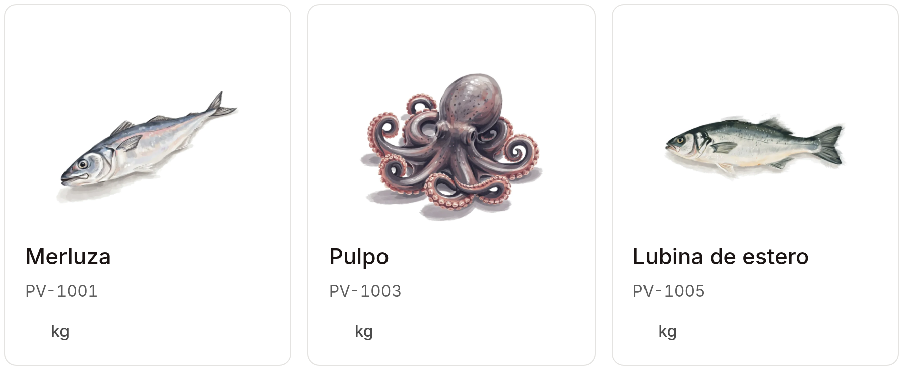

# AI-native ERP

Rocoto combines catalogue, customers, orders, stock, delivery, documents and payments around shared business records. This release preserves its original architecture, working backend and interactive Cedar workspace.



Catalogue components rendered from Cedar. [Capture provenance](docs/assets/erp/NOTES.md).

## Open the workspace

Use Node 22.12+ and npm.

```sh
make install-ui
make dev-ui
```

Open [localhost:8080/app.html](http://127.0.0.1:8080/app.html). Choose a sample business, open Products, and paste a three-row catalogue into the native import review. The workspace uses synthetic records and browser storage. [First result](docs/getting-started.md) explains each step and its persistence boundary.

## Run the backend proof

Use Python 3.12, PostgreSQL 16, `vector` and `ltree`.

```sh
make install
make starter-proof
```

The proof creates its own local database, loads three products and two orders, approves an order, verifies authenticated HTTP and tenant boundaries, restarts PostgreSQL and reads the persisted order. Provider and model calls: zero. [Backend setup](docs/backend-starter.md) also covers the existing Docker lifecycle.

## Build on it

| Part | Current boundary | Start here |
|---|---|---|
| Maintained backend | Persistent commerce, events, scoped memory, action gates, authenticated services | [Backend starter](docs/backend-starter.md) |
| Cedar workspace | Interactive product design with fixtures and browser state | [First result](docs/getting-started.md) |
| Prototype APIs | Separate parsing, transcription, identity, phone, email, Copilot and artwork adapters | [Own provider keys](docs/providers.md) |
| Collection service | Persistent workspace/payment evidence and guarded bank/fiscal adapters | [Service contract](app/src/prototypes/copper/SPEC.md) |
| Full ERP direction | Detailed domain, interaction, intelligence and implementation contracts | [Design and specifications](docs/design.md) |

Follow [catalogue → order → delivery](docs/workflows.md), then read the [architecture](docs/architecture.md) and [decisions](docs/decisions.md). The [source reference](docs/reference/source-index.md) locates functions and components. [Agent setup](AGENTS.md) defines safe installation and provider configuration.

MIT for original code. [Third-party notices](NOTICE.md) cover dependencies, fonts, maps, marks and generated artwork. [Release status](RELEASE-STATUS.md) records the exact source, checks and remaining integration work.
