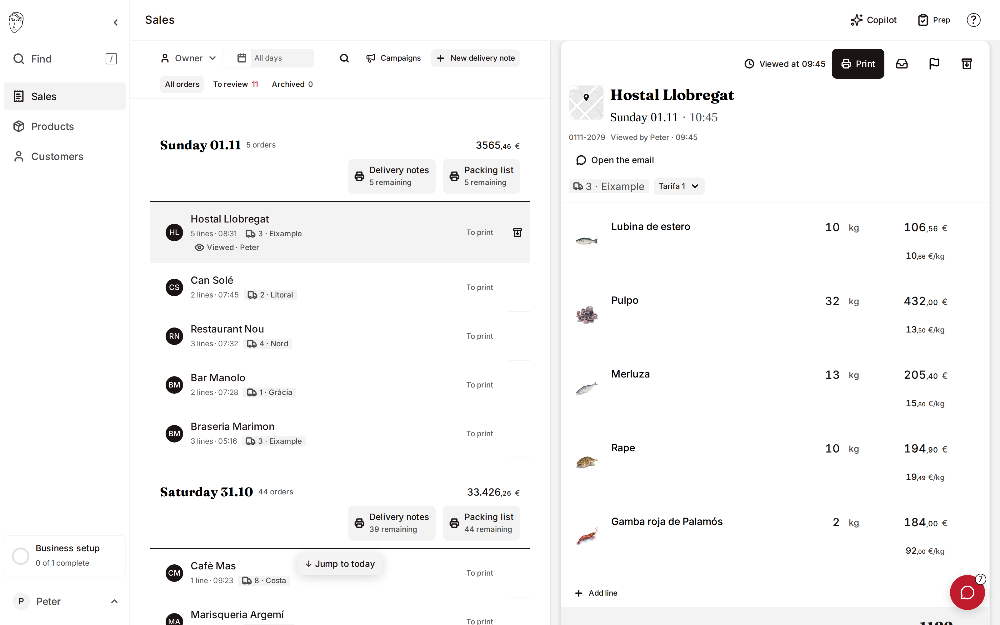

# Rocoto

Rocoto is an AI-native ERP for fresh-food distributors. It turns customer messages, voice notes, emails and calls into reviewed orders, then carries products, weights, substitutions and customer prices through preparation, stock and delivery notes.

[Website](https://soyrocoto.com) · [Open preview](https://preview.atelierneyra.com/?project=ai-native-erp&entry=open-workspace) · [Documentation](https://docs.atelierneyra.com/ai-native-erp/overview/)

[](https://preview.atelierneyra.com/?project=ai-native-erp&entry=open-workspace)

## Food distribution workflows

- **Catalogue and prices.** Supplier catalogues, product illustrations, units, case conversions and customer price lists.
- **Orders and delivery.** Customer orders, quantities by weight, preparation, packing lists and delivery notes.
- **Documents and conversations.** Parsing, transcription and Copilot adapters connect source material to product and order records.

The source includes the original interactive product, a FastAPI/PostgreSQL backend, provider adapters and the product’s design and architecture specifications.

## Run the workspace

Use Node 22.12+ and npm.

```sh
git clone https://github.com/latintzar/ai-native-erp.git
cd ai-native-erp
make install-ui
make dev-ui
```

Open [localhost:8080/app.html](http://127.0.0.1:8080/app.html). Explore the sample food distributor, then open **Products** and paste a three-row supplier catalogue into the import review. The [first-result guide](docs/getting-started.md) walks through the original interface.

The browser workspace uses sample records and browser storage. The persistent backend has a separate starter; connecting the workspace to that backend is documented integration work. [Release status](RELEASE-STATUS.md) identifies each part’s tested scope.

## Run the backend

Use Python 3.12, PostgreSQL 16, `vector` and `ltree`.

```sh
make install
make starter-proof
```

The starter creates a local database, loads products and orders, approves an order and verifies it after PostgreSQL restarts. It also checks authentication and tenant access. [Backend setup](docs/backend-starter.md) explains the service and Docker options.

## Connect your services

Follow [provider setup](docs/providers.md) to configure your own AI, identity, calling, email and artwork accounts through a private environment file. Each integration lists its purpose, credentials and current verification status. [Agent instructions](AGENTS.md) give your coding agent the same setup path.

## Documentation

| Guide | What it covers |
|---|---|
| [Product](docs/product.md) | The distributor workflow, original ambition and implementation boundaries |
| [First result](docs/getting-started.md) | Run the product and explore its sample food distributor |
| [Workflows](docs/workflows.md) | Catalogue import, orders, delivery and documents |
| [Architecture](docs/architecture.md) | Workspace, persistent backend and provider boundaries |
| [Decisions](docs/decisions.md) | Product and engineering choices, with source references |
| [Design specifications](docs/design.md) | The full ERP product and interaction model |
| [Functions and modules](docs/reference/source-index.md) | Navigation through 804 modules and 11,015 named symbols |
| [Verification](docs/verification.md) | Tests, persistent-data proof and integration status |

## Licence

Original code is [MIT licensed](LICENSE). Dependencies, fonts and artwork retain their [own notices](NOTICE.md). [Image provenance](docs/assets/erp/NOTES.md) records the original components and sample data.

[made by atelier neyra](https://atelierneyra.com)
