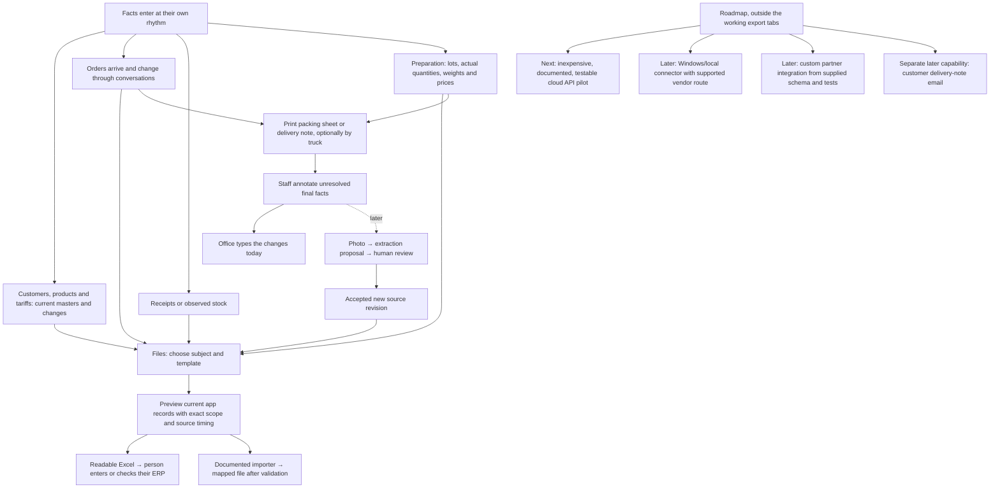

# THE-EXPORT-CANON.md — THE EXPORT ACTS, THEIR STATES, AND WHERE THE MONEY IS

> August 2026 download-pack snapshot. The maintained output contract is
> [THE-OUTPUTS-SPEC](../../../docs/omitted-sources.md),
> which identifies the details retained from the
> [later export record](../../../docs/omitted-sources.md).
> The original review text follows.

**What this document is.** The deliberated state architecture for the acts that finish an albarán —
print · the house's own system · the customer's copy · el reparto (§15.3 names it; «the round» is
retired) — and for the one act that governs
attention. It exists because §58 killed the answer that was standing:

> «PRINT ALWAYS BEING LIVE ETC THAT'S NOT TRUE. IT SHOULDN'T BE ALWAYS LIVE LOL. YOU GOTTA THINK
> ABOUT THESE STATES ARCHITECTURALLY COME ON… THIS IS WHERE WE MAKE MONEY, BY BRINGING CLARITY
> EXACTLY IN THIS: SOME COMPANIES WANNA JUST PRINT, OTHERS WANNA JUST SEND TO ERP, BUT ALL WANNA
> MAKE SURE IT'S SUPER RELIABLE AND DO THAT IN MINIMAL TIME UNTIL THEY SIMPLY TRUST ROCOTO.»
> — Peter, 2026-08-25 (FEED-IA §58.1, §58.4)

And it is built on the model §66 set the same evening, which removed the act this architecture was
about to be organised around:

> «I DON'T WANT THE THINGS TO NEED LOCKING. SIMPLY TO BE READ. LIKE GMAIL. ONCE READ, IF THEY DON'T
> EDIT, THAT'S DOWN TO THEM. THEY CAN MARK UNREAD THOUGH.» — Peter, 2026-08-25 (FEED-IA §66.1)

**The blessing is dead.** «Lock it» and the required finalize act are gone — his own §51.9 line and
§6.3's *finalize = LOCK*, superseded by him. **Nothing in this architecture waits for a blessing.**
What remains meaningful is stated in §2, and every verdict below is rebuilt on it.

This is the canon for THE-REVIEW-LEDGER rows **C7 · C8 · C3 · C4 · B3 · B4 · B14 · B15 · B16**. It
is the sibling of THE-ADMIN-CANON: same form, same standing. It was deliberated against the code as
it actually folds (`app/sale.ts` — states are FOLDED from events, never stored), against Base's own
content guidelines (the 18 `*--content.txt` files in the extract), and against how other products
show send-state — named honestly in §8.4.

**How it grows.** New rails, new states, new failure modes land HERE first, then in code (§46.1).
Newer FEED-IA sections outrank this file; when they move, this file moves the same session.
**Peter's verbatim lines outrank every verdict below** — and only Peter supersedes Peter, which is
exactly what §66 did to §51.9.

> **AMENDED THE SAME EVENING BY FEED-IA §67 — READ §15 FIRST.** He answered this canon's open calls
> and three of the answers change the text below: **nothing closes** (§15.1), read is **house-wide**
> with rich ownership (§15.2), and the destinations are named **with icons** — «the round» included
> (§15.3). **§16 is the new work he assigned: THE DISPATCH DIAL.** Where §15 or §16 disagrees with an
> earlier section, the amendment wins.

---

## 1 · THE THESIS, AS FOUR LAWS

§58.4 is one sentence with four separable demands. Every verdict here derives from one of them; a
proposal that serves none is out of scope.

| # | The demand, in his words | The law it becomes |
|---|---|---|
| **L1** | «some companies wanna just print, others wanna just send to ERP» | **THE HOUSE'S OWN RAIL LEADS.** Which acts EXIST is the document's answer; which one is LOUD is the house's. One layout, two postures, zero modes. |
| **L2** | «all wanna make sure it's super reliable» | **RELIABLE MEANS VISIBLY RELIABLE.** Every rail states what happened, what is coming, and what stopped — as structure, in one place, always on screen. A rail that succeeds silently and fails silently is not trusted, it is unexamined. |
| **L3** | «and do that in MINIMAL time» | **THE COMMON MORNING HAS A CLICK BUDGET** (§9), defended like a performance number. With §66 the budget got shorter: the fine ones cost ONE press in a paper house and ZERO in a system house. |
| **L4** | «until they simply trust Rocoto» | **THE SURFACE IS THE TRUST RAMP.** §32's path — the sweep teaches the net, the grants widen, one press replaces the sweep — is the product's own onboarding: never announced, never a setting, never a progress bar. |

Binding all four, from §59.5: **evidence by design, never explanation.** Nothing here is taught with
a sentence. The state is the shape of the control.

---

## 2 · THE STATES, AFTER §66

§58.1 asks for an architecture «derived from the sale's statechart». So it is derived from the fold
in the file — and then cut back by §66, which removed the ceremony the fold was carrying.

### 2.1 · THREE AXES, and none of them is a blessing

| Axis | Values | How it moves | Does it gate an export? |
|---|---|---|---|
| **ATTENTION** (§66.1, the Gmail axis) | unread · read | **Reading happens by opening** — automatic, never an act. **Mark it unread** is the one deliberate act on this axis | **NEVER.** Attention is about the person, not about the document |
| **RESPONSIBILITY** (§66.1) | Rocoto's · edited | a human line event on the document | **NEVER.** «If they don't edit, that's down to them» is a transfer, and a transfer is shown, never enforced |
| **THE RECORD** (§21) | open · closed | printed (or gone out), with nothing changed since | It IS the export's own consequence, not a condition of it |

> **§67.4 AMENDS THIS ROW: «NOTHING CLOSES, basically.»** The record axis is no longer a binary and
> `closed` is no longer a value. It is a STREAM of acts with one live reading. **§15.1 replaces this
> row**; read it before building anything off «closed».

The two clauses of §66.1 that matter architecturally: a responsibility transfer must be **VISIBLE**
(so the person can see what they are letting stand — §6.2's Gmail weight) and **REVERSIBLE** (mark
it unread). Those two together are the whole of the model, and they replace the lock.

### 2.2 · The document's own line (the fold, minus the ceremony)

| State | RANK | What it means now | What §66 changed |
|---|---|---|---|
| `request` | 0 | **The net caught something** — an unreadable amount, a word off the catalogue, an order-question owed the customer, or the house's own ceiling wanting a yes. Every `request` has a REASON | unchanged: this was never a blessing, it is a missing fact (§32's net) |
| `committed` | 1 | **The ordinary living document.** Rocoto's defaults or their edits, and it is what the morning is made of | **this is now where the work lives**; nothing has to happen to it before it can leave |
| `made` | 2 | **A copy has left the house, and the money is stamped** | **DERIVED, never pressed** — see §3.3 |
| `scheduled` | 3 | Queued to go with the round at its window | unchanged |
| `sent` | 4 | The goods left; the customer holds them | unchanged |
| `delivered` | 5 | Confirmed with them | unchanged |
| `disputed` | 5 | A complaint is open — the loudest OPEN state there is | unchanged |
| `settled` | 6 | Closed record | unchanged |
| *(pre-state)* `composing` | — | **The new-albarán composer** (§66.3), the sheet pane's landing spot: a document being written, not yet in the ledger | new with §66 |

### 2.3 · The overlays — facets, not states

Folded facts that ride ANY state. Treating them as states gives a twenty-state chart nobody can
hold; treating them as overlays gives eight states and five modifiers, which is what a person can
actually read. (The facet-versus-state split is the Shopify lesson, §8.4.)

| Overlay | The fold | What it overrides |
|---|---|---|
| **A · AN ANSWER IS OWED** | `answerOwed` (§2.4) | **The one hold in this architecture.** Paper and the rails wait; the LEAD becomes the reason's own act |
| **B · CHANGED SINCE THE PAPER** | `printed.stale` (+ `staleAt`) | Paper is owed AGAIN and re-leads in a paper house; the row re-opens in the river (`isClosed` false) |
| **C · CHANGED SINCE THE SYSTEM** | `sentToErp.stale` | The system is owed again and re-leads in a system house |
| **D · ON THE MACHINE** | a queue job exists for this subject | The paper control reads in-flight; a second press REPLACES the job (subject + kind is the job's identity) rather than adding one |
| **E · UNREAD** | nobody has opened it | **Nothing.** It changes WEIGHT in the river and it changes nothing else — §66.1 is explicit that an unread albarán is still theirs to send |

### 2.4 · The ONE hold, and what it is not

With the blessing dead, exactly one condition may hold an export act, and it has to be nameable in
one line: **the crate is undetermined, or the house's own limit is waiting for a yes.**

```
answerOwed(sale) =  an unreadable amount on a line          (flagsOf · 'unreadable')
                 |  a word the catalogue has no row for     (openNonSku)
                 |  an order-question owed the customer     (needsReply.kind === 'order')
                 |  a flag asking for a yes                 (wantsAYes — the house's own ceiling)
```

**What is deliberately NOT a hold** — and every one of these is a correction to what the code holds
today (`isStanding`):

| Not a hold | Why |
|---|---|
| **unread** | §66.1. An unread albarán prints. That IS the trusting behaviour §32.B describes, and holding it would rebuild the lock under another name |
| **unedited** | Rocoto's own numbers are a legitimate document. «If they don't edit, that's down to them» |
| **a complaint** (`disputed`) | The goods already went; the document is determined. A second copy is legitimate paper. What the state owes is a RESOLUTION, and that leads |
| **a stale pick** (`prep.stale`) | The crate changed after it was picked — and fresh paper is the FIX, not the hazard |
| **a customer's question** (`needsReply.kind === 'ask'`) | It rides the Messages row (§26.4); it says nothing about what goes in the crate |

And the held control's own label is the reason, in its own seat, costing no row (§59.1, §59.2):
**«Print after the answer»** — one label, because the reason itself is already on the document as
its own flag, one section up. On a `request` where the answer IS the yes, it reads **«Print after
confirming»**, which is the shipped string today and stays true.

### 2.5 · HELD versus ABSENT

- **HELD** — the act exists the moment the person does the named thing, and that thing is reachable
  from this same surface. Greyed, in its seat, its label saying what it waits for.
- **ABSENT** — the act belongs to another time or another party; the control is not drawn. A held
  control whose reason names something the person cannot do is a dead door, and worse than none.
- **THE EYE IS NEVER HELD.** Looking at the paper is not exporting it. On every state, under every
  overlay, the preview stands — which is what keeps the one hold from reading as a wall.

---

## 3 · THE ACTS

### 3.1 · The seven

| # | Act | Scope | Event(s) | Rail |
|---|---|---|---|---|
| 1 | **Print the albarán** | one document · a day's batch | `print` (carries the prices it froze) | paper |
| 2 | **Send to «Sage 50»** | one document · everything owed | `erp-send` (carries its target) | the house's own system |
| 3 | **Send their copy** | one document | `email-schedule` · `email-sent` | the customer's copy |
| 4 | **Send with the round** | one document | `schedule` → `send` | the goods themselves |
| 5 | **Print the packing list** | the day · one order's block | `print` (subject `packing`) | the bay's paper — NOT an export |
| 6 | **Mark it unread** | one document | `unread` — **designed here, unbuilt** (§13) | attention |
| 7 | **Look at it** | any subject | none | none — never held, never counted |

Gone from this list, and from the app: **Lock it**. Its seat on the dock closes without leaving a
gap; §4.3 says what fills it.

### 3.2 · A SEND NAMES ITS DESTINATION (the three sends)

«Send» currently means three things on one bar: the goods leaving with the round, the document
reaching the house's own system, and the customer's copy going out. That is §54.4's failure — two
products wearing one word — one level up. Base's own button guidance answers it: *«When you have two
or more different actions on your buttons, include nouns after each verb to be clear what the action
applies to.»*

**THE LAW: every send names where it goes, in the control itself.**

| The act | The control says | Its sub-line (one, under the LEAD only) |
|---|---|---|
| the goods leave | **Send with the round** | «Truck 2 · it goes at 09:30, and you can cancel until it does» |
| the house's system | **Send to Sage 50** | «It lands in Sage 50 as this albarán» |
| the customer's copy | **Send their copy** | «It reaches Casa Nou at 10:30 with the albarán attached» |

At 390 a control drops to its mark plus its destination, never to the bare verb.

### 3.3 · THE DOCUMENT FREEZES WHEN IT LEAVES — and nobody presses anything

The hardest call in this document, and §66 decided its harder half.

**The problem.** «Why would printing be impossible before it is made?» (§51.9) and «locking is the
main button and then printing is possibly the first to lock» (§54.2) both came from a real
inconsistency: the DAY's press has always printed everything the house committed to
(`sheetSalesOf` = `canPrepare`, from `committed` up), so the house press already put paper on
documents the dock said were not finished. Two answers were available — hold the paper until the
lock, or let the press do the locking. §66 removed the first one from the table.

**The resolution.** There is no lock. The document is real from the moment it exists, and it FREEZES
when a copy of it leaves the house: the first rail out appends `make` **as a system stamp**, at that
same hour, with the money it printed. So:

1. **`made` is a fold, not a button.** The ledger keeps the event — the house needs the fact «a copy
   of this is out in the world» — and no surface ever offers it.
2. **§32's money law lands exactly**: «quantity is promised at confirm; money is final at print» —
   the freeze and the price stamp are the same moment, which is what `moneyAt` already means. A rail
   that leaves before the paper (a `stream` ERP) stamps it just the same, because what left is what
   the other side now holds.
3. **§32.B's batch becomes literally true**: «⎙ Print 200 new» finishes 200 albaranes.
4. **The paper house's morning costs ONE press per albarán**, and its dock has one loud control.
5. **Editing after the freeze is still allowed** — it is a normal day (§26.6). What changes is that
   the document now owes its rails again (overlays B and C), and the state row says so.

*This was an open call in the first draft of this canon. §66 closed it: with locking dead there is
no alternative to weigh, and the only remaining question is the one below.*

### 3.4 · MARK IT UNREAD is the whole of «going backwards»

§6.3 used to say «going backwards from locked is possible but deliberately harder». With no lock
there is nothing to unlock — and the human need behind it («this one needs looking at again») is the
need §66.1 answers itself: **mark it unread.**

- It is an **attention** act. It touches no rail: the paper stays printed, the system still has its
  copy, the state row keeps every hour it had.
- It puts the row back into the standing register — bold in the river, back in the person's way.
- It is live on **every** state, including `settled`. A closed record somebody wants to look at again
  is exactly what this is for.
- It is the only deliberate act on the attention axis. Reading is never an act (§66.1).

That is the entire replacement for lock/unlock: one act, no rights model, no consequences to explain.

---

## 4 · THE STATE × ACT MATRIX

**8 states (+1 pre-state) × 7 acts = 63 cells**, plus 5 overlays that override them. Read: `—` the
act is ABSENT · `live` it exists, secondary · **LEAD** it is the loud one · `held: «…»` greyed with
the reason in its own seat · `says` the rail states itself and offers no act.

`LEAD*` means the posture decides — §5 resolves it. The table is the **paper house** reading (no
system connected), because that is the posture every house starts in.

### 4.1 · The states

| State | Print the albarán | Look | Send to the system | Send their copy | Send with the round | Packing list | Mark it unread |
|---|---|---|---|---|---|---|---|
| `composing` (§66.3) | — until it has a customer and a line | live (the blank paper) | — | — | — | — | — |
| `request` | held: «Print after confirming» · **the reason's act LEADS** | live | says «it goes once the order is confirmed» | says «it goes once a copy exists» | — | — (outside the day's scope) | live |
| `committed` | **LEAD\*** — it prints, and the freeze follows it (§3.3) | live | live where owed · says where the stream already took it | live | live (**LEAD** in a system house whose rails are fed) | live (in the day's run; per-order in the doors) | live |
| `made` | **LEAD\*** where paper is owed | live | **LEAD\*** where owed | live · auto-scheduled by default (§35.4) | **LEAD** where the rails are fed | live | live |
| `scheduled` | live | live | live where owed | live | the queued control, in place: `[⏱ Sending 09:30 ‖ ↺]` | live | live |
| `sent` | live: «Print it again» | live | live where owed | says | — | — (the crate is gone) | live |
| `delivered` | live: «Print it again» | live | says | says | — | — | live |
| `disputed` | **live** — the goods went, the document is determined (§2.4); the **resolution LEADS** | live | says | says | — | — | live |
| `settled` | live: «Print it again» | live | says | says | — | — | live |

### 4.2 · What the overlays override

| Overlay | Paper | System | Copy | Round | Unread | The LEAD becomes |
|---|---|---|---|---|---|---|
| **A · an answer is owed** | held: «Print after the answer» | suppressed | suppressed | suppressed | live | **the reason's own act** — edit the line · answer them · confirm (`ExceptionReason.act`) |
| **B · changed since the paper** | **LEAD** in a paper house · «Print it again» | — | — | — | — | the paper. The sheet in the tray no longer describes the crate, and that outranks every other owed thing |
| **C · changed since the system** | — | **LEAD** in a system house · «Send it again» | — | — | — | the system |
| **D · on the machine** | the seat reads «Printing»; a second press replaces the job | — | — | — | — | unchanged |
| **E · unread** | **unchanged — nothing is held** (§66.1) | unchanged | unchanged | unchanged | (it is already unread) | unchanged; the row is BOLD in the river and that is the whole of it |

Overlay A is the only hold, and it is the same predicate the house press obeys — `exportState` holds
those albaranes out of every count (§35.3). **One law, two scales**: the document's dock and the ⎙ on
the header can never disagree about what may go on paper. That equality IS the architecture §58.1
asked for; §66 simply made the law shorter.

### 4.3 · What each control BECOMES after acting (§59.1, in place)

> «An act TRANSFORMS ITS OWN CONTROL, in place… acting NEVER stacks new rows, buttons, or sentences
> under the thing.» — Peter, §59.1

The bar's height is identical on both sides of every press below. A press that grows the bar is a
defect, not a state.

| Act | At rest | The instant it is pressed | At settle | The seat |
|---|---|---|---|---|
| **Print the albarán** | `[⎙ Print it]` + eye | `[⎙ Printing]` (Base: progressive verb for a step happening now) | `[⎙ Print it again]`, secondary; the state row's paper cell takes the hour | identical |
| **Print, on a `committed` document** | `[⎙ Print it]` | `[⎙ Printing]` | the freeze lands as a FACT on the state row; **no control appears and none leaves** | identical |
| **Send with the round** | `[Send with the round]` | `[⏱ Sending 09:30 ‖ ↺]` — the state, the hour, and both its acts inside one box | `[Mark it delivered]` | identical (built: `SendFlush`) |
| **Send to Sage 50** | `[⇄ Send to Sage 50]` | `[⇄ Going to Sage 50]` | the control **dissolves**; the rail's row states «Sage 50 · went 07:41» | the gap holds on the desk; the row re-flows only at 390 |
| **Send their copy** | `[✉ Send their copy]` | `[✉ Sending 10:30 ‖ ↺]` | «Sent to Casa Nou at 10:31» in the rail's row | identical |
| **Mark it unread** | `[Mark it unread]` in the doors row | — (instant) | the row goes bold in the river; on the sheet the door reads `[Mark it read]` | identical |
| **Look** | the eye, slim column | the modal opens | the modal closes | untouched |

**The sub-line belongs to the LEAD, whichever control leads.** The one line under the dock's row
explains the loud act — so on a document whose paper is owed it describes the print. (Today it is
bound to `primaryOf`; that binding is the defect this clause closes, and with «Lock it» gone the old
sub — «What is on it now is what goes out» — goes with it.)

---

## 5 · PER-HOUSE RAIL PRIMACY

### 5.1 · The three postures

| Posture | Who they are | Rails alive | The morning |
|---|---|---|---|
| **PAPER HOUSE** | the default; the whole trade starts here | print (+ mail, sometimes) | one press, then the bay |
| **SYSTEM HOUSE** | ERP-first (§35.6: «even a house that never prints or emails from us gets full value from the ERP rail alone») | the system, at `stream` or `file` cadence | **zero presses** for the fine ones — the rail acts on its own, and the surface's whole job is proving it did |
| **BOTH** | a connected house that still prints every crate — common, and the end state we want | all three | one press for paper; the system rides along |

### 5.2 · What leads, per posture

The lead is **the next act the document owes**, tie-broken by posture:

```
LEAD =  the reason's own act        if an answer is owed                (overlay A)
     |  the resolution              if a complaint is open              (`disputed`)
     |  the paper                   if the paper is owed AND the house is paper-first
     |  the house's system          if the system is owed AND the house is system-first
     |  the paper                   if the paper is owed and nothing else is
     |  the house's system          if the system is owed and nothing else is
     |  the goods                   otherwise — «Send with the round», then the record's verbs
```

| State | PAPER HOUSE | SYSTEM HOUSE (stream) | SYSTEM HOUSE (file) | BOTH |
|---|---|---|---|---|
| `request` | the reason's act (Confirm · edit · answer) | same | same | same |
| `committed` | **Print it** | **Send with the round** — the system already has it | **Send to Sage 50** (owed until the file goes) | **Print it** |
| `made`, paper owed | **Print it** | Send with the round | **Send to Sage 50** | **Print it** |
| `made`, rails fed | Send with the round | Send with the round | Send with the round | Send with the round |
| overlay B | **Print it again** | Print it again (secondary) | Print it again (secondary) | **Print it again** |
| overlay C | — | **Send it again** | **Send it again** | **Send it again** |
| `disputed` | the resolution | the resolution | the resolution | the resolution |

**AN AUTOMATIC RAIL REPORTS; IT NEVER ASKS.** A `stream` system took the document when it arrived,
so its row is a FACT, not a button — an act appears only where the rail is genuinely owed (the file
cadence before its hour, a change after the send, a failure). This is the Linear lesson (§8.4), and
it is what stops a system house from being handed 300 buttons for work that already happened.

### 5.3 · The door's one number

§37.2: «The export centre gets ONE main icon with its count.» **The door counts what a HAND must do.
A rail that acts on its own never puts a number on the door.**

| Posture | The badge counts | When it is quiet |
|---|---|---|
| paper house | today's albaranes owed paper (`toPrint`) | «All printed» — the calmest sentence a morning can read (§29) |
| system house · stream | what the system is owed right now — normally 0 | almost always; a number here means something changed or stopped |
| system house · file | what goes with today's file | after the file goes |
| both | `toPrint` — the paper is the one a hand works down | — |

Review is never in the badge and never hidden: it rides its own ticker inside, under the rule
(§35.3). **Unread is never in the badge either** — it is not owed work, it is attention, and it has
its own weight in the river (§6.2). The full sentence — every rail's count, what is new since the
last paper, what is coming out of the printer, what stands for review — is the control's hover label
and its aria (§30).

### 5.4 · Where the preference lives (ties THE-ADMIN-CANON)

**Primacy is DERIVED, never an onboarding question.** A house that has connected Sage 50 at a stream
cadence has already said it is system-first; asking again is asking a person to describe themselves
in our vocabulary.

| Fact | Its home seat | What it decides here |
|---|---|---|
| which rails EXIST | **Conexiones** — ERP · email-in · partner suppliers | whether a rail is drawn at all; an unconnected rail states what connecting it does and wears the plug + the wash (§51.20) |
| `posture` (rocoto · erp) and `cadence` (al momento · fichero) | **Operaciones** (ADMIN-CANON §5's placement rule) | the tie-break above, and whether the system rail ever holds a button |
| printer · A4/A5/ticket · copies · **valued/unvalued** · the packing press | **Ajustes › Impresión** (§20: set once, a settings row, never a dialog per print) | what the paper carries; never what the rails do |
| the override, where a house disagrees with its own derivation | **Operaciones**, one row: «Cómo salen los albaranes» — papel · tu sistema · las dos | the lead, explicitly |

The override exists because a derivation with no exit is a guess. It arrives pre-answered from the
connections, so a house never meets it as a question.

### 5.5 · What NEVER changes between postures

The posture changes what is LOUD. It changes nothing else — and this list is the audit:

1. **The three rails keep one order everywhere**: paper · the house's own system · the customer's
   copy. It never re-sorts, because recognition comes before reading (§43).
2. **Every rail states its own truth, connected or not.** An unconnected rail says what connecting it
   does; there is no empty state and no «not connected» anywhere.
3. **The one hold is the same hold at both scales** — the document's dock and the house's press.
4. **The eye is never held.**
5. **The counters' rules** (§8.3) are identical in every posture.
6. **The attention axis is identical in every posture** — read on open, mark unread by hand, and it
   gates nothing.
7. **Nothing here is a mode.** No toggle changes what exists; no surface swaps; no second place.

---

## 6 · THE STATE ROW (§59.4)

> «On top of an icon, maybe it can be an inline row that has some of those things to give you a
> quick snapshot to see if you've completed or need to complete.» — Peter, §59.4

One organ, three scales. It is §35.3's always-known facts made into a SHAPE, and it is what makes L2
true on the surface a person lives on.

### 6.1 · Anatomy

```
┌─ THE STATE ROW ──────────────────────────────────────────────────────────┐
│  Closed   Edited 07:14   ⎙ 09:12   ⇄ 07:41   ✉ 10:30   4 of 6 weighed   │
│  └ RECORD └ WHOSE HAND   └ PAPER   └ SYSTEM  └ COPY     └ THE SCALE      │
└──────────────────────────────────────────────────────────────────────────┘
```

| Cell | Content | Type | Ink | Rule |
|---|---|---|---|---|
| 1 · **THE RECORD** | `Closed` / `Open` — §21's binary — **superseded: §15.1 replaces this cell with THE LIVE READING** | LabelXSmall | contentPrimary | always first, always drawn, never a colour |
| 2 · **WHOSE HAND** (§66.1) | «Edited 07:14» once a human line event exists — **and nothing at all before that** | LabelXSmall | tertiary | silence is the default: a row that announced «Rocoto's numbers, unread» would be the software fretting out loud, and this sheet is open in front of them |
| 3 · **PAPER** | ⎙ + the hour, or the owed word | LabelXSmall + mark 16 | tertiary done · **primary owed** | drawn on every document |
| 4 · **SYSTEM** | ⇄ + the hour | same | same | drawn only where the rail exists |
| 5 · **COPY** | ✉ + the hour | same | same | drawn only where the rail exists |
| 6 · **THE SCALE** | «4 of 6 weighed» (Base: «4 of 6», never «4/6») | same | tertiary | last: the first thing a narrow screen can afford to lose |

**Order is fixed and never re-sorts** — the eye returns to a place, not to a word. The row **never
wraps**: a second storey pushes the goods off a 390px screen. It truncates from the right, towards
the block in flow where every hour is a full sentence (§35.3's «the line between visible and obscure
is the design», answered).

**Owed versus done is INK WEIGHT, never colour.** Colour is not a status system here (§51), the
accent marks Rocoto's own acts alone, and a red rail would claim an emergency the trade does not
have. Work stands in primary ink; the record steps back. Same grammar the river uses for whole rows,
applied inside one line.

### 6.2 · The three scales, and the Gmail weight

| Where | Form | Why |
|---|---|---|
| **THE SHEET'S DOCK** | the full row above, sticky at the pane's foot | The bar never scrolls away, so the facts are always on screen. **This is why the row is NOT repeated in the sheet's head**: §35.3 asked for the facts said small at the top «so nobody scrolls to know», and a sticky bar answers that intent exactly, where a second copy would be one fact said twice (§54.3). |
| **THE RIVER'S ROW** | **marks only** — a fixed lane on the right rail beside the figure, at most two marks: the paper and the house's leading rail. **And the row's own weight carries UNREAD** | 300 rows read as shapes. Unread is the Gmail move he named: the customer's name and the figure at full weight, regular once read — no badge, no dot, no word (§66.2: extra info belongs on review cards only; on the fine ones it is pollution). A mark draws only where the fact is DONE or the day presses (`day <= today`) — the horizon stays clean. |
| **THE EXPORT CENTRE** | the same facts as labelled `Fact` cells (label over figure) | Same information, room to be a number with its name on it. |

### 6.3 · The drunk glance (§61.2, §61.3)

The test: at arm's length, in one second, without reading — **is this one finished, has anyone
looked at it, and if not, which rail wants me?** It passes because three things do the work and none
of them is a word:

- the row's **weight** (unread stands, read recedes) — the Gmail axis,
- the **number of primary-ink marks** in the lane — zero means done,
- the lane's **position**, identical on every row.

The win stays felt, never said (§61.2: «WITHOUT SEEING IT SAID AS GOAL — just having the feeling of
it»): as the morning is worked down, rows lighten and the lane goes quiet, and the river visibly
flattens. There is no «8 of 8 ready» anywhere in this architecture.

### 6.4 · The sober open

**Every cell of the state row is a door into its own rail.** Tapping the paper cell opens the sheet
scrolled to the export block with the paper's row lit; the system cell lands on the system's row; on
a river row the whole lane opens the document with the export block in view. One tap from the drunk
register into the sober one (§61.3) — and the tap never mutates anything (§6.1: «the row tap never
mutates»). **Opening is what reads it** (§66.1), which is the one state change a tap may cause,
because it is not a change to the document.

---

## 7 · THREE PAPERS: THE ALBARÁN · THE DAY'S SHEET · THE PACKING LIST

> «It is still absolutely unclear what is about packing and what is not. Really bad.» — Peter, §54.4

The diagnosis: a day prints three different papers, and all three controls wear **the same ⎙ mark** —
three identical marks in a row on the day whisper, told apart only by the words beside them. That is
one mark with three meanings, which §30's «determination» forbids.

### 7.1 · What each one is

| Paper | Whose | Leaves the house | Carries prices | Per | Its mark |
|---|---|---|---|---|---|
| **THE ALBARÁN** | the customer's document | yes, with the goods | yes, unless the house prints unvalued (§37.7) | one per crate | `print` — the printer |
| **THE DAY'S SHEET** | the round's manifest | rides with the van | no | one per day, sorted by requested delivery time (§21) | **`van`** — the round's own mark |
| **THE PACKING LIST** | the bay's own paper | never | **never, in any setting** | one block per order | **`packing`** — new glyph, Lucide ClipboardCheck |

### 7.2 · Naming · grouping · iconography

**NAMING.** «Print» never stands alone. Every press names its paper: «Print the albarán» · «Print the
day's sheet» · «Print the packing lists». Where the control is a mark with a count (§29.1), the count
belongs to the ALBARANES and to nothing else — the other two are one press each and carry no number.

**GROUPING.** They never share a control, a menu, or a row.
- *The export centre:* the albarán's three rails are the RAILS region; the packing lists and the
  day's sheet stand in **THE PRINTER** region — the machine and its other paper (built, §36.3).
- *The day whisper:* three dual-flush controls, parted by hairlines (built) — now told apart by three
  different marks rather than by their labels, so the 390 reading works with no words at all.
- *The sheet's dock:* the dock holds acts upon THIS document. A packing list is not one, so printing
  one order's block lives in the secondary doors row: «Print this packing list».

**ICONOGRAPHY.** One new `GlyphId`: `packing` (ClipboardCheck — a picking list is literally a
clipboard; `ops`/ListChecks is taken by Operaciones). The day's sheet takes `van`, which already
means «the round» on truck chips — the sheet IS the round's paper, so the meaning holds in both
places. *(If `van` on a control reads as an act rather than a subject, the fallback is a `route`
mark; §12, cheap and reversible.)*

**AND THE SETTINGS FOLLOW THE PAPER.** valued/unvalued, format and copies (Ajustes › Impresión)
govern the ALBARÁN. The packing list has no price setting to have — saying so on the settings row is
what makes the two products visibly two.

### 7.3 · The logo and the lockup (§54.5)

> «The fitting of logos is still really bad.» — Peter, §54.5

Rules, in the order they are violated:

1. **THE PAPER IS THE HOUSE'S, SO THE LOGO IS THE HOUSE'S.** RocotoMark never appears on a
   customer-facing document — not on the albarán, not on the day's sheet, not in the mail's body. Our
   mark lives in the app's chrome. (The mail's footer line about connecting an ERP, §35.4, is the one
   sanctioned mention, and it is text.)
2. **A RESERVED BAND, NOT A BOX.** The identity block reserves a band of fixed height (12mm on A4;
   the same optical height at every paper size) with **clearspace of half that height on all four
   sides**. The asset fits by its bounding box — `contain`, never `cover`, never stretched.
3. **TWO ASPECT CLASSES, ONE DECISION.** Bounding ratio > 2.5:1 → **wordmark**: fit by WIDTH, capped
   at one third of the text measure. Otherwise → **mark**: fit by HEIGHT to the band. Nothing else is
   measured, so no asset needs hand-tuning.
4. **OPTICAL LEFT, NOT BOX LEFT.** The logo's inked left edge sits on the document's text margin.
   Aligning the asset's transparent bounding box is the classic misfit, and it is what the current
   surfaces do.
5. **NEVER RE-COLOUR, NEVER TINT BEHIND.** No panel, no wash under a logo. A house with only a
   light-on-dark asset supplies a second asset, or the paper stays white and the name sets in type.
6. **THE HEAD IS A THREE-CELL GRID:** the house's identity (logo · razón social · CIF) · the
   document's identity (Albarán nº · date · customer) · the round (truck + zone). The logo lives in
   cell one and nowhere else, on any of the three papers.
7. **On screen** the logo appears inside the paper preview only, at the same optical height — never
   in the modal's own chrome, where it would compete with the app's identity.

---

## 8 · RELIABILITY MADE LEGIBLE

### 8.1 · Four phases, three rails, one vocabulary

Every rail is in exactly one of four phases, plus the stale overlay. These are the shipped strings
(English thinking layer; the Spanish surface keeps the same grammar). Every one **states what IS** —
no rail says what is missing, pending, or failed-as-an-adjective.

| Phase | PAPER | THE SYSTEM (named) | THE CUSTOMER'S COPY |
|---|---|---|---|
| **OWED** | «It has yet to print» · row cell `⎙ to print` | «Sage 50 · it goes as soon as it is confirmed» / «…with today's file at 16:00» | «It goes to Casa Nou at 10:30» |
| **GOING** | «Printing page 3 of 6» (Base: «3 of 6», never «3/6») | «Going to Sage 50» | «Sending 10:30» |
| **DONE** | «Printed 09:12» · «Printed 3× · last at 09:12» | «Sage 50 · went 07:41» | «Sent to Casa Nou at 10:31» |
| **STALE** | «Printed 09:12 · it changed since» | «Sage 50 · went 07:41 · it changed since, so it goes again» | «Sent 10:31 · it changed since» |
| **STOPPED** | «The printer stopped at page 3 of 6» | «Sage 50 gave it back at 07:41» + the reason where the rail names one | «The mail came back at 10:31» |

Base's rules the table obeys: declarative language · no exclamation · no end punctuation on a single
phrase · progressive verbs for a step happening now · «3 of 6» rather than «3/6» · tags 1–2 words and
never verbs · tooltips carry what a mark leaves out and never carry status.

**The one place we knowingly depart from Base:** button labels carry NUMBERS («⎙ Print 3 new»), which
Base's button content page forbids («No variable, like numbers»). Peter's §29 is explicit and
outranks it — «the button counts, the person never does… the least mental tracking the best». The
departure is recorded here so it stays deliberate, and it is confined to the press.

### 8.2 · A FAILURE ASKS FOR EXACTLY ONE ACT

The rule, and it is all of L2 in one line: **a stopped rail states what stopped, in its own row, and
offers ONE act — and that act is the FIX, not the retry, whenever the fix is ours.**

| What stopped | What the row says | The one act | After |
|---|---|---|---|
| the printer ran out | «The printer stopped at page 3 of 6» | **Print it again** | the job re-enters the queue at page one |
| the system refused it, reason unknown | «Sage 50 gave it back at 07:41» | **Send it again** | `[⇄ Going to Sage 50]`, in place |
| the system refused it, reason known | «Sage 50 gave it back: Casa Nou has no code there» | **Add the code** (a door to the customer's sheet) | the send retries ON ITS OWN once the code exists — nobody presses twice |
| the mail bounced | «The mail came back at 10:31» | **Change the address** (door), else **Send it again** | same |

Three clauses that keep failure from becoming noise:

- **A failed rail never holds another rail.** The paper prints while the system is stuck; the goods
  go out while the mail bounces. Rails are independent by construction (facets, not states).
- **A failure is not a toast, a banner AND a row.** It is the row — and, only where the person is not
  looking at that document, one entry at the export centre's foot. Never three surfaces for one fact
  (§59.1's stacking ban, generalized).
- **Retries are silent inside their window and honest after it.** The rail reads GOING while
  automatic retries run, and STOPPED the moment the window closes. The window's length is open (§12)
  and belongs to the server (§13).

### 8.3 · The counters stay honest — five rules

§35.3's list is answered once, in `exportState`, and every surface reads that one answer. Trust in
the numbers IS the product (L4):

1. **AN OWED ANSWER IS OUTSIDE EVERY COUNT** and inside its own ticker. An albarán whose crate is
   undetermined is not owed paper: counting it makes the number un-finishable, which is the one thing
   a counter may never be.
2. **A COUNT COUNTS ONLY WHAT ITS PRESS WOULD ACT ON.** The number on a control and the set it acts
   on are the same set, computed once.
3. **A CHANGE RE-OWES.** Stale is owed (overlays B and C), so a count goes UP when the goods move
   after an export. A number that only falls is a number that lies.
4. **FAILURES REJOIN THE OWED COUNT** rather than living in a silo. There is no «errors» screen.
5. **ONE NUMBER PER DOOR** (§37.2), and **unread is never counted** — attention is not owed work
   (§66.1).

### 8.4 · What the references taught

*From my own knowledge of these products, not fetched this session; each is stated as a pattern we
adopt or refuse, never as a claim about their current UI.*

| Reference | The pattern | Our verdict |
|---|---|---|
| **Gmail** | Read happens by opening; unread is WEIGHT, not a badge; mark-unread is the one deliberate act and it changes nothing but attention | **Peter's own reference, adopted whole** (§66.1) — and it is why unread gates nothing here |
| **Gmail** — Undo Send / Scheduled | The cancel lives in the act's own aftermath, time-boxed, in one surface; a scheduled send shows its hour and is cancellable where it stands | **Adopted** — `SendFlush` is exactly this, and §59.1 demanded it independently |
| **Stripe** — invoices | The document's state and the DELIVERY's state are two axes on one object, with a resend that never mints a second invoice | **Adopted whole** — our states × rails split, and why export facts are facets |
| **Linear** — integrations | A healthy sync says nothing; a broken one surfaces once, with one action | **Adopted** as «an automatic rail reports, it never asks» (§5.2) — with one amendment: ours also states the healthy hour, because a distributor's trust is in seeing the hour, not in silence |
| **Xero / QuickBooks** — invoice send | Sent versus viewed as separate facts; a resend that reuses the document number | **Adopted** for idempotency (§13). «Viewed» is **refused** — it is surveillance of a customer and it is not our business |
| **Shopify** — orders | Payment and fulfilment as independent facets of one order, never a merged status ladder | **Adopted** — the facet law (§2.3) |
| **The OS print spooler** | The machine's problems live in the MACHINE's row (printer, pages, paused), never on the document | **Adopted** — the queue's rows are the machine's; the document's row says only whether its paper is right |

---

## 9 · MINIMAL TIME, AND THE TRUST RAMP

### 9.1 · The click budget for a common morning

The load is §12's: **300 orders, ~260 fine, ~40 for review**, 6–10 comerciales with 30–50 customers
each. The budget is a design constraint, not an outcome — a change that spends a click has to say
what it bought. **§66 took a whole column out of this table**: every «lock» press is gone.

| The morning's work | PAPER HOUSE | SYSTEM HOUSE | BOTH |
|---|---|---|---|
| the 260 fine albaranes | **1 press** («⎙ Print 260 new») | **0** — the stream took them as they arrived; the file goes at its hour | **1 press** |
| the day's sheet | 1 press | 0 (it prints if they want it) | 1 press |
| the packing lists | 1 press | 1 press | 1 press |
| the 40 for review | 40 × (the fix + one answer), **0 navigation clicks** — settling advances to the next (§51.25) | same | same |
| letting Rocoto's numbers stand | **0** — reading is opening, and not reading is a decision they are allowed to make (§66.1) | 0 | 0 |
| knowing it all worked | **0** — the state row and the door's count are on screen | 0 | 0 |
| **the fine ones, per albarán** | **1/260 of a press** | **zero** | **1/260** |

**Model (b), the comerciales.** «Mine» is a NARROW, composing with the day narrow (§32) — band,
counts and every ⎙ scope to it. Their morning is the same table over 30–50 rows, and their press
prints a batch nobody assembled.

**The sweep, for a house that is not there yet** (§32.A): the detail open, **P prints and advances**,
← → walk without printing, Esc out. 3–5s per order → 260 in 13–22 minutes; a comercial's 35 in
2–4 minutes. Keycaps ride the hover labels the classic way. The sweep is not a mode and not a feature
— it is the same document, the same press, one key. **And walking with the arrows READS each one on
the way past**, which is the sweep's second product: after a sweep, the river is uniformly light.

### 9.2 · The ramp, and what the surface owes at each stage

| Stage | What they do | What the surface owes them |
|---|---|---|
| **1 · THE SWEEP** | they open all 300 | the flow (settle → next), P as one keystroke, and the NET made legible on each document — the checks that ran, in the trade's words (§32.B, `net.ts`) |
| **2 · THE SLICE** | they sweep a slice — a comercial, the big ones, the new customers — and press the rest | the narrows, and a press whose count matches the narrow exactly. The batch was never cut by hand |
| **3 · THE PRESS** | one press, and they live in the 40 | counters that have never once been wrong, the state row proving each rail, and the band holding the exceptions |

**The ramp is never announced.** No stage is named on screen, no setting selects one, nothing
congratulates anybody for arriving (§61.2). It happens because the same three things keep being true
every morning: the count matched the work, the rails said the hour, and nothing needed a second
press. **§66 is the ramp's own design**: a product that required a blessing per albarán would have
made stage 3 impossible, because the blessing is the sweep in disguise.

---

## 10 · WIREFRAMES (§51.24 — regions, contents, type steps, states)

```
┌─ THE SHEET'S DOCK · PAPER HOUSE · a `committed` document ────────────────┐
│ FACTS   Open   ⎙ to print                        ← the state row (§6)    │
│ ACTS    [⎙ Print it ▸👁]                    ······  [💬 Open the chat]    │
│         └ LEAD, filled — the ONE control on this state                  │
│ REASON  It prints today's prices, and the albarán is out.               │
│         └ ONE line, and it belongs to the LEAD                          │
│ DOORS   Mark it unread · Print this packing list · Where it goes        │
│ STATES  an answer owed → LEAD becomes the reason's act; the press greys │
│         and says «Print after the answer»; the eye stays live           │
│ GONE    «Lock it» — §66.1. No seat is left empty; the row is shorter    │
└──────────────────────────────────────────────────────────────────────────┘

┌─ THE SHEET'S DOCK · SYSTEM HOUSE · same document, same state ────────────┐
│ FACTS   Open   ⎙ to print   ⇄ 07:41                                     │
│ ACTS    [Send with the round]  [⎙ Print it ▸👁]      ·····  [💬 chat]     │
│         └ LEAD                 └ secondary                              │
│         ⇄ Sage 50 is a FACT on the row above, never a button here       │
│ REASON  Truck 2 · it goes at 09:30, and you can cancel until it does.   │
│ NOTE    Same regions, same order, same components. Only the fill moved. │
└──────────────────────────────────────────────────────────────────────────┘

┌─ THE SHEET'S DOCK · `scheduled`, after the press (§59.1) ────────────────┐
│ FACTS   Closed   Edited 07:14   ⎙ 09:12   ⇄ 07:41   ✉ 10:30   6 of 6   │
│ ACTS    [⏱ Sending 09:30 ‖ ↺]   [⎙ Print it again ▸👁]     [💬 chat]     │
│         └ ONE box: the state, the hour, and both acts inside            │
│ STATES  the bar's height is identical before and after every press      │
└──────────────────────────────────────────────────────────────────────────┘

┌─ THE HEADER'S RIGHT CLUSTER (§66.3) ─────────────────────────────────────┐
│ ROW     … the day · the area's name (centred) ·  [+ New albarán] │ [⎙ ⁵²]│
│                                                   └ a MAKE act   │  └ a  │
│                                                   (ink, labelled)│  door │
│ RULE    the hairline that parts the three papers parts these two too:   │
│         one MAKES a document, one shows where documents WENT — never    │
│         one lockup (§36.3's law, applied to the header)                 │
│ BADGE   the door's count is the posture's own number (§5.3); the New    │
│         control never carries a count                                   │
└──────────────────────────────────────────────────────────────────────────┘

┌─ THE HEADER EXPORT CENTRE (the modal) ───────────────────────────────────┐
│ HEAD    Today's albaranes, out of the house      Day Fri 22.08 · 283     │
│ RAILS   ┌ identity 168 ─┬ facts (shared grid) ─────────────┬ eye 40 ┐    │
│         │ ⎙  Print      │ To print 12 · New since 06:40 3  │   👁    │    │
│         │               │ [⎙ Print 12 new ▾]                │        │    │
│         │ ⇄  Sage 50    │ To send 4 · In Sage 50 37        │   👁    │    │
│         │               │ [Send the 4 now]  · or a FACT     │        │    │
│         │ ✉  Email      │ Scheduled 16 · Sent 21           │   👁    │    │
│         │               │ [The schedule]                    │        │    │
│ PRINTER ── region head ──────────────────────────────────────────────    │
│         │ 📋 Packing lists  │ Orders to fill 283 │ [📋 Print 283] │ 👁 │   │
│         │ 🚚 The day's sheet│ One round          │ [🚚 Print it]  │ 👁 │   │
│         │ Printer  Bench · A4 · 1 copy · with prices        [Change] │   │
│         │ …queue rows: what · state · pages…                          │   │
│ STOPPED any rail that stopped states it here, with its ONE act          │
│ FOOT    ─── rule ───   For review 6      ← outside every count above    │
│ STATES  posture reorders NOTHING; it decides which act is filled and    │
│         which rail's count rides the door's badge                       │
└──────────────────────────────────────────────────────────────────────────┘

┌─ THE STATE ROW, at its three scales ─────────────────────────────────────┐
│ DOCK    Closed   Edited 07:14   ⎙ 09:12   ⇄ 07:41   ✉ 10:30   4 of 6    │
│         LabelXSmall · marks 16 · gap scale200 · nowrap · truncates right │
│ RIVER   ▸ CASA NOU     3 lines · 06:33      284,50 €   Open    ⎙ ⇄      │
│         name+figure at FULL WEIGHT while unread (the Gmail axis, §66.1) │
│         marks only · fixed lane · ≤2 marks · owed = primary ink,        │
│         done = tertiary · nothing drawn for a rail the house lacks      │
│         no reason, no question, no extra info on a fine card (§66.2)    │
│ CENTRE  the same facts as labelled cells (label over figure)            │
│ STATES  every cell is a door into its own rail (§6.4); the tap never    │
│         mutates — and opening is what READS it                          │
└──────────────────────────────────────────────────────────────────────────┘

┌─ THE PACKING PRESS ──────────────────────────────────────────────────────┐
│ DAY     Friday 22.08 · 18 albaranes · 3 want a hand · 4.912 €           │
│ PAPERS  [⎙ 12 ▸👁] │ [🚚 Print the day's sheet ▸👁] │ [📋 Print 18 packing│
│         └ albaranes│  └ the round's manifest        │    lists ▸👁]      │
│         THREE MARKS, three papers — told apart without reading (§30)    │
│ SHEET   the per-order block lives in the sheet's DOORS row, never the   │
│         dock: «Print this packing list»                                  │
│ PAPER   a tick column, big amounts, per-order blocks, and NO prices in  │
│         any setting                                                      │
│ STATES  at 390 the three controls keep their marks and drop their words │
└──────────────────────────────────────────────────────────────────────────┘

┌─ THE LANDING: THE NEW-ALBARÁN COMPOSER (§66.3) ──────────────────────────┐
│ WHEN    the sheet pane before any selection — the landing spot IS the    │
│         composer, never a placeholder and never an empty state          │
│ HEAD    the customer field first (§51.8: the customer leads the sheet),  │
│         with the §62 chip-entry grammar; the day beside it              │
│ BODY    the add-a-line organ at the foot of the document (§51.5)        │
│ DOCK    the same bar, with every export act ABSENT until the document   │
│         has a customer and a line — then the paper house's press        │
│         appears in the LEAD seat and the bar is the ordinary dock       │
│ STATES  a document a hand wrote is EDITED from birth (§6.1 cell 2)      │
│ WIDTH   the sheet pane takes more of the split (§66.4) — the details    │
│         stop being cramped, and the state row gets its full six cells   │
└──────────────────────────────────────────────────────────────────────────┘
```

---

## 11 · THE LAWS THAT BIND THIS AREA (compressed; sources in FEED-IA)

1. **§66.1 no blessing** — nothing waits to be locked; reading is opening; mark-unread is the one
   attention act; edited-or-not is shown, never enforced.
2. **§58.1 architecture** — which acts exist, which leads, which is held, is DERIVED from the fold;
   never a button that is simply always on.
3. **§58.4 primacy** — the house's own rail leads; one layout, two postures, zero modes.
4. **§59.1 in-place** — an act transforms its own control; acting never stacks a row, a button or a
   sentence. Bar height identical on both sides of every press.
5. **§59.2 words** — an act carried by its icon does not spell its verb; the words that earn space
   are the STATE and the COUNT.
6. **§59.4 the state row** — the snapshot is one organ at three scales.
7. **§29 the button counts** — «⎙ 3 new» · «All printed»; the re-print lives one level down, worded
   as a re-print.
8. **§24.2 dual flush** — the big column prints, the slim column previews. Never a preview on the way
   to paper.
9. **§21 closed or open** — printed means closed; closed lies flat, open stands. No tick ladders.
10. **§35.3 counters** — the system always knows; an owed answer is outside the counts.
11. **§32 money** — quantity is promised at confirm, money is final when a copy leaves; the print
    event carries the prices it froze.
12. **§66.2 clean cards** — the reason and the question ride needs-review cards only; a fine card
    stays minimal.
13. **§54.4 two products** — the packing list and the albarán are visibly two: naming, grouping, mark.
14. **§54.5 lockups** — the house's logo, a reserved band, optical alignment, never our mark on their
    paper.
15. **§58.2 content** — Base's own guidelines govern every string; the one departure (numbers on the
    press) is recorded in §8.1.
16. **§30 icons** — one mark, one meaning, everywhere; hover carries the word.
17. **§61 the game** — the win is felt, never said; the drunk pass reads shapes, the sober zoom reads
    depth; no transition may add stress.
18. **Copy law** — say what IS; Peter's lines verbatim; headings name the thing; the stranger test on
    every label.
19. **§13 containers · §38 panes · §33 air** — one scrollport per pane, verified at 390 AND 1600 by
    screenshot, stateful bits exercised.
20. **Theme gate** — zero owned colours; the accent marks Rocoto's own acts alone; failure is weight
    and words, never red.

---

## 12 · OPEN CALLS — Peter's, kept so they keep building

| Call | Where it stands | Route |
|---|---|---|
| **Whose read is it?** In a house of 8, is an albarán read because ANYONE opened it, or because I did? | Recommendation: **house-wide** — the work is shared and a second person re-reading it is waste; the sober view names who and when («Read by Núria 07:12»). A per-person model would make one river look different to every person at the same desk | **AskUserQuestion at build** — it decides the data model, so it is cheap now and expensive later |
| **Does a batch press mark its albaranes read?** | Recommendation: **no** — printing is not reading, and §66.1 is explicit that read-but-unedited is the responsibility transfer. The pile does not linger, because printing CLOSES them and closed rows lie flat (§21) whatever their attention state | AskUserQuestion at build |
| **Mark-unread on a closed document** — does it re-open the river's row, or only bold it? | Recommendation: **bold only** — the record's binary belongs to the paper, and an attention act must never claim the crate changed | Peter, cheap |
| **The retry window** — how long a rail retries silently before it says it stopped | Recommendation: 3 attempts / 10 minutes, then STOPPED with its one act | Peter, cheap · BANK owns the mechanism |
| **The lead-rail override row** — ship name, and whether a derived-only lead is enough | Draft: Operaciones › «Cómo salen los albaranes» — papel · tu sistema · las dos | AskUserQuestion at build |
| **valued/unvalued per customer** | Today it is global (§37.7); some houses price for one customer and not another | Peter |
| **The day's sheet mark** — `van` (proposed) versus a `route` mark | Cheap and reversible either way | Peter, cheap |
| **The disclosure line on the customer's mail copy** (AI-Act) | Open contract item (memory: rocoto-contract) | Peter |
| **«Viewed» on the customer's copy** | Refused here as surveillance of a customer; recorded in case he wants it | Peter, if ever |

> **THREE OF THESE ARE ANSWERED (FEED-IA §67) — see §15.2 and §15.3.** Whose read · batch print and
> attention · the destinations. The mark-unread-on-a-closed-document row is dissolved by §15.1,
> because nothing closes. The rest stand open.

---

## 13 · WHAT THIS PUTS IN THE BANK (for THE-IMPLEMENTATION-BANK — listed, not written)

1. **Read state is server data, not a browser fact** (§66.1). It needs an `read` / `unread` event pair
   carrying the actor and the hour, and the scope decision above. With 6–10 people on one morning, a
   read state in `localStorage` would give every desk a different river.
2. **A server-side print queue with real job states**, including STOPPED and retry. Today
   `JobState = waiting · printing · printed` in the browser; a closed tab loses the morning's queue,
   and no failure state exists at all.
3. **Printer reachability** — a local agent or cloud print, and the honest question behind the word
   «printed»: did paper come out, or was a job accepted?
4. **Idempotency keys per rail per document.** A re-send must never mint a second albarán in the ERP
   (the Xero/QuickBooks lesson). The queue already keys jobs by subject + kind; the same discipline
   has to reach the system and the mail.
5. **The freeze stamp is server-side and atomic** (§3.3): the first rail out appends `make` with its
   price stamp in the same transaction as the export event.
6. **The ERP echo (§35.6, two-way).** An inbound event kind, and a conflict policy for a document
   that moved on both sides — «it changed since» must be answerable about THEIR change too.
7. **A server-side scheduler** for the customer's copy (§35.4's window) and for supplier-forwarding
   cutoffs (§35.7's 01:30) — neither can live in a browser.
8. **Mail delivery signals** — bounce webhooks at minimum; the only honest source for «the mail came
   back».
9. **Failure reasons mapped to fixes.** The rail's error → the ONE act (§8.2): a per-ERP table of
   «reason code → the fix in Rocoto», and the automatic retry that follows the fix.
10. **House-wide counters computed server-side.** At 300/day across 6–10 comerciales, `exportState`
    cannot be a per-browser fold while two people work the same morning.
11. **Posture and lead rail as policy data**, versioned beside the grants (ADMIN-CANON §5), so the UI
    stays a renderer of the contract.
12. **An export audit trail** per document — act · actor · hour · target · outcome. With the blessing
    gone, this is the only record of who let a document stand, which makes it the first genuinely
    load-bearing entry for the audit log ADMIN-CANON §2 holds as LATER.
13. **Print settings are per house, not per browser** (printer, format, copies, valued/unvalued) —
    they belong to the company object.

---

## 14 · THE SEAM LIST — where the code opens for this canon

| Seam | File | What opens |
|---|---|---|
| The blessing | `app/sale.ts` · `primaryOf` | **«Lock it» comes out** (§66.1). `make` stays an event and stops being a verb; `PrimaryAct` loses `'make'` |
| The freeze | `app/sale.ts` · `printSale` · `sendToErp` · `markEmailSent` | the first rail out appends `make` + the price stamp (§3.3) |
| The hold | `app/sale.ts` · `exportStance` | `isStanding` gives way to `answerOwed` (§2.4) — a complaint, a stale pick and an unread document stop holding paper |
| The attention axis | `app/sale.ts` | new events `read` / `unread`, folded to `sale.read`; `Mark it unread` in the dock's doors row |
| The stance | `app/sale.ts` · `exportStance` | `lead` resolves through the house's posture (§5.2); the packing and sheet subjects stay out of it |
| The dock | `detail.tsx` · `detail-dock` | the sub-line binds to the LEAD rather than to `primaryOf`; the three sends take their destinations |
| The state row | `detail.tsx` · `detail-facets` → its own component | lifted out as the ONE organ, so the river's lane and the centre's cells are the same code at three scales; cell 2 gains «Edited hh:mm» |
| The river | `areas/sales.tsx` | the unread WEIGHT (§66.1) on the row's name and figure; the ≤2-mark lane; fine cards stay minimal (§66.2) |
| The landing | `areas/sales.tsx` + `detail.tsx` | the pre-selection composer (§66.3) and the wider sheet pane (§66.4) |
| The header | `shell/frame.tsx` · `shell/printing.tsx` | `[+ New albarán]` beside the export door, parted by the hairline; the badge follows the posture |
| The three papers | `areas/sales.tsx` · `DayPaper` | three marks instead of three ⎙; words become the secondary cue |
| The marks | `app/glyphs.tsx` | new `GlyphId` `packing` (ClipboardCheck); `van` gains its second, consistent use |
| The paper | `app/print-view.tsx` | the identity band, the aspect classes, the three-cell head (§7.3) |
| The queue | `app/print-queue.ts` | a STOPPED state and a retry that re-enters at page one |
| The settings | `app/config.ts` · Operaciones/Ajustes | the lead-rail override, and print settings moving onto the company object |

---

## 15 · AMENDMENTS — FEED-IA §67 (Peter, 2026-08-25, answering §12)

He answered the open calls the same evening. Three answers change the canon above; they are made
explicitly here, and **§15 wins over any earlier section it touches.**

### 15.1 · NOTHING CLOSES — the record axis becomes a stream and a reading

> «NOTHING CLOSES, basically — get it? I just don't want them to have to make closed to quickly print
> everything once they trust us, then print again as new shit comes in.» — Peter, §67.4

**What dies.** `closed` as a value, as a wall, and as a word on any surface. The §21 reading
«printed means closed» stays true as a SENTENCE ABOUT THE PAST — paper came out — and stops being a
door that shuts the document.

**What replaces it — two things, and they were both already in the ledger:**

| | The STREAM | The LIVE READING |
|---|---|---|
| What it is | every act that happened, in hours: printed 09:12 · printed again 10:40 · went to Sage 50 07:41 · sent 11:20 | what this document is owed **right now**, recomputed on every event |
| Where it lives | the ledger, and the export block's full sentences | the state row's first cell, the river's row word, the elevation |
| Its predicate | the events themselves | `owed(sale)` — the rails that want something, plus §2.4's answer |
| Can it go backwards | no. It is history | **yes, constantly** — that is the point. Goods move, and the document is owed again |

**THE LOAD-BEARING READING IS «CHANGED SINCE».** With no terminal state, overlay B is promoted from a
modifier to the axis's main event: a document is quiet when nothing is owed, and it **stands again**
the moment the crate moves after the paper came out. `isClosed` becomes `nothingOwed` — a reading,
never a state — and the elevation law of §21 survives intact by being restated on it:

> **A DOCUMENT WITH NOTHING OWED LIES FLAT. A DOCUMENT THAT OWES SOMETHING STANDS.** Elevation follows
> what is owed, never a flag anybody set.

**The state row's first cell (§6.1), replaced.** It is no longer `Closed / Open`. It is **THE LIVE
READING** — the shortest true answer to «what does this want», and where nothing wants anything, the
last act that happened:

| Situation | Cell 1 says | Ink |
|---|---|---|
| paper owed and the day has come | «Out today» | primary |
| paper owed, the day is ahead | «To print» | primary |
| the crate moved after the paper | **«Changed 10:40»** | primary — the loudest reading there is |
| a rail is owed after a change | «Sage 50 again» | primary |
| nothing owed, paper is out | «Printed 09:12» · «Printed 3× · 10:40» | tertiary |
| nothing owed, the goods went | «Sent 11:20» · «Delivered» · «Settled» | tertiary |
| an answer is owed (§2.4) | the reason, in the reason's own words | primary |

**What this changes in the matrix.** No cell of §4.1 was gated on `closed` — the one hold has always
been §2.4's answer — so the matrix stands. What changes is everything that READ the wall:

| Where | Was | Now |
|---|---|---|
| §6.1 cell 1 | `Closed` / `Open` | the live reading, above |
| §6.3 the drunk glance | «zero primary marks means done» | «zero primary marks means **nothing owed right now**» — done is not a thing a day is |
| §9's argument for batch-print-not-marking-read | leaned on «printing closes them and closed rows lie flat» | **re-argued in §15.2** — the premise is gone, the answer is unchanged |
| §11 law 9 | «printed means closed; closed lies flat» | «what is owed stands; what is owed nothing lies flat; printing is an act, not a door» |
| §12's mark-unread-on-a-closed-document call | open | **dissolved** — there is no closed document to mark |
| the wireframes' `Closed` strings | the word | the live reading in its place |
| `app/sale.ts` · `isClosed` | a predicate that answers «has it ever printed, unchanged» | `nothingOwed` — renamed AND re-derived, because the name was teaching the wall |

**And the press keeps its meaning.** «⎙ Print 12 new» already counted arrivals AND changed-since
(§29.2) — a stream-shaped number from the start. Nothing about the counters changes; §8.3's rule 3
(«a change re-owes; a number that only falls is a number that lies») is now the axis's own law rather
than a caveat on it.

### 15.2 · WHOSE READ — house-wide, with covering as the normal case

> «House wide unless they filter for the ones attributed to them or other comerciales (they can cover
> for each other after all, which is how it should be).» — Peter, §67.1

**Answered as recommended.** Read is a fact about THE HOUSE, not about a person: if Núria opened it,
the house has looked at it. Covering is not an exception to be modelled — it is the normal case, so
**any comercial can be picked in the narrow, not just yourself.**

- **The scope is the narrow, never the read state.** «Whose accounts» thins the same river (§32's
  narrow, composing with the day narrow); it never gives two people different read states for one
  document.
- **The sober view names the hand**: «Read by Núria 07:12» in the export block's history. The river
  says only weight.
- **THE OWNERSHIP ROWS ARE PERSON OBJECTS** (§67.1: «as another column in the drop-down etc etc — you
  see where I'm going»). The narrow's dropdown is not a list of name strings: each row is the
  comercial — initial tile · name · **phone** · email where it exists · the size of their book — and
  the row is a door to that person (ADMIN-CANON §1's «every appearance is a door»). It is the same
  person object Team renders, at menu scale.
- **«And I hope this whole comercial routing attribution etc is clear in admin too!!!!»** — a
  cross-document implication, recorded for THE-ADMIN-CANON's owner: Equipo and Geografía have to make
  who-holds-whom legible at a glance, and this narrow is the desk-side reading of that same fact.

**Batch print does NOT mark read — confirmed** (§67.2: «paper leaving is not attention»). The
argument in §9 has to be rebuilt, because §15.1 removed its premise. The honest one:

> **TWO AXES SHRINK BY TWO DIFFERENT ACTS, and neither is a pile.** The OWED lane empties by
> pressing — the marks go quiet, the door's count falls to «All printed», and that is the morning's
> felt progress (§61.2). The ATTENTION weight lightens by looking, at whatever pace they choose. A
> printed-but-unread row is a true statement about both: the paper is out, nobody read it. Marking it
> read at the press would be the software claiming an attention that never happened — and the whole
> point of §66.1 is that the transfer is theirs to make knowingly.

### 15.3 · THE DESTINATIONS, NAMED — and «the round» does not survive the stranger test

> «Name the destinations. Icons/visual should make it super clear and thought through.» And:
> «anything that's a system like "the round" — what the fuck does it mean and is it thought through?»
> — Peter, §67.3

**He is right, and «the round» was mine, not the trade's.** It is an English abstraction for something
the house already has a word for — and that word is already in this product, in Operaciones: **el
reparto** («días de reparto», ADMIN-CANON §2.1). The trade says el reparto for the run, and names the
van by its number. So the destination is named as **concretely as the data allows**, and «the round»
is retired from every surface.

| Destination | What actually happens | ES ship name | EN thinking draft | Mark (Lucide, line, 24 grid) |
|---|---|---|---|---|
| **the goods, going out** | the crate rides the van on the day's delivery run | «Sale con el reparto» · **«Con el camión 2»** where a truck is known | «Send with truck 2», falling back to «Send with the delivery run» | `van` (Truck) — the same mark the truck chip already wears (§21) |
| **the house's own system** | the document lands in their ERP | **the real name, always: «Sage 50» · «Holded» · «A3»** | same | `erp` |
| **the customer's copy** | the mail reaches the buyer | **the customer's own name: «A Casa Nou»** | same | `email` (Mail) |
| **the bay** (not an export) | the picking paper stays in the building | «Para el almacén» | «For the bay» | `packing` (ClipboardCheck, §7.2) |
| **paper** (the albarán itself) | the printer | «Imprimir el albarán» | «Print the albarán» | `print` (Printer) |

**THE RULES that make it «thought through» rather than four labels:**

1. **NEVER A CATEGORY WHERE A NAME EXISTS.** «Your ERP» is a label for a house that has none; the
   moment it is connected, the rail wears «Sage 50» everywhere. Same for the customer: «their copy»
   becomes «A Casa Nou» wherever the row is about one document.
2. **ONE MARK PER DESTINATION, ON ALL FOUR SURFACES** — the send control · the state row's cell · the
   export centre's rail identity · the print queue's row. A destination a person learns once is
   recognised everywhere (§30's determination).
3. **THE MARK IS THE DESTINATION, NEVER THE ACT.** Three papers wore one printer mark and that was
   §54.4's whole complaint (§7.2). A control is `[mark of where it goes] + [what it does]`.
4. **THE STRANGER TEST, applied to every term shipped here:** «Sage 50» ✓ a named system · «Casa Nou»
   ✓ a named customer · «Camión 2» ✓ a numbered van they own · «el reparto» ✓ their own word, already
   in their settings · ~~«the round»~~ ✗ retired · ~~«dispatch»~~ ✗ never shipped, it is this
   document's thinking word only.
5. **AT 390 A CONTROL DROPS TO ITS MARK PLUS ITS DESTINATION** — never to a bare verb. The
   destination is the last thing to go, because it is the thing that makes the act unambiguous.

**Amends §3.2 and every «the round» in §4, §5, §10.** The act is the same act; its name is now the
trade's.

### 15.4 · WHAT SURVIVED UNTOUCHED

§67 changes none of: the one hold (§2.4) · the freeze-when-it-leaves (§3.3) · mark-unread as the
whole of going backwards (§3.4) · rail primacy and the door's number (§5) · the state row's rails
(§6) · the three papers and the logo fit (§7) · the reliability vocabulary and the one-act failure
(§8) · the click budget (§9). The attention architecture gains one clause from §67.6, recorded in
§16.4: **there is no sticky for-review band, and nothing here may build one.**

---

## 16 · THE DISPATCH DIAL — the trust ramp, made concrete (FEED-IA §67.5, §67.7)

> «Does something send to their ERP once it comes in or must they approve?… it's about what happens
> as their trust level increases.» · «Confidence is key, non-intrusively.» · «The thing about sending
> to customers we'll figure it out — or u help me… it's a tradeoff I'm really mentally battling
> with.» — Peter, §67.5, §67.7

The assignment: design the policy, deliberately, against §32's ramp. Held open until his pick — the
recommendation and its alternatives are below.

### 16.1 · The tradeoff, stated honestly

Sending early is what makes Rocoto worth having: the orders team processes while orders still come in
(§26.5), and the house's own system is the source of truth they already live in. Sending early is
also the only way to put a wrong document somewhere we cannot reach — an ERP amendment is their
problem, not ours, and it costs them more than the send saved.

So the question is not «early or late». It is: **what is the smallest thing that has to be true
before a document may leave by itself?** Two candidate answers were on the table, and §66 already
killed one of them.

### 16.2 · The shapes he named, judged

| Shape | What it means | Verdict |
|---|---|---|
| **A · Immediately, always** | every albarán streams on arrival | **The endpoint, not the start.** It is where a trusting house lands, and it is the wrong default for day one: the first wrong document in Sage 50 costs more trust than a hundred fast ones earn |
| **B · Once approved manually** | somebody presses per albarán | ~~**Rejected — it is the lock in another costume.**~~ **OVERRULED BY §68 — see §16.7.** «An appetite freely chosen is not a lock.» It survives as the third notch |
| **C · On a timer after it arrives** | it goes by itself after a wait | **The mechanism to build on** — the wait is where a correction fits, and nobody presses anything |
| **D · Opening starts the timer** | reading commits you | **Rejected — it makes looking dangerous.** §66 deliberately decoupled attention from consequence («read but unedited is theirs» is a right, not a trigger), and a clock that starts when you open would teach people not to open |
| **E · A setting for it** | the house picks | **Necessary but not sufficient.** The setting has to exist (houses genuinely differ); the design's job is the DEFAULT that is right before anybody touches it |

### 16.3 · THE RECOMMENDATION — one mechanism, three lengths, no presses

> **SUPERSEDED IN PART BY §16.7 (FEED-IA §68).** «The grace window is a SETTING. It still means
> they're slaves to the system… this is a SETTING, an APPETITE, bro.» The single mechanism is gone:
> the window survives as ONE NOTCH of a three-notch setting, and the confidence-derived window LENGTH
> dies with it. What survives untouched is confidence's other job — the reading on the row (§16.3's
> clauses 2, 3 and 4). **Read §16.7; the deliberation below is kept as the path to it.**

**THE GRACE WINDOW, ITS LENGTH READ FROM CONFIDENCE.** Every albarán goes to the house's system by
itself. The only thing that varies is how long it waits first, and the wait is the system's own
reading of how sure it is:

| The reading | What it means | The window | What the row says |
|---|---|---|---|
| **SURE** — the net found nothing (§32.B: usual quantities, known customer, catalogue words, inside the ceiling) | this is an ordinary order | **it goes at once** | the system cell states the hour it went |
| **WORTH A LOOK** — a soft signal: bigger than usual but inside the ceiling · a new customer · a product this customer has never taken · a price out of their own pattern | probably right, and a person would like to have seen it | **it waits out the window** (default 30 minutes) | the reason, in 2–3 words, quietly on the row |
| **AN ANSWER IS OWED** (§2.4) | the crate is undetermined | **it does not go at all** | the reason, and its one act |

Four clauses make it work:

1. **AN EDIT RESTARTS THE WINDOW.** A hand on the document is the strongest confidence signal there
   is, in both directions: they are working on it, so it waits for them to finish.
2. **A WINDOW IS STATED AS AN HOUR, NEVER AS A COUNTDOWN.** «Sage 50 · goes at 07:41» — the same
   sentence the file cadence already speaks (`erpWordsOf`). A ticking clock on 300 rows is stress
   (§61.4), and it would make the surface the thing they watch instead of the work.
3. **THE LABEL IS THE REASON, AND THERE IS NO GENERIC ONE.** «Bigger than usual» · «New customer» ·
   «First time they take this» · «Price out of pattern». Two or three words, adjective-shaped, on the
   row itself — which is Base's own tag guidance (1–2 words ideally, nouns and adjectives, never
   verbs) and §67.5's «it just needs them to check it» said without ever using the words «review» or
   «check» as a category. **The number of them is never displayed anywhere.**
4. **NOTHING IS FOLDED, AND NOTHING IS PILED** (§67.6: «some things get folded feels complicated —
   maybe no»). The labelled rows stay exactly where they are, in the river, in their day.

**Why this is the ramp and not a proxy for it.** §32's path is «the sweep teaches the net, the grants
widen, the press replaces the sweep». The window is that path with a number on it: a new house runs
30 minutes and watches the labelled ones; a house that has seen the net catch things for three weeks
takes it to «at once» and lives in the labels alone. **The ramp is one value moving, and the house
moves it because their own mornings earned it** — never because we asked them how much they trust us.

### 16.4 · Where the interruption goes — system-led, and no band

§67.6 is law over this design: **there is no sticky for-review surface, and the dispatch dial may not
grow one.** The routing:

| What happened | Where it surfaces |
|---|---|
| Rocoto deferred something genuinely urgent (a customer is held, a decision cannot wait) | **the chat widget notifies** — the conversation is where a held person lives |
| a document is worth a look | **a quiet label on its own row**, in its own day, in the river |
| an answer is owed (§2.4) | the row's own reason and its one act — the rails are held, and that is the only hold |
| everything else | nothing. Silence is the correct interface for an ordinary order |

**The system decides what interrupts; the person never manages a pile.** That sentence is the test
for every future addition to this area.

### 16.5 · The setting it implies — **the row below is replaced by §16.7's**

**Home: Tu agente** — this is an autonomy dial («what Rocoto handles alone»), and ADMIN-CANON §5's
placement rule sends autonomy to the agent seat while working-style facts stay in Operaciones. It
cross-links to Operaciones' `cadence` row (WHEN the system receives things — al momento vs fichero),
because the two answer different halves of one sentence and both write the same policy.

```ts
{ id: 'dispatch',
  name: 'Cuándo sale a tu sistema',          // ES draft — Peter's line ships over it
  kind: 'choice',
  values: ['al momento', 'tras un margen', 'cuando lo apruebas'],
  default: 'tras un margen',
  rocoto: (g) => g.dispatch !== 'cuando lo apruebas',   // saffron: Rocoto acts alone
  check: 'dispatch',                          // the net check the band proves (§32.B)
  home: 'agent' }

{ id: 'dispatchWait',                         // shown only under 'tras un margen'
  name: 'El margen',
  kind: 'choice', values: ['10 min', '30 min', '1 h'], default: '30 min',
  home: 'agent' }
```

`'cuando lo apruebas'` exists because a house may demand it and we should not argue — but it is
**not** the per-document blessing §66 killed: it is a house-level posture, and the act it produces is
the ordinary `[⇄ Send to Sage 50]` that already stands on the dock, with the day's «Send the 4 now»
in the export centre for the batch. No new control, no queue, no folder.

**And the stage performs it** (ADMIN-CANON §6): the setting plays its own consequence — one order
arrives, the control switches between «al momento» and «tras un margen», and the chat/row pair shows
the same document leaving at once or waiting with its two-word label. The dial explains itself by
running, which is §59.5 exactly.

### 16.6 · The three rails, three timings — said once

| Rail | What moves it | Why that is right |
|---|---|---|
| **paper** | **a hand** — the press, with its count | Paper is a physical act in a physical morning; nobody wants the printer starting by itself |
| **the house's system** | ~~a window (§16.3)~~ → **THE HOUSE'S APPETITE** (§16.7) | It is data going where their work already lives, so the house says how eagerly it goes |
| **the customer's copy** | **the clock** — the requested delivery hour (§35.4) | It is addressed to somebody else's morning, so it leaves on their schedule |

That is the whole finishing architecture in three lines, and it is the answer to the tradeoff he named:
**the house presses paper, the system flows, the customer's copy waits for its hour.**

### 16.7 · THE APPETITE — the setting, three notches (FEED-IA §68, overruling §16.3)

> «The grace window is a setting. It still means they're slaves to the system. I told you earlier —
> this is a SETTING, an APPETITE, bro. Think about this!!!» · «Either it's auto, okay fine also with a
> grace window as well as an alternative, and also alternatively manual. **Printing always manual.**»
> — Peter, §68

**He is right about what I got wrong.** §16.3 made a house's eagerness a consequence of OUR reading
of ITS orders — a mechanism the house lives inside rather than a choice it makes. However good the
mechanism, the shape was ours. An appetite is theirs.

**THE SPINE OF THIS WHOLE SECTION, and the sentence every future addition is tested against:**

> ## THE SYSTEM LEADS ATTENTION. THE HOUSE LEADS APPETITE.
>
> What is worth noticing is Rocoto's judgment, said quietly on the row (§67.6). **How eagerly a
> document leaves is the house's own decision**, made once in a setting and changed in one row.

#### The three notches

The setting is the house's appetite for its own system rail. Confidence never moves the TIMING —
the notch does. Confidence moves only what the row SAYS.

| Notch (ES draft) | SURE (the net found nothing) | WORTH A LOOK (a soft signal) | AN ANSWER IS OWED (§2.4) |
|---|---|---|---|
| **AUTO** · «al momento» | it goes as it comes | **it goes as it comes**, and wears its reason on the row for whoever wants to look after | it holds — the one hold, unchanged |
| **AUTO WITH A GRACE WINDOW** · «tras un margen» | it goes after the margin | it goes after the margin; **an edit restarts the margin** | it holds |
| **MANUAL** · «cuando lo apruebas» | a press — one document or the day's batch | a press, and it wears its reason | it holds |

**One margin, chosen — not a length we compute.** The window is «10 min · 30 min · 1 h», the same for
every document, because the moment its length varied by our reading it stopped being their setting
and became our mechanism again. **The confidence-derived window of §16.3 is dead.**

**A window is still stated as an hour, never as a countdown** (§16.3 clause 2 survives): «Sage 50 ·
goes at 07:41». And nothing about the notches changes §2.4: an owed answer holds every rail at every
appetite, because that is not eagerness, it is a crate nobody has determined.

#### The MANUAL notch, designed honestly

The rejection in §16.2 was overruled, and the distinction that overrules it is real: **a ceremony we
impose on every document is a lock; a house pressing because it chose to press is a house working.**
§66.1 killed the blessing Rocoto DEMANDED — it never said a house may not want its own hand on the
rail. So the notch is built properly, not grudgingly:

| | |
|---|---|
| **Where the press lives** | exactly where it already lives — `[⇄ Send to Sage 50]` on the document's dock, and «Send the 4 now» in the export centre's system rail. **No new control, no queue, no folder, no approval screen** |
| **In place, §59.1** | `[⇄ Send to Sage 50]` → `[⇄ Going to Sage 50]` → the control **dissolves** and the rail's row states «Sage 50 · went 07:41». Nothing stacks, and the bar's height is identical on both sides of the press (§4.3, unchanged) |
| **What LEADS** | in a manual house the system rail is owed on every document by definition, so §5.2's lead rule already hands it the loud seat on a system-first house — the appetite makes that reading true rather than adding a rule |
| **The door's number** | the badge counts what a hand must do (§5.3), so in the MANUAL notch it counts what the system is owed. That is the notch's own honesty: they asked to press, so the count is theirs |
| **The batch is never cut by hand** (§32) | «Send the 4 now» · «Send the 37 now» — the day and the narrow ARE the batches, exactly as the press's count works for paper |
| **It is one row away from the others** | an appetite chosen is an appetite changed. The setting is a row in Tu agente, not a migration |

#### PRINTING IS ALWAYS MANUAL — at every appetite

> «PRINTING ALWAYS MANUAL.» — Peter, §68.3

**Paper never auto-fires. There is no appetite, no notch, no setting and no future feature in which
the printer starts by itself.** Printing is a physical act in a physical morning: paper comes out
where a person is standing, or it comes out into an empty bay and lies there describing crates
nobody packed. The rail capability table, stated once so nothing drifts:

| Rail | May it act on its own? | What moves it |
|---|---|---|
| **paper** | **never** | a hand — the press, with its count (§29) |
| **the house's system** | yes, at the house's appetite | AUTO · AUTO WITH A GRACE WINDOW · MANUAL (§16.7) |
| **the customer's copy** | yes, on the clock | the requested delivery hour (§35.4) — a schedule the customer's morning sets, not an appetite |
| **the bay's packing list** | **never** | a hand (it is paper) |

The appetite setting therefore governs **the system rail only**, and its name has to say so — a
setting called «automatic sending» would silently claim the printer.

#### The setting, updated (replaces §16.5's)

**Home: Tu agente** — an autonomy dial («what Rocoto handles alone»), per ADMIN-CANON §5's placement
rule, cross-linked to Operaciones' `cadence` row (WHEN the system receives things: al momento vs
fichero). Two settings, one sentence between them: the cadence says how it arrives, the appetite says
how eagerly it leaves.

```ts
{ id: 'dispatch',
  name: 'Cuándo sale a tu sistema',                    // ES draft — Peter's line ships over it
  kind: 'choice',
  values: ['al momento', 'tras un margen', 'cuando lo apruebas'],
  default: 'tras un margen',                           // the middle notch is the safe first answer
  rocoto: (g) => g.dispatch !== 'cuando lo apruebas',  // saffron RocotoMark: Rocoto acts alone
  check: 'dispatch',                                   // the net check the band proves (§32.B)
  home: 'agent' }

{ id: 'dispatchWait',                                  // shown only under 'tras un margen'
  name: 'El margen',
  kind: 'choice', values: ['10 min', '30 min', '1 h'], default: '30 min',
  home: 'agent' }
```

**The stage performs all three** (ADMIN-CANON §6: the setting performs its consequence). One order
arrives; the control walks the three notches and the same document is seen leaving at once, waiting
out its margin, and sitting under a press — three behaviours, one script, no prose. That is the dial
explaining itself by running (§59.5).

#### The ramp survives only as an OFFER

§32's path — «the sweep teaches the net, the grants widen, the press replaces the sweep» — is no
longer a mechanism that moves by itself. **The house moves the notch, and Rocoto may only OFFER the
next one.** The offer's rules, so it can never become pressure:

1. **It appears on the setting's own row, in Tu agente** — never as a notification, never on the
   desk, never in the chat, never on an albarán.
2. **It states a fact and nothing else**: «300 albaranes have gone to Sage 50 in three weeks with no
   correction after they went.» The next notch sits beside it as a one-tap change.
3. **It is offered once per notch.** Declining is doing nothing, and doing nothing is a complete
   answer.
4. **It withdraws itself** the moment the streak breaks or the setting moves.
5. **It never counts down, never nags, and never appears in MANUAL as a criticism** — a house that
   presses is not behind, it is a house that presses.

That is the ramp as an appetite rather than as a road: they get told what their own mornings have
been doing, and the notch is theirs to move.

---

## 17 · THE CONFIDENCE RUBRIC — the classes, their labels, their one act, their dispatch

FEED-IA §69 and §70, folded into this canon's reading and label system. §16.7 settled WHO decides how
eagerly a document leaves (the house, by appetite); this section settles WHAT the system says about a
document while it is deciding — the «worth a look» middle of §16.7, opened up.

> **§69.2's rubric is the ORCHESTRATOR'S PROPOSAL, which Peter has seen and has not yet ruled on.**
> He named the shape («the level of confidence is a rubric, with "jumbled message" being the
> shittest») and asked for the scale. The classes below are our answer to that ask. **His verdict
> outranks every letter, name and boundary in it**, and the structure is built so a re-cut of the
> classes costs a table row rather than a redesign.

### 17.1 · The reframe — confidence is a predicted correction distance (§70.1)

> «The whole what they sell vs what was ordered, and variation by season etc — all the reasons why
> they correct something… the class they're gonna sell. The unit conversions, idk. OUR JOB IS TO
> PREDICT THE "CORRECTED" ALBARÁN.» — Peter, §70

Confidence is not «did we read the message». It is **how far our predicted final document sits from
the one that will actually leave after their hand.** Reading (family A) is only the floor — the part
where there is nothing to predict yet. Everything above it is a prediction with a distance, and the
distance is what the row reports.

Three consequences that bind the rest of this section:

1. **We always FILL, then say what we filled and why.** A gap is family A; everywhere else the line
   carries our best answer and the row carries the prediction. Nothing is left blank for a person to
   complete out of politeness.
2. **THE GLANCE JUDGES THE PREDICTION, NOT THE PARSE.** The person is not checking our reading
   comprehension; they are checking whether we guessed their trade right.
3. **The taxonomy is learned, never authored complete** (§70.2's «idk»). The axes below are the ones
   the traces already show; the rest are IN the traces, and the design must let a new axis arrive as
   a row rather than as a release.

### 17.2 · The rubric — and its order IS the triage order

Worst understanding first: the flip loop (§51.25) walks the classes in this order, so a person always
meets the documents that are furthest from right before the ones that are nearly right.

| # | Class | What happened | THE ONE ACT | Label draft (ES ship · EN thinking) |
|---|---|---|---|---|
| **A · THE WORDS** | *did we even read it?* | comprehension — **these HOLD; you cannot dispatch what was not read** | | |
| A1 | **Jumbled** — the bottom | the message does not segment into an order: a garbled voice note, an unreadable photo. **The original IS the artifact** | **listen / look** at the original | «no se entiende el audio» · «the audio, as it came» |
| A2 | **A line unreadable** | the order read; one line's amount or words did not | **fill** the line, the original beside it | «no se lee la 3ª línea» · «line 3, by hand» |
| A3 | **A word we don't know** | read fine; a product word matches nothing in the reference | **adopt** it or map it (§50.2 mints the row) | «palabra nueva: picaña» · «new word: picaña» |
| **B · THE MATCH** | *did we pick the right thing?* | resolution — **these WAIT the appetite's window, wearing their reason** | | |
| B1 | **Ambiguous** | one word, two products («lubina» — ¿salvaje o de estero?) | **pick** one | «lubina: salvaje o de estero» |
| B2 | **Solved by analogy** | filled from their history or the variation knowledge | **glance** | the prediction + its ground (§17.3) |
| B3 | **First time** | this customer has never taken this product — no prior to lean on | **glance** | «primera vez que pide esto» |
| **C · THE PATTERN** | *is this normal for THEM?* | plausibility — **these WAIT the window** | | |
| C1 | **Quantity out of pattern** | 10× their usual | **confirm** it is real | «10× su pedido habitual» |
| C2 | **Money** | big against their history; **over the ceiling it escalates to a required yes** | **confirm** | «por encima de su media» · over the ceiling: the grant's own line |
| C3 | **New customer** | no history — everything is patternless | **glance** at the whole | «cliente nuevo» |
| C4 | **Price out of pattern** | tarifa mismatch, or the price moved since | **confirm** the line | «precio fuera de su tarifa» |
| **D · A PERSON IS OWED WORDS** | *not confidence at all* | the §9 split, kept apart on purpose | **answer them** | the question, in their own words |

**WHY D IS KEPT OUT OF THE SCALE.** A waiting human is URGENCY; the rest of the rubric is DOUBT.
Mixing them buries a person under quality noise, and it is the one mistake this rubric exists to
avoid. D never enters the flip loop either: its act is words, not an edit, so **D lives in the chat
widget** and reaches the person as §67.6's notification.

**The C2 / D seam, resolved.** An over-the-ceiling order is C2 with an escalation: the act is a
**confirm on the document** and the rails hold. It becomes D — and notifies — only when a customer is
actually waiting on that answer. The test is «is somebody held», never «is the number big».

### 17.3 · The label grammar — three forms, and none of them is a category

**THE CLASS'S LABEL IS THE ROW'S REASON** (§69.3), and it never says «for review», «pending», «check
this» or any other word that names a pile. There is no pile (§67.6).

| Form | Used by | Shape | Examples |
|---|---|---|---|
| **THE FAULT** | A1 · A2 · A3 | a fact about the MESSAGE, never a judgment of the customer | «no se entiende el audio» · «no se lee la 3ª línea» · «palabra nueva: picaña» |
| **THE PREDICTION + ITS GROUND** (§70.3) | B · C | `what we did` **·** `what we went on` — the ground in tertiary so the eye can take the first half alone | «lubina de estero — la que tenías» · «1 caja ≈ 6,5 kg» · «clase A, como siempre para ellos» · «el sorte de temporada» · «10× su pedido habitual» |
| **THE QUESTION** | D | the customer's own words, quoted | «pregunta por el precio del rape» |

**The rules every label obeys:**

1. **The trade's words, and the customer's own where they exist** (§30, §51.7). Never our vocabulary
   for their goods.
2. **Six words is the ceiling; the ground may take a second clause and nothing takes a third line.**
   These are one-line REASONS on a row, so they follow Base's banner/snackbar grammar — declarative,
   specific, no end punctuation on a single phrase, never an exclamation. Where a reason compresses
   into a chip it takes Base's tag rules instead: 1–2 words, a noun or an adjective, never a verb.
3. **It states what IS.** «Filled with lubina de estero» ✓. Never a sentence about what is missing.
4. **It names the axis it is about** (§17.4), because the axis is what the glance checks.
5. **A LABEL WAITS; A WHISPER DOES NOT.** Two weights, one grammar: a **label** rides in primary ink
   on a row whose document is waiting out its window (B/C); a **whisper** rides in tertiary on a row
   that is going anyway (§17.5's strong-evidence case). Same words, different weight, and the weight
   is the only thing that says whether it is holding anything up.
6. **The line grammar is this law's existing face** (§70.3): the strikethrough and the asked-for note
   already show asked-versus-given on the line. The row's reason quotes that; it never re-states it a
   second way.

### 17.4 · The correction axes — what the middle is actually predicting (§70.2)

The B and C families are not one undifferentiated «worth a look». Each is a prediction **on a named
axis**, and the axis decides the evidence the label quotes and the act the row offers.

| Axis | What it predicts | The evidence it quotes | The act |
|---|---|---|---|
| **SUBSTITUTION** — what they SELL vs what was asked | the ask filled with what the house has and does | «— la que tenías» · «— lo que sirves» | glance |
| **SORT / SEASON** | the variety that answers a broad ask NOW; season moves what «the usual» means | «— el sorte de temporada» · «— como en agosto» | glance |
| **CLASS** (§41.2) | the internal grade they will mark for THIS customer | «clase A, como siempre para ellos» | glance |
| **UNITS** (§41.3) | the conversion from the customer's word to the selling unit — the ratio itself is a prediction, learned per customer-product | «1 caja ≈ 6,5 kg» | glance; the scale settles it at packing |
| **QUANTITY SHAPING** | rounding to packs, minimums, what a caja really holds | «4 cajas · 26 kg» | confirm where it moves the figure |
| **PRICE / TARIFA** | which price the correction lands on | «su tarifa 2» | confirm — **and the axis itself is gated behind THE PRICING SESSION (§32); recorded here, not designed** |
| **THE OPEN TAIL** («idk») | the axes nobody has named yet | whatever the trace shows | — |

**The tail is a design requirement, not a caveat.** Every correction on every path leaves a trace
(§35.9, §61's fifth stream, §64), and the axes we have not named are in those traces. So the row's
reason renders from `{axis, prediction, ground}` rather than from a fixed set of strings, and a new
axis arrives as data with a label — never as a new component.

### 17.5 · The dispatch mapping — class × appetite

§16.7's notches decide the timing; the class decides whether the document is eligible for that timing
at all. This table is the whole of it, and it is the same law at both scales (§4.2).

| Class | AUTO «al momento» | AUTO WITH A GRACE WINDOW | MANUAL | On the row |
|---|---|---|---|---|
| **A1 · jumbled** | **holds** | **holds** | **holds** | the fault label — **and it notifies** (§67.6 deferred-urgent: there is no order to look at, so the chat is where the original lives) |
| **A2 · line unreadable** | **holds** | **holds** | **holds** | the fault label |
| **A3 · unknown word** | **holds** | **holds** | **holds** | the fault label |
| **B1 · ambiguous** | goes as it comes, **wearing its reason** | waits the margin, wearing its reason | a press, wearing its reason | label |
| **B2 · analogy** · **B3 · first time** | goes as it comes | waits the margin | a press | label — **unless the evidence is strong (§17.6), then a whisper** |
| **C1 · quantity** · **C3 · new customer** · **C4 · price** | goes as it comes | waits the margin | a press | label |
| **C2 · money, under the ceiling** | goes as it comes | waits the margin | a press | label |
| **C2 · over the ceiling** | **holds** — the grant's own line | **holds** | **holds** | label; notifies only where a customer is held |
| **D · a person is owed words** | **holds** | **holds** | **holds** | **not on the row at all — it notifies, in the chat** |

**Nothing in this table is a queue.** No class produces a list, a folder, a badge or a count
(§67.6). A held document sits in its own day wearing its own reason, and the only aggregate that
exists anywhere is the press's paper count (§8.3 rule 5).

**This refines §2.4's `answerOwed`** — same predicate, now with names: it is exactly **A1 · A2 · A3 ·
C2-over-ceiling · D**. B1 leaves the hold set, because a filled line with a stated alternative is a
prediction, not a gap (§17.1's first consequence), and holding it would be us refusing to guess.

### 17.6 · When a prediction is strong enough to ride SURE

§69.3's clause: «B2/B3 at strong evidence may ride as a whisper on a SURE row.» The threshold has to
be a fact about THIS pair, never a global setting:

> **A prediction rides SURE when the same axis has been predicted for this customer-product pair
> before and the person did not correct it — three times, and never corrected.** Then the document
> is SURE for dispatch (it takes the appetite's ordinary timing) and the row keeps a **whisper** in
> tertiary ink saying what was filled and on what ground.

Three clauses keep that honest: **one correction resets it to a label** (the evidence was wrong, and
that is the strongest signal there is); the **whisper never disappears entirely**, because a
prediction that stops saying it is a prediction is the thing that ends trust; and the count of
confirmations is **never displayed** — it is our reason for going quiet, not a number for them to
manage.

### 17.7 · What this changes upstream in this canon

| Section | Amended by §17 |
|---|---|
| §2.4 · the one hold | now enumerated by class: **A1 · A2 · A3 · C2-over-ceiling · D**; B1 no longer holds |
| §15.1 · the live reading (cell 1) | where an answer is owed, cell 1 carries **the class's label**, in the class's own words |
| §16.3 clause 3 · «the label is the reason» | stands, and gains the three forms of §17.3 and the axis of §17.4 |
| §16.7 · WORTH A LOOK | is exactly the B and C families; SURE is «no class fired, or a class rode a whisper» |
| §8.3 · the counters | unchanged, and reinforced: **no class of this rubric is ever counted anywhere** |

### 17.8 · BANK lines — the per-axis learners (§70.4)

For THE-IMPLEMENTATION-BANK, listed not written. **Every correction updates exactly the axis that was
wrong** — which is the whole learning loop, and it is also the confidence input.

1. **A learner per axis, keyed at the grain the axis lives at**: unit ratios per **customer-product**
   («1 caja ≈ 6,5 kg» for THIS buyer) · class defaults per **customer** · substitution acceptances per
   **house-product pair** · season priors per **product-week** · quantity shaping per
   **product-pack** · price per the pricing session's own model (§32, gated).
2. **Prediction quality per axis IS the confidence input** — the rubric's B/C classes fire off a
   per-axis error rate, so the system's own accuracy decides what it whispers and what it labels.
   Nothing here is a hand-tuned threshold beyond §17.6's three.
3. **The correction trace carries the axis**: `{axis, predicted, corrected, ground, at, by}` on every
   line event, so a trace answers «which axis was wrong» without re-deriving it later.
4. **The taxonomy is data** (§70.2's tail): axes are rows, and a new axis discovered in the traces
   arrives with a label and a grain — never as a schema migration.
5. **The rubric's classification runs server-side with the intake**, beside the §65.2 image pass and
   the §50.2 auto-extend, so a document arrives already carrying its class, its axis predictions and
   their grounds.
6. **A1's artifact must survive** — the original voice note or photo is the thing the act operates on,
   so it is stored, playable and reachable from the chat notification (§46.2's voice-note fidelity).
7. **The «did they correct it» signal must distinguish a correction from an edit** — a person
   changing a line for their own reasons is not evidence our prediction was wrong. The event needs
   the distinction, or §17.6's threshold learns the wrong thing.

### 17.9 · What is Peter's here

| Call | Where it stands |
|---|---|
| **The rubric itself** — the letters, the boundaries, the names | §69.2 is our proposal; he asked for it and has seen it. **His verdict outranks it.** A re-cut costs table rows, by design |
| The three-clean-times threshold (§17.6) | our number; his to move |
| Whether A1 notifies immediately or waits for a batch of them | recommendation: **immediately** — a jumbled message means a customer said something we could not read, and that is minutes-matter (§10) |
| The axis names, in Spanish, on the row | drafts above; the trade's own words win wherever he gives them |

### 17.10 · THE ORDER BRAIN GRADES IT — the rubric is an LLM's instrument (FEED-IA §71)

> «It's a scale or rubric which would be handled by the ORDER BRAIN, which is an LLM.» — Peter, §71

This settles what §17 IS, mechanically: not a set of if-statements a builder writes down the side of
the intake, but **the grading instrument the order brain applies to every order it reads.** The brain
outputs the predicted corrected albarán (§17.1) **plus per-line, per-axis grades on this rubric, each
carrying its evidence.**

**So the rubric is written in the examiner's register**, and that is a real constraint on §17.2's
table rather than a note about it:

1. **A class is defined by what would make a grader choose IT over its neighbour.** «Ambiguous»
   versus «solved by analogy» is decided by one question — was there more than one live candidate at
   fill time? — and every boundary in §17.2 has to reduce to a question that shape. A class that
   needs a paragraph is a class two graders will split.
2. **The bottom of the scale is the anchor** (§69: «jumbled being the shittest»). A1 is defined as
   «the message does not segment into an order», which a model can decide without knowing anything
   about the trade.
3. **One class per line, and the document takes its worst line.** Grading is per line because
   correction is per line; the row's own reason is the worst class the document holds, which is also
   what makes §17.2's order a triage order at document scale.
4. **The stated reason is CONSTRAINED, never free text.** The brain returns `{class, axis,
   prediction, ground}` and the surface renders it through §17.3's three forms. **A row never carries
   a sentence a model wrote loose** — that is how «helper slop» (§51.7) would come back in through
   the model's mouth, and at 300 rows it would be 300 different voices.

**HARD LAW STAYS HARD, and the split is architectural** (§71.2): the deterministic net and the
model's judgment are two different authorities, and the surface must never blur which one spoke.

| | Who decides | Examples | May the model move it? |
|---|---|---|---|
| **POLICY — the house's own law** | grants · thresholds · `answerOwed` (§2.4) · the ceiling · the appetite (§16.7) | over the ceiling holds · an unknown word holds · manual notch means a press | **Never.** The model may not dispatch, may not release a hold, may not raise its own confidence past a grant |
| **JUDGMENT — the middle** | the order brain, graded on this rubric | substitution fit · season sort · class · units · quantity shaping | Yes — that IS its job (§17.4) |

**Hybrid by construction**, and it is also what keeps §32's net honest: «the fine ones are fine
BECAUSE everything unusual got caught» is a claim about deterministic checks, and a model that could
talk its way past one would make the claim false. The accent law says the same thing visually —
saffron marks Rocoto's own acts, so a grade is Rocoto speaking and a hold is the house's own rule.

**The design build renders grades; it never fakes the model.** The seeded readings in `sale.ts` are
fixtures shaped like the contract below — a real day's grades will arrive from the brain and render
through the identical components. Any surface that would look different with real grades than with
seeded ones is a surface that is lying now.

**THE BANK CONTRACT** (§71.3, listed for THE-IMPLEMENTATION-BANK):

```
ORDER BRAIN
  in   the message (text · voice · photo, whole and playable)
       this customer's history · what the house sells (the catalog + reference §52)
       the season · the customer's tarifa · the house's grants
  out  the PREDICTED CORRECTED ALBARÁN — lines, units, class, quantities, prices
       per line: { axis, class, prediction, ground, act }   ← §17.2 · §17.3 · §17.4
       per document: the worst class it holds
  law  rubricVersion on every grade — a grade is reproducible against the rubric that made it,
       and a rubric change is a versioned policy release, never a silent prompt edit
```

Three clauses that belong with it: **the rubric is versioned policy** and travels with the grants
(ADMIN-CANON §5's contract shape), so «why did this get flagged in March» is answerable; **grades are
stored with their evidence**, because §17.6's three-clean-times threshold reads them and §17.8's
learners are trained on them; and **the act class is the brain's output too**, so the one verb a row
offers (§17.2) comes from the same grade that produced the reason, and the two can never disagree.

### 17.11 · THE DISTRIBUTION — ≥90% SURE, and the first login (FEED-IA §73)

> «They'll mostly be good, like above 90% or whatever. Like Grammarly's.» · **«There's nothing worse
> than logging in and seeing 300 orders that need urgent fixes.»** — Peter, §73

**THE OPERATING ASSUMPTION OF THIS ENTIRE SECTION.** The rubric's visual budget is spent on the
assumption that its classes are RARE. The Grammarly register is the target: a clean document with a
few precise underlines — not a page of highlighting. Concretely, on a 300-order morning, ≥90% carry
no class at all, and every label, whisper, weight and reason in §17 was sized for the handful that
remain.

**So a river covered in chips is an UPSTREAM FAILURE, never a labelling problem.** If the design ever
needs to fold, group, count, filter or paginate the labelled rows, the design is not what is wrong —
the rate is. That is the diagnostic, and it is why §67.6's ban on a review pile is safe to hold: at
the assumed rate there is no pile to build.

**FLAGS ARE PREVENTED, NOT MANAGED** (§73.2: «most of these we have to DEFO MAKE SURE THEY DON'T
HAPPEN»). Every class in §17.2 has an upstream owner whose job is driving its rate toward zero, and
**each class's rate is a tracked number** — the flag UI exists for what survives prevention:

| Class | What drives its rate down | Owner |
|---|---|---|
| A1 · jumbled | transcription and photo reading quality | the intake |
| A3 · unknown word | the reference's completeness + auto-extend | §52 · §50.2 |
| B1 · ambiguous · B2 · analogy | this customer's history and their accepted substitutions | §60 · §70.4 |
| B3 · first time · C3 · new customer | the history import's priors | §60 |
| C1 · quantity · C4 · price | unit ratios and tarifa learning per customer-product | §70.4 |

*(BANK: the flag budget — per-class fire rate as a tracked metric, per house and per week, with the
prevention work measured against it. A class whose rate is not falling is a roadmap item, not a UI
question.)*

**COLD START MUST NOT FLOOD.** With no history there is no pattern — and **you cannot be out of
pattern before a pattern exists.** The pattern-shaped classes (B3 first time · C3 new customer · the
C1 family, and C4 where no tarifa history exists) would otherwise fire on every row of a fresh
house's first morning, which is precisely the 300-urgent-fixes screen he named. The calibration:

1. **On a house with no history, the pattern classes are SILENT** — not suppressed by a threshold
   that happens to be high, but structurally: a class that needs a prior does not grade until the
   prior exists. B3 and C3 are the extreme case — on day one every customer is new and every product
   is a first time, so the classes carry no information and must say nothing.
2. **THE HISTORY IMPORT SEEDS THE PRIORS BEFORE THE FIRST MORNING.** §60's hydration is the
   cold-start answer, not a nice-to-have: what they bring is what makes day one graded rather than
   guessed.
3. **DAY ONE IS CONSERVATIVE IN SHOUTING, AGGRESSIVE IN SOLVING.** The order brain still fills
   everything it can (§17.1: we always fill) — the restraint is in what it flags, never in what it
   attempts. A fresh house should see a solved morning with a few underlines, and the appetite's
   default middle notch (§16.7) is what keeps the consequence safe while the priors are thin.
4. **THE FIRST WEEKS MUST VISIBLY IMPROVE.** Fewer chips, more SURE, week over week — and that felt
   improvement is exactly what §16.7's offer rides: the ramp's «300 albaranes with no correction»
   line is only honest if the curve is real, and it is the same curve the flag budget tracks.
5. **«SUPER NOT COMPLICATED»** — the first session explains nothing (§59.5). A rubric a house has to
   be taught is a rubric that failed; the labels are the trade's own words, so the first one they read
   is the last one they need explained.

---

## 18 · EXPORT THE COMPANY'S WORK — THE FACTS, THEIR RHYTHM AND THE MANUAL HANDOFF (Peter, 2026-08-31)

**Latest authority.** This amendment records Peter's customer-meeting/internal-strategy direction and its later refinements on 31 August: deliberate pricing controls; strong manual exports; customers, products, orders/albaranes, stock/lots and tariff prices; a classic file gallery with previews of current app data; and a practical sequence toward integrations. It extends FEED-IA §§143–145, §175 and this canon. Later user direction supersedes both older rules and the first draft of this amendment: **the active Export centre has Print and Files only. ERP and Email are future roadmap capabilities, not active Coming soon tabs.**

**One dossier.** This section is the export workflow source of truth, inside the existing canon. The broader implementation specification, work directory and E175 backlog link here and carry implementation/evidence rather than maintaining a rival export architecture. English `app.html` is the active design. The Spanish snapshot and production app are outside this change.

**Status discipline.** “Decided” below means product direction from Peter. “Proposed” means a reversible default or future contract for review. “Prototype” means app-kit behaviour or an example artifact; it is not a production service. This document does not mark its task graph complete.

### 18.1 · What Peter has decided

| Latest direction | Consequence |
|---|---|
| Make the manual work very good first | Useful readable files do not depend on an API connection, a named importer or an ERP partner |
| Cover customers, products, orders/albaranes, stock/lots and tariff prices | Five export subjects; Stock and Sales alone are insufficient. A daily stock-and-sales pack is a convenience bundle, not a sixth business subject |
| Think about the rhythm at which people give facts to Rocoto, and what Rocoto makes easier | Capture cadence, owner and export cadence are explicit; “everything daily” is not a universal model |
| Show templates in a classic gallery, sidebar and preview | The selected template shows the current app's actual records and exact selection, not a fixed picture or unrelated sample |
| Two working Export centre tabs now | Print and Files. ERP/Email move to an account roadmap or the official roadmap and do not take active tab positions |
| Stock needs products, lots and quantities; one lot is common, several must work | Preserve every lot and allocation without making the one-lot case noisy |
| Sales need customer grouping, article code and quantity | Customer/article identity leads manual entry; grouping never removes document identity |
| Two paper variants: packing sheet and delivery note | A compact Print surface chooses the variant; truck dividers are supporting pages in that run |
| Staff may handwrite final weight and price before office staff enter them into the ERP | Paper may precede final facts; a print is an output snapshot, not proof those figures are final |
| Templates can be favourites and a questionnaire can help choose | Favourites reduce repeat setup. A later optional wizard can recommend from the same library; the gallery remains directly usable |
| Manual first; inexpensive/testable cloud APIs next; local Windows later; bespoke partner integrations later | Roadmap sequencing, not a claim that any connector is built, cheap for every customer or compatible with every edition |
| A photo of annotated paper could later become input | Preserve photo → proposed extraction → human review → new source revision → selected/authorized destination; no OCR-to-ERP shortcut |

**Proposed defaults:** `.xlsx` for human entry; a flat companion view where useful; all selected day's sales by default; current snapshots for master data; explicitly timed stock snapshots; browser-local favourites in the kit; and the seven artifacts in §18.5. They are reviewable product choices, not a promise that an ERP accepts a universal file.

### 18.2 · The rhythm of the facts comes before the rhythm of exports

A company does not produce one complete, settled dataset at one time each day. It supplies different facts at different moments, and different people are authoritative for them. Rocoto's useful job is to retain each fact once, match it to the right entity and revision, and present the right subset when another person needs it. This is a **proposed ownership contract** to validate per company; importing a dataset does not automatically transfer all authority to Rocoto.

| Fact and likely capture moment | Proposed owner / capture evidence | Export or handoff moment | What becomes easier |
|---|---|---|---|
| Existing customer and delivery-site masters at onboarding; changes as accounts/sites change | Customer's chosen master system and accountable office user; external IDs and import/source version retained | Current customer snapshot when onboarding another tool, checking mappings or handing the list to office staff; not tied to a sales day | Match incoming messages to existing customers; stop retyping customer/site details and avoid creating a second account because a name differs |
| Existing product/SKU masters, units and codes at onboarding; new items/corrections when introduced | Chosen catalogue owner; imported identities, source revision and explicit reviewed mappings | Current product snapshot on request; selected changed records later if revision evidence supports it | Use the same article code and unit in conversations, sheets and office entry; preserve a customer's original SKUs rather than recreating a catalogue |
| WhatsApp/email orders as customers send or change them throughout the day | Original channel/message identity plus reviewed Rocoto order revision; order owner governs commercial changes | Morning preparation, a selected truck, a selected day or an office batch | Enter the order once from the conversation; reuse its lines for packing and sales entry without re-reading every exchange |
| Tariff prices before a working period or daily market update; occasional ad hoc changes | Named price owner; tariff/SKU/unit, effective time, revision and the user's deliberate price operation | Current/effective price-list snapshot when staff or another system need it; historical day only when supported by source evidence | Share one consistent tariff list and distinguish tariff edits from a one-off line-price correction; reduce price-copying and reconciliation |
| Purchase receipts whenever goods arrive | Receiving person/source purchase document; receipt/line/lot IDs and event time | Per-receipt entry, selected-period purchase file or office batch | Reuse received quantities and lots without copying the purchase sheet again or accidentally entering the same receipt twice |
| Observed/declared stock at a count or at a deliberate office cut-off; possibly a rolling owner elsewhere | Stock owner with as-of time, source and declared/derived/approximate/unknown meaning | Explicit stock snapshot when needed; no universal day boundary | Hand office staff one clear product/lot/quantity reading without confusing a stock level with a new incoming movement |
| Physical preparation: lot allocations, actual quantities and final weights as goods are picked/weighed | Warehouse/packing staff and their measured/reviewed facts; keep ordered vs actual distinct | Each truck's working paper/delivery notes, later updated sales export | The same lot and measurement need not be typed separately on every downstream form; provisional values cannot masquerade as measurements |
| Final line price during preparation or later office review where that is the house's process | The person/system explicitly responsible for that line price; source and revision retained | An updated paper or office sales-entry batch when the fact exists | Keep a handwritten or one-off final price attached to the correct line; do not accidentally change the whole tariff |
| Truck assignment, dispatch and delivery changes when a run is formed or leaves | Dispatch owner; run identity and actual event evidence | Per-truck packing/delivery-note run and manifest | One consistent set of sheets and tick list; dispatch need not reconstruct which customers belong to that truck |
| Manual sales entry at an end-of-day or another office batch | Office person acts in the ERP; Rocoto holds the file snapshot and any explicit human entry mark, not presumed ERP success | Customer-grouped sales file, optionally bundled with the stock snapshot their process needs | Read code and quantity directly, retain document boundaries, and see what changed after the last file rather than re-entering everything blindly |

**Capture cadence is not export cadence.** Orders arriving continuously do not force continuous ERP writes. Receipts captured on arrival can be exported in a batch. An infrequently changed customer master can be exported today without becoming “today's customers”. A stock count taken at 05:30 remains an as-of reading even if downloaded at 14:00. A corrected weight changes only the affected line/revision and the outputs that contain it.

**Proposed work recipes, not completed automations:**

- **Morning preparation:** review the relevant delivery-day orders, use the latest applicable tariffs, produce a packing run and, only when the house needs it, a clearly timed stock view. It does not regenerate master records as daily transactions.
- **Each truck:** select its current documents and allocations, show unresolved final facts as unresolved, print the right paper with its divider, and preserve that output's revision. Handwritten changes are not captured by magic after printing.
- **Office batch:** choose the relevant sales scope, generate customer-grouped entry sheets, and optionally combine the stock snapshot matching that customer's stock-entry process. Check changed documents and preserve their IDs; a second download is not a second sale.

A recipe saves useful selection/presentation choices. It does not authorize an automated send, claim physical completion or impose one daily workflow on every customer. The first kit may present these as proposed recommendations; automatic capture, scheduling and reconciliation need their own production evidence.

### 18.3 · The workflow branches



The branches coexist. A company can capture receipts throughout the day, update prices in the morning, print each truck and enter sales in one office batch. Neither the gallery nor a later wizard should force those into an exclusive whole-company mode.

**Three stock meanings remain distinct:** goods received in a period are additions; stock counted or declared at an instant is a snapshot; rolling stock derives from movements/corrections under a defined inventory policy. A receipt file cannot be relabelled current stock. A stock snapshot cannot be replayed as a receipt without adding stock twice. For a customer who enters stock and then sales together, the snapshot must state whether it is before or after the sales in that batch; otherwise the same sales may be deducted twice. A historical stock file requires historical source evidence, not today's level relabelled with yesterday's date.

**Integration sequencing.** The next research/pilot target is a cloud API that is documented, accessible and affordable to test for the needed workflow. Local Windows connectors wait for an installed customer's supported vendor route; bespoke partner work waits for supplied technical material, a clear owner and a test environment. The researched Spain and LATAM routes are supporting evidence, not product compatibility claims: [integration routes](../../../docs/omitted-sources.md) and [LATAM ERP research](../../../docs/omitted-sources.md). Keep those research notes linked, with evidence dates, rather than duplicating their tables here. When moved into the repository, replace these review-bundle paths with their approved permanent locations.

### 18.4 · Working UI: Print and Files, with a real gallery

`Print` · `Files` form the recognisable active tab row. Keyboard navigation, focus, selected styling and the content panel agree. **ERP and Email have no active tabs for now.** Describe their future capabilities under the account's roadmap entry or the official roadmap, with status and prerequisites; do not leave inactive controls occupying the daily workspace.

**Print** has two variants: Packing sheet / Delivery note. Scope, day/run, A4/A5 and copies stay compact. Preview renders the selected paper model, not one generic page under two labels. Truck dividers list the following documents with ticks and belong to the run. Provide final-weight/final-unit-price writing spaces where needed. Customer-facing delivery notes exclude internal class; unresolved final facts do not produce an invented final total. The exact scope is stated before printing.

**Files** is a classic gallery: a sidebar lists the seven templates, grouped or labelled by their subjects, and a larger adjacent panel previews the selected one. Favourites can rise to the top without hiding Browse all. The preview uses **current app data**: selecting another sector, changing an actual quantity or choosing a different sales day changes the relevant rendered rows. A library thumbnail can illustrate layout, but it is not the data preview. On a narrow screen, template selection leads into a readable preview with a clear return; it does not squeeze a full spreadsheet into an unreadable card.

The preview and the download read the **same built sheet data** for the same template, scope and source revision. Show filename/format, row counts and missing or unsupported fields before Download. Empty data is an empty state, not a silently substituted sample. Kit data may itself be seeded demonstration data; “current app data” means the current kit's live model and edits, not a claim that it is connected production/customer data.

**Date and freshness follow the subject.** Sales and purchase receipts use their chosen day/period. Customer and product lists are current snapshots independent of the selected sales day. Tariff prices use the selected day's supported reader and clearly label any fallback to catalogue prices; fallback is not an exact historic price record. Stock uses an explicit supported as-of. The current kit cannot reconstruct historical stock safely, so it limits stock/daily-pack availability to the supported current-day snapshot and explains that limitation. This is a prototype capability boundary, not a permanent rule that stock belongs to a day.

A complete file flow is select template → inspect current-data preview and scope → generate → browser download request → honest result. Favouriting does not export; selecting a recipe does not send; changing date does not reuse unrelated history. The navbar summary is a quick factual entry point; the centre is the place to choose and act.

**Evidence-bound status:** “Download requested 10:42”, “Print dialog opened 10:42”, “Changed since that file”, or an explicit unsupported-source message. Never “Imported”, “Stock updated”, “Sent to Sage” or “Delivered” because a local button was pressed. A browser download request is not proof of saving; a browser print event is not proof paper left a printer. Any stronger status requires stronger evidence.

### 18.5 · Five subjects, seven template artifacts

The five subjects are **Customers · Products · Orders/albaranes · Stock/lots · Tariff prices**. Seven concrete templates combine human layouts with lossless detail sheets. The earlier draft's six layout ideas become component views; they are not six competing top-level templates.

| Stable runtime template ID | Title | Subject and row meaning | Artifact / views |
|---|---|---|---|
| `stock-lots` | Stock by lot | Stock/lots; explicit as-of level, not incoming quantity | `01-existencias-por-lote.xlsx`: readable one-product row with lot/quantity pairs; flat product–lot–unit detail for every lot |
| `sales-customers` | Sales by customer | Orders/albaranes; customers contain separate documents and commercial lines | `02-ventas-por-cliente.xlsx`: human customer blocks; flat commercial lines; separate lot allocations linked to those lines |
| `daily-pack` | Stock and sales | Convenience bundle of the chosen stock snapshot and sales batch; not a new subject | `03-entrada-diaria-stock-y-ventas.xlsx`: stock and sales views with their own scope/as-of metadata; explicitly states stock before/after those sales |
| `purchase-receipts` | Purchase receipts | Stock/lots; received goods by purchase document, line and lot in the chosen period | `04-entradas-de-compra.xlsx`: supplier/receipt blocks and flat receipt allocations; distinct from stock levels |
| `customers` | Customers | Current customer master snapshot and known mappings | Customer code/name, stable identity, known contact/site/route/tariff references as relevant; no invented ERP code or duplicated customer because a display name changed |
| `products` | Products | Current company catalogue snapshot, preserving individual sellable SKUs | Article code/name, source identity, unit and explicit conversions/pack facts where present; family relationships do not replace distinct SKU rows |
| `tariff-prices` | Tariff prices | Product–tariff–price-unit values with effective/source-time meaning | Article, tariff, price, unit and source/effective-day information; selected-day reader and any catalogue fallback labelled honestly |

**Artifact status.** The seven review workbooks are deliberately labelled prototype examples; the first four use the filenames above. Their example codes and settlement facts are not evidence those fields exist in the app model. The actual gallery and generated files must use current app data. Missing ERP/customer codes remain blank rather than copying fabricated example codes. Where the app does not own a final-price state, the final-price field stays blank; an available tariff/current price may be shown separately under its truthful name. Do not infer “final” from a nonzero price.

**Readable and reusable views.** Human sections may merge customer headings/labels. Filterable data tables have no merges and repeat customer/document identifiers on every applicable row. Use frozen headers, readable widths, sensible print areas/page breaks, text identifiers with leading zeros preserved, and typed numbers with readable display formats. Blank, zero and provisional mean different things. Totals never combine unlike units.

**All lots survive.** A wide stock view grows to fit its lot pairs or directs the person to the detailed view when too wide; it never drops a third/fourth lot. Sales keep one commercial line and one commercial total, with allocations as children. Repeating the whole commercial quantity or value once for each lot would double count and is forbidden. The flat details in the workbook carry all lots even if the preview abbreviates presentation; any visual truncation is explicit.

**Quantities retain their meaning.** Actual given quantity is not ordered quantity under a new heading. A box quantity may coexist with final weight; the exporter does not replace one with the other or invent a conversion/pricing basis. Stock availability cannot be computed by summing sales allocations. Current masters do not become day transactions. Tariff output does not compute a new margin or change source prices.

**No compatibility claims from a file extension.** A generic CSV is “Rocoto CSV”, not “Sage format”. A named provider profile requires supplied/versioned schema, mapping, validation examples and tested acceptance. CSV has no merged cells or multiple sheets. Excel can be immediately useful for human entry without claiming import compatibility. There is no extra transcription/messages template in the first seven; preserve existing general data takeout functionality elsewhere rather than silently deleting it.

### 18.6 · Favourites, optional guidance and rhythm-aware defaults

Favourites store template ID/version and useful presentation/selection preferences, not stale records or authority to send. The kit persists these preferences in the browser and identifies that scope; production personal-vs-house defaults remain a separate decision. A storage failure must not say “Saved”. A favourite of Customers opens a fresh current master snapshot, not the customer data from the day it was starred.

The gallery works without a questionnaire. **A later optional wizard is proposed, not claimed built.** It asks only what changes the recommendation:

1. **Which work do you need to hand off?** Customer/product masters, prices, stock/receipts, sales or a combination.
2. **When are these facts available?** At onboarding/on change, as orders or goods arrive, at a stock count, during preparation or in the office batch. The answers can differ by subject.
3. **How is the next person using them?** Reading/typing, printing/annotating, or importing through an existing documented importer. Unknown schema means no guessed ERP mapping.
4. **Who settles the final physical/price facts?** Already recorded in Rocoto, handwritten during preparation, settled in the office, or mixed. This determines blanks/notes and the moment at which a later export is useful.

A recommendation describes the practical saving in one sentence and opens the relevant **current-data preview**. It may recommend the Morning preparation / Each truck / Office batch recipes in §18.2; those are reviewable defaults, not automatic schedules. Users can browse, change or favourite several templates without becoming locked into a company mode.

### 18.7 · Shared source contract, ownership and deduplication

This extends the existing sales/catalogue/tariff/stock models. It does not create a second ledger. Use `SaleLine.allocations` for lot children and the existing stock fold for stock facts; the `lot` display string cannot stand in for allocation quantities. Full runtime schemas belong to the common implementation specification and cite this section.

| Concern | Required meaning |
|---|---|
| Export identity | Export ID, tenant, actor/time/timezone, template ID/version, renderer version, format and locale |
| Scope | Subject-appropriate current snapshot, selected day/period or stock as-of; actual inclusion/exclusion filters; counts and source snapshot references. Every sub-book in a pack retains its own scope |
| Capture vs output time | Source event/observation time, effective time where applicable and export generation time are different fields; one is not relabelled as another |
| Masters | Stable customer/site/SKU/tariff identities, source-system identity and source revision; human codes preserved as text; original sellable SKU identities retained |
| Sales | Stable sale/document/line/customer/SKU identities, document number/date and revision; ordered and actual quantities separately with units |
| Stock and receipts | Stock snapshot grain/as-of/provenance separate from immutable receipt/document/line/movement identity; location and unit explicit where known; no replay of snapshots as movements |
| Lots | Batch/lot ID and user-facing code, allocation quantity with its actual unit/basis; do not split evenly or parse quantities from display text |
| Final facts | Actual quantity, optional measured weight/unit and final unit price/basis with explicit source-owned known/provisional/unknown evidence; value existence alone is insufficient |
| Prices | Selected source revision's resolved price and provenance/effective meaning; no exporter-owned price arithmetic or unlabelled catalogue fallback |
| Ownership | Chosen authority per field group and allowed direction; importing a master does not silently transfer ownership of stock, prices or physical execution |
| Reproducibility | Exact built sheets/source revisions, template version, scope/config and canonical content digest; a historical output does not silently regenerate with today's tariff |
| Attempt record | Actor, destination/action, attempt time, result/error/evidence; generation, download request, human entry, provider receipt and confirmed application are distinct |
| Change detection | Every rendered/exported field and template/scope identity, including allocations, codes, final weight, source timing and price provenance. Compare only compatible contexts |

**Ownership keys reduce retyping without creating duplicates.** Names, phone display text and row position are not identities. Match imported customer/site/SKU records through explicit `(source system/instance, entity type, external ID) → Rocoto ID` mappings where those IDs exist. Human codes stay visible for manual entry but are not silently treated as globally unique across systems. Suggested matches require review when ambiguous; no automatic merge on a similar name. Orders retain source message/order identity and revision; receipt lines retain source receipt/line/lot identity; sales retain document/line identity. A re-download changes neither identity nor the ERP's entered state.

For current snapshot updates, show whether a row is existing, changed or unmatched only when a mapping and comparable revision support that label. For transactional batches, distinguish an original row from a correction and preserve its reference. A human “Entered in ERP” mark is the user's assertion with time/actor; it is not a provider receipt. A generated file or favourite is never an idempotency authorization.

**Baseline gaps and prototype boundary.** On the inspected d28a19828 baseline, generic CSV omitted allocation quantities and customer/article codes; `incoming` meant receipts, not current stock; the day-only history and sale hash omitted relevant fields. The revised kit should compare the complete serialized built sheets for each `template:sector:day` context, not that incomplete hash. For masters, those sheets remain current snapshots despite the UI's selected sales day; the production key must represent the actual subject scope, source revisions and tenant explicitly. A stock-only-current-day restriction remains visible until historical source readings exist. Missing ERP codes and absent final-price ownership state stay missing rather than borrowed from artifact examples.

**Purpose-sensitive validation.** A manual worksheet can remain useful with missing codes or unfinished final facts when gaps are visible before download and in the file. It must not be advertised import-ready. A mapped importer enforces its required fields and returns repairable validation reasons. Unknown quantities do not become zero; NaN cannot vanish into an unexplained blank. Negative/approximate stock, returns and adjustments preserve source meaning if present rather than being filtered out to look tidy.

Codes/lot IDs with leading zeros remain text. Untrusted cell values must not become spreadsheet formulas. CSV delimiter, encoding, decimal/date convention, quoting and formula-injection handling are profile choices with round-trip verification. XLSX uses typed numeric cells and display formats. Preview and file derive from the same data; preview-only corrections do not exist.

### 18.8 · State and evidence: prototype now, services later

Document attention, capture completeness, file attempt and destination acceptance are independent. No new universal lock/finalize ceremony is introduced. Read/unread remains attention (§15.2).

| Surface | State chain / exception | What it may claim |
|---|---|---|
| Gallery | Selected → building preview → preview; empty/unsupported source/validation failure explained | Exact template, current records and scope; never a substituted sample |
| File attempt | Ready → generating → download requested; failure preserves useful selection | File built and browser request made; no ERP mutation inferred |
| File revision | Current at generation → source changed | Old snapshot intact; a new file offered with comparable scope; master changes independent of sales-day changes |
| Local preferences/history | Stored / storage unavailable | Browser-local evidence only; failure cannot produce success copy |
| Print | Preview → print dialog requested | Dialog/preview evidence, not assumed physical print success |
| ERP/Email today | Roadmap entries outside active tabs | Future capability, prerequisites and separate implementation status |
| ERP later | Not configured → validating → ready → queued/scheduled → sending → receipt / applied / rejected / partial; pause/cancel as applicable | Transport acceptance is separate from confirmed business application; per-record outcomes survive partial failure; retry is idempotent |
| Email later | Not configured → verified → queued/scheduled → provider accepted; delivered/bounced only with matching event | Provider acceptance is not recipient delivery; recipient and attached revision recorded |
| Photo later | Uploaded → matching/extracting → review required → corrected/accepted → new revision; duplicate/stale/uncertain matching stays reviewable | Extraction is a proposal; no direct OCR-to-ERP write |

A production job store retains immutable attempts and per-record outcomes. LocalStorage and a browser hash are prototype conveniences, not tenancy, integrity, concurrency or authorization controls. Capture events must be attributable even when several people edit between two export batches. A production revision conflict is resolved against source ownership, not whichever browser downloaded last.

**Photo handoff.** Print a document/revision reference suitable for later matching. Retain the original image, proposed changes, evidence coordinates/confidence, reviewer, before/after values and accepted revision. Check duplicates and stale-paper conflicts. Accepted corrections change the live source and stale only the affected outputs; they do not rewrite what was printed. “Upload to Vercel” is Peter's implementation idea, not customer-facing language or a promised service; the customer uses Rocoto.

### 18.9 · Pricing buttons name the actual operation

The product-sheet pricing work owns these controls; exports consume its resolved source values. The cadence matrix makes the distinction deliberate: a tariff update can be a daily/on-change master edit, while a warehouse or office price correction may affect only one sale line.

The observed “Set by margin” operation defines percentage **differences between tariffs relative to an anchor tariff**. It is not a cost-to-sale gross-margin calculator. Implemented kit label: **Calculate tariff prices (%)**. Show the anchor, percentage relation, resulting values and affected tariffs; validate absent/retired/unpriced anchors; save atomically; preserve draft on failure/cancel. Ordinary and nested entry points must use the same draft flow.

The chain's current operation means the same price across tariffs. Accessible label and explanatory surface: **Use the same price for all tariffs**. Show the consequences before saving. Cancel leaves prices unchanged; removing the relationship preserves current values until deliberately edited. Do not use the same unexplained icon to mean an external URL or unrelated source link.

Do not call this “margin” until the product separately decides whether it means markup on cost, gross margin on selling price or tariff differences, with the necessary source basis. This amendment does not invent a financial model. Exporting prices never applies a pricing rule; handwritten final prices never silently rewrite standing tariffs.

### 18.10 · Explicit overrides and surviving rules

| Older rule / earlier draft | Latest amendment |
|---|---|
| First §18 draft: four active Print / Files / ERP / Email tabs | **Print / Files only now.** ERP/Email are roadmap items under account or official roadmap, without daily-work controls |
| First §18 draft: two file families, Stock and Sales; six proposed templates | Five subjects, seven runtime template IDs in §18.5; wide/flat/lot/detail layouts are workbook component views |
| Static sample-led gallery or template screenshots as previews | Gallery previews current app records and edits; workbook artifacts remain explicitly labelled prototypes for design review |
| Universal selected-day boundary for files | Sales/receipts have chosen transactional periods; masters are current snapshots; prices have explicit effective/fallback meaning; stock has a supported as-of, not an invented day balance |
| §7: three paper types, never shared in a control/menu/row | Two paper variants in one Print tab; truck dividers/manifests support that run, preserving §175 |
| §7: packing paper never contains any price field | Working paper may provide a clearly labelled final-unit-price writing space. Printed provisional price is a separately reviewable template choice |
| §3.3/§11/§13/§14: first print universally finalises money | Every output freezes **its snapshot**; paper may precede final price/weight. Edits remain possible and make affected outputs stale |
| §3/§5/§8/§16: ordinary live “Send to Sage”, scheduled file sending and system success rails | Future service contract only while unbuilt. Downloads are manual acts; no zero-click integration promise |
| §5.4: workflow can never be an onboarding question | Optional guidance may ask capture/entry rhythm to recommend templates; it does not configure dispatch authority or cadence silently |
| BACKLOG 7b: Rocoto never writes ERP integration code | Not a permanent prohibition under the latest integration strategy. Prioritize a scoped, testable cloud pilot later, then supported local/custom work; no adapter now implied shipped |
| BACKLOG 9: two-way integration parked | Still parked; a photo idea, file or roadmap entry is not two-way sync |
| Day-only history and incomplete sale hash | Complete rendered-sheet comparison per template/context in kit; actual subject scope and immutable source revisions in production |

**Survives:** no required lock/finalize ritual; read/unread is attention; history is an acts stream; source edits after output are permitted; stale copies are visible; actions name their consequence/destination; customer documents do not expose internal class; source arithmetic and SKU identities are preserved; no fake provider/runtime evidence.

### 18.11 · Stable task graph — planned, with evidence required

The `EXP` IDs supplement the shared build directory/E175 items. They are **planned acceptance contracts**, not completion claims. Implementers record status, commit, artifact and actual verification there. A task's UI prototype may be complete while its production dependencies remain open.

| ID | Scope / stage | Depends on | Acceptance |
|---|---|---|---|
| **EXP-01** | Canon, subject/rhythm/ownership audit — prerequisite | — | Latest direction recorded once; five subjects and capture/export cadence explicit; facts have source owner/key; old rules superseded without inventing ERP capability |
| **EXP-02** | Seven workbook review artifacts | EXP-01 | Seven openable `.xlsx` artifacts matching runtime IDs; single/multiple lots, customer/document separation, code text, mixed units and unknown final facts; flat views reconcile with human views; example data clearly labelled |
| **EXP-03** | Print/Files tabs and thin print flow — kit | EXP-01 | Only two working tabs; distinct paper previews, truck dividers, A4/A5 and 1600/390 usability; no active ERP/Email placeholders; current scope shown |
| **EXP-04** | Current-data gallery and browser-local favourites — kit | EXP-02, EXP-03 | Classic sidebar + preview; seven templates; current kit edits change relevant preview rows; preview/download share sheet data; masters current independent of sales day; browser-local persistence and failure truthful |
| **EXP-05** | Source-backed generation, safe scope and change evidence — kit/runtime seam | EXP-02, EXP-04 | Allocation quantities/codes use source, missing values blank; no invented final-price state/historical stock; price fallback labelled; complete serialized built sheets compared per template/context; source changes and unsupported dates visible |
| **EXP-06** | Pricing action repair — product-sheet owner | EXP-01 | “Calculate tariff prices (%)” and same-price chain explain impacts; anchor validity, draft/save/cancel/error work across entry points; export reads saved source prices only |
| **EXP-07** | Durable source snapshots, mappings and attempts — production | EXP-05 | Tenant-scoped ownership/identity mapping, immutable source revisions, actual subject scopes, concurrency/conflict policy, per-attempt evidence, artifact access and replay/deduplication demonstrated |
| **EXP-08** | First mapped file profile — later, demand-led | EXP-05, EXP-07; supplied importer schema | Versioned field/code/unit mapping, repeat/correction policy, validation and observed acceptance; manual readability does not substitute for import proof |
| **EXP-09** | First economical/testable cloud API pilot — later | EXP-07; documented coverage, scoped access and test environment | Test necessary customer/product/tariff/order/stock facts and actual ownership directions; distinguish received/applied; partial errors/retry/reconciliation verified; cost and limitations explicit; no production promise from a logo |
| **EXP-10** | Annotated-paper photo intake — later | EXP-07; reviewed match/extraction contract | Original retained, document/revision matched, uncertainty/duplicates/stale conflicts reviewed, accepted changes attributable; no automatic external write |
| **EXP-11** | Optional workflow wizard and rhythm recipes — proposed | EXP-04, EXP-05 | Recommendations depend on subject, capture time, owner and manual/import use; open current preview; can skip/change; no scheduled automation implied |
| **EXP-12** | Supported Windows/local connector — later | EXP-07; real customer's exact version, vendor-supported route, partner/test access | No direct unsupported table writes; versioned contract, network/credential owner, upgrade and recovery plan; application receipts and reconciliation demonstrated |
| **EXP-13** | Bespoke partner integration — later | EXP-07; supplier schema/docs/test environment | Supplied evidence register, field ownership and limits, explicit acceptance tests and support boundary; no guessed schema/endpoint or unreviewed customer commitment |
| **EXP-14** | Customer delivery-note email — separate later capability | EXP-07; sender capability and authorization | Correct recipient/attachment revision; send authority, scheduling, cancellation, provider receipt and bounce handling; no dependency on pretending an ERP is connected |

**Verification.** Inspect actual workbook files and visual layouts; reconcile their sample data independently of app fixtures. In the app, edit a real current kit value and confirm the matching preview and download agree; change sales day and confirm current master lists do not become fictitious historical lists; exercise empty, unsupported-stock-date, missing-code/final-price and persistence-failure states. Review distinct print models and keyboard/mobile navigation. Production additionally proves tenancy, mapping conflicts, immutable snapshots, concurrent edits, revoked access, partial results, idempotent replay and provider receipts. A mock response never verifies named ERP compatibility.

### 18.12 · Decisions to resolve through actual workflows

1. Per customer, which system/person owns customer/site identity, SKU/unit definitions, tariff prices, stock, order revision and final physical facts? Which existing external IDs are reliable, and which mappings need review?
2. At what moments do they actually give each fact? Which facts arrive too late for morning paper but in time for a truck or office batch? Do not assume one daily price or stock cut-off if their practice differs.
3. For the stock-and-sales office recipe, is the stock figure an opening level, observed current balance, receipt quantity or deliberate adjustment—and have the exported sales already affected it? State this before the daily pack becomes their default.
4. Which current source event proves final weight/price? Until it exists, use blank final fields and separate provisional/current values. Do not infer settlement from print, read or download.
5. Is the preferred office handoff customer sections, separate customer sheets or separate files? Start with the current grouped template and preserve lossless raw views; split-file variants follow review.
6. Which master fields and tariff variants reduce actual retyping? Include known useful facts without dumping unneeded personal information or inventing codes; expose gaps needed for later mapping.
7. Are favourites personal, shared house defaults or both? Browser-local prototype preferences do not settle the production choice.
8. Which cloud pilot can cheaply prove the complete required workflow with documented access? Which local/custom customer can supply their provider's real contract? Keep roadmap selection connected to evidence, not theoretical connector counts.

These questions do not block the manual gallery or seven review artifacts. They block only unsupported claims that a stock meaning, finality rule, source mapping, automatic recipe or specific integration is already correct and working for a customer.


### 18.13 · Operation-by-operation access cascade (latest direction)

Peter’s latest clarification makes the access route a practical qualification question, separate from business coverage. Classify each of customers, products, orders/delivery notes, lot stock and tariff prices independently:

1. **Self-service connection:** the account owner signs in and consents, or creates a documented API key. A Rocoto production connector is “ready” only after its own customer onboarding, scope/tenant verification and real operational tests exist. Public API documentation alone is not an official Rocoto integration.
2. **Self-service after partner/developer access:** an application, entitlement or program approval is needed before the customer-facing connection can work. Record who applies, cost and the actual gate; do not put this in the immediate no-application shortlist.
3. **Joint work with the ERP provider:** the provider supplies tenant/version-specific schemas, access and a test environment, and participates in implementation/support.
4. **Supported file upload:** the exact operation has a documented importer and template. Capture mapping, identities, required fields, unit/lot meaning, duplicate/correction behavior and a real accepted/rejected import result. Exporting CSV from an ERP is not importer evidence.
5. **Manual entry:** a clear workbook, clipboard table or printout gives the operator the codes, quantities, lots and customer/document groupings they need. It is useful without claiming file compatibility.

An ERP can occupy different routes for different operations. Prefer a documented file importer over weeks of provider negotiation when it covers the customer's job. Each row also carries its evidence stage: documentation inspected → authenticated read verified → fixture write verified → operational workflow verified. None of the research currently has authenticated ERP evidence.

**Prepared now:** the companion research includes official source links and importer evidence, two workflow labs (Bsale Chile sandbox and ERPNext), an optional Zoho OAuth onboarding comparison, fictional fixtures and a credential-free, dry-run-first CLI verifier. Explicit `--verify` makes read-only calls after test credentials are supplied; it does not create records, request partner membership or implement a customer-facing Connect button. The no-application test route and the later production OAuth/provider requirements must not be conflated.

**Manual delivery and ERP research stay independent.** The kit's gallery/Excel work ships on its own. Research, credentials and a future API pilot do not block it. Email, supported Windows/local access and bespoke integration remain separate future work.


### 18.14 · Implementation evidence for this kit release

The planned task graph in §18.11 remains the production acceptance contract. The following records the narrower implemented kit stages, without marking its future services complete:

| Tasks | Kit status | Evidence / remaining boundary |
|---|---|---|
| EXP-01, EXP-02 | Canon/research and seven review artifacts prepared | §18, research folder, public `export-templates/`; examples explicitly fictional |
| EXP-03, EXP-04 | Print/Files composition and current-data gallery implemented | 50 focused browser checks, distinct paper models, screenshots at 1600/390; physical printing is not inferred |
| EXP-05 | Source-safe prototype generation and local change evidence implemented | Preview/XLSX agreement, source edit, blank unknown values, current-date restriction; 13 independent allocation/unit edge checks |
| EXP-06 | Tariff action repair implemented | `Calculate tariff prices (%)`, explicit same-price save scope, 40 pricing checks including Cancel/error/Undo |
| EXP-11 | Optional template/rhythm recommendation implemented | Uses the same live gallery; no automation or importer compatibility implied |
| EXP-09 | Research, fixture plan and read-only verifier prepared | Needs a test account/key; zero authenticated ERP operations, no customer-facing connection built |
| EXP-07, EXP-08, EXP-10, EXP-12–14 | Production/future stages remain open | No durable backend, certified file profile, photo intake, Windows connector, bespoke adapter or customer email delivered |

See `export-integration-research-2026-08/DELIVERY.md` for test scope, build/deployment boundary and final served evidence. Bsale API sandbox access is self-service via email validation; production OAuth specifically requires integrator application/vendor credentials (§18.13 tier 2). The commercial 30-day trial is not evidence of an API-sandbox duration.

---

## Current export-surface override — 2026-08-31

This override outranks earlier export-surface proposals. It records the intended design while implementation is under QA; it does **not** assert deployment.

- **Print is the default.** Delivery notes and packing sheets are vertically stacked in the existing PrintFlush surface. Each keeps the existing eye/preview and primary/remaining/menu treatment. Packing’s remaining control must show completion evidence separate from preparation state.
- **No ERP or Email tabs** belong on this surface.
- **Files:** default to compact favourites: name, Excel format, download and eye. “Add template” opens a gallery sidebar with current-data preview and an explicit “Add to favourites”; no upfront full catalog or wizard.
- **Normal manual workbook:** one working sheet only: sales with all lots inline and unequal quantities retained; stock as wide product/lot pairs. **Daily pack:** two sheets only, stock then sales. No Read first appendix and no technical parallel sales/stock sheets.

### 18.16 Visual refinement, custom columns and support (2026-08-31)

Founder direction: refine the daily export layout, outline the file in the brand colour, and offer custom columns with an escape route to human support. The existing red accent is expressly permitted on file previews here. Everyday print/favourites use a compact dialog; document reading and the gallery expand. Print remains two stacked sections with primary print, scope menu and eye.

The template gallery ends with one row: **Don’t see what you need? Build your own · Chat with us.** The first action opens a source/column editor. Users choose source fields, rename headings, reorder/add/remove columns, preview current data and save to favourites. The saved mapping resolves exact source header names, never drifting indices; disappeared fields become blank with review warnings. Custom workbooks preserve numeric values and text article codes. These are manual workbooks, not certified ERP importer profiles. Custom templates persist in this kit browser; tenant-backed persistence remains production work.

Support uses the founder-provided Zendesk Messaging channel, launched from a top-navbar question-mark control and the gallery row. No persistent second launcher should compete with customer chat. Opening support closes customer chat; opening customer chat closes support. Closing support hides its launcher. The export dialog must close before support opens so its focus lock cannot trap the conversation. Never transmit customer/order identity or prefill a support message automatically. Zendesk admin routing/staffing and message-delivery verification are separate from testing the client launcher.


### 18.17 Delivery morning, full gallery, and file coverage (2026-08-31)

Peter’s latest correction supersedes the visible kit/review caveats and nested gallery chrome above. Export centre names the delivery morning, not a bare order count. Both stacked print sections show a window onto the real native paper renderer, retaining remaining/all and full-preview eye. File gallery, saved-file preview and builder take over the whole modal; one back chevron returns, with no outer Export centre heading or Print/Files tabs. There is no “Review notes” disclosure or generic demo/kit footer. Missing source values still stay blank and actual row-level issues remain in data.

Files offer Not yet exported (default), Full day and Date range. Sales ranges carry each line’s delivery date; receipts filter their received date. Customers/products are explicitly current lists; tariff values are explicitly as of the selected end date. Stock and the stock-containing daily pack require today’s single-day snapshot; no historical stock is invented. Scope appears by each favourite and on the preview, workbook heading and download filename.

Coverage is retained per sector/template/source-record identity in browser storage until account persistence is wired. Successful file generation/download request updates it; it does not establish ERP import or physical printer success. New records and changed whole sales orders return to Not yet exported; changed records are called out so an operator replaces the earlier entry instead of blindly adding it. A range and a single day share coverage. Editing a custom mapping clears that template’s coverage. Copy and print do not mark file download coverage. Empty/invalid periods disable downloads.

Roadmap lives near the bottom of App settings, at #/admin/app-settings/roadmap; the old public URL redirects there. It contains planned customer capabilities only, not example workbooks, research notes or internal QA handoffs. Zendesk lives behind navbar help, hides its native launcher after close, and excludes the customer-chat UI through the native close animation. No message or identity payload is sent automatically.
### 18.11 · E182 export controls acceptance

The Export centre keeps the standard 800 × 600 viewport-bounded card for Print, Files, favourites, gallery and preview. Only the custom-file workspace asks for the 1160px expanded card. The gallery is a separate card container: every template is selectable as a card, and the current-data preview remains derived from the same document renderer as download. “Can’t find what you need?” sits beside icon-labelled Build your own and Chat with us actions.

The builder presents the chosen columns as the file itself. Each column has its field chooser and heading on the card, supports pointer drag/drop reordering, and retains move controls for keyboard and phone use. Empty, source/sheet validation and preview states remain visible; editing a field updates the same projected preview.

A repeat print is a new, explicit attempt. A duplicate press on the same still-pending request is ignored; the “print all again” menu action deliberately creates another attempt. Attempts retain captured target printer, layout/paper and source revision so the reader can see a changed source. “Print dialog requested” is distinct from “physical print confirmed”; browser close/afterprint is not proof that ink reached a printer. A browser-only prototype must remain awaiting dialog/explicit confirmation, and only an operator assertion or verified connector receipt may confirm the physical result. The web platform exposes a dialog request, not a physical printer receipt: [Window.print()](https://developer.mozilla.org/en-US/docs/Web/API/Window/print) and [afterprint](https://developer.mozilla.org/en-US/docs/Web/API/Window/afterprint_event).

Production acceptance still requires a rendered-document print route or PDF artifact, tenant-scoped immutable attempt storage, source snapshots, idempotency keys that survive reloads/concurrency, and connector/operator confirmation evidence. Browser-local queue history is an interface prototype, not durable print evidence.

The browser path opens its popup from the person’s press, renders the same captured albarán, packing and truck-separator paper as the preview, and then calls the browser dialog. A blocked popup leaves that one attempt waiting and retryable; it does not create another record. Saved copies, paper and named target are captured on the attempt. The browser dialog may print to a printer or save a PDF, but neither choice nor closing the dialog confirms physical paper.

Every attempt records requester, request time, target, paper, copies and source revision separately from any confirmation actor and time. The compact Activity trail distinguishes requested, dialog requested, physical confirmation and an explicit later attempt; a browser dialog never fills confirmation fields. The browser kit shows the current member as “You”; production must replace it with the authenticated actor and durable evidence.
