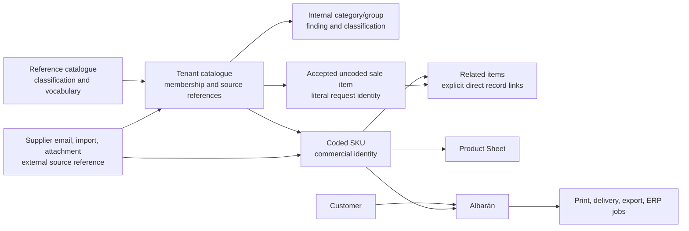
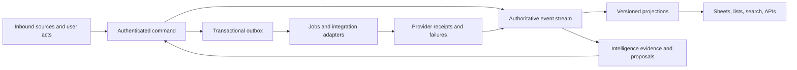

> Current design contract, restored to the active documentation index on 2026-09-07. Implementation readiness is recorded separately in [ENGINEERING-READINESS.md](ENGINEERING-READINESS.md).

# THE ARCHITECTURE — Cedar's proposed product system

**Scope:** the proposed adoption of the [Cedar candidate](../app/src/prototypes/cedar/README.md).
Other product possibilities keep their own specifications and explicitly adopt any reusable contracts.

**Status:** canonical contract within that proposal. It tells builders what the completed system must do and
which document decides a disagreement. It is not evidence that a production backend, provider
connection, or operational process is already live. The published product-sheet kit is useful UI
evidence; it is not a substitute for the services specified here.

## ARC-00 · Authority and reading order

Cedar's proposal resolves disagreements through this hierarchy. Read the parts relevant to the task:

| Rank | Document | Decides |
|---|---|---|
| 1 | This document | system shape, ownership, boundaries, and supersessions |
| 2 | [THE-SYSTEM-SPEC.md](THE-SYSTEM-SPEC.md) | production behaviour, APIs, state, security, operations, and acceptance |
| 3 | [THE-INTERACTION-SPEC.md](THE-INTERACTION-SPEC.md), [THE-PRODUCT-SHEET-SPEC.md](THE-PRODUCT-SHEET-SPEC.md), [THE-STOCK-LOTS-SPEC.md](THE-STOCK-LOTS-SPEC.md), [THE-CATALOGUE-CONTRACT-SPEC.md](THE-CATALOGUE-CONTRACT-SPEC.md), [THE-OUTPUTS-SPEC.md](THE-OUTPUTS-SPEC.md), and [THE-AI-SPEC.md](THE-AI-SPEC.md) | detailed interaction, domain, output and intelligence contracts, including the accepted amendments in ARC-01.0 |
| 4 | [THE-IMPLEMENTATION-SPEC.md](THE-IMPLEMENTATION-SPEC.md), [THE-KIT-TO-PRODUCT-PLAN.md](THE-KIT-TO-PRODUCT-PLAN.md), and [GitHub issues](omitted-sources.md) | implementation contracts, dependency order and current work |

[THE-OBJECT-MAP.md](THE-OBJECT-MAP.md) is the companion reference for object ownership and
doors. Existing canons remain useful detail only where they do not conflict with this hierarchy.
`FEED-IA.md` preserves directive evidence and history; it is not a back door for reviving a
superseded live rule. A newer explicit product instruction outranks a historical doctrine.

The deployed-kit statements in `RELEASE-176.md`, `RELEASE-177.md`, and their drives establish
only what was observed in that kit. They do not establish durable tenancy, event persistence,
provider delivery, or AI execution.

## ARC-01 · The product boundary

Rocoto helps a food distributor turn incoming customer demand into a correct, traceable albarán,
then carry that work through stock, delivery, documents, and the systems around the business. It
does this with one tenant-safe record of what happened, not with separate copies of the same
product, customer, order, or email.

### ARC-01.0 · Current design and earlier release profiles

The E185–E190 profiles below record earlier scope decisions. The following accepted amendments
govern the current design where they differ; their integration and release evidence remains scoped
to each capability.

| Subject | Current contract | Evidence and boundary |
|---|---|---|
| Chat and email | [THE-OUTPUTS-SPEC OUT-05](THE-OUTPUTS-SPEC.md#out-05--chat-and-email-inside-the-app), from FEED-IA §202.3: the primary doors open Rocoto's own chat and email surfaces; provider doors are fallbacks | [RELEASE-196](omitted-sources.md) records the E200 prototype. Provider authorization, sending and receipts require their own integration proof. This supersedes ARC-01.1's native-handoff-only UI. |
| Output templates | [THE-OUTPUTS-SPEC OUT-01](THE-OUTPUTS-SPEC.md#out-01--the-template-model): one editable template object, the export library and one preview/editor | E200 replaces the earlier separate recipe/saved-copy UI model. Immutable output attempts and truthful receipts remain required. |
| Stock and tariffs | [Current interface map](INDEX.md#whole-product-and-interface-map) and E191 subject specs | The maintained prototype exposes independently switched review surfaces. Production activation remains per capability; earlier disabled-profile prose does not remove these prototype surfaces. |
| Data intake, runtime and Copilot | [THE-AI-SPEC](THE-AI-SPEC.md), [THE-IMPLEMENTATION-SPEC](THE-IMPLEMENTATION-SPEC.md), and [THE-KIT-TO-PRODUCT-PLAN](THE-KIT-TO-PRODUCT-PLAN.md), from FEED-IA §203–§209 | E201 completes the design layer and defines future implementation work. Earlier statements that this architecture is still undesigned are historical. Wiring remains a later task. |
| Cedar commerce and onboarding | [Cedar product map](../app/src/prototypes/cedar/PRODUCT-SPEC.md), [Money](../app/src/prototypes/cedar/MONEY-SPEC.md), [payment evidence](../app/src/prototypes/cedar/PAYMENTS-SPEC.md) and [onboarding](../app/src/prototypes/cedar/ONBOARDING-SPEC.md), from FEED-IA §227–240 | Cedar owns sequential business setup, order channels, direct Yape/Plin requests, Prometeo validation, NubeFact invoicing and the Money dashboard as one development experience. Pricing and valued Delivery Notes start enabled; stock starts disabled. This supersedes earlier unvalued/default-disabled prototype scope and ACT-01’s older step sequence. Provider evidence and maintained-product adoption remain separately scoped. |

The shared kit is the intended frontend reference. Current source and release records establish
what has been built; [engineering readiness](ENGINEERING-READINESS.md) records what remains before
the designed product can be released.

### ARC-01.1 · Earlier order-review release profile (E185–E190)

> Historical profile, amended by ARC-01.0 above. Its capability isolation and evidence requirements
> remain applicable; the later subject contracts govern current surfaces and intended behaviour.

The first-customer product is a bounded profile of this full architecture. Its job is to turn an
inbound WhatsApp or email order into a trustworthy, human-reviewed, **unvalued albarán** using the
company's literal SKU list. “Built”, “enabled for this tenant” and “proven in production” are three
separate states. A capability appears as available only when its profile gate, authority and release
evidence all say so.

| Capability | First-customer state | Governing behaviour |
|---|---|---|
| Literal tenant products | **Kit-interactive** | Preserve imported name, source code/SKU and declared Product Unit. Internal category/group and Related items context explain Rocoto's interpretation but never replace tenant identity or require manual placement. |
| Exact-SKU artwork | **Kit-interactive for reviewed assets** | Every exact SKU owns its image association. Missing artwork has a review/generation state; no sibling, category/group or Related items image silently substitutes. |
| Inbound order review | **Enabled** | Retain source wording and resolve each line as exact, field-check, off-SKU provisional, or multiple-SKU choice. A separate reply-attention state covers non-line uncertainty. |
| Albarán editing and output | **Enabled, unvalued** | Operators correct product, quantity, unit and notes, then print or export the selected revision. Price, tax, line total and document total are absent from this profile. |
| Native communication handoff | **Enabled** | Source conversations are read-only in Rocoto. **Open chat**, **Open Gmail** or **Open Outlook** moves the operator to the real provider. |
| Pricing and tariffs | **Planned / disabled** | Full COM-01 records remain in the architecture. They do not appear as live Product, Customer or Albarán controls in this profile. |
| Inventory, lots and supplier intake | **Planned / disabled** | Full INV-01, LOT-01, UTL-01 and supplier-source contracts remain designed. They cannot change the active product or imply recorded stock. |
| Customer outbound from Rocoto | **Planned / disabled** | No customer composer, WhatsApp template flow, send button or provider-delivery claim is active. Reply attention ends in native handoff. |
| ERP automation | **Planned / disabled** | Product and order records preserve stable IDs and export seams without claiming live ERP writes. |
| Scheduled subcontractor list | **Optional, separately gated** | If a tenant asks for it, Export may own a scheduled order-list email with its own recipients, approval, job and receipts. It is not customer messaging and is outside this release. |

This table records what the earlier order-review profile could expose. Disabled capability rows
in that profile could appear in Operations as quiet,
non-interactive roadmap information with the single explanation **Planned for after order review**.
They never look like editable settings. Accuracy is measured later against human-confirmed order
ground truth; a confidence label, model answer or polished UI is not accuracy evidence. This
release preceded the Runtime / model-learning design now recorded in THE-AI-SPEC (ARC-01.0).

### ARC-01.2 · E186 capability and literal-SKU precedence

E186 resolves the Product and intake UX without promoting a capability. The release profile is the
first rendering authority; a capability's authorization and evidence are second; a detailed
full-domain contract is third. A lower authority cannot make a disabled surface appear live.

| State | Meaning | Rendering rule |
|---|---|---|
| **Disabled** | Not available in the active profile. | Hide the work surface unless Operations needs a quiet, non-actionable roadmap row. No editable-looking copy. |
| **Design-reviewed** | The future UI contract is complete enough to review. | Keep it out of the active product flow and make no kit or production claim. |
| **Kit-interactive** | A bounded browser interaction demonstrates the UX seam. | Name its local/demo limits; it cannot imply authorization, a provider, durable business truth or an external outcome. |
| **Production-authorized** | Authority, runtime and current release evidence all exist. | Show the control only to an authorised actor and render real acknowledgement/failure states. |

These states apply independently to inventory/supplier intake, pricing/tariffs, source-provider
reply, customer outbound and ERP. Enabling one cannot enable another. E186's active Product Sheet
continues to be unvalued; inventory/supplier intake, pricing/tariffs and outbound remain separate
future gates.

### ARC-01.3 · E187 UI closure and record-kind precedence

E187 makes Export Centre part of the shared current UI scope and adds an accepted **uncoded sale
item** record alongside the exact coded SKU. A Product Sheet is an exact sellable record sheet: it
may represent either kind, but only a coded SKU is a tenant SKU master. An uncoded record can be
created only by an explicit acceptance of an off-SKU Albarán line; it retains literal wording/unit
and exact request evidence. It cannot acquire a silent SKU, tariff, stock, lot, ERP master or
customer alias. Both kinds can be internally categorised, commented upon, shown in request history and joined by
direct sparse Related items links. Only a coded SKU can hold a reviewed artwork association. An
accepted uncoded sale item has a neutral face and no artwork association or artwork control until a
separately reviewed coded-SKU creation exists.

Export, Sales-day and Albarán output doors are projections of one Output recipe/capture/attempt
contract. Print and Files are active daily work; email/ERP delivery remains independently gated.
A browser print dialog and a browser download are attempt evidence, never physical-print or local-
save proof. This is a UI/UX closure only. E188 supplies the shared physical grammar; E189
supplies source-order Product, one-Unit and Output-object decisions; E190 was the UI authority
where composed Product Sheet and resilient editable Albarán geometry supersede them. For this active
UI profile, Runtime/model-learning/UI intelligence/Copilot execution was separately deferred.
ARC-01.0 records the later E200 surfaces and E201 design that amend this profile.

The three work objects a person opens are:

- **Product Sheet** — one exact sellable record: coded tenant SKU or accepted uncoded sale item.
- **Customer Sheet** — one tenant customer and their operational relationship with the house.
- **Albarán Sheet** — one work record from captured request through fulfilment, issue, delivery,
  correction, and historical reading.

An explicit object door opens its stable object where the user has permission. An order card is one selection target that opens only that order; customer, truck and product names inside it are not competing click targets. Related-object doors belong in the opened sheet or an explicitly labelled menu. A list, an AI answer,
an export, and a related-email panel are projections of the same IDs; none makes a second master
record.

## ARC-02 · Canonical ownership: reference → tenant catalogue → exact SKU, internal category and Related items

This chain is deliberately asymmetric:

| Layer | Owns | Never owns or implies |
|---|---|---|
| **Reference catalogue** | stable reference concepts, classifications, vocabulary, visual-subject candidates, and evidence/provenance | tenant membership, a tenant's commercial name, a price, stock, a customer alias, or a sellable item |
| **Tenant catalogue** | a tenant's admitted source records, SKU membership, local display/search policy and review proposals | a shared commercial identity across tenants |
| **Internal category/group** | transparent, reviewable finding/classification context for browsing and feedback | a sellable sheet, manual placement requirement, Related items relation, price, tariff history, stock balance, lot, order history or artwork assignment |
| **Related items link** | an explicit direct, reciprocal navigation link between two existing coded SKU or accepted uncoded sale-item records, with actor/time/reason/source | a category/group membership, transitive relationship, sellable sheet, unit, price, stock, lot, alias, order history or artwork assignment |
| **SKU** | immutable commercial ID, current projection, original identity, tenant aliases, customer-scoped aliases, own tariff prices/history, own stock/lots, own artwork association and exact order links | facts inherited silently from a category/group, Related items link, sibling or similarly named import row |

An internal category/group can open classification feedback. Related items opens only a selector of
explicitly linked exact SKUs. Neither has a Product Sheet and neither can be sold, priced, stocked
or illustrated as if it were an SKU. A newly confirmed related SKU is a new SKU even where its
name, unit or artwork candidate is similar to another item.

Raw inbound email bodies and incoming file bytes are transient only in Rocoto. Original custody stays with the provider/user. Rocoto persists authorized source references, minimal reviewed business facts and actor/parser lineage; it cannot reconstruct a missing original from a summary. THE-SOURCE-PRIVACY-SPEC governs fetch, cache, logging, model input, deletion and legacy cleanup. Selected literal SKU names/codes/units and order phrases are business facts, not an email archive. A correction adds a versioned fact; it does
not overwrite the source. Aliases always carry scope and provenance. A customer-scoped alias is
considered only while resolving that customer's language and cannot silently resolve another
customer's request.

A recurring customer option, brochure item, or preparation note is a scoped request/planning fact,
not an Internal category/group, Related items link or SKU. It may overlay an approved base SKU with preparation, pack, declared weight,
an explicit surcharge, or a reviewed final line-unit price without creating a catalogue item, stock
position, tariff, artwork, or external product master. The base SKU and its tariff never mutate
from one order. Definition, approved audience, and each albarán line's immutable option/commercial
snapshot are distinct records. Recurrence alone never hardens an option into an SKU. A person may
deliberately admit an SKU through the reviewed catalogue command; until then external exports use
only an approved base item plus the permitted option/financial snapshot or an explicit pre-existing
ERP variation mapping, and never create a master implicitly.

## ARC-03 · Source of truth and system boundary

Commands are the only way to change authoritative business state. A command is authenticated,
tenant-scoped, schema-validated, authorized, idempotent, and revision-checked before it commits
one or more append-only domain events. The command transaction also writes an outbox record. It
never waits on an email, ERP, printer, AI provider, or browser before committing the business
fact.

Event streams are authoritative for changes to their aggregate. Read projections make sheets,
lists, counters, search, feeds, dashboards, and export preparation fast. They can be rebuilt from
streams and retained business facts; raw source replay additionally requires renewed provider access. Jobs and external adapters consume the outbox at least once and use
their own idempotency keys; a provider receipt is a separate fact, never assumed from queueing a
job.

The three rules that keep this honest are:

1. A projection, cache, local draft, AI proposal, queue record, and browser acknowledgement are
   not source of truth.
2. An external result changes Rocoto only when a verified receipt or inbound event is recorded.
3. Historical albaranes retain their resolved SKU, original words, unit/equivalence revision,
   price source, monetary snapshot, lot, class, source evidence, and document revision even when
   later catalogue data changes.

The contract uses a current-revision model for ordinary edits and an immutable issued-document
snapshot for commercial output. Printing renders a named snapshot; it does not calculate a new
price or change the record.

## ARC-04 · Product areas and stable feature IDs

These IDs are stable references for system sections, detailed contracts, task records, tests, and
release gates.

| ID | Capability | Architectural owner |
|---|---|---|
| FND-01 | tenant identity, authentication, membership, and roles | identity/tenant boundary |
| FND-02 | canonical objects, IDs, ownership, and retention | domain model |
| FND-03 | commands, streams, projections, outbox, and audit | domain runtime |
| OBJ-01 | shared object-sheet grammar and doors | experience + projection boundary |
| INTX-01 | shared interaction surface, navigation, overlays, responsive geometry, and cross-sheet propagation | interaction boundary |
| PRD-01 | Product Sheet | sellable SKU domain |
| CUS-01 | Customer Sheet | customer domain |
| ALB-01 | Albarán Sheet | fulfilment/document domain |
| CAT-01 | tenant catalogue and SKU lifecycle | catalogue domain |
| SRC-01 | reference data, imports, supplier sources, and email evidence | source-ingestion domain |
| INV-01 | stock, availability, physical movement history, and inventory position | inventory domain |
| LOT-01 | named lots, unassigned stock, split receipt/count/allocation, traceability and recall | inventory traceability boundary |
| COM-01 | prices, tariffs, units, tax, and money history | commercial domain |
| DOC-01 | albaranes, delivery, printing, and commercial documents | document domain |
| UTL-01 | Stock update utility | utility boundary |
| UTL-02 | New product utility | utility boundary |
| UTL-03 | Upload utility | utility boundary |
| UTL-04 | Export utility | utility boundary |
| INT-01 | predictive and interactive intelligence | intelligence contract |
| INT-02 | reviewed artwork/image generation | intelligence contract |
| INTG-01 | connected mail, human phone, ERP, printers, messaging, and delivery systems | integration boundary |
| ADM-01 | business settings, billing, data controls, and administration | tenant administration |
| OPS-01 | realtime, presence, concurrency, sync, and operations | platform/runtime |
| QLT-01 | privacy, security, authorization, and audit | platform/runtime |
| QLT-02 | accessibility, performance, offline, reliability, and recovery | experience/platform |
| ACT-01 | onboarding, activation, migration, and support | tenant lifecycle |
| REL-01 | observability, evaluation, test evidence, and release gates | release engineering |

The full production architecture has Sales, Products, Customers and Administration as primary work
areas; inventory becomes a Products capability when enabled. In the order-review profile the
navigation label is **Products** and presents the tenant's literal catalogue, exact-SKU sheets,
search and classification filters. It does not render stock counts, stock update, lot allocation,
supplier-email intake, prices or tariffs. **New product** owns both single creation and list upload.

When inventory and supplier intake are independently enabled, supplier emails and attachments are
subordinate sources inside Stock update and may appear as exact-SKU evidence. They never become a
peer Catalogue seat. The future utility contracts below describe that enabled state; they do not
override ARC-01.1.

Four utilities are separate intentional tools, each with its own entry, authority, state,
history, and recovery path:

- **Stock update** records an exact SKU/location receipt, count, physical correction, reservation, allocation or depletion through the inventory command boundary. Its lot split obeys **LOT-01**: a typed/selected lot identity and exact quantities, never a generated code or a quantity-only guess. It does not create a product by accident.
- **New product** is the shared `PRD-C01` creation and review utility for the toolbar, an
  unknown SKU request and **Add related SKU**. It preserves original wording and source context;
  ordinary creation/import never requires manual category placement or a Related items choice.
  Add a product list offers **Drop a file** or **Paste catalogue text** into the same review grammar,
  without a pre-result mapping screen. **Save proposal** records or updates a `CatalogueProposal`
  and may leave it awaiting review indefinitely; it creates no SKU. The separate authorised,
  idempotent SKU-confirmation command writes one reviewed SKU and opens that SKU's own Product Sheet.
- **Add a product list** accepts **Drop a file** or **Paste catalogue text** transiently, then presents one ordered review queue. No field mapping appears before results. Only explicit reviewed literal SKU facts/result/decision and a minimal source checksum/reference or text fingerprint may persist; raw bytes/text do not. An original requires authorized external access or re-selection.
- **Export** creates durable, immutable output jobs and delivery records. It is not an upload
  inverse and does not alter business facts.

No global “two actions on every screen” law survives. Each context exposes the smallest safe set
of actions for that object and the actor's role. The utility capabilities remain separate, while their entry points follow the task: Upload is inside New product, and supplier email intake is inside Stock update. Common navigation may reveal the utilities,
but a utility's command is never silently applied from an unrelated screen.

## ARC-05 · Shared sheets, not a shared blank template

`OBJ-01` gives Product, Customer, and Albarán Sheets the same interaction promises: stable
identity, one object ID, contextual actions, clear current work, visible history, source evidence,
truthful loading/error/offline state, keyboard and touch access, and explicit save acknowledgement.
It does **not** make them visually or semantically identical.

- The Product Sheet is SKU-first. In order review it presents literal identity, own artwork,
  transparent internal category/group context, Related items, exact-SKU orders, quantity patterns,
  customers and details/history. Tariff, stock/lot and supplier-source sections enter only when
  their profile capabilities are enabled.
- The Customer Sheet is relationship-first: contacts and delivery/account facts, next actions,
  frequent products, upcoming work, history, observations, and insights.
- The Albarán Sheet is decision-first: exact lines and commercial facts, scoped concerns, native
  source conversation, fulfilment/delivery status, documents, and audit trail.

The full state matrices and saving rules live in `THE-SYSTEM-SPEC.md` under PRD-01, CUS-01, and
ALB-01. [THE-INTERACTION-SPEC.md](THE-INTERACTION-SPEC.md) decides the shared route, focus,
draft, overlay, responsive and cross-sheet behaviour. A sheet may show sparse or empty evidence,
but may not fabricate history, stock, an image, an equivalence, a price, a resolved SKU, or an
external delivery result.

## ARC-06 · Intelligence has a hard boundary

Intelligence enriches, predicts, explains, and proposes. It may create typed proposals, concern
evaluations, and artwork jobs with traceable evidence. It cannot directly mutate an authoritative
aggregate, archive/merge an SKU, set a price, issue/print/send a document, change stock, resolve a
concern, or message a customer. Each such action must return through an authorized domain command.

[THE-INTELLIGENCE-SPEC.md](THE-INTELLIGENCE-SPEC.md) is authoritative for predictive AI,
interactive AI, and image generation. This architecture owns only the boundary above, the
tenant/command/event requirements, and the rule that provider execution is not claimed before a
durable provider receipt exists.

## ARC-07 · Supersessions

The following older rules are preserved as evidence in historical material but are not live
architecture:

| Historical formulation | Status | Current rule |
|---|---|---|
| “The product is a ladder.” | Superseded | The reference hierarchy classifies vocabulary. A tenant **SKU** is the sellable product and the only Product Sheet. Internal category/group and explicit Related items links are distinct, non-commercial context. |
| “Money is final at print.” | Superseded | A draft can reprice under its disclosed pricing policy. `document.issue` creates the immutable commercial snapshot. Print/reprint renders that exact snapshot. A material correction creates a successor revision, credit/correction, or other configured document act; printing never silently reprices. |
| “Stock has two peer seats.” | Superseded | Stock has catalogue/availability work and its SKU sheets. Supplier mail/incoming material is a source trail and related-email evidence, not an equal navigation seat. |
| “The same two actions apply to every screen.” | Superseded | Actions are object-, state-, and permission-specific. Stock update, New product, Upload, and Export remain distinct utilities. |
| “Group-only artwork.” | Superseded | Every SKU owns an independent reviewed artwork association. A category/group or Related items image may be a reference candidate, never a silent assignment. |
| “A standing stock rule is a physical stock event.” | Superseded | Only evidence-backed physical inventory facts feed **Recorded balance**. A daily/standing estimate, supplier claim and demand prediction are separate labelled streams and never change balance, lots, availability or a delivery promise. |
| “A lot code is an ID or may be generated from a receipt.” | Superseded | A named lot has an opaque immutable ID and a person-entered/selected display lot number. Matching display text requires an explicit existing-versus-separate decision; missing identity is **Unassigned stock**, never a synthetic code. |
| “Changing an allocation changes stock on hand.” | Superseded | Reserve, allocate, release and reassign are commitment facts. Only receipt, count, physical depletion and authorized physical correction change **Recorded balance**. Reattributing unassigned stock to a named lot is zero-net and auditable. |
| “Set by margin %.” | Superseded | The control is **Set by percentage**. It previews `anchor price × (1 + percentage / 100)` — €10 at +10% is €11 — and is never described as gross margin. |
| “Linked tariff prices stay connected.” | Superseded | Each tariff price is independently saved. The live Product Sheet has no persistent chain/link toggle; reviewed percentage save is the only explicit multi-tariff write. |
| “Order state is all that is needed.” | Refined | The Albarán stays one continuous work object for the user, with versioned document, fulfilment, source, and output facts. It is readable after issue and can be reprinted, but commercial revisions are explicit. |
| Independently sized task modals. | Superseded | Task workflows use the shared 800 × 600 px frame, viewport clamping, one body scroll and fixed actions. Object sheets, menus, comments and media keep their named roles. |
| Timer-based print completion. | Superseded | Browser print is an unconfirmed attempt; physical completion requires explicit human confirmation or a verified printer receipt. Reprinting is a new deliberate attempt of a named immutable revision. |
| A generic assistant log is an operational workflow. | Superseded | Assistant conversations hold typed, evidence-backed proposals and per-recipient outcomes. Discussion, business writes and external delivery remain separate authorities. |
| Browser stores/local ledger prove the runtime. | Superseded | They prove interaction only. Production truth requires FND-01 through FND-03, authorization, durable storage, projections, receipts, recovery, and release evidence. |

## ARC-08 · Build and release discipline

The system is complete only when every feature ID has a named owner, command/event/projection
contract, explicit failure behaviour, automated checks, operator runbook, access policy, and
release gate in its subject contract and implementation work. A UI control without an authorized command and durable
acknowledgement is not complete. A queued export, mail, printer, ERP, or image job is not a
delivered result. A provider connection, migration, or model is not described as live until its
own health, receipt, and recovery checks pass.

The implementation spec and kit-to-product plan define the current wiring contracts; GitHub
issues track executable work and link its proof. The archived tasklist and its JSON graph preserve
an earlier inventory. Their task identifiers remain useful references, while their old scope and
status claims require reconciliation with current contracts before reuse.

## ARC-10 · Units, discussion and source custody

The exact SKU owns one Product Unit and may own exact-product exceptions to reusable global UnitConversions. Price, stock, lots, order lines and issued documents retain their own Unit snapshots under their separate domain policies; they are not parallel Product-unit roles. The platform supplies vocabulary, never a guessed pack weight. Standard dimensional conversions differ from SKU package contents; nominal contents differ from a measured delivery weight. [THE-UNITS-SPEC.md](THE-UNITS-SPEC.md) governs products, receipts, lot splits, albaranes, quotes and ERP mapping.

Internal comments are line-linked team discussion in a right-side panel. Customer line notes are explicitly authored/approved document content attached beneath the product. Neither changes catalogue identity. A manually saved customer note cites its authored business event; promoting a comment requires a separate action. Recurrence can remain an option forever.

[THE-SOURCE-PRIVACY-SPEC.md](THE-SOURCE-PRIVACY-SPEC.md) supersedes older requirements to retain raw incoming emails/files in Rocoto. The comments panel supersedes the always-visible Team note explanation box. These decisions do not remove audit, provider security review, issued business snapshots, generated outputs or approved illustration storage. Existing production tasks stay open until runtime evidence proves them.

## ARC-11 · Connected work and assistant authority

The unit of interaction is a recoverable task with a known object, draft and next destination.
A workflow cannot grow a second modal merely because its next step uses a different component.
The shared task frame does not change size between identity, review, pricing, stock, source and
output steps. Its content states what is being edited and its final action names the actual write.
The detailed controls, geometry and transitions are in INTX-11. Main sheets retain their own
reading structure; a context-preserving drilldown is not a second master record.

**Assistant** is the tenant operator's conversation surface, separate from support and customer
communications. **Report supply issue** and **Discuss category** open this same assistant with
explicit scope. Its history contains operator-authored messages, minimal reviewed business facts,
typed proposals, approvals and summarized tool outcomes. It does not become a stored copy of an
inbound mailbox or an unbounded memory shared across tenants. Predictive enrichment, interactive
assistance and artwork generation remain separate execution paths under INTEL-17 and INTEL-01–16.

A reported shortage is an `AvailabilityIncident`, not a physical stock event. A confirmed
operator report may support a proposed impact on open orders while the recorded stock ledger
remains unchanged. Current physical availability, uncertain availability and delayed inbound
are different evidence types. The operator reviews recipients and exact wording before a separate
authorized outbound command. A model cannot promise a substitution, count stock or message a
customer by narrating an intention. A stock update, classification change and external send each
produce their own command/event/receipt chain and can fail independently.

Printing has three different facts: a rendered snapshot, a submitted attempt and evidence that
paper was printed. A browser dialog creates only the middle fact. Each physical reprint is a new
attempt against a named snapshot. Changing a price, customer or albarán cannot alter the contents
of a previous attempt. The ERP remains a downstream data/invoicing system; neither file creation
nor a browser print acts as ERP acknowledgement.
