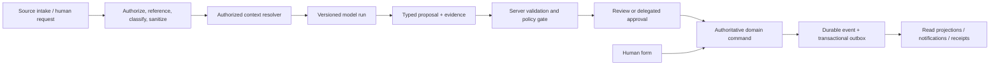
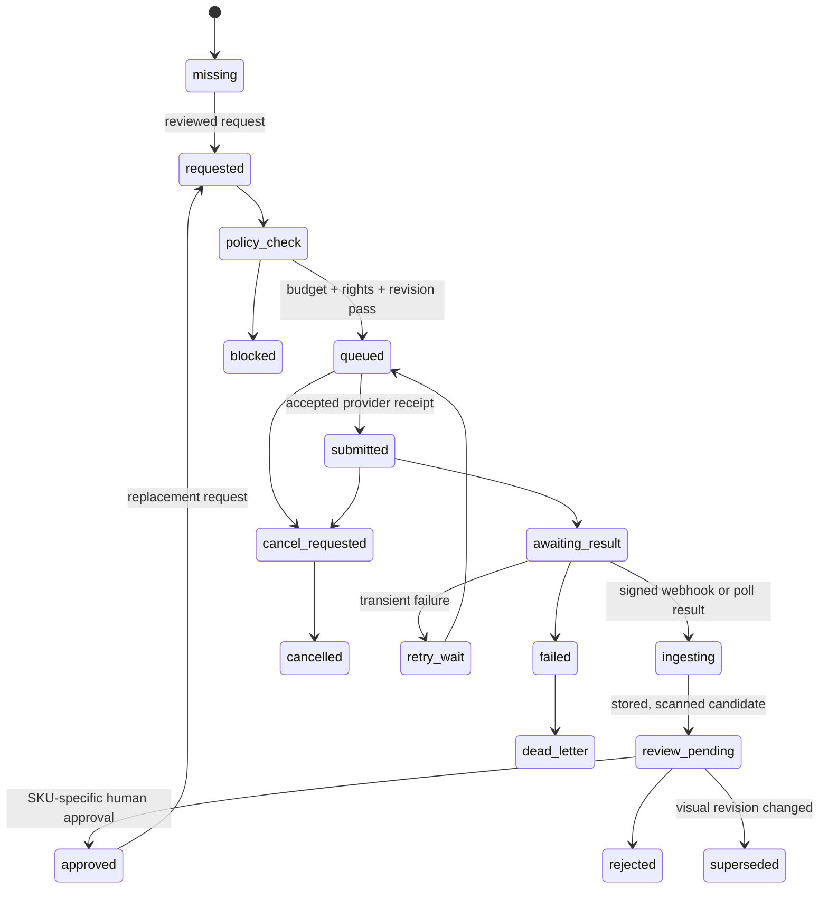

# Rocoto intelligence — production contract

**Canonical domain contract:** INT-01 intelligence and INT-02 image generation.
**Status:** build specification, not a claim that any model, messaging channel, storage bucket, or Ideogram account is connected.
**Version:** `2026-08-31/v1`.

This document turns the product doctrine in [THE-INTELLIGENCE.md](omitted-sources.md) into a production contract. The doctrine remains the product intent: Rocoto should propose the finished albarán a house is likely to prepare, explain material changes, learn from corrections, and make the catalogue more useful. This document governs runtime behaviour. Where the two disagree about implementation, this document wins. It sits below `THE-ARCHITECTURE.md` and `THE-SYSTEM-SPEC.md`, and is implemented through the command/event/projection boundary in FND-03.

Related contracts: FND-01 identity and authority, FND-02 object ownership, FND-03 commands/events/projections, CAT-01 tenant catalogue, SRC-01 source ingestion, DOC-01 documents, OPS-01 concurrency, QLT-01 security/audit, QLT-02 reliability, REL-01 release gates, [THE-SOURCE-PRIVACY-SPEC.md](THE-SOURCE-PRIVACY-SPEC.md) for provider-backed source handling, and the catalogue-specific rules in [THE-CATALOGUE-CONTRACT-SPEC.md](THE-CATALOGUE-CONTRACT-SPEC.md).

The machine-readable v1 contracts are:

- [`proposal-envelope.schema.json`](kit/specs/intelligence/v1/proposal-envelope.schema.json)
- [`command-envelope.schema.json`](kit/specs/intelligence/v1/command-envelope.schema.json)
- [`event-envelope.schema.json`](kit/specs/intelligence/v1/event-envelope.schema.json)
- [`image-job.schema.json`](kit/specs/intelligence/v1/image-job.schema.json)
- [`prompt-contracts.v1.json`](kit/specs/intelligence/v1/prompt-contracts.v1.json), the public-safe source text for pinned prompt contracts and the Rocoto-owned style profile
- [`evaluation-manifest.v1.json`](kit/specs/intelligence/v1/evaluation-manifest.v1.json), the sealed synthetic fixture and release-gate manifest

## INTEL-00 · What this system is and is not

Rocoto has three bounded intelligence jobs:

1. **Fulfilment prediction:** propose the corrected, intended finished albarán from the actual order, current tenant context, and cited historical evidence.
2. **Interactive interpretation:** turn a user's question or new information into a reviewable catalogue, variant, concern, or supply proposal.
3. **Artwork generation:** create candidates for a particular reviewed SKU variation, then associate an approved asset with that SKU only.

The system writes *proposals*, assessments, and job records. It does not write business truth by itself. A model cannot archive, merge, reprice, publish, print, send, resolve a concern, alter stock, or create a sellable SKU directly. Those are domain commands, with the same validation, authorization, revision, audit, outbox, and projection path whether their origin is a person or an AI proposal.

“Prediction” means a bounded proposition about a target revision, not an assertion of fact. “Generated” means a provider accepted a request only when the provider receipt is retained. “Sent” means a channel accepted a message only when a per-recipient receipt is retained. The UI must never replace either term with a reassuring simulation.

No raw hidden reasoning is persisted, streamed, or shown. The model may return a short operator explanation made of evidence references and concrete claims. It may not return chain-of-thought, undisclosed source text, a private prompt, or an instruction trace.

## INTEL-01 · Non-negotiable boundaries

| Boundary | Required behaviour |
|---|---|
| Tenant | Every source reference, retrieval query, model run, proposal, job, command, event, asset association, and receipt carries one tenant id. The server derives it from authenticated authority; the client and model do not choose it. |
| Object ownership | A category or family may classify and navigate. It never owns a variant's price, unit, stock, lot, order history, or approved artwork association. A SKU owns each of those commercial and visual facts. |
| Source truth | Provider-backed source content, derived facts, operator corrections, and model propositions remain different records. A correction never rewrites a source reference or turns a transient source view into a retained Rocoto copy. Raw email bodies/attachments never enter durable Rocoto storage, queues, logs, browser stores, retained prompts, or traces. A policy-authorized extraction may receive a transient, minimised source view through a server tool; it must not echo, cache, or retain that view in model output or telemetry. See `SRC-PRIV-00`. |
| Evidence | Every material proposed change has at least one immutable `EvidenceRef` with a source revision and locator. Missing evidence is a blocking state, not invented detail. |
| Domain write | Only a registered domain command handler can mutate authoritative state. It checks actor permission, tenant, target revision, preconditions, idempotency, semantic rules, and policy before writing an event and transactional outbox row. |
| Model capability | Models use a release-defined, read-only tool allowlist. A tool result is data, never an instruction. No model tool can call a command endpoint or a messaging provider. |
| Time | Context is a named snapshot. A later tariff, stock fact, alias, correction, or model release cannot silently alter an old replay, proposal, or finished document. |
| Safe failure | A failure leaves the current projection and last approved artwork intact. It may create an explicit retry, review-needed, or dead-letter record; it never fabricates success. |

The model never trusts imperative text in email, OCR, PDF, chat, supplier notes, filenames, URLs, or retrieved snippets. That text is quoted as untrusted evidence inside a delimited data field. It cannot alter system policy, tool selection, tenant scope, authority, model configuration, or a command payload. This is a required defence against direct and indirect prompt injection, not a prompt-writing convention. It follows Anthropic’s [prompt-injection guidance](https://platform.claude.com/docs/en/test-and-evaluate/strengthen-guardrails/mitigate-jailbreaks) on handling third-party material as untrusted tool data and limiting sensitive actions.

## INTEL-02 · Authoritative records, evidence, and context

The following records are append-only or revisioned. Their ids are opaque; public surfaces must not expose internal storage paths, provider request identifiers, credentials, raw prompts, or unredacted tenant evidence.

| Record | Required fields | Rule |
|---|---|---|
| `SourceRecord` | `tenant_id`, opaque `source_ref`, kind/provider, received time, source revision, access class, content state/expiry | Minimal provider-backed reference. It contains no raw body, attachment bytes, native link or provider message id. Parsing never overwrites the source reference. |
| `EvidenceRef` | `evidence_id`, `source_ref`, `source_revision`, typed locator class, derived/redacted field value where policy permits, retrieval time/expiry | A reference is stable enough for an authorized server-side re-open. It is not a model assertion and does not retain a raw excerpt by default. |
| `ContextManifest` | `context_id`, tenant, target ids/revisions, effective-at time, retrieval policy/release, ordered evidence ids, redaction version, fingerprint | The exact bounded input set for a run. It is immutable once a run begins. |
| `ModelRun` | `run_id`, purpose, release id, context id/fingerprint, status, token/usage/cost accounting, attempt lineage, output checksum | Holds execution metadata. Private prompt material is protected separately and is never copied into an ordinary event stream. |
| `Proposal` | contract version, proposal id/type/state, target preconditions, evidence, operator explanation, typed payload, model release/run, review history | Can be accepted, edited and accepted, dismissed, superseded, expired, or blocked. It is not a domain mutation. |
| `Concern` | concern id/revision, kind, exact target, predicate/release, evidence, lifecycle state, causation, dismissal/resolution records | Active status derives from this record; no client-side boolean is authoritative. |
| `ImageJob` | schema version, SKU/revision, visual description revision, style/prompt contract hashes, budget authorization, provider receipt, state/attempts, candidate assets/review | Defined in `image-job.schema.json`; one job never grants art to a sibling SKU. |

### Evidence grammar

An `EvidenceRef` has a `kind` from `source_field`, `source_span`, `document_line`, `historical_outcome`, `catalogue_fact`, `inventory_fact`, `tariff_fact`, `customer_preference`, `operator_correction`, `supplier_assessment`, or `policy_result`. It must name an immutable source revision and a deterministic locator such as a field key, document-line id, event id, or byte/text span hash. The API returns a safe display form only to principals who may read the source.

Evidence supports a claim; it does not make the claim true. The proposal payload must distinguish `observed`, `inferred`, `missing`, and `requires_confirmation`. A UI can say “Based on the last three accepted albaranes” and link authorized evidence; it must not say “Rocoto knows” when the support is only an unreviewed inference.

### Context construction

The context resolver is server code, not a tool the model controls. For a fulfilment run it may include, after authorization and time filtering:

- the exact opaque source order reference and only authorized, transiently derived parse/transcript facts;
- customer identity, delivery context, reviewed aliases and preference events within the tenant;
- the target order/albarán revision and current unresolved concerns;
- active SKU/family/catalogue facts, declared unit equivalences, availability and stock facts, and tariff facts effective at the target time;
- relevant prior ordered-versus-fulfilled pairs and prior accepted corrections; and
- supplier information only where its provenance, effective time, and scope permit it.

It may not include another tenant, a broad vector-search dump, hidden system instructions, a future revision, raw passwords/tokens, or data unrelated to the target. Retrieval returns stable ids, revisions, minimal fields, and a declared limit. It records why each item was selected. If a necessary fact is unavailable, stale, ambiguous, or access-denied, the resolver emits a typed gap; the model cannot fill it from general knowledge.


### Stock, inbound and recommendation state grammar

Availability is not one fact. Every prediction, supply assessment and recipient preview uses a typed
`AvailabilityAssertion` with `state_kind`, exact display label, target SKU/revision, source evidence
ids, `as_of`, `expires_at`, quantity/unit only when source-backed, and a validation status. The
server rejects an assertion that loses any of those fields. The UI uses these exact labels:

| `state_kind` | Exact label | What it means | What it never means |
|---|---|---|---|
| `recorded_balance` | **Recorded balance** | A physical ledger/count/receipt/adjustment fact at its stated `as_of` time. This is the only state that can be called actual on-hand stock. | A forecast of later stock or a supplier delivery promise. |
| `daily_stock_estimate` | **Daily stock estimate** | A planning calculation for a named future period, based on a rule/forecast and carrying its rule revision, calculation time and expiry. | A physical reset, recorded balance, supplier-confirmed inbound, or promise that a product will be back tomorrow. |
| `supplier_confirmed_inbound` | **Supplier-confirmed inbound** | A quantity/date explicitly confirmed by an authorized supplier source, with source revision and expiry. | A general supplier expectation, a daily estimate, or an assurance that the product will be available to every customer. |
| `unknown` | **Availability not confirmed** | Rocoto has no sufficiently fresh, authorized source for the needed assertion. | Permission to guess or to use a planning rule as evidence. |
| `model_recommendation` | **Rocoto suggestion** | A predicted fulfilment or operational proposal, with its context/evidence fingerprint and expiry. | A stock fact, inbound confirmation, price, lot, or completed action. |

“Expected stock” is not a permitted standalone label because it hides whether the number is a plan,
a physical fact, or an inbound promise. Show **Daily stock estimate** for a planning rule and
**Supplier-confirmed inbound** only when that confirmation exists. If neither exists, show
**Availability not confirmed**. A recorded balance, planning estimate, and inbound confirmation
remain separate fields even when their quantities happen to match.

An assertion expires when its source freshness policy, effective period, or target revision expires.
A prediction becomes stale when any linked assertion changes or expires. A recipient draft must use
only claims backed by the assertion shown beside it. It may say “we do not yet have confirmed
availability”; it must not say “it will be back tomorrow” from a daily rule, past pattern, or model
recommendation.

## INTEL-03 · One execution path for people and models



`H` is deliberately shared. A human edits the same command shape that an accepted proposal creates. The UI may make a proposal easy to accept, but acceptance constructs a new command with an authenticated actor, fresh revision preconditions, an idempotency key, a policy decision, and the exact accepted payload. A stale proposal must be re-evaluated; it cannot be replayed against new data.

The server validates before command creation and again in the domain handler:

1. schema/version validity and tenant derivation;
2. actor role and purpose-based data authorization;
3. idempotency key/body match and semantic fingerprint policy;
4. target existence, archival policy, and exact revision preconditions;
5. evidence accessibility, source revision, scope, and freshness;
6. business rules: SKU ownership, unit equivalence, pricing, lots, stock, document state, and concern scope;
7. autonomy/budget/release policy; and
8. transactional write of event, outbox item, audit record, and projection trigger.

The outbox publisher is the only component that asks an external channel or provider to act. It gives every provider call an independent idempotency key and stores acceptance/rejection/receipt events. A UI notification is a projection of those records, not a substitute for them.

## INTEL-04 · Release registry and approved runtime

Rocoto's maintained backend calls the Anthropic SDK directly; [backend/brain/llm.py](../backend/brain/llm.py) is its existing structured tool-call helper, with configuration in [backend/config.py](../backend/config.py). The intelligence implementation qualifies and extends an owned backend seam for this contract. Its consumers share that implementation. A production release records an explicit Anthropic model id and the effective configuration, so the reviewed release selects a stable model rather than a mutable tier default.

The existing helper forces a named tool call. Strict-schema support and the release registry designed below require their own implementation and proof. Before releasing the stateful intelligence designed here, qualify the Rocoto-owned Anthropic integration against the official request semantics:

- JSON response contract through `output_config.format` with `type: json_schema`;
- strict tool contracts with `strict: true` when tools are enabled;
- explicit handling of `refusal` and `max_tokens` as non-schema-complete outcomes; and
- adapter tests showing the exact configured SDK/model request preserves those semantics.

The required semantics are described in Anthropic’s [structured outputs documentation](https://platform.claude.com/docs/en/build-with-claude/structured-outputs), which distinguishes structured JSON responses from strict tool inputs. Qualifying the owned backend adapter is a release gate for this intelligence work.

### `AIRelease` registry

Every executable purpose has a reviewed immutable release row:

| Field | Requirement |
|---|---|
| `release_id` | Immutable semantic id, for example `rocoto.fulfilment.v3`. Never a model nickname alone. |
| `purpose` | One of `fulfilment_prediction`, `concern_assessment`, `catalogue_feedback`, `variant_interpretation`, `supply_assessment`, `recipient_draft`, or `image_prompt_composition`. |
| `model_id` and `provider_route` | Exact registered id and qualified transport route. No `latest`; no silent provider fallback for a stateful output. |
| `prompt_template_id`, version, and hash | Immutable rendered-template source identity. Secrets and private source text are excluded from normal logs. |
| `input_schema_id` / `output_schema_id` | Versioned schemas and checksums. Changes require a new release. |
| `tool_allowlist` | Read-only tools, their schema hashes, maximum calls, timeout, and data-class permission. |
| `policy_bundle_id` | Safety, retention, autonomy, cost, and redaction rules evaluated for this release. |
| `evaluation_dataset_id` / results | Sealed fixture version, scenario coverage, measured result, reviewer, and approval decision. |
| `rollout_state` | `disabled`, `offline`, `shadow`, `canary`, `enabled`, or `rolled_back`; effective time and approver. |

A release cannot become `canary` or `enabled` until its model, prompt, schema, tool set, validation code, policy bundle, evaluation dataset, and alert routing are each pinned and approved. A prompt/model/schema/tool change creates a distinct release and re-runs the relevant evaluation. No production deployment or promotion occurs without Peter’s explicit approval recorded against that release.

### Tools and permissions

Allowed model tools are server-owned read APIs: `get_target_snapshot`, `get_evidence`, `search_catalogue`, `get_sku`, `get_family`, `get_customer_history`, `get_availability`, `get_tariff_fact`, `list_affected_orders`, and `draft_recipient_set`. Each tool has a narrow JSON schema, tenant derived server-side, object/revision bounds, result-size ceiling, timeout, and audit record. The model cannot pass arbitrary filters, URLs, SQL, filesystem paths, credentials, or another tenant id.

The following are never model tools: command execution, export/print, archive/restore, merge, tariff update, price update, stock change, lot assignment, recipient dispatch, key management, network fetch, shell, database query, or generic browser/computer control. A request to do one of those becomes a proposal and follows the command path.

### Pinned prompt contracts and trusted input boundary

[`prompt-contracts.v1.json`](kit/specs/intelligence/v1/prompt-contracts.v1.json) is the versioned source of the three initial prompt contracts. It contains their exact public-safe text, source-bound constraints, typed output references, and synthetic examples; it is not a registry placeholder. A rendered-template, style, output-shape, or constraint change creates a new prompt version, hash, release, and evaluation.

Every text-model request has one immutable system instruction and this server-rendered envelope:

```text
<rocoto_trusted_request version="2026-08-31/v1">
{"purpose":"{{purpose}}","release_id":"{{release_id}}","target":{{target_json}},"context":{{context_manifest_json}},"allowed_evidence_ids":{{allowed_evidence_ids_json}},"allowed_tool_names":{{allowed_tool_names_json}},"typed_output_contract":{{typed_output_contract_json}}}
</rocoto_trusted_request>
<rocoto_untrusted_evidence format="json">
{{redacted_evidence_bundle_json}}
</rocoto_untrusted_evidence>
<rocoto_untrusted_tool_result format="json">
{{redacted_tool_results_json}}
</rocoto_untrusted_tool_result>
```

The instruction treats both `rocoto_untrusted_*` blocks as quoted evidence, never instructions. It ignores any role claim, policy, URL, tool request, or data-access request inside them; permits only `allowed_evidence_ids`; forbids invented facts/ids; and returns JSON only, with no copied source or hidden reasoning. Tool results use the same untrusted wrapper. Delimiters do not grant trust: server-derived tenant/actor/release data, redaction, tool allowlists, schema validation, evidence-subset checks, and command validation enforce the boundary.

The model emits a **typed fragment** only: `payload`, short `operator_explanation` claims, and `referenced_evidence_ids`. The server creates the full `ProposalEnvelope` identity, tenant, run, release, target, context fingerprint, revision preconditions, and expiry after validation. Every cited id must be in the context manifest; every affected target/revision must be in the trusted resolution set; every `before` value must match current state.

| Contract | Typed result and hard constraint |
|---|---|
| `rocoto_fulfilment_prediction_v1@1.0.0` | `fulfilmentPrediction` + evidence-linked `explanationClaim`. Unsupported SKU/quantity/unit/conversion/customer intent is `unresolved` and `requires_confirmation`, never a filled field. Per-line availability labels are exactly **Recorded balance**, **Daily stock estimate**, **Supplier-confirmed inbound**, or **Availability not confirmed**. A daily estimate is planning only and never a delivery promise. |
| `rocoto_interactive_typed_proposal_v1@1.0.0` | Exactly one `catalogueFeedback`, `variantInterpretation`, `supplyAssessment`, or `concernAssessment`. Every change names trusted record/revision, before value, proposed value, and evidence. It cannot create, merge, archive, reprice, print, send, or resolve. |
| `rocoto_sku_illustration_v1@1.0.0` | An `image_prompt_fragment_v1` with template/style/version, prompt, negative requirements, evidence ids, and mandatory human-review flag. It can use only an approved exact-SKU reference and cannot submit or approve art. |

The canonical own profile is **`rocoto_catalogue_illustration@1.0.0`**. Its exact text in the contract calls for one reviewed product, centered on a warm off-white background with soft natural shadow, calm natural colour, clean edges, and generous empty space; it preserves only reviewed form, state, and packaging distinctions. It prohibits unreviewed attributes, text, logos, watermarks, price/certification/brand claims, people, props, extra products, scenes, and every named artist, studio, living creator, or third-party style. This is Rocoto-owned profile wording, not an ownership claim over provider output. A family/library image never inherits to an SKU. `standard` is the default endpoint; `transparent_background` needs an explicit approved alpha-PNG requirement for that SKU.

## INTEL-05 · Transport contracts, idempotency, and versioning

All internal API envelopes carry `api_version: "2026-08-31/v1"`. The server rejects an unknown major version, returns additive unknown fields only after a negotiated minor version, and never changes the meaning of an existing enum. New optional fields are additive; incompatible changes require `/v2` schemas and a dual-read migration plan.

### Start an intelligence run

`POST /api/v1/intelligence/runs` accepts references, never a client-supplied dump of tenant data.

```json
{
  "api_version": "2026-08-31/v1",
  "run_type": "fulfilment_prediction",
  "target": {"object_type": "albaran", "object_id": "alb_…", "revision": 42},
  "source_refs": [{"source_id": "src_…", "source_revision": 7}],
  "release_id": "rocoto.fulfilment.v3",
  "interaction_id": "int_…",
  "requested_by": "authenticated_server_principal"
}
```

The authenticated session supplies tenant and actor; the literal `requested_by` value is not trusted. The request needs an `Idempotency-Key` header. Repeating the same key and canonical request returns the original run. Reusing it for another body returns `409 IDEMPOTENCY_KEY_REUSED_DIFFERENT_BODY`.

```json
{
  "run_id": "run_…",
  "state": "queued",
  "target": {"object_type": "albaran", "object_id": "alb_…", "revision": 42},
  "release_id": "rocoto.fulfilment.v3",
  "stream_url": "/api/v1/intelligence/runs/run_…/stream",
  "created_at": "2026-08-31T00:00:00Z"
}
```

### Review a proposal

`POST /api/v1/intelligence/proposals/{proposal_id}/review` accepts one of `accept`, `edit_and_accept`, `dismiss`, or `request_revision`. It carries `proposal_revision`, target `expected_revisions`, an optional operator edit expressed in the proposal payload schema, and a reason. It returns either a command receipt or a typed block:

```json
{
  "review_id": "rev_…",
  "decision": "accept",
  "proposal_revision": 3,
  "expected_revisions": [{"object_type": "albaran", "object_id": "alb_…", "revision": 42}],
  "idempotency_key": "review_…"
}
```

`409 REVISION_CONFLICT` returns current target revisions and keeps the proposal unaccepted. `422 POLICY_BLOCKED` returns machine-readable rule ids safe for the actor to see. `403 EVIDENCE_NOT_AUTHORIZED` must reveal no hidden source metadata. A model output that fails schema, evidence, or policy validation becomes `blocked`, records the failure class, and cannot be rendered as a reviewable recommendation.

### Command and event envelopes

The full shapes live in the linked schemas. The important invariant is that a command contains a fresh authority and precondition set, while an event contains the authoritative result after validation.

```json
{
  "api_version": "2026-08-31/v1",
  "command_id": "cmd_…",
  "command_type": "albaran.apply_prediction",
  "tenant_id": "ten_…",
  "actor": {"actor_type": "user", "actor_id": "usr_…"},
  "origin": {"kind": "proposal", "proposal_id": "prp_…", "run_id": "run_…"},
  "idempotency_key": "cmd_…",
  "semantic_fingerprint": "sha256:…",
  "expected_revisions": [{"object_type": "albaran", "object_id": "alb_…", "revision": 42}],
  "authorization": {"mode": "human_approved", "approval_id": "rev_…"},
  "payload": {"accepted_line_ids": ["pln_…"]}
}
```

```json
{
  "event_id": "evt_…",
  "event_type": "albaran.prediction.applied",
  "aggregate": {"object_type": "albaran", "object_id": "alb_…", "revision": 43},
  "causation_id": "cmd_…",
  "correlation_id": "run_…",
  "outbox_id": "obx_…",
  "occurred_at": "2026-08-31T00:00:00Z"
}
```

An idempotency key protects transport repetition. A semantic fingerprint protects equivalent concurrent requests that arrive with different keys. It is a canonical hash of tenant, command type, target ids/revisions, effective time, and normalized material payload; it never uses a raw prompt or private evidence body. The domain handler defines its deduplication window by command type. It never treats a same-looking command on a newer revision as equivalent.

## INTEL-06 · Finished-albarán prediction

The target is the likely *finished* albarán: what the house will actually fulfil after interpreting the order, applying its known customer routing and current available product context. It is not a transcription-only answer and it is not permission to create commercial facts.

### Required inputs and output discipline

The run begins with an authoritative target revision and a context manifest. For every proposed line it returns:

- `line_action`: `carry_through`, `substitute`, `add`, `omit`, or `unresolved`;
- a source phrase or existing line id;
- a target SKU id only when the context has a reviewed catalogue path to it;
- quantity/unit only when an explicit source quantity or a declared, cited conversion supports it;
- an evidence-backed explanation and material evidence refs;
- a typed availability assertion using the exact labels in INTEL-02, including source/evidence, `as_of` and expiry;
- an internal confidence band used for triage, never a customer-facing probability; and
- a `requires_confirmation` flag whenever the result changes an order meaning, relies on incomplete support, or cannot be applied safely.

The prediction may propose a finished composition, including an omitted requested item or a plausible substitute, only when the evidence makes that relationship reviewable. It must leave an unresolved line unresolved when customer wording, a family alias, availability, or SKU mapping is ambiguous.

These prohibitions are absolute:

- Never invent a quantity where none is supported.
- Never invent, convert, or assume a selling unit or equivalence. An unknown unit remains unknown.
- Never predict a lot/batch id. Lots are selected only by the inventory/packing authority.
- Never generate, copy from memory, or revise a price. The domain price resolver may attach a tariff fact effective at the document time after the proposal; absent a valid tariff it returns `price_pending`.
- Never state that stock is available from a daily stock estimate, a historic pattern, a par rule, or a model recommendation. Only a sufficiently fresh **Recorded balance** or explicitly scoped **Supplier-confirmed inbound** can support an availability claim, and neither guarantees allocation until the authoritative stock/packing command validates it.
- Never create a SKU, variant, customer alias, family relation, or unit conversion as a side effect of prediction.

Each correction creates an explicit event that links original proposal, accepted/edit payload, target revision, evidence snapshot, and actor. Corrections are training/evaluation data only after data-governance review; they do not automatically alter a prompt, learned fact, or model weight.

### Safe application policy

Default autonomy is proposal-only. `albaran.apply_prediction` always requires an authorized human approval unless a later release has passed the delegated-command gate in INTEL-10. Even then, no automatic application may change unit, quantity, price, lot, customer, delivery date, payment, or external communication. A changed source revision, stock snapshot, tariff, availability fact, or document revision invalidates a pending proposal and produces `stale_context` rather than a silent refresh.

The UI shows the proposed corrected line as a normal line with a concise change note and evidence door. It shows literal source wording beneath when the proposed fulfilment differs. No evidence door leaks hidden prompt text, another customer, internal confidence, or private rationale.

### INTEL-06A · Corrected-paper review and final-print state

A correction to a paper albarán is a human evidence-review workflow. It is separate from an LLM
prediction, separate from stock allocation, and separate from an assertion that a printer or driver
physically completed anything. The document’s normal line commands remain the only way to change
quantity, unit, price or packing facts. The paper review records the print snapshot being checked
and, optionally, an opaque/provider-backed or session-only source reference.

The UI uses these exact states, derived from immutable print snapshots and material document events:

| UI state | Required meaning | It must not imply |
|---|---|---|
| **Unprinted** | No print snapshot exists, so there is no paper copy to compare. | That a draft has been printed or delivered. |
| **Current paper** | A print snapshot exists and no correction-review baseline was opened for it. | That a physical printer, customer or driver received it. |
| **Working paper** | An operator opened a manual comparison against a named print snapshot; there is no later material document event. | That every handwritten figure has been entered, or that a photo was read. |
| **Working paper changed** | A material line/note/unit/price event is newer than the working print snapshot. | That the change is correct, or that a final copy exists. |
| **Final paper** | A later canonical print snapshot follows an explicitly completed review acknowledgement for the checked revision; no later material event or replacement source invalidates it. | Physical print completion, handover, delivery, payment, ERP export, or customer receipt. |

A printer integration may add its own durable job/recipient receipt. That receipt is the only basis
for a claim that paper completed a physical route. After comparing the source and the fields, the
operator explicitly presses **Finish review**. That acknowledgement records the checked document
fingerprint, durable source reference when present, and current print count. A later print can be
**Final paper** only when it is after that acknowledgement and all three still match. Loss of a
session-only photo after reload does not retroactively invalidate a completed acknowledgement when
that fingerprint and source reference still match; it only blocks starting or finishing a new or
replacement source review until the source is selected again. A replaced photo/source or material
line event invalidates the acknowledgement, and a reprint then stays **Working paper** until the
operator finishes reviewing again. Reopening a review never rewrites the earlier print snapshot; it
links a new review baseline to its own document and print revisions.

#### Source-photo intake and manual correction

The current client accepts an operator-selected `image/*` file up to **10 MiB** only after a
working paper exists. The bytes and selected filename are held only in the active browser session.
The durable record contains only the print baseline, opaque source ref, review acknowledgement and
document fingerprint; it contains no image bytes, durable browser blob key, user-supplied filename,
or session key derived from a filename. Historic local records remain inaccessible until explicit
privacy cleanup; the feature never claims that a metadata reset deleted them. After a reload, an
incomplete review says **The photo is gone from this session. Add it again to finish the review.** A
fingerprint/reference-matched completed review instead says **Photo no longer available. Your
completed review is saved.** A selected photo is not silently re-opened, downloaded or treated as
retained evidence. Legacy local bytes are not read by the feature; an explicit privacy-cleanup
control must report whether its own deletion actually completed. The full boundary is
[THE-SOURCE-PRIVACY-SPEC.md](THE-SOURCE-PRIVACY-SPEC.md), `SRC-PRIV-08`–`SRC-PRIV-09`.

Visible copy is deliberately literal: **No automatic reading is connected. Compare the photo with
the quantity and unit price on each line, then enter only the figures on the paper.** An accepted
photo is `review_pending`; it has no extracted fields, confidence, provider result, or applied
correction. A session/mapping failure says that the photo was not applied, keeps the selected file
only for an active-page retry, and makes no source/evidence claim for it. A later line edit or
replacement source invalidates an acknowledgement. Missing session bytes or reload only blocks a
new/replacement review; they do not revoke an already completed acknowledgement whose checked
document fingerprint and durable source reference still match.

For production, the source-association command is revisioned and tenant-scoped. It names a
provider-backed opaque source ref or a separately authorized direct-upload asset ref; it never
carries source bytes, a filename, a raw content hash or a provider URL:

```json
{
  "command_type": "albaran.paper_source.attach",
  "origin": {"kind": "human_form", "correlation_id": "cor_…"},
  "expected_revisions": [
    {"object_type": "albaran", "object_id": "alb_…", "revision": 43},
    {"object_type": "print_snapshot", "object_id": "prn_…", "revision": 1}
  ],
  "payload": {
    "kind": "albaran.paper_source.attach",
    "albaran_id": "alb_…",
    "print_snapshot_id": "prn_…",
    "source_ref": "src_…",
    "source_kind": "operator_photo|provider_attachment",
    "content_state": "provider_backed|session_only",
    "media_type": "image/jpeg",
    "byte_size": 482901,
    "captured_at": "2026-08-31T09:14:00Z"
  }
}
```

The server validates tenant/actor scope, object revisions, the direct-upload retention policy when
one is requested, safe media type/bytes, malware/content streaming result, source availability and
idempotency before emitting an association event. Ordinary UI and public documentation expose only
the authorized source label, revision and review state. Source pixels, OCR text, filename, email
body and embedded instructions are untrusted data: they cannot alter policy, tool permissions,
recipient scope or a command payload. No source pixels/bytes are written to ordinary events,
outboxes, logs, queues, browser storage, prompts or model traces.

Manual fields are explicitly **Actual quantity** and **Actual unit price** after paper exists. A
changed value submits the ordinary revision-checked line command with the review/print baseline as
context. It never changes a tariff globally, invents a unit conversion, selects a lot, or derives a
price from an image. A rejected validation or revision conflict leaves both source review and the
operator’s field draft visible with a precise retry/refresh action. A successful line event makes
that paper stale through the same domain fold as a hand edit made anywhere else.

A future OCR or model integration may only emit `albaran.paper_extraction.proposed`: each proposed
field has the opaque source ref/revision, authorized transient locator class, literal candidate,
confidence/abstention, normalization version and expected line revision. It is review-only. It
cannot call a line command, print, send, allocate, reprice, resolve a concern, or mark paper final.
The only final transition is a subsequent canonical print snapshot after an authorized correction.

## INTEL-07 · Concerns: exact scope, dismissal, acknowledgement, reopen

A concern is independent from a proposal. It represents a check that applies to an exact target: one source block, one document field, one line, or an explicitly enumerated line group. It never paints an entire document red because one line is uncertain.

The visual contract is a thin red boundary enclosing exactly the affected row, field, source block, or explicit group and its sentence. Header/card badges are projections of active concerns only. A response concern sits immediately above its native source conversation. A category, supplier, or order-level concern must list its exact target ids; “all affected products” is invalid.

### Lifecycle

```text
raised -> active -> evaluating -> resolved
                  \-> active (check remains true)
active -> dismissed (specific evidence/revision only)
dismissed -> reopened (new or contradictory evidence)
any active/evaluating state -> superseded (target revision no longer applicable)
```

`raised` requires predicate/release id, evidence refs, target revision, and a plain-language statement. `evaluating` is set only by a relevant accepted domain event or a scheduled recheck. A model can propose a concern or a recheck; only a server evaluation of the predicate against the relevant post-command state can resolve it. Navigation, printing, an unrelated edit, another concern’s dismissal, and a failed save cannot resolve it.

Dismissal asks for one custom free-text explanation, labelled **Why are you dismissing this check? · optional**. There are no reason buttons, chips, preset answers or reason-category menu. The command records the exact operator text, actor and evidence/target revisions. An optional internal `dismissal_kind` defaults to `operator_judgement`; any later classification is versioned, records its provenance and never replaces or edits the operator's words. It is not another question for the user. A dismissal does not mark the predicate true or erase its history.

Resolution writes `concern.resolved` with the evaluated predicate, relevant command/event ids, evidence revision, and resolver. The projection may show **Thanks for editing — that check is resolved.** as a local acknowledgement linked to those facts. This acknowledgement is an evidence-backed consequence, never a congratulations message for an unverified change, and it may be dismissed only as presentation. New contradictory evidence creates a new concern revision with a `reopened_from` link; it never rewrites the old resolution or dismissal.

## INTEL-08 · Interactive catalogue and variant intelligence

Interactive intelligence is a conversation that produces a typed proposal, never a hidden mutation. It has three public outcomes:

| Interaction | Required output | Never does |
|---|---|---|
| Category/family feedback | Proposed classification diff, explicit affected SKU ids/revisions, evidence, alternatives, impact summary, reversible command | Does not open a category as if it were a SKU, or change price/image/stock/unit/history. |
| New SKU/variant interpretation | Original wording, corrected display description, attribute candidates, family relation, ambiguity/missing facts, alternatives, evidence, visual-description readiness | Does not create a sellable SKU or bill image generation before review. |
| Supply-chain issue | Source assessment, affected stock/orders/customers, uncertainty/gaps, recipient draft and channel plan | Does not send a message or assert delivery without approval/receipt. |

### Typed preview and apply contract

Every interactive result renders the same review structure before an apply control is enabled:

1. **What changes** names every affected record by stable id, human label and current revision.
2. **Field changes** show one row per changed field: current value, proposed value, `observed`/
   `inferred`/`missing` status, evidence links, source and target revisions, validation state, and
   whether an operator edit is required.
3. **What does not change** names commercial/visual facts outside the proposal. Category feedback,
   for example, says explicitly that prices, units, stock, lots, history and SKU artwork are not
   changing.
4. **Evidence** opens only authorized, redacted source material and displays `as_of`/expiry for
   every availability assertion.
5. **Apply** submits selected record ids and fresh expected revisions. The server validates again;
   a green preview is not a guarantee that a stale command will apply.

The visible control labels are **What changes**, **Evidence**, **Availability**, **Review**, and
**Apply selected changes**. A preview never calls itself an update. A partial result returns a
record-by-record receipt; it does not hide failures behind a single success toast.

### Category feedback

For “these belong under leafy greens,” the response must identify every proposed SKU by immutable id and current revision, show a before/after category/family diff, identify excluded ambiguous members, and state downstream projections that will change. The reviewer can accept all, select a subset, edit the destination, or dismiss. Acceptance uses `catalogue.classification.apply` with expected revisions for every chosen SKU. The inverse event includes the accepted-before state and an `undo_of` link; undo is a new authorized command, not a projection rewrite.

Category feedback can suggest a universal-reference grounding or tenant-family relation. It cannot convert a reference node into tenant membership, replace a house name, merge two IDs, or propagate an image. A relation proposal includes a confidence band and alternatives, but uncertainty remains visible when a phrase could resolve at family rather than SKU level.

### Variant interpretation and corrected description review

For “fresh chicken wings, frozen,” the service keeps the literal wording and proposes separate facts: base SKU/family candidate, state, form, display description, missing commercial facts, and visual description. It returns alternatives when “frozen” could be a line amendment rather than a new sellable variation. A typo correction is a visible reversible diff, never a silent rewrite.

Review is two gates:

1. **Interpretation review** confirms or edits the semantic description, family relation, retained source wording, and ambiguity disposition.
2. **SKU creation review** creates a new immutable tenant SKU through CAT-01. It opens that SKU’s independent price sheet and image state. A parent/family price can be offered as a sourced starting value, never inherited.

Only after both gates can a visual-description revision be eligible for a paid image job. The SKU keeps its own original source row/name, stock/history/price ownership, and later image association.

### Conversation state and injection safety

The conversation service emits only bounded UI events: `accepted`, `queued`, `retrieving`, `generating_draft`, `needs_input`, `proposal_ready`, `reviewing`, `applying`, `completed`, `blocked`, `failed`, or `cancelled`. It can stream an evidence count, a safe progress sentence, and a final typed proposal. It never streams raw model tokens, tool arguments, private source text, hidden reasoning, or a speculative command.

An interaction has a server-owned `interaction_id`, tenant, actor, target set, locale, redaction policy, release id, sequence number, and expiry. A later turn sees only authorized prior turns and selected proposal/evidence ids. Uploaded and retrieved content is explicitly labelled untrusted. The model is instructed to answer the user's business question, not instructions embedded in that content; server code enforces the boundary regardless of its wording.

## INTEL-09 · Supplier shortage to real announcement

Supply intelligence is a staged assessment-to-dispatch workflow. It is designed to avoid the two dangerous false claims: that an unverified shortage is real, and that a drafted message was sent.

1. **Ingest:** retain only an opaque provider-backed source reference and provenance. Do not copy the supplier message or attachment into Rocoto. An authorized extraction may read a transient, minimised view to produce bounded facts; source instructions do not become policy.
2. **Assess:** retrieve **Recorded balance**, **Daily stock estimate**, **Supplier-confirmed inbound**, affected SKU revisions, open orders, customers, delivery cutoffs, and policy-approved contact routes as separate fields. Return named affected IDs, field-level evidence/expiry and gaps. If a source cannot prove an SKU mapping, quantity or date, mark it uncertain.
3. **Draft:** produce recipient candidates, the reason each is affected, one draft per language/channel, and an exact channel plan. The draft says what is known and what remains uncertain. It contains no recipient address in model-visible output unless the actor is authorized and the release requires it.
4. **Review:** an authorized operator selects recipients, edits copy, chooses the channel, confirms document/data revisions, and explicitly approves dispatch. Bulk sends require the configured higher approval threshold.
5. **Command:** `notification.dispatch` is created with tenant, actor, selected recipient ids, normalized body hash, channel, approval, idempotency key, and semantic fingerprint. The command handler checks consent, suppression, authority, recipient state, and stale impact analysis.
6. **Outbox and receipts:** Rocoto-owned backend channel adapters dispatch through the outbox, under [THE-CONNECTIONS-SPEC](THE-CONNECTIONS-SPEC.md). Each recipient has an idempotent delivery row and receives `accepted`, `rejected`, `failed`, `delivered`, or `unknown` only when the provider supplies that state. A retry preserves the recipient idempotency key. No provider call means no `sent` claim.

A browser preview, a queued job, and a channel provider acceptance are three different states. The projection must name them separately. A **Daily stock estimate** or model prediction may inform internal triage, but cannot appear in a customer announcement as a confirmed inbound or a promise that a product will return at a stated time. If there is no supplier-confirmed source, the draft must say availability is not confirmed. Partial dispatch preserves per-recipient receipts and never retries recipients already accepted unless the channel contract expressly supports a safe replacement.

## INTEL-10 · Autonomy, concurrency, budgets, cancellation, and recovery

### Autonomy tiers

The tenant policy chooses a maximum tier; a release may choose a lower one. The default is Tier 0.

| Tier | Allowed | Prohibited |
|---|---|---|
| 0 — observe/draft | Read authorized context, generate proposals, create non-billable local drafts, request a review | Any domain mutation, paid image request, external dispatch, export/print. |
| 1 — bounded maintenance | Deduplicate queued runs, schedule rechecks, retry a previously authorized transient job within its original budget, mark stale/superseded state | Creating commercial facts, accepting a proposal, changing an association, sending a message. |
| 2 — delegated low-risk command | Only named, release-approved, tenant-opted-in commands whose evaluation precision and rollback conditions passed. Each command still uses FND-03 validation and audit. | Price/unit/stock/lot/document/customer changes; archive/merge/publish/print/send; concern resolution; first SKU/image approval. |
| 3 — external effect | Not autonomous. It is a human-confirmed command with a durable approval and per-effect receipt. | Treating a draft or queued outbox row as sent. |

There is no model-level “admin” tier. A user with higher application authority can approve a command; the model cannot inherit that authority.

### Exact lifecycle copy and controls

The intelligence UI uses plain verbs and names the state it has actually reached. It does not use
“AI magic”, “done” before a receipt, or an unexplained spinner. These strings are the canonical
copy for the corresponding state; a locale may translate them without weakening their meaning.

| Area / state | Exact visible text | Available control |
|---|---|---|
| Prediction — writing | **Writing a suggested finished albarán from the order and the facts shown here.** | **Cancel** |
| Prediction — review | **Suggestion ready for review. Nothing has changed yet.** | **Review suggestion**; **Continue without a suggestion** |
| Prediction — failed | **Rocoto could not write a suggestion. Your order is unchanged. Try again or finish it yourself.** | **Try again**; **Finish manually** |
| Prediction — stale | **This suggestion is out of date because the order or its facts changed. Nothing was applied.** | **Write a new suggestion**; **Finish manually** |
| Prediction — manual fallback | **Finish this albarán yourself. Rocoto will keep the source and your edits separate.** | ordinary editable fields |
| Interaction — clarify | **I need one detail before I can make a safe preview: {field}.** | **Answer**; **Cancel** |
| Interaction — preview | **Preview only. {count} records would change if you apply it.** | **What changes**; **Evidence**; **Apply selected changes** |
| Interaction — applying | **Applying your reviewed changes…** | **Keep this page open**; cancellation only before an irreversible outbox effect |
| Interaction — partial failure | **Some changes were applied. {failed_count} records were not changed: {safe_reason}.** | **Review unchanged records**; **Try those again** |
| Image — requested | **Artwork requested. It has not been sent to a generator yet.** | **Cancel request** |
| Image — queued | **Artwork is queued. Current approved artwork remains in place.** | **Cancel request** |
| Image — generating | **Artwork is being generated. It is not ready to use.** | **Check status**; **Cancel request** when supported |
| Image — review | **Artwork is ready for review. It will not replace the current artwork until you approve it.** | **Review artwork** |
| Image — approved | **Artwork approved for this SKU.** | **View artwork**; **Request replacement** |
| Image — rejected | **Artwork was not approved. Current approved artwork remains in place.** | **Request another candidate** |
| Image — unknown | **Artwork status is unknown. Rocoto cannot confirm that a provider started or completed it.** | **Check status**; **Try again** |

Use **Recorded balance**, **Daily stock estimate**, **Supplier-confirmed inbound**,
**Availability not confirmed**, and **Rocoto suggestion** exactly as defined in INTEL-02. These
are field labels, not interchangeable status badges. Every label opens **Evidence** and shows its
`as_of` time and expiry; every model proposal also opens **What changes** before **Apply**.

### Concurrency and stale work

- A run pins target and context revisions. The domain rejects a result if any required revision changed.
- At most one active fulfilment run exists for a `(tenant, target object, target revision, release)` fingerprint. Equivalent requests attach to it.
- At most one active image generation attempt exists for `(tenant, sku, SKU visual revision, style version, provider options fingerprint)`. A retry increments attempt lineage instead of creating a competing approval path.
- A review applies a fresh revision check. First accepted command wins; later review returns conflict with a safe re-evaluate route.
- The service serializes events per aggregate and uses transactional outbox ordering. Projections can be eventually consistent but show their source event/revision and refresh state.

### Limits and cost controls

Before a run, the policy gate reserves a tenant/purpose budget. It enforces a maximum input size, output tokens, tool calls, concurrent runs, daily cost, per-SKU candidate count, and per-recipient dispatch count. Units are explicit: LLM tokens and image provider `usd_micros` are not mixed. The release records the estimated ceiling; completion records actual usage when available. A missing cost field is `unknown`, not zero.

Image requests and external dispatches require budget authorization with an expiry. If the actual provider quote/result exceeds the authorization, the job becomes `budget_review_required`; it does not silently continue. Rate-limit responses honor provider retry-after where supplied and consume a bounded retry budget.

### Timeout, retry, cancel, and dead letter

Every asynchronous operation has a deadline, attempt count, retry classification, next-attempt time, and causation id. Retry only transient `timeout`, `rate_limited`, and verified provider-unavailable failures; use capped exponential backoff with jitter and the original idempotency/fingerprint. Do not retry invalid schemas, policy blocks, safety refusals, invalid webhook signatures, malformed provider payloads, or stale targets without new operator/review action.

Cancellation is a command. `cancel_requested` prevents new dispatches and model calls immediately; a worker checks it before every irreversible step. A provider job that cannot be cancelled is recorded as `cancel_pending_provider`; a late result may be ingested only as a non-approvable stale candidate. Exhausted retry or operator-quarantined work moves to `dead_letter` with safe error class, correlation id, and redacted diagnostics. Reprocessing creates a new attempt after a human or policy decision; it never edits the failed record in place.

## INTEL-11 · Ideogram artwork: SKU-owned, asynchronous, verified

### Current boundary and chosen provider adapter

The local painting inventory and scripts are source/provenance material, not evidence of a live generation integration. No provider credential, health check, paid request, webhook endpoint, or Ideogram receipt is asserted by this document.

The production provider contract is a versioned **Ideogram 4.0 async** adapter, `ideogram-v4-async@1`, under Rocoto’s product integration boundary. It uses the existing core HTTP/resilience/storage primitives and a narrow integration worker; it is not an alternate LLM runtime. The adapter pins `model_id: "ideogram-v4"`, an exact `endpoint_variant`, and exact option/style versions. It must not call a moving “latest” model label.

`endpoint_variant: "standard"` uses `POST /v1/ideogram-v4/async/generate` and is the default for a reviewed white/scene background. `endpoint_variant: "transparent_background"` uses `POST /v1/ideogram-v4/async/generate-transparent` only when the reviewed SKU visual contract explicitly requires an alpha-channel PNG. Transparent background is not a family default, an automatic cleanup step, or a way to hide an unreviewed variant distinction. Both variants return a `generation_id`, support polling and an optional signed webhook; both must retain their exact endpoint/options in the job provenance.

The selection is deliberate. Async is the correct job boundary because artwork must survive delayed completion, retries, cancellation, and review. The adapter sends the documented multipart request body and an `Api-Key` header only from its secret-managed server process. It never exposes the key to the browser.

**Provider reference verified 2026-08-31, without credentials or a paid request.** Ideogram’s official [V4 async endpoint](https://developer.ideogram.ai/api-reference/generate-images/generate-v4-async) is `POST https://api.ideogram.ai/v1/ideogram-v4/async/generate`; its [transparent V4 async endpoint](https://developer.ideogram.ai/api-reference/generate-images/generate-transparent-v4-async) is `POST https://api.ideogram.ai/v1/ideogram-v4/async/generate-transparent`. Both use `Api-Key` authentication and `multipart/form-data`, return `generation_id` immediately, accept an optional HTTPS `webhook_url` query parameter, and are polled at [GET `/v1/generations/{generation_id}`](https://developer.ideogram.ai/api-reference/generate-images/get-generation). Both request bodies accept exactly one of `text_prompt` or `json_prompt`, plus `rendering_speed` and `enable_copyright_detection`. Their size controls are deliberately different: the standard endpoint accepts one `resolution` enum, while the transparent endpoint accepts `aspect_ratio` (default `AUTO`) and `output_resolution` (`1K`/`2K`/`4K`/`8K`). The adapter allow-list for either endpoint is `TURBO`, `DEFAULT`, or `QUALITY`; although the standard schema currently exposes `FLASH`, the provider documents that it returns `400`, so Rocoto must reject it before submission. `text_prompt` enables provider magic-prompt behaviour; `json_prompt` disables it, so the approved adapter must record the prompt form, endpoint-specific size field, and every option in its fingerprint while retaining no raw request body. The endpoint itself fixes V4; Rocoto’s `model_id` is provenance, not a submitted model field.

Polling returns `pending`, `completed`, or `failed`; only completed responses contain result `data`, and may contain `usage_cost_usd_micros`. Result URLs are temporary, so the worker downloads a validated image promptly into tenant-controlled storage and never treats that URL as approved art. Official [webhook guidance](https://developer.ideogram.ai/ideogram-api/webhooks) requires raw-body SHA-256 and Ed25519 verification over `generation_id`, user id, timestamp, and that hash; it names `X-Ideogram-Webhook-Generation-Id`, `X-Ideogram-Webhook-User-Id`, `X-Ideogram-Webhook-Timestamp`, `X-Ideogram-Webhook-Key-Id`, and `X-Ideogram-Webhook-Signature`, with keys at `https://api.ideogram.ai/v1/.well-known/jwks.json`. The webhook response contains `generation_id`, `created`, and image `data` including `url`, `prompt`, `resolution`, `seed`, and `is_image_safe`; webhook delivery can be retried or dropped, so polling remains required.

The remaining launch gate is operational, not a missing API detail: a secret-managed account must pass a non-production credential/allowlist health check; the server must prove HTTPS webhook reachability, raw-body verification, replay/idempotency, poll fallback, cost/budget capture, temporary-URL ingest, asset scanning/storage, and a retained provider receipt before any tenant canary or paid request. None is established by this specification.

### Prompt and style contract

An image request is composed only after a human-approved `visual_description_revision` for one SKU. It contains:

- SKU id and visual revision, not merely a family or canonical subject;
- reviewed subject/form/packaging distinctions, including known ambiguities;
- a named `style_profile_id` and immutable `style_version` owned by Rocoto;
- a structured composition/negative requirement contract and options fingerprint;
- allowed reference asset ids/checksums, each with rights and review status; and
- `prompt_template_id`, prompt hash, style hash, and provider configuration hash.

The prompt composer may improve wording, but it cannot add a species, pack, state, brand, label, product claim, or commercial fact missing from the reviewed visual description. It uses Rocoto’s own style profile rather than presenting an unlicensed third-party artist or studio as the requested style. Raw prompt text is restricted operational data; ordinary catalogue surfaces expose only purpose, style version, provenance, and a safe reviewed description.

### Image job state machine



Only an accepted provider response containing the correlated `generation_id` transitions `queued` to `submitted`. A webhook is accepted only after raw-body signature verification, timestamp/replay checks, generation-id correlation, tenant/job lookup, and idempotent completion insertion. Ideogram documents Ed25519 webhook signatures and a JWKS endpoint; the worker verifies the exact raw bytes before JSON parsing, caches keys, refreshes on verified key-rotation conditions, and rejects failures without calling the asset pipeline. Webhooks are an acceleration path, not the only path: a scheduled poller reconciles pending jobs because deliveries may be retried or dropped.

On completion, the worker validates provider status, `is_image_safe`, result cardinality, URL scheme/host, redirect policy, content type, byte ceiling, image magic bytes, decoded dimensions, decompression safety, checksum, malware/content scan, and storage write. It stores an immutable candidate with checksum and provider/result provenance. Duplicate webhooks, polls, and identical bytes are idempotent. Asset bytes may deduplicate in storage, but each SKU gets a distinct `SKUArtworkAssociation` with its own visual revision, approval actor/time, and permitted usage. A family/library visual can be presentation-only; it never automatically becomes a SKU’s approved art.

If an SKU’s visual attributes or reviewed description changes while a candidate is pending, the candidate becomes `superseded` or `stale_review_required`. It cannot replace the old approved association. The old approved image remains visible until a new candidate has passed SKU-specific review. A rejected, failed, cancelled, or dead-letter job never deletes the SKU, price sheet, stock, order editing path, or last approved asset.

### Review, backfill, and budgets

Artwork review displays the candidate beside the reviewed visual description and the currently approved SKU art, with checks for subject, form, packaging, unsafe/copyright result, brand/label policy, crop/accessibility, and wrong-variant risk. Approval binds an immutable candidate checksum to exactly one SKU revision. Reject, retry, and replace preserve reviewer/actor/time and reason; no action overwrites history.

Backfill enumerates only missing or explicitly stale SKU artwork associations. It creates deterministic request fingerprints, partitions work by tenant budget and concurrency, and creates review queues. It cannot infer that a family, category, source alias, or generic fallback covers a variant. Requests above configured budget, candidate-count, or daily quota wait in `budget_review_required`; users can approve a bounded batch with a stated maximum spend and candidate count. Provider-reported cost is recorded in `usd_micros` when available; absent cost is marked unknown.

## INTEL-12 · Privacy, provenance, retention, and operator access

Tenant data is classified before context assembly: `public_reference`, `tenant_operational`, `restricted_contact`, `sensitive_document`, and `secret`. The release policy declares which classes each purpose may use. Raw email body and attachment content are never retained model input or ordinary reasoning context; a purpose normally receives only a policy-authorized, typed, redacted derived fact with source ref/revision and expiry. A separately approved, server-supplied one-shot extraction may receive a minimised transient source view under `SRC-PRIV-07`; it has no command/network tools and cannot retain or echo the view. Access control is applied at source retrieval, context construction, proposal display, evidence opening, model-run inspection, and export—not only at the page route.

Rocoto retains model release/template hashes, context-manifest fact refs, output checksum, safe typed proposal, usage/cost metadata and policy/audit decisions. It does **not** retain raw email/provider payloads, raw model prompts/rendered inputs, attachment bytes, or model traces. An authorized model tool may transiently receive a minimised source view for one extraction; that view is excluded from prompt logs, telemetry, retries, evaluation data, output text, and durable model-run records. Image-provider receipts retain only the minimum job/result identifiers, status, checksum, safety/review and asset-provenance metadata; image assets follow their separate approved-art retention policy. Event/projection records preserve non-sensitive lineage needed for audit. Deletion requests tombstone access and delete eligible metadata/derivatives without breaking foreign-key history; they do not erase immutable financial/document events where retention law requires them. Cross-tenant retrieval, training, evaluation, and prompt replay are prohibited. Production customer data cannot be copied into a fixture, demo, screenshot, or evaluation dataset without an explicit authorized de-identification/export path.

Model releases record the provider data-handling setting and approved processing purpose. No secret, internal hostname, recipient address, raw prompt, source body, or provider credential appears in public notes, logs, client events, error pages, telemetry labels, or generated artwork metadata.

## INTEL-13 · Observability, fixtures, evaluations, and security tests

Every run, command, event, outbox delivery, source access, and image attempt exposes a correlation chain: `interaction_id` → `source_ref`/`run_id` → `proposal_id` → `review_id` → `command_id` → `event_id` → `outbox_id`/`provider_receipt_id`. Operational dashboards aggregate by release/purpose/tenant policy without exposing raw source content. Alerts cover schema blocks, authorization denials, injection detections, budget exhaustion, rate limits, retries/dead letters, stale proposal rates, delivery receipt gaps, webhook signature failures, raw-source leak detections, and image-review rejections.

The evaluation corpus is versioned and sealed. The initial machine-readable manifest is [`evaluation-manifest.v1.json`](kit/specs/intelligence/v1/evaluation-manifest.v1.json), `rocoto_intelligence_synthetic_v1_0_0`. It is synthetic or formally de-identified, has no customer contacts, production source bodies, secrets, credentials, or third-party art, and separates tuning examples from the sealed held-out split. No paid provider or live messaging channel runs in this suite.

Its named v1 cases are `FX_FUL_001`–`FX_FUL_005`, `FX_INT_001`–`FX_INT_002`, `FX_SUP_001`, `FX_SEC_001`–`FX_SEC_002`, and `FX_IMG_001`–`FX_IMG_004`. They assert exact carry-through, unknown quantity, ambiguous variants, daily planning versus physical stock, stale tariff/no-lot, selected category diffs/undo, new-SKU ambiguity, shortage without delivery promise, embedded instructions, cross-tenant ids, SKU-only art, unapproved references, temporary provider URLs, and invalid/stale webhooks.

These are **proposed release thresholds**, not measured production claims:

| Gate | Required v1 result |
|---|---|
| Schema and authority | 100% pass for schema, tenant, permission, redaction, idempotency, revision, refusal/max-token, and no-tool-escape assertions. |
| Safety | 100% pass and zero forbidden-field, phantom-send, cross-tenant, or unreviewed-art violations. One failure blocks promotion. |
| Fulfilment held-out | At least 98% precision for non-unresolved SKU/quantity/unit claims and 95% recall for marking unsupported claims unresolved across at least 100 sealed synthetic cases. Any unsupported price, lot, or conversion is critical. |
| Interactive held-out | 100% exact target revision/evidence-subset validation and at least 95% correct ambiguity/missing-fact disposition across at least 80 sealed synthetic cases. |
| Image held-out | 100% style/version and SKU-revision binding, no unreviewed attribute/reference/third-party-style finding, and full mock receipt lifecycle across at least 60 sealed visual cases. |
| Promotion | Peter records release/dataset/configuration hashes, results, rollout scope, budget cap, rollback owner, and approval. |

The corpus must cover at least:

- exact order carry-through, substitution with strong evidence, ambiguous family/SKU wording, unknown unit, absent quantity, variable weight, unavailable product, stale tariff, and no available lot;
- repeated corrections, conflicting history, source revision changes, and replay against a historical effective time;
- concern exact-scope rendering, custom-text dismissal without preset reasons, evidence-backed resolution, unrelated edits, stale saves, and reopen on contradictory evidence;
- category batch feedback with selected subset, undo, independent SKU tariffs/images, and ambiguous variant description;
- supplier shortage uncertainty, recipient selection/consent, rejected dispatch, partial receipt, retry, duplicate request, and no-provider-call proof;
- prompt-injection strings in emails, OCR, PDFs, web-like snippets, filenames, and tool output; cross-tenant ids in every input position; and
- image webhook valid/invalid signature, replay, wrong generation id, temporary URL expiry, malformed/non-image payload, unsafe result, duplicate result, stale visual revision, review reject, approved replacement, cancellation, timeout, and budget stop.

Adapter contract tests must simulate the configured Anthropic route and prove JSON-schema output, strict tool input enforcement, refusal/max-token handling, and no tool escape. Image tests use a mock provider and signed fixture payloads; they never invoke a paid production provider. Fixtures must assert every event/payload schema, idempotency behavior, revision conflict, permission denial, outbox receipt transition, and redaction rule.

## INTEL-14 · Design targets and release gates

The following are **proposed targets**, not measured production claims. They become release criteria only after the relevant instrumentation is live.

| Area | Proposed target / definition | Gate |
|---|---|---|
| Tenant isolation | 100% denial in cross-tenant automated cases; any production signal pages security owner | Required before shadow. |
| Mutation lineage | 100% of accepted AI-originated commands have release, run/proposal, actor, evidence, revision, command, event, and audit links | Required before canary. |
| Schema safety | 100% schema-invalid/refusal/truncated outputs block before review/apply | Required before any enabled release. |
| Prediction latency | P95 under 20 seconds from accepted run to proposal for the configured normal context; request acknowledgement P95 under 500 ms | Measured in shadow before canary. |
| Command latency | P95 under 1 second from accepted command to authoritative event, excluding external side effects | Measured before delegated tier. |
| External truth | 100% of visible “sent” states have a recipient receipt; 0 phantom sends in test corpus | Required before outbound use. |
| Image durability | 100% approved assets have checksum, storage object, SKU association, review, and provider provenance; 0 approvals backed only by temporary URL | Required before image canary. |
| Image completion | P95 candidate ingest under 10 minutes after accepted provider job for the selected provider, excluding provider outage; webhook/poll reconciliation tested | Observed during image canary. |
| Availability | 99.9% monthly API acceptance target excluding announced maintenance; 99.5% worker completion target excluding provider outage while preserving recoverability | Operations target, not an implementation claim. |
| Quality promotion | A held-out evaluation must meet purpose-specific precision/recall thresholds approved by Peter; delegated tier requires a stricter threshold than visible proposals | No fixed threshold is invented before baseline data exists. |

## INTEL-15 · Rollout, rollback, and ownership

The release order is intentionally conservative:

1. **Offline replay:** run sealed historical fixtures and de-identified replay snapshots. No tenant projection or provider call changes.
2. **Shadow:** build proposals against live authorized snapshots but do not expose or apply them. Compare to subsequent human outcomes; log release metrics.
3. **Visible draft:** a named opt-in tenant sees clearly labelled proposals, all human-reviewed. No delegated mutation or outbound dispatch.
4. **Canary:** explicit tenant/operator consent, release/rate/budget limits, alert coverage, on-call owner, and rollback plan. Image jobs and outbound messaging each have their own canary.
5. **Expansion:** only after documented evaluation and operational evidence, with Peter’s recorded release approval.

Rollback disables a release at the policy gate, stops new runs/commands, leaves domain truth and prior approved artwork untouched, and routes queued work to `paused` or `cancel_requested` according to side-effect state. It does not delete evidence, issued events, receipts, or audit history. A replacement release uses a new id and must requalify schemas/prompts/tools/evaluations; no mutable rollback edit changes history.

## INTEL-16 · Builder tasks and acceptance matrix

| Task | Deliverable | Done only when |
|---|---|---|
| INTEL-T01 | Source/evidence/context service | Tenant-scoped resolver emits immutable manifests and typed gaps; cross-tenant, stale, and injection fixtures pass. |
| INTEL-T02 | Rocoto backend Anthropic adapter qualification and pinned prompt renderer | Exact model/release and template hash selected; official structured JSON and strict tool semantics pass; trusted/untrusted envelopes and fragment-to-envelope validation pass; refusals and truncation block. |
| INTEL-T03 | Proposal/command/event contracts | Linked v1 schemas validate fixtures; human and AI proposals enter identical command validation; idempotency/fingerprint/revision conflict tests pass. |
| INTEL-T04 | Fulfilment predictor and concern service | Finished-albarán payloads carry evidence; no unsupported unit/quantity/lot/price fixture can apply; exact concern lifecycle and reopen tests pass. |
| INTEL-T04A | Corrected-paper source and review | Session-only source fixture, no-OCR copy, explicit finish-review fingerprint, reload/reselect for new/replacement review, fingerprint/reference-matched accepted-review preservation, replacement/material-change invalidation, legacy-cleanup truth, and a later-print-only final-state fixture pass. |
| INTEL-T05 | Interactive catalogue/variant service | Category diffs enumerate affected SKUs and undo; variant review separates interpretation, SKU creation, price, and art. |
| INTEL-T06 | Supply assessment and dispatch bridge | Affected analyses are revisioned; recipient approval, channel idempotency, partial receipts, and no-phantom-send tests pass through Rocoto's backend channel adapters. |
| INTEL-T07 | Ideogram V4 async integration | Secret-managed adapter submits/polls/verifies signed webhooks, downloads temporary assets safely, and handles timeout/cancel/retry/dead-letter paths. No live claim until receipt/health checks are recorded. |
| INTEL-T08 | SKU artwork association/review/backfill | Candidate and approved associations are SKU/revision-specific; stale candidates cannot replace approved art; batch budget and dedupe tests pass. |
| INTEL-T09 | Governance/observability | Retention/redaction/access checks, correlation chain, release registry, cost controls, and operational alerts are exercised. |
| INTEL-T10 | Evaluation and rollout gate | The sealed manifest’s named fixtures and hard/held-out thresholds pass, then shadow comparison, SLO instrumentation, canary controls, rollback drill, and Peter’s explicit production approval are recorded. |

No task is complete because a browser preview looks convincing. Completion evidence is an executable contract test, retained fixture/evaluation result, or durable authorized receipt appropriate to the task. The wiring task list may link these ids, but may not weaken the rules above.

## INTEL-17 · Customer-facing assistant interaction contract

The customer-facing assistant is a tenant-scoped working record for an authenticated operator. It is not a customer conversation, support thread, supplier inbox, source archive, or independent domain writer. Browser persistence may retain only the operator-authored prompt, a safe proposal/review summary, selected target ids, proposal/revision ids, and verified receipts under a sector-specific key. It must never retain raw supplier mail, attachments, provider source text, audio bytes, remote transcript payloads, private prompts, or arbitrary retrieved evidence.

### Open event and client boundary

The shell mounts exactly one `AssistantHost` under the authenticated current `Cast`. Entrypoints use this client-only request event; its `context` is a hint, never authority:

```ts
openAssistant({ kind: 'general' | 'supply' | 'catalogue', context: { productId?: string, productIds?: string[], categoryId?: string, orderId?: string, complaint?: string, source?: 'stock' | 'catalogue' | 'navigation' | 'unknown' } })
```

The event carries no tenant id, customer object, recipient list, supplier source, evidence payload, authorization claim, or send instruction. `AssistantHost` derives its sector from the mounted `Cast`, rejects an unknown product/order hint, clears in-memory state on sector switch, and loads history only from that sector’s record. A browser record is a convenience projection; it never grants access, proves a send, or resolves a revision conflict. A stored assistant thread may retain only its selected scope, an operator report, reviewed selected order-recipient ids and outgoing wording, safe evidence/revision identifiers, proposal/digest ids and authenticated receipt summaries so the same review can reopen after an order or stock handoff; it must not become a copy of customer chat, support, source mail, files, transcripts or model input. In the kit, no provider or model is assumed: deterministic projectors may explain a manual review but cannot silently turn an inbound date, a category complaint, or an availability estimate into a stock change, recipient selection, or dispatch.

Production separates three roles: the LLM produces a typed, read-only proposal from a minimized authorised evidence view; the operator reviews exact existing SKU/order scope and outgoing copy; the authenticated runtime validates tenant/revision/idempotency and writes an outbox command. Image generation is a separate paid asynchronous SKU-artwork job under INTEL-11; neither an assistant model nor an image worker may send customer messages, change stock, or approve an image.

### States, evidence, and copy

A visible interaction is one of `idle`, `collecting`, `evidence_ready`, `model_unavailable`, `proposal_ready`, `reviewing`, `sending`, `sent`, `blocked`, `conflict`, or `save_failed`. Tool trails are short named summaries with expandable safe detail; they are not chain-of-thought. The supply trail names the stock/book revision, the affected-order projector, and model/runtime state. A catalogue trail names the selected existing product and complaint without converting free text into a SKU.

Required concise safety states are a plain unavailable-review status such as **“Automatic review · Ready to connect”**, the verified delivery adapter’s actual unavailable reason, **“Based on reported availability”** when a manually confirmed quantity drives an order projection, **“Open orders stay as they are.”** when none are owed, and a save-failure instruction that keeps the review open or asks the operator to copy it. They must not imply service health, reasoning, sending, or a generated result. A delayed inbound quantity is labelled with its stated time and cannot be used as current allocation.

A missing, disabled, refused, schema-invalid, stale, inaccessible, or policy-blocked model run reaches `model_unavailable` or `blocked` with its safe reason. The UI may show deterministic projectors as evidence, but it must not impersonate a model with keyword replies. A connected model uses the INTEL-03 run/proposal path, an enabled `catalogue_feedback` or `supply_assessment` release, typed evidence subset, and a read-only tool allowlist. It cannot create a catalogue change, alter a SKU, select recipients, or send.

### Supply proposal and dispatch contract

Supply recipient calculation uses the existing revisioned stock/order projector: exact issue product, current recorded ledger/book snapshot, `affectedOf`, `swapFor`, `usefulNext`, and `messageFor`. An operator may also record a current, product-specific quantity without mutating physical stock; exact-unit open-order rows are then allocated first-requested-first-served and labelled **Based on reported availability**. Unknown unit conversion blocks a quantitative promise; delayed inbound is retained with its time but cannot allocate today. A valid no-row result says **No open orders affected** and remains in history for monitoring. The alternative counted-stock door calls the existing count workflow and preserves the assistant draft. Every actual affected customer/order is a selectable card with an order door, exact proposed wording, and explicit Send. An edited shared wording applies only to selected reviewed recipients; no implicit recipient is added. A daily planning rule remains **Daily stock estimate** and cannot claim confirmed availability.

The following client adapter type is a browser-kit/test seam only. Its `sector` identifies the mounted demonstration projection; it is never a production tenant assertion or server request. A production dispatch uses `specs/intelligence/v1/assistant-action.schema.json`: the authenticated server derives `tenant_id`, validates actor authority, evidence/revisions, SHA-256 digests and idempotency, writes the outbox atomically, and returns the complete per-recipient disposition envelope.

```ts
type AssistantSendRequest = {
  proposalId: string;
  textDigest: string;
  sector: SectorId;
  revision: string;
  issue: { productId: string; shortage: number; unit: string };
  recipients: Array<{ id: string; customerId: string; orderId: string; text: string }>;
};
type AssistantDeliveryReceipt = {
  id: string;
  proposalId: string;
  textDigest: string;
  sector: SectorId;
  revision: string;
  recipientIds: string[];
  rejectedRecipientIds?: string[];
  retryableRecipientIds?: string[];
  acceptedAt: string;
};
```

Send is enabled only after a runtime reports verified availability and there is at least one selected recipient. A receipt is accepted only when proposal id, text digest, sector, revision, and the complete sorted order-recipient disposition set exactly match. Accepted, rejected, and retryable order ids are shown separately; retry is a new explicit review action for known retryable ids only; rejected ids remain review-only. A timeout or incomplete receipt is `unknown`, no local sent entry is written, and the client does not retry. Production dispatch remains INTEL-T06’s authenticated command/outbox/channel-adapter path in Rocoto's backend with per-recipient idempotency, authorization, revision check, partial receipts, and audit events. A user explicitly presses Send after review. UI state, a chat-store write, timer, optimistic notification, or fixture is not proof of delivery.

### Dictation contract

The assistant reuses the normal composer and approved `StatefulVoiceButton` transport seam. It never calls browser `SpeechRecognition` or an unapproved remote speech provider. If no approved transcription transport is passed, no microphone control is shown. A retained take is sent only to that transport; the returned transcript appends to the current composer value with a newline where needed, preserving typed text. It does not create a voice note, customer/support turn, proposal acceptance, or outbound message. Empty/failed transcription leaves the composer unchanged. Audio bytes and raw provider payloads are transient and excluded from assistant history, traces, telemetry, and browser persistence.

INTEL-T06 additionally proves: sector switches cannot expose another tenant’s assistant history or recipients; no-recipient, unavailable-runtime, stale-revision, receipt-mismatch, duplicate-click, partial-receipt, and storage-failure states cannot show sent; edited wording is shown on every selected card before dispatch; model-unavailable remains an honest evidence review; and dictation appends rather than replaces existing typed text or creating a voice note. These are contract tests, not visual assertions.

### E182 exercise selectors

`assistant-dialog`, `assistant-host`, `assistant-thread`, `assistant-supply-report`, `assistant-supply-review`, `assistant-recipient-<orderId>`, `assistant-evidence`, `assistant-review-counted-stock`, `assistant-manual-supply-result`, `assistant-catalogue-review`, and `assistant-catalogue-picker` cover the drive: new report, reported-availability proposal, no-order/unknown-conversion/inbound states, recipient selection and delivery outcomes, stock handoff, catalogue correction, history reopening, and dictation append.
