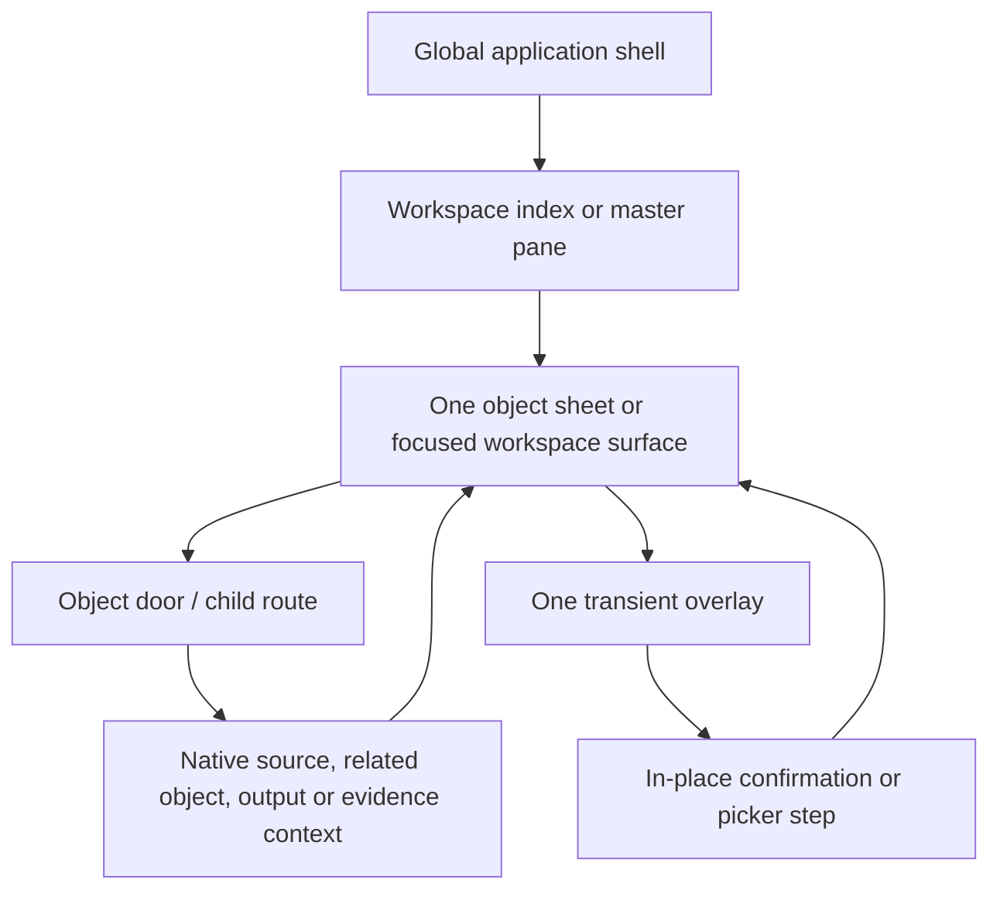

# THE INTERACTION SPEC — Cedar's application surface

**Scope:** the [Cedar candidate](../app/src/prototypes/cedar/README.md). Shared kit components remain
reusable; another candidate defines its own interaction model and adopts this contract explicitly.

**Status:** canonical interaction contract within Cedar's proposal beneath
[THE-ARCHITECTURE.md](THE-ARCHITECTURE.md) and
[THE-SYSTEM-SPEC.md](THE-SYSTEM-SPEC.md). It specifies how a person moves through, reads, edits,
and recovers across Rocoto’s shared surface. It does not claim that the current browser kit has a
production backend, live connector, or durable workflow.

## INTX-00 · Authority and boundary

This document owns cross-sheet interaction, navigation, layers, focus, layout posture and the
propagation of visible state. It does not rename or weaken a domain fact:

1. Architecture decides object ownership, source of truth and supersessions.
2. System Spec decides business state, commands, permissions, error semantics and the Product,
   Customer and Albarán control registries.
3. This document decides where those controls appear, what stays visible, whether a use is a route,
   menu, popover, dialog or sheet, and how context/focus/drafts survive a transition.
4. Product, catalogue and intelligence specifications decide their detailed controls within this
   surface contract. The wiring tasklist proves implementation.

Rocoto continues to use the current theme’s type, spacing, elevation, radii, colours and motion.
This is not a second design system. The measured geometry below freezes the shared app behaviour
that makes the domain controls usable across widths.

## INTX-01 · Shared surface graph

The application has one ordered visible surface stack. A later layer never creates a second copy of
the object under it.

1. **Global application shell** is always rendered for the active tenant, except when an explicit
   full-screen, accessibility-safe take-over is required. It contains the workspace navigation,
   active tenant/member context, authorized utilities and the job/connection/realtime state.
2. **Workspace surface** is the list, dashboard, catalogue, source inbox or administration area
   selected by **Sales**, **Stock**, **Customers** or **Administration**. It owns its filters and
   selection; it never owns a second editable customer/SKU/albarán copy.
3. **Object sheet** is the main surface for one Product, Customer or Albarán. Its object heading,
   route context, lifecycle state and permitted primary action are visible without hover. Its
   section anatomy and copy live in `PRD-*`, `CUS-*` and `ALB-*`.
4. **Object door** is a navigable relation: a customer, SKU, albarán, source, lot/equivalence,
   output job or evidence item. It carries stable object ID, tenant scope, origin and permitted
   relation context. It is a link or button with an accessible name, not an unlabelled card.
5. **Transient overlay** is used only for focused edit, selection, confirmation, short reference
   detail or a bounded job state. It has one owner, one return target and one scrollport. A child
   route is preferred when the person needs to read native source/history at length.

### What is always visible, conditional, or revealed on intent

| Surface element | Always rendered when its state permits | May be revealed on hover/focus | Never hidden behind hover alone |
|---|---|---|---|
| Workspace navigation | current workspace, active target, accessible label; phone bottom navigation / desktop rail | desktop tooltip for a collapsed icon | workspace name, active state, current route |
| Object sheet frame | named back control, object heading, lifecycle state, current freshness/pending marker, primary action or precise unavailable reason | source/provenance detail may expand | identity, blocked state, destructive/lifecycle consequence |
| Section | heading, primary permitted action, state/empty/loading/denied copy | secondary row action can become visually quieter on fine-pointer hover | row state, relationship, error/concern, keyboard access |
| Row | main object name/fact, state/provenance that changes meaning, primary door | contextual `More … actions` trigger may become more prominent | the same menu trigger on focus/touch, a row’s actionable status |
| Form | heading, field labels, required/optional status, value/default, inline error, Cancel/save action | helper/example can appear on focus and remains available to assistive technology | validation, save disabled reason, conflict or permission state |
| Concern | exact affected source/field/line boundary, **its own name in the red with its line-mark** (§196.3), text explanation, permitted dismissal **pinned at the right edge** | extended evidence/source link | red scope, actual blocker, text explanation, the flag's own name |

Fine-pointer hover adds orientation, never capability. Touch and keyboard receive the same named
control, state and outcome without having to hover. A tooltip describes an already available
control; it cannot contain a unique action, blocker, customer/source fact or required instruction.

## INTX-02 · Navigation, object doors, and return context

### Route and history contract

1. A workspace, object sheet, source/evidence context, search result and output job has a stable
   tenant-authorized route. Browser Back/Forward follows the user’s actual route stack, including
   the object selected and its opening context.
2. A user-initiated object door adds a history entry. Changing a local disclosure, hovering,
   receiving a realtime projection update or refreshing a read model does not.
3. A context carries only what the next view needs: origin object/workspace, permitted relation
   ID, list query/filter/page/selection and scroll restore point. It does not put protected source
   text, money, contact data, credentials or arbitrary tenant IDs in the address.
4. Direct entry or reload resolves the stable object route first. If the original context is gone
   or unauthorized, the sheet provides its safe default return: **Back to sales**, **Back to
   catalogue** or **Back to customers**.
5. A source route is subordinate. **Open original conversation** and **Open related email** enter
   a native-source context whose return control names the actual Product or Albarán. Supplier email
   never changes the primary Stock navigation seat.

### Posture-specific movement

| Posture | Door behaviour | Back behaviour |
|---|---|---|
| Desk, 1440 px and wider | master and object panes may stand together; opening a row changes the object pane and preserves master filters/selection | back clears the object-pane selection or returns to the exact prior object route |
| Compressed desk, 1096–1439 px | both panes remain where their measured floors fit; the sheet uses its compact reading measure | same as desk; no phone furniture is stretched into the workspace |
| Stacked desk, 560–1095 px | one master/detail pane is visible at a time; a door pushes the detail in the desk chrome | visible **Back to …** restores the master’s state; browser Back does the same |
| Phone, 559 px and below | one column and bottom navigation; an object/source flow is a pushed sheet or full-screen context | top **Back to …** returns to the immediate origin; bottom navigation remains a workspace switch, not a hidden Back button |

### Focus, scroll, and draft return

1. Opening a new object sheet moves programmatic focus to its heading and resets only that sheet’s
   scroll to its heading. Returning moves focus to the exact origin door and restores its stored
   scroll position after the projection is ready.
2. Opening an editor focuses its heading or first invalid field; opening a picker focuses its
   search field. Closing a menu/popover returns focus to its trigger. Closing a dialog returns to
   the trigger unless a successful save replaces it with an inline updated field, in which case
   focus lands on the changed field’s summary.
3. Every editor owns one local draft tied to object ID, field set, base revision and tenant. A
   sheet route does not silently commit or discard it. Leaving a changed editor asks **Discard your
   changes?** with **Keep editing** / **Discard changes**; returning restores the same draft when
   its tenant/object/revision policy permits.
4. Tenant switching, sign-out, hard deletion/redaction and a revoked permission remove unsafe
   drafts/cache. Offline eligible drafts remain separately marked **Not saved yet** and are never
   shown as projection truth.
5. Realtime changes update non-edited read facts after their permitted cursor arrives. A change to
   a field under edit produces the System Spec’s named conflict surface, retains the draft and
   makes no automatic high-risk merge.
6. **Request history return.** Product **Requested personalisations** stores an opaque return token containing the
   permitted Products query/filter, selected record/sheet, scroll anchor and initiating door.
   Opening the row pushes the exact Albarán/line. Its Back control and browser Back restore that
   token after the Product projection is ready; an expired token falls back to the exact Product
   Sheet. It never returns to a generic catalogue root or exposes source text in the URL.

## INTX-03 · Controls, pointer parity, keyboard, and visible state

### Geometry of interactive targets

- Every directly tappable control has a minimum 44 × 44 px hit area. The desktop rail’s and
  phone-navigation row height is 44 px and 64 px respectively; an icon may be smaller only inside
  that target with an accessible text name.
- Rows with a primary door keep the whole stated row target and do not place a hidden action over
  editable text, a source link, a product door or another nested control. A nested control stops
  only its own event and identifies its outcome.
- A compact control may have a visually small label but cannot shrink its target below 44 px, even
  in a dense list. Numeric entry uses the domain’s explicit field geometry; it is not converted to
  an icon stepper by a narrow screen.
- Keyboard focus uses a visible 2 px theme-coloured outline with sufficient contrast. It appears on
  `:focus-visible`, not as a mouse-only hover effect. The focus outline may sit inside a bounded
  row only if it remains unambiguous.

### Control state matrix

| State | Visible contract | Interaction contract |
|---|---|---|
| Resting | label/value and current factual state | activates on click/tap/Enter/Space according to native semantics |
| Hover / pressed | modest theme-state feedback only | no new hidden action or protected information; pressed feedback never substitutes acknowledgement |
| Keyboard focus | 2 px visible focus outline and exact accessible name | Enter/Space/arrow behaviour follows native link/button/menu/listbox semantics |
| Disabled | visible label plus adjacent, exact reason | cannot receive a command; remains focusable only where assistive technology needs the reason, otherwise reason is associated to the next reachable control |
| Loading | section/control-specific **Loading …** copy and skeleton/progress | do not reissue the command; unrelated safe navigation remains usable |
| Saving | **Saving [object]…** | final action is disabled only for its command; Cancel follows the explicit command-cancellation policy |
| Unknown network outcome | **Checking save…** / **Checking issue…** | resolution is idempotency lookup; user cannot create a duplicate command |
| Validation failure | field error and summary in plain language | focus moves to summary then field; draft remains editable |
| Conflict | changed object/field and comparison door | read latest/reapply is deliberate; no silent high-risk merge |
| Permission / unavailable | exact capability/state reason | protected values/counts are not exposed through hover, title attributes or DOM-only text |
| Offline | stale timestamp plus **Not saved yet** on eligible draft | prohibited commands cannot be queued or visually claimed as complete |

## INTX-04 · Overlay, menu, picker, and dialog contract

The surface uses the smallest layer that can complete the current decision. Opening a layer always
moves focus and creates a clear return path; no layer may make the underlying sheet’s scroll or
draft state ambiguous.

1. **Inline disclosure** is for readable evidence already attached to its section: details/history,
   insight evidence, price/stock history and short source metadata. It changes neither route nor
   focus unless deliberately opened by keyboard, then exposes a labelled expanded state.
2. **Menu** is for a bounded set of valid sibling actions, such as **More customer actions** or
   **More albarán actions**. It is anchored to a visible text-labelled trigger; Arrow keys move
   items, Escape closes it, and menu state is not persisted in browser history. If a touch/phone
   surface has insufficient safe room, the same menu opens as a named action sheet with identical
   order and labels.
3. **Popover** is for a short, non-destructive lookup/preview tied to its trigger: unit conversion
   summary, row provenance or short status detail. It must fit without horizontal clipping, close
   on Escape/outside activation, and expose no edit that needs a second dialog. A long native source,
   audit log or related object is a route/sheet instead.
4. **Picker** is a focused selection state inside its owning editor: product search, tariff,
   contact owner, customer, lot or unit. It has a heading, search/filter field where needed,
   labelled empty/loading/error state, listbox semantics and **Cancel**. Selecting one result
   returns to the original editor with the selection uncommitted until that editor’s specific Save.
5. **Dialog** is for an editor, high-impact confirmation or compact review. It has one title,
   purpose/consequence, one internal vertical scrollport, labelled close/Cancel action, focus trap,
   Escape behaviour and a final named command. It never opens a second modal above itself.
6. **Full-screen sheet** is for a phone or stacked-desk flow that needs sustained reading/editing:
   native conversation, full output status, product/customer/albarán detail or a multi-step
   review. It has a top named Back/Cancel and one body scrollport. A phone full-screen sheet does
   not leave a hidden active dialog behind it.
7. **Confirmation step** from an editor replaces the editor’s body in the same dialog/sheet. It
   retains the draft behind the review and gives **Back** / **Keep editing** rather than nesting a
   new dialog. An object door inside an overlay either opens its own full route after an explicit
   **Open …** action or is a read-only summary; it cannot silently abandon unsaved work.

### Overlay state and closing rules

- At most one modal/dialog/full-screen sheet is active. Menus and popovers close before it opens.
- A modal owns only its own scroll. The sheet behind it is visually inert and does not scroll under
  touch or keyboard; no global `overflow` side effect creates a competing scroll container.
- An outside click/tap closes only a non-destructive menu/popover. A changed editor, issue review,
  archive/merge/void confirmation or external-send review requires its named Cancel/Back path.
- A picker’s **New product** route preserves the original form’s unsaved context and enters
  `PRD-C01`. **Save proposal** may return without an SKU; only the separate reviewed SKU-confirmation
  command returns a reviewed SKU. It does not write an arbitrary product into the calling line.
- A permission or revision change while an overlay is open leaves its text/draft readable where
  safe, replaces its final command with the exact unavailable/conflict state, and never submits an
  old intention.

## INTX-05 · Cross-sheet and external-state propagation

A projection refresh must show a change where a person expects it, but it must not blur different
truths or rewrite an issued snapshot. The table is a visibility contract; the authoritative
command/event rules remain in the System Spec.

| Authoritative accepted change | Surfaces refreshed after their cursor | What remains unchanged / honest |
|---|---|---|
| SKU identity, alias, Internal category, Related products or archive state | Product Sheet header/details, catalogue/search, draft product pickers, customer frequent-product doors | issued albarán SKU snapshot; category/group and Related products never inherit SKU price/stock/art; a stale draft gets review/conflict |
| SKU tariff/price change | Product prices/history, eligible new/draft albarán price suggestion, customer product availability note | issued line/document price; other tariffs unless deliberate **Set by percentage** command selected them |
| Physical receipt/count/variance/depletion/lot event | Product **Recorded balance**, lots/history and appropriately scoped stock views; current allocation/availability calculations | daily estimate, supplier claim and demand prediction; no unacknowledged local count becomes truth |
| Reservation/allocation/release | dated **Available to promise** / allocation views and affected draft albarán warning | **Recorded balance**, lot receipt history and an external delivery promise |
| Supplier-confirmed inbound / source link | Product **Expected delivery** / related emails, source inbox, reviewable linked albarán source context | physical balance and Available to promise until a physical receipt is recorded; this source row is not a customer promise |
| Daily stock estimate or demand prediction | Product planning/insight presentation with owner/version/freshness | recorded balance, lots, availability and a promise to customer |
| Customer contact/detail/status change | Customer Sheet, customer search, editable unissued albarán customer/delivery suggestions | issued customer/delivery snapshot; consent is never inferred from a display refresh |
| Customer action change | Customer Actions list/row/history and linked-object summary | albarán state; no action completes because a delivery happens |
| Albarán line/state/source/concern change | Albarán Sheet, customer upcoming/history, exact-SKU order history, sales list, stock availability/allocation as applicable | issued document snapshot; concern scope other than the exact target |
| Document issue/correction/void | Albarán document section, customer history, SKU history/insights, output centre and export eligibility | print/reprint money calculation; a correction never alters the prior issued record in place |
| Output request/provider receipt/failure | output row and relevant Albarán/document status | a queue/submission is not labelled printed, emailed, delivered or synced without receipt |
| Role, connection, retention or tenant change | navigation, allowed actions, open sheets and job/source doors immediately re-authorize | protected current data remains hidden; old tab/draft cannot retain authority |
| AI proposal/evaluation/image-job state | proposal/evidence card, related product/source/concern context and job status | authoritative SKU/customer/albarán/inventory state until a permitted domain command is accepted |

### Conflict and presence across surfaces

1. Presence names only a permitted viewer/editor and broad action area; it is advisory and cannot
   lock a sheet or claim ownership of a field.
2. A source or AI evaluation may mark one exact albarán field/line as checking. It must not dim,
   block or resolve unrelated fields. A Customer or Product Sheet sees the same source/proposal as
   related evidence, not as an independent fact.
3. An issued albarán always reads its own immutable snapshot even while the current Product or
   Customer Sheet changes under it. A direct link labels the relationship and opens the current
   object in a new context.
4. Invalidation banners name the affected object/action: **This price changed while you were
   editing**, **This customer is now paused**, or **This source is no longer available**. Never
   use an unexplained global refresh.

## INTX-06 · Responsive geometry and reading measure

The application follows a four-posture continuum. It reflows live as browser width changes and
never uses a stretched phone layout on a tablet or horizontal page overflow as a fallback.

| Posture | Width | Shell and pane contract |
|---|---:|---|
| Desk | ≥ 1440 px | two panes can show full anatomy; expanded rail is 208 px when the user has it open; the measured 1600 px product view has a 772 px master and 620 px sheet pane |
| Compressed desk | 1096–1439 px | two panes compress honestly; rail may be 64 px collapsed or 208 px when room/persisted choice permits; content never invents a phone rail/bottom navigation |
| Stacked desk | 560–1095 px | 64 px collapsed rail, desk day/chrome, one master/detail pane at a time; measured product sheet widths are 960 px at 1024 viewport and 704 px at 768 viewport before the inner reading cap |
| Phone | ≤ 559 px | one column, bottom navigation at 64 px plus safe-area inset, pushed detail route; 390 px and 320 px examples retain 16 px outer page gutters and no horizontal overflow |

### Measured shared geometry

- Product, Customer and Albarán readable inner content is capped at **720 px including its own
  horizontal padding**, centred in a wider pane. On a wide or stacked table-sized pane this yields
  a maximum **680 px** text/control column after the 20 px desktop padding on each side. It stops
  tablet rows becoming an unscannable 960 px line.
- Sheet content uses **20 px** horizontal padding on desk/stacked desk and **16 px** on phone. At
  390 px that makes a 358 px sheet surface with a 326 px inner column; at 320 px it makes a 288 px
  sheet surface with a 256 px inner column. Do not add a second nested side gutter.
- Current object heading measure is **28 px** type with **36 px** line height. Body text remains
  **16 px**. Long names wrap; they do not reduce below the body scale, overlap a control or force
  a horizontal scroll.
- Section separation uses the current theme scale. Measured product Stock begins after **24 px**
  and its rows use **12 px** gaps; the contained insight card has **16 px** padding and a **12 px**
  radius. Customer and Albarán sections use these existing surface patterns rather than bespoke
  card systems.
- Task dialogs use the **800 × 600 px** landscape frame in INTX-11. The viewport clamps it;
  header and final actions remain outside the body scroll. The price field retains its large
  numeric entry style inside this frame, with product/tariff context beside it on a desktop and
  above it on a phone. This supersedes the old 480 px price dialog.
- The target phone frame has **8 px** viewport insets, giving **374 px** at 390 px and **304 px**
  at 320 px. A 16 px body gutter leaves **342 px** and **272 px** respectively. There is no second
  nested modal gutter. Keyboard/short-height states scroll the body while retaining reachable
  actions; measured release evidence must verify this, not infer it from the CSS.
- The desktop header in the measured view uses 16 px vertical and 20 px horizontal padding; phone
  header uses the 16 px page gutter and a 12 px lower separation. Shell/pane measures are not
  duplicated inside a sheet.
- The measured 1600, 1024, 768, 390 and 320 px views have no horizontal overflow. This remains a
  release requirement for all shared states, including long names, inline errors, red concerns,
  price editors, source attachments, tables and menus.

## INTX-07 · Accessibility, motion, and reading safety

1. All route changes, overlay opens/closes, validation summaries, save/unknown-outcome/conflict
   changes and source/AI evaluation updates announce through appropriate semantic live status.
   Announcements name the object/action and never repeat private source content.
2. Menus use menu semantics only for action menus; selection uses listbox/combobox semantics;
   field groups have legend/labels; date/quantity/money controls state unit/currency/precision to
   assistive technology. A red concern has its target relation in text and programmatic metadata.
3. Escape closes a menu/popover, returns focus, and never commits. Escape in a changed editor asks
   the same discard question as its Cancel path. Enter only invokes the safe focused control; it
   cannot issue, void, archive, merge, dispatch, deliver or send external communication without the
   explicit final confirmation.
4. Hover affordance is ignored under coarse pointers. Motion respects reduced-motion preference:
   no essential state is communicated only by animation, transitions are removed or reduced, and a
   resize goes directly to the correct posture without a transient wrong layout.
5. Loading skeletons have the right section label and do not become an endless motion barrier.
   Rows/cards with data visualisation provide readable text/table equivalents. Contrast, focus and
   target checks apply to all normal, disabled, concern and external-job states.

## INTX-08 · Required interaction evidence

A feature cannot pass visual review merely because a static sheet looks correct. The release
record must include reproducible evidence that:

1. every `PRD-*`, `CUS-*` and `ALB-*` leaf has a visible/resting, keyboard-focus, touch, loading,
   empty, save/failure, conflict, permission, offline, archive/deleted/redacted state where it is
   applicable;
2. all object doors preserve tenant authorization, stable return context, focus and scroll across
   Product ↔ Customer ↔ Albarán ↔ native source ↔ evidence/output flows;
3. menu/popover/picker/dialog/sheet nesting follows `INTX-04`, keeps one scroll owner, traps and
   returns focus correctly, and preserves/discards drafts only by the stated path;
4. a command/event/receipt causes the exact refreshes in `INTX-05`, with no issued snapshot,
   physical-stock/estimate, source/normalized fact, or queue/receipt confusion;
5. desk, compressed desk, stacked desk and phone pass at 1600, 1024, 768, 390 and 320 px with no
   horizontal overflow, 44 px target minimum, readable content cap, safe-area bottom spacing and
   no hover-only action;
6. screen-reader, keyboard-only, reduced-motion, high zoom, slow-network and reconnect runs cover
   the same surface graph; and
7. the wiring task graph records these results against `INTX-01` and the owning domain control
   IDs. A design-kit pass is visual evidence only until the production command/projection/receipt
   contract also passes.

## INTX-09 · Workspace anatomy beyond the three object sheets

This section gives literal surface anatomy for the shared workspaces that surround Product, Customer
and Albarán Sheets. It supplies the interaction contract where a domain canon has deeper rules:
[THE-CATALOGUE-CONTRACT-SPEC.md](THE-CATALOGUE-CONTRACT-SPEC.md) for catalogue/source,
[THE-STOCK-LOTS-SPEC.md](THE-STOCK-LOTS-SPEC.md) for LOT-01,
[THE-EXPORT-CANON.md](omitted-sources.md) for export interaction, and
[THE-SYSTEM-SPEC.md](THE-SYSTEM-SPEC.md) for production authority. It is a target specification,
not a claim the current kit or any provider implements all of these paths.

### Global shell, navigation and work controls

~~~text
Tenant application
  → top/side shell
    → active tenant
      → Switch tenant menu
    → primary workspaces
      → Sales | Stock | Customers | Administration
    → global work controls
      → Search | Notifications | Help and support | profile menu
    → utilities
      → Stock update | New product | Upload | Export
~~~

| Control | Opened surface, fields and exact behaviour |
|---|---|
| **Active tenant** | A named button. Menu lists only memberships the person may open, each name plus **Current** where applicable. **Switch tenant** asks **Leave this draft?** only if a current-tenant changed editor exists; on switch it clears prior tenant routes, caches, presence and unsafe drafts before loading the next tenant. |
| **Sales / Stock / Customers / Administration** | Native navigation links, not buttons pretending to be links. Active workspace is visibly selected and announced. A unavailable item remains labelled with adjacent reason: **You do not have access to Administration.** |
| **Search** | Opens **Search Rocoto** picker. Field **Search customers, products, albaranes and sources**; results show type, stable permitted identity, state and one safe context line. Empty **No matching records**; loading **Searching…**; failure **We couldn’t search right now. Try again.** Selecting result opens its object door and retains query on Back. |
| **Notifications** | Opens **Notifications** panel with unread/read grouping, time, safe object door and **Mark all as read** only if policy permits. An empty panel says **You’re up to date.** A notification is not evidence that an external job succeeded; delivery/job rows retain their own receipt state. |
| **Help and support** | Opens **Help and support** sheet: **Search help**, **Contact support**, **Report a problem**, **Keyboard shortcuts**, **Service status**. Contact/report forms have **What do you need help with?**, optional object reference, **Tell us what happened**, and **Send**; source/customer content is attached only after explicit review. |
| **Profile menu** | **My profile**, **Accessibility**, **Sign out**. Accessibility opens preference controls rather than changing document/business data. Sign out confirms only when unsafe draft needs dismissal and clears tenant data. |
| **Stock update / New product / Upload / Export** | Each opens its own named route. It never appears as an unnamed item inside another object menu and cannot silently inherit a different object’s permission or state. |

The shell uses the existing 208 px expanded or 64 px compact rail on desk, the 64 px navigation
posture on phone, 44 px minimum direct targets, and the 20 px desk / 16 px phone content gutters
from INTX-06. At 560–1095 px, a workspace door pushes the detail pane and **Back to [workspace]**
restores filters/scroll; it must not force a phone bottom-navigation layout.

### Products, New product and source-evidence anatomy

~~~text
Products
  → toolbar
    → Search products
    → Filters
    → New product
      → Add one product
      → Add a product list
        → Drop/choose a file | Paste a product list | Take photo (phone)
        → Catalogue intake review queue
  → coded SKU or uncoded sale-item row
    → Product Sheet
      → Internal category feedback
      → Related products inline picker → exact existing SKU
  → separately gated Stock update
    → incoming supplier/source feed
    → native source detail → return to exact SKU
~~~

| Surface/control | Exact labels, fields, menus and state |
|---|---|
| **Search products** | Placeholder **Search products, codes or aliases**. It searches exact authorized coded SKU/current aliases and accepted uncoded literal wording in the current tenant. Loading **Searching products…**; no result **No products match that search.** It does not select an Internal category/group or Related products as a product. |
| **Filters** | Search remains visible beside one compact **Filters** trigger. The trigger opens a contained desktop popover or a phone bottom sheet; it does not create separate Sort or archive controls. Its draft groups are **Sort by** (**Source order** default / **Category** / **A–Z**), **Items** (**SKUs** / **Uncoded**), **Status** (**Current** / **Archived**) and **Related product** (**Any item** or one explicit direct related-product value). Source order preserves tenant/import order and default rows have no Internal category. Every choice remains draft-only on desktop and phone. **Apply** changes the list atomically; **Clear** resets the draft to Source order / SKUs / Current / Any item. The resting trigger may show only a compact applied count/summary. It never says **Show [N] products**, applies a checked choice immediately, or renders disabled stock filters in the order-review profile. |
| **New product** | One shared task frame. **Add one product** collects **Product name**, **SKU** and **Unit** through the same live fields the Product Sheet carries (§196.1 · §195's checkout-grade consistency) — and **no class field** (§197.2), then has an identity-only manual review. **Add a product list** has a collective readback: each row shows and edits only **Product name**, **SKU**, **Unit** and **Include**/**Skip** beside its retained original locator/wording. Internal category may be stored as a quiet suggestion/default and is reviewed later on the Product Sheet; neither intake route makes category, artwork status or Source & history a per-product task. Neither ordinary route asks for Category, Placement, manual group filing or Related-products candidates. |
| **Add a product list** | Entry is inside **New product**. The one input surface offers **Drop/choose a file**, **Paste a product list**, and **Take photo** on phone. Excel/CSV create the same ordered **Catalogue intake review** queue; a selected PDF or photo without a connected extractor says so and asks for a supported source or manual row review without inventing an OCR result. It has no mapping controls before results. The queue states are: **Ready for input**, **Reading source**, **Review needed**, **Ready**, **Save failed**, **Added**. Each source row keeps literal source-row evidence beside its processed readback and explicit **Include**/**Skip** state. The operator confirms the readback; **Add** commits only included rows. Duplicate canonical SKUs block confirmation until corrected or skipped. Raw bytes/text and previews are session-only; an unavailable source asks for reselect/paste/photo again. |
| **Internal category / Related products** | Internal category is a quiet classification/browse context. **Related products** is an inline direct existing-record picker (coded or accepted uncoded). The two are independent: category co-members do not appear as related. The picker is the only relation-writing path and never creates a SKU or opens a creation modal. |
| **Category feedback** | **Discuss category** appears on category hover/focus and in its touch-accessible menu. Opens a contextual internal conversation with **What seems wrong?**, affected products, editable message and **Send feedback**. It is a proposal/review path and never reclassifies a category from a casual click. |
| **Source evidence** | A Product Sheet contains only exact-SKU source cards and their empty/unavailable states. When inventory/supplier intake is independently enabled, the supplier/source feed lives inside **Stock update**, never as a peer Products seat. A source card opens authorized native context and has **Back to [Product]**; it does not create inventory facts by sender/name match. |

Catalogue arrow keys and Home/End skip structural Internal-category headings. In a desktop split view they
select an exact row and update its adjacent preview. In a narrow single-pane view they move focus
without opening or hiding the list; Enter or Space opens the focused row through its native button.
Internal-category headings own no artwork, stock, price, selection state or Product Sheet door.

### Stock work surface and LOT-01 door

~~~text
Stock → Product Sheet → Stock
  → Recorded balance
  → Receive stock | Record a stock count
  → Lots
    → Assign stock to lots
    → lot rows / Unassigned stock
    → Stock history
  → Daily stock estimate
~~~

**Assign stock to lots** is an explicit physical-attribution action with a fixed Recorded balance.
It must never be labelled **Allocate stock** or open an Albarán chooser. Its typed lot-number
selection, quantity slider plus exact input, total/unassigned summary, new-lot flow, source/reason,
concurrency, history and mobile accessibility are defined by LOT-L01–LOT-L07 in
[THE-STOCK-LOTS-SPEC.md](THE-STOCK-LOTS-SPEC.md). Albarán-line **Allocate stock** is the distinct
fulfilment commitment flow at LOT-A01–LOT-A08.

### Messages and native-request anatomy

~~~text
Sales → Messages
  → conversation list
    → Search messages | channel/status filters
  → read-only conversation
    → channel header / participant
    → source timeline
    → reasoned ReplyAttention tray when required
    → one-destination unvalued Albarán card
    → native Open chat / Open Gmail / Open Outlook handoff
~~~

⚠ **That future profile arrived: FEED-IA §196.7 / §196.8 (E193.08–09) add the composer, and MSG-26
/ MSG-27 below are its contract.** The projection above still describes the SOURCE — read-only,
provider-custodied — and the composer stands beside it rather than inside it. What §196.7 lifts is
only the clause forbidding a writing surface; every non-claim MSG-25 makes about delivery, receipts
and provider custody stands unchanged.

| Surface/control | Exact labels, fields, menus and state |
|---|---|
| **Search messages** | Placeholder **Search messages**. Filters **Channel**, **Needs reply**, **Date**, **Assigned to**. It returns authorized provider conversations, not a copied business record. |
| **Conversation list row** | Channel icon/name, safe participant/title, last-message preview, timestamp, unread/needs-reply state and primary **Open conversation** door. Hover may reveal **More message actions**; touch offers same action sheet. |
| **Conversation header** | Channel name, participant/customer where permitted, **Open albarán**, **Open customer**, **Open product** when exact related ID exists, and **More conversation actions**. The object doors preserve return context. |
| **Native source timeline** | Original messages, media/attachment doors and precise source time in channel order. It distinguishes transient original content, unavailable source and system summary; raw email/file contents are not durably cached by Rocoto. It cannot transform a summary/AI proposal into a message that was actually sent. |
| **Reply composer** | Only on a connected, permitted, reply-capable channel. Fields **Message**, optional **Attach file**, optional **Internal note** when policy provides it. Actions **Send reply**, **Save draft**, **Discard draft**. Read-only forwarded/imported mail says **This message is read-only. Open the original channel to reply.** |
| **Send review** | Replaces composer body in same sheet: channel, recipient, message/attachment list, policy warning and **Back to edit** / **Send reply**. Send state **Sending reply…**, receipt state **Reply sent** with provider receipt time, failure **We couldn’t send this reply. Your draft is still here.** |
| **Message actions** | **Mark unread**, **Assign**, **Add internal note**, **Link to existing record**, **Report source issue**. Actions apply only to exact conversation/message and never modify an Albarán line or customer field without separate command. |
| **Expanded view** | **Expand messages** opens full-screen/deskside source context; **Collapse messages** restores list scroll/selection. Opening Albarán collapses the source pane but reopening restores conversation and draft safely. |

For an Albarán, native source stays a readable, channel-correct section rather than a parallel
business object. WhatsApp-style controls appear only where actual channel capability permits them;
email shows thread/subject/attachments. A simulated composer or tick must never stand for a provider
connection or delivery receipt.

### Export, print, packing, files and integrations anatomy

> **Superseded by [THE-OUTPUTS-SPEC.md](THE-OUTPUTS-SPEC.md) OUT-02 and OUT-04** (E200 · FEED-IA §202).
> One library of templates, and one print screen holding Preview and Edit on the same paper. The history below is kept.

The current detailed interaction authority is [THE-EXPORT-CANON.md](omitted-sources.md), subject to
Architecture/System Spec supersessions for authoritative money, document snapshot and receipt rules.
The centred **Export center** is one bounded output workspace, never a screen-sized list or a
collection of unrelated panes. It has three explicit destinations: **Print**, **Email** and
**Files**. They start with the same applied date/salesperson/order scope and each names a distinct
outcome. Albarán/Packing print cards sit side by side on desktop and stack on phone; their document
kind, selected template and output status remain separate. Connection setup and provider
qualification still live in Administration **Connections**; a job/provider path is target
behaviour until its own receipt/recovery evidence exists.

~~~text
Sales or Albarán → Export center
  → Print
    → Saved copies | Templates → Use template → configure copy | Albaranes | Packing lists
    → Print remaining | Print all | Preview
  → Email
    → Saved copies | document copy / scheduled delivery | recipient, channel and schedule review
  → Files
    → Saved copies | Recent files | Templates → Use template → configure copy | current-data file setup
Administration → Connections / roadmap
  → operation-specific destination cascade
~~~

| Surface/control | Exact labels, fields, menus and state |
|---|---|
| **Albarán header** | Lifecycle **status** is visible text and is itself the door to a compact chronological **Activity** trail. Adjacent header controls are icon **Activity**, direct **Print**, direct **Flag**/**Unflag**, and direct **Archive** when each is permitted. Flag is its own durable actor/time ledger event and Activity shows both Flag and Unflag. It is never a synonym for Mark unread: viewed/read remains a separate opening-derived state. The three-dot trigger is reserved for rare secondary actions only; it must not contain Print, Activity, Flag, Archive, a status explanation, or the primary lifecycle action. Direct actions name their target in the confirmation/review surface and never claim an output result. |
| **Print** | A direct named entry in the Albarán header and Sales-day toolbar opens the **Print** destination in Export center. The landing state has separate **Albaranes** and **Packing lists** cards (side by side where they fit, stacked on a phone), rather than mixing their counts or paper models. Each section shows **Remaining [N]**, **All [N]**, **Preview**, **Print remaining**, **Print all**. The eye/Preview is always available when a renderable snapshot exists; looking is not printing. |
| **Print remaining** | Review states selected documents, page format, printer/profile and count. Button **Print [N] remaining**. It creates one output job per selected print identity; repeated press while in progress says **Printing…** and resolves/replaces according to job idempotency, never silently duplicates paper. |
| **Print all** | Review says **Print all [N]** and distinguishes previously printed/reprinted rows. It is deliberate; it does not inherit a hidden “remaining” filter. |
| **Packing lists** | Separate stack with **Preview packing list**, **Print remaining**, **Print all**, truck/route/date context and accurate packing count. Template selection owns **1 column** or **2 columns** and **Route order**, **Customer A–Z**, **Order value**, or **Lifetime value** within each truck; there is no vague **Edit layout** entry point. Two columns pair complete order blocks into independent lanes; they never split an order or cross a truck run. The captured print profile freezes template revision, columns, sorting and source values for preview, retry, activity and reprint. It cannot reuse Albarán preview as its layout. |
| **Preview** | Eye button label **Preview [Albarán/Packing list]**. Opens read-only preview in same dialog/sheet surface with **Back to print**, page count, document/profile revision and safe download/print door only where allowed. Preview never issues, marks delivered or changes money. |
| **Saved copies** | Print first shows a centred responsive grid: one card on a narrow phone, two on a compact desktop, and up to four cards before it grows to another row. Each card names its saved copy, destination, source template/version, paper/file/email settings and short scope summary. **Use**, **Preview** and **Edit saved copies** are direct doors. The grid is never a favourite toggle; changing a saved copy cannot rewrite its source template, an earlier copy or output history. |
| **Templates** | **Templates** opens a standard gallery of default, organisation and permitted custom templates compatible with the active destination only; switching Print, Email or Files changes the gallery, never the saved copies already configured for another destination. The Email gallery starts with **Subcontractor delivery pack** and **Daily albaranes to accounting**; cards state their provider/profile posture honestly. **Use template** opens the shared configuration step and creates an independent saved copy with name, destination, source template/version, scope chips, permitted fields/columns, settings and connection profile. **Build your own with Copilot** creates only a reviewed proposal that the user owns and can configure; it cannot silently create a schedule/send or alter another template. A template is never an output attempt and an output attempt never mutates its template. The gallery owns template creation and editing, replacing the ambiguous label **Edit layout**. |
| **Email** | **Email** is a first-class destination beside Print and Files. A saved Email copy names recipient rule, channel, attachment/revision, schedule and policy before submission. Its card exposes **Send history** on hover/focus outside the editor. Scheduled Email owns a separately versioned schedule with cadence/timezone, next run, active/paused state and history; **Edit schedule**, **Pause**, **Resume** and **Remove schedule** are reviewable. Before a send, show the final rendered draft and any unusual/new change note for review; that is a deferred-runtime seam, never an implicit AI send. **Email requested**, **Submitted to the message service**, **Accepted by the message service**, **Delivery status unavailable** and provider receipt/failure remain distinct. It never treats opening Email, a due schedule, or a browser handoff as a sent message. |
| **Files** | **Files** route has **Saved copies**, **Recent files**, **Templates**, **Search files**, date/type filters and **Open file**. Empty **No files yet**. A saved copy records the permitted output configuration, not protected source/customer data beyond its authorization. |
| **Spreadsheet templates** | E191 supersedes the old fixed seven-template promise. **Files → Templates** is the destination-scoped gallery: default, organisation and user-owned recipes may include CSV or Excel where a real renderer supports it. Every card names format, purpose and available scope; **Use template** creates an independent configured saved copy. A template preview names its columns, date/filter scope and empty/projection state. The Kit currently proves the configurable **Order file** CSV recipe; it does not fabricate six unavailable Excel renderers or imply that dormant source modules are reachable. |
| **Create file setup** | Fields **What do you need?**, **Date**, **Date range**, **Include**, **Format**, **File name** and selected template. Defaults are explicit; Cancel makes no file. Final action names the file: **Create Excel file** or **Download Rocoto CSV** only where the selected profile supports it. A file setup does not contain a send control; customer-document delivery belongs to the separate Email destination. |
| **Output history / Activity** | Status and its icon **Activity** open the same compact chronological trail. Rows show request time/actor, selected immutable snapshot and template/profile revision, target, attempt/reprint relationship and outcome. Empty **No output activity yet**; failure **We couldn’t complete this output. Your selection is still here.** A requested browser dialog, generated bytes or a download start stays requested/unconfirmed; only explicit human confirmation or a verified provider/printer receipt may advance the relevant outcome. |
| **Roadmap** | **What Rocoto can connect today** is an honest read-only status list: **Available**, **Setup needed**, **Planned**, **Not available**. It is not a sales promise and does not fabricate a connection button. |

### Connections and roadmap, outside active destinations

The **Email** destination is a customer-document action, not an integration-setup substitute. Print,
Email and Files do not gain generic ERP tabs. The path for a future or connected operation lives in
Administration **Connections** and the read-only **What Rocoto can connect today** roadmap. It is
shown per operation, never as a generic export mode.

| Surface/control | Exact labels, fields, menus and state |
|---|---|
| **Operation connection** | Select an operation such as **Send to accounting system**, **Send customer copy**, **Send with delivery**, or **Create a file**. Header states current posture: **Ready to connect**, **Setup needed**, **Ready**, **Sending**, **Receipt recorded**, **Failed**, or **Unknown outcome** with last safe timestamp. |
| **Destination cascade** | In this order: **Set up yourself**, **Ask a partner**, **Connect a provider**, **Create a file**, **Do it manually**. Each route says its prerequisite and opens a setup or guide surface; it never claims a provider sync from a queued file or a research result. |
| **Connection setup** | Provider-specific sheet has account/organization selector where permitted, requested scopes, verification step, **Back**, **Cancel**, **Connect**, **Test connection**, and **Save connection**. Credentials remain in the approved connector boundary and are never rendered in product docs or ordinary pages. |
| **Connection activity** | **View activity** shows operation, selected snapshot, attempt, receipt/failure and retry status. **Retry** uses idempotency; **Use file instead** opens the Files route with current scope. |
| **Roadmap** | **What Rocoto can connect today** lists **Available**, **Setup needed**, **Planned**, **Not available**. It is read-only, does not make a sales promise and never substitutes a connection control for an unavailable integration. |

### Administration settings anatomy

~~~text
Administration
  → Organization
  → Operations
  → Commercial
  → People and security
  → Connections
  → Notifications
  → Billing
  → Data and privacy
  → Test, support and audit
~~~

Every settings route has heading, one-sentence purpose, current saved value, **Edit** or named
primary action, local draft, **Cancel**, **Save [section]**, save/failure/permission/conflict state
and immutable history/audit door where setting affects documents or operations. A generic
**Manage** label is not acceptable.

| Section | Literal form/menu anatomy |
|---|---|
| **Organization** | **Organization details** → fields **Trading name**, **Legal name**, **Tax identifier**, **Registered address**, **Billing email**, **Country/region**, **Language**, **Timezone**, **Currency** → **Save organization details**. Required-field errors name field; timezone/currency change previews document/business-day effect and preserves historical snapshots. |
| **Operations** | **Locations** list → **Add location** → **Location name**, **Address**, **Stock enabled**, **Default for new stock**, **Delivery notes** → **Save location**. **Delivery and stock policy** → cutoffs, delivery zones/routes, traceability policy, allocation exception policy, evidence policy; each change has effective time, affected-record count and review. |
| **Commercial** | **Tariffs**, **Tax categories**, **Units and equivalences**, **Customer price policy**. Each registry has search, active/retired filter, **Add**, row **Edit**, history, and retire confirmation naming affected SKUs/customers. Unit equivalence form uses source unit, target unit, factor, precision, scope, source and effective date; unknown conversion remains unknown. |
| **People and security** | **Members** → **Invite member** → email, role, optional message → **Send invite**. Row menu **Change role**, **Resend invite**, **Remove member**. Role editor lists each capability and its consequence; an owner transfer has new owner, reason and confirmation. No member action can remove final required owner. |
| **Connections** | List groups Mail, ERP, printing, delivery, storage and billing. Row has status, last check, last receipt/failure, **Set up**, **Reconnect**, **Test connection**, **View activity**, **Remove connection**. Setup uses provider-specific authorization sheet and ends with verified receipt/health state, never a guessed Connected label. |
| **Notifications** | **Notification preferences** → per-event channel controls, quiet hours/timezone, recipient groups, digest frequency, escalation policy → **Save notification preferences**. A disabled channel explains missing connection/permission. |
| **Billing** | **Plan and billing** → current plan/status, seats/usage, billing contact, payment-method state, invoices, change/cancel door. Payment data stays with approved payment surface; Rocoto does not render secret card details. A payment issue states affected access/future action clearly. |
| **Data and privacy** | **Data retention**, **Export tenant data**, **Privacy requests**, **Delete or close tenant**. Export requires scope, format, secure delivery and review. Close/delete shows affected data, retention/legal constraints and typed confirmation **Close [organization name]**; it creates governed request/job, not immediate silent erasure. |
| **Test, support and audit** | **System checks**, **Audit log**, **Support access**, **Release status**. Audit filters actor/object/action/date/outcome and opens authorized safe event detail. Support access requires scope, expiry and visible active banner; test connection/output produces labelled test result, never business event. |

### Cross-workspace state and disclosure rules

| State | List/workspace behaviour |
|---|---|
| **Loading** | Name what is loading: **Loading catalogue…**, **Loading messages…**, **Loading files…**, **Loading settings…**. Keep unrelated safe navigation available. |
| **Empty** | State what is absent and give only valid next action: **No source evidence yet**, **No files yet**, **No team members yet**, **No connected services yet**. |
| **Saving / working** | Name specific act: **Uploading file…**, **Creating Excel file…**, **Saving location…**, **Sending invite…**. Disable only duplicate final action. |
| **Unknown outcome** | **Checking [act]…** then idempotency/receipt lookup; never show success and offer a blind duplicate retry. |
| **Failure** | Name operation and preserve selection/draft: **We couldn’t create this file. Your selection is still here.** |
| **Conflict** | Name changed setting/object and compare latest/draft. High-impact setting, source link, stock or document acts cannot silently merge. |
| **Permission/restricted** | Show exact capability/state reason without exposing title/count/source data that is protected. |
| **Offline** | Local drafts may show **Not saved yet** where policy permits. Provider, physical stock, document issue/send and destructive administration actions never become complete offline. |
| **Archive/redaction/deletion** | Preserve safe history/reference where retention requires; current controls explain unavailability and do not open a substituted record. |

Workspace cards and rows use the existing surface rhythm: 16 px body text, 12 px internal gap for
compact product patterns, 16 px card padding/12 px radius where the current contained card pattern
applies, 20 px desktop and 16 px phone page gutters, 44 px direct targets and the 720 px inclusive
reading cap. Dense export/template/settings tables may scroll horizontally only inside a labelled
data-table region with a usable compact card alternative on phone; the page itself must not overflow.

## INTX-10 · Line discussion and compact output panel

| Control | Surface, copy, geometry and state |
|---|---|
| **ALB-X01** | Product-title row: **Add note**/**Edit note** opens **Line note** on **Delivery note**. Save/Remove note explicitly changes outward draft wording; failure retains draft. The button and any row expand/collapse/thumb action are at least 44 × 44 px. |
| **ALB-X02** | Product-title row: **Comments** icon with accessible product name and populated label/count. Opens the exact-line author/time thread; no auto-promotion. Its card-in-row hover/focus area matches the card geometry and the whole visible affordance is keyboard/touch reachable. |
| **ALB-X03** | Right-side 400 px panel (phone full width), viewport scroll, subject header and **Close**. **Comments**/**Delivery note** tabs; Escape/Back closes only this layer, Forward restores subject/tab; focus returns to trigger. The composer tray carries the same scoped concern reason and dismissal/re-evaluation lifecycle as its source card. |
| **ALB-X04** | Internal textarea **Write a comment…**, helper **Only your team can see comments.**, action **Comment**, disabled blank. Customer textarea **Write an instruction for this delivery note…**, helper **Shown on this delivery note and in customer confirmations.**, **Save note**/**Remove note**. Both 500 characters, multiline, Ctrl/Cmd+Enter saves. A sent message re-evaluates only its related concern and retains prior note history. |
| **ALB-X05** | Header (FEED-IA §193.5 supersedes the chevron-only pager): the albarán head is `position: sticky` on every posture and holds two states in one element — the full head at rest (Back on phone/stacked, Status · Activity · Flag · Archive, identity with map, state row, truck and tariff; Print and the workflow verb in the head on a desk) and a **compact** 56 px state once the paper has scrolled under it (hysteresis: in past 120 px, out under 72 px; a document with under 240 px of travel never compacts): Back where the posture has one, WHO at LabelLarge with an ellipsis, WHEN plus the place in the walk as a stated sub-line («Saturday 23.08 · 07:30 · 3 of 16»), the attention pill, and on a desk the truck chip, tariff and **Print**. No Previous/Next buttons anywhere on the sheet: a phone swipes horizontally on the sheet, a desk keeps ← / →; the position is stated, never controlled. **Actions** names the former ellipsis menu. |
| **EXP-X01** | Navbar summary opens below trigger, aligned right: 800 × 600 px normal /1160 px expanded, desktop edge 24 px/top 64 px; phone edge 8 px. Height is bounded to the viewport; only the content scrolls. Trigger exposes expanded state and panel ID. |
| **EXP-X02** | **Print** has albarán and packing cards side by side desktop, stacked phone. Real scoped paper previews use 174 px desktop/154 px phone frames and actual aspect ratio; labels/actions stay above. No repeated dummy paper. |
| **EXP-X03** | Print/Email/Files, day/all-day scope, A4/A5, profiles, queue, counters and email/ERP semantics remain unchanged by layout. Smaller previews cannot change records/jobs or imply provider completion. |

Albarán arithmetic occupies at most 420 px on desktop: quantity/unit, rate and total in readable aligned groups. Phone uses available width and preserves separate quantity/unit targets and validation. Customer note is attached below product; internal discussion/review machinery consumes no row space until opened. Full stock, product-stat and outbound views remain inactive outside the Meta-window capability gate; their unavailable state must name the gate and preserve the current order context, never show a stale count, callable send control or implied live transport.

## INTX-11 · Connected task anatomy

This section is normative UI detail, not runtime evidence. The implementation task graph maps
every ID below to a leaf with its own failure and release proof. Labels are operator-facing;
architectural explanations stay here or behind an intentional evidence door.

### Shared task frame → header → content → actions

| Control | Geometry and resting state | Interaction, state and recovery |
|---|---|---|
| **UTL-M01** | Task card: 800 px wide, **as tall as the step inside it, up to 600 px** — radius/shadow/border from Base theme. Normal desktop gutter 24 px; the card clamps to viewport minus 48 px. Export may align below its navbar trigger at top 64 px. ⚠ E193.21 · FEED-IA §131 «Why is there so much space there?» and §182.2 «content fits the frame» SUPERSEDE «600 px high»: 600 is the CEILING now, never the height. The card declares `data-workflow-fit="content"`, carries `height: auto`, and the only white under a step is the scrollport's own gutter — measured, on the tree that shipped it, at 367 px (New product · choose, 1600) · 305 px (Stock update, 1600) · 571 px and 466 px at 390. This is Base's own Modal law returning: Base sizes a modal to its content and caps it, and the fixed height was Rocoto's override. | Product/customer creation, stock changes, prices, assistant and export use this frame. Steps replace content within one focus boundary, and the frame's height follows the step — two steps of one task are two heights. A frame that scrolls its body while it is SHORTER than its ceiling is the old fixed box wearing a new name. Tiny confirmation popovers, object sheets, the comment sidebar and full media viewers remain distinct named surfaces, not random task sizes. |
| **UTL-M02** | Header ≥64 px; title at HeadingXSmall; optional concise subject or step beneath. Left **Back** chevron only when there is a parent step; right **Close [task]**, both ≥44 × 44 px. Directional icons always point toward the direction they perform. | | Back changes only the current task step and keeps its draft. Close ends that task, subject to dirty/unknown-outcome policy. Escape follows the same guarded close. Back/Forward restores the named layer and selected subject; never closes an unrelated order or chat. |
| **UTL-M03** | Content flexes with `min-width/min-height: 0`, one vertical scroll, desktop 24 px / phone 16 px padding — and that padding is the ONLY white a step may leave under itself (UTL-M01). Fields use minmax(0,1fr) grids; names/errors wrap. | No nested viewport-height form inside a modal; no submit button below an unreachable inner scroll. Large tables have an intentional contained horizontal scroll with fixed identity/header, never whole-page horizontal overflow. |
| **UTL-M04** | Footer ≥68 px, fixed after the body, 16 px vertical/24 px side padding. One primary write; related secondary and Cancel actions. Phone actions wrap in DOM order without truncation. | A disabled write must have a discoverable validation reason after interaction. Busy locks duplicate submission, not reading/copying. Completion names accepted objects and returns to the intended next step; “Done” cannot claim an external result. |
| **UTL-M05** | Phone (≤559 px, the app's own `PHONE_MAX`): the frame is **docked to the bottom edge, full width, and rises to its step**, capped at the whole visual viewport; top corners rounded, bottom corners on the edge it sits on; it comes up from below and goes back down. ⚠ E193.21 SUPERSEDES the full-screen phone sheet: a task owns the screen when its step needs the screen, and a short step is a sheet — §197.3's «inline on a desk, a slide-up sheet on a phone… as per usual», one level up. The scrim is the height of the VISUAL viewport, not the layout one, so a docked sheet's floor is the top of the keyboard and never behind it. | Verify 1280 × 800, 1440 × 900, 1024 × 768, 390 × 844 and 320 × 740 plus keyboard/zoom. Navigation, expand/collapse and thumb controls are ≥44 px; every other direct target is ≥40 px and frequent mobile actions are ≥44 px. Focused input and failure copy remain reachable. |
| **UTL-M06** | Dirty draft, in the same frame: **Keep editing** / **Discard changes**, plus a valid **Save** only when it is actually supported. Error sits beside the failed field/action. | Outside click, Back, Close, Escape, sector switch and route navigation cannot silently drop edited business fields. A stored draft is tenant/subject scoped. Uncertain save says **Checking save…** and reconciles the original request ID; retry never invents another identity. |
| **UTL-M07** | Menus are anchored to their owning control; selected value is visible before opening. Searchable long selectors use a combobox; short choices a select. ⚠ E193.01 · FEED-IA §196.1 makes every CMS-like PRODUCT field a combobox regardless of list length — Code, Unit, Description, Internal category, Group, Related products and both New-product identity fields are one shared `LiveField` (`app/src/prototypes/cedar/live-field.tsx`) that offers the house's own values, filters as the person types and accepts the typed word as new. A product field never opens a dialog to change one word, and the Product Sheet holds no disclosure. | Menu Escape returns focus to its trigger. Popover selection does not create a second full modal. A subtask with its own write uses a named same-frame step and returns to the parent with acknowledged data. Independent saved changes are not silently undone by parent Cancel. |
| **UTL-M08** | Concise noun title, persistent field labels, verb-specific actions. No “what Rocoto knows”, architecture lecture or debug status in the work area. | Skeleton/empty/invalid/offline/permission/stale/unavailable/unknown states are distinct. Status describes known facts; evidence and methodology are intentionally opened details, never a wall of default helper text. |

### Insights → chart card → exact evidence

| Control | Screen and click target | Expanded content and limits |
|---|---|---|
| **UTL-I01** | **Sales patterns** / **Insights** section on a subtle 24 px square grid using low-contrast theme borders. Cards stand above it on a solid surface; labels remain readable without the grid. | The grid groups data; it is not a plotting axis. Responsive cards use equal columns where they fit and one column on phone. No background grid on the whole Product Sheet. |
| **UTL-I02** | Each chart card is one keyboard/touch button with descriptive title, current value/unit and stated window. A plotted line/bar never doubles as an unlabeled separate action. | Opens the same-frame chart detail for the exact SKU or customer, metric and date range. **Back** returns to the same card/scroll; underlying sheet is unchanged. |
| **UTL-I03** | **Sales**, **Quantity**, **Customers**, or a named tariff chart shows only supported observations. Separate histories per tariff, no blended “price trend”. | Detail includes chart, labelled axes, date filter, source counts, accessible values table and exact albarán/customer doors. A tariff switch changes the selected history, not commercial data. |
| **UTL-I04** | Empty **No sales yet**, **No price history**, or **Not enough history**. One observation remains one point, not a fabricated trend. | Missing dates/data are not zero sales unless the observation window is complete. Mixed non-equivalent units are separate series; predictions are labelled and include evidence/confidence/as-of when supplied. |
| **UTL-I05** | **Set price** in price detail opens the selected SKU/tariff editor; related customer/order opens that stable sheet. | A chart click cannot edit a price, set stock, send a quote, manufacture history or overwrite the active albarán. Source permission and stale-projection states carry through every drilldown. |

### Assistant → conversation → scoped proposal → outcome

| Control | Placement, label and visibility | Flow and command boundary |
|---|---|---|
| **UTL-A01** | Navbar **Assistant** with assistant icon; phone icon with accessible **AI assistant**. Stock toolbar secondary **Report supply issue**. Category **Discuss category** on hover/focus, always available on touch. | All enter one assistant with explicit product/category/order context. Support stays separate. Covering a customer chat must keep its unsent text and selection; assistant Back/Close restores that context without sending it. |
| **UTL-A02** | Copilot head: the name, **Sessions** (where the rail is not beside), **New session**, Close — every control ≥ 44 px. The sessions rail stands beside the conversation at ≥ 1728 (216 + 416 + the 1096 two honest panes need — E193.16) and over the thread, never over the head, below that. Default opens on a useful question and the starters, not an empty generic data form. §196.2 replaces «Back» with the absence of modes. | Sessions are per tenant/operator authorization, show actual titles/time and open complete owned messages, proposal/evidence and outcomes. New session keeps the filed ones and starts with no inherited recipients or approval. A door pressed and abandoned files nothing; a session survives a reload; every row can be forgotten. |
| **UTL-A03** | Composer **Ask the Copilot, or start a report**; one box with the writing surface above a control row; dictation mic beside a send that is always present and dimmed while empty. | Dictation appends its returned text to the latest composer value for review; it never sends audio or replaces concurrent typing. Unsupported/unconnected dictation is honest — **Runtime offline**, said beside the box — and typing remains usable. Enter submits, Shift+Enter breaks the line; it never sends an external customer message. |
| **UTL-A04** | Supply report asks exact **Product**, **What happened?**, relevant **Available quantity** with stated unit, and **When?**. Unknown quantity is explicit; delayed inbound is not present physical stock. | Human-confirmed report becomes incident evidence and can generate a proposal even if the old ledger showed no shortage. It cannot itself count stock, subtract lots or reserve substitutes. A stock correction uses the separate stock workflow and returns with the report draft. |
| **UTL-A05** | Compact **Affected customers** cards show customer, exact order, delivery time, requested quantity/unit and proposed impact. Source line **Based on reported availability** where applicable. | Selection is explicit per order/recipient; counts distinguish unique customers and orders. Same customer with several orders retains each exact ID. **Open order** preserves assistant review for return. Unknown pack equivalence blocks quantitative promises and offers unit review; no open orders yields **No open orders affected**, not a pretend broadcast. |
| **UTL-A06** | **Review affected orders** shows exact order/customer cards, the reason each is affected and a suggested note for the operator. | Review pins incident/evidence/order revisions. The order-review profile offers native **Open chat** or **Open email** only; it has no customer-send command. |
| **UTL-A07** | **Open chat** / **Open email** hands the operator to the actual provider. **Copy note** is secondary where useful. | No assistant turn, ordinary Send, dictation, review selection or tool card grants external-send authority. Customer outbound remains a planned capability. |
| **UTL-A08** | Activity records **Drafted**, **Reviewed**, **Opened provider**, **Dismissed** or **Changed**. It never says Submitted/Delivered from a local click. | Provider activity is visible only if a later independently enabled integration supplies a verified receipt. |
| **UTL-A09** | Tool trails are short completed/pending/blocked rows such as **Checked 4 orders**, with a disclosure for evidence and errors. | Summaries derive from actual tool results. No chain of thought, fake progress, invented provider execution or raw tool payload dumping. Cancel stops unsubmitted work; already accepted external acts remain visible. |
| **UTL-A10** | Category report retains exact category/products and original words; suggestion card shows before → after and affected SKU count; **Apply change** separate from conversation Send. | Revalidation checks all exact tenant SKU/category IDs. Applying classification changes no original SKU code/name, price, stock, artwork or history. A casual complaint does not change taxonomy. |
| **UTL-A11** | An incident shows **Active**, **Monitoring**, **Resolved**, or **Dismissed**, last evidence/time and reviewable history. | New stock/source/order evidence reevaluates impact without silently sending another message. Resolution from actual evidence and manual dismissal with free text are separate events. Reopening/scope expansion needs fresh review; no erasure of earlier customer communications. |
| **UTL-A12** | Reopened conversation restores its reviewed proposal and per-recipient result, never stale send enablement. Failure banner preserves the working text. | Own-authored history may persist by tenant policy; incoming raw mail/files remain provider-owned/transient. Storage failure cannot display a durable “saved” state. Tenant switch, permission loss, concurrency and retention/redaction have explicit recovery. |

### Files → gallery → custom template → columns → file

| Control | Layout and exact action | State and consequence |
|---|---|---|
| **EXP-B01** | **Templates** is a standard contained gallery inside the centred Export center, with a quiet boundary and individual default, organisation and permitted custom-template cards. **Use template** opens configuration for an independent saved copy; the Export landing state shows the responsive saved-copy grid outside this subview. | Opening the gallery preserves selected date/scope and the active destination, with one Back control. Cards are content, not the modal’s outer frame. Selected card has visible/focus state and concise document-kind, permitted field and source-template summary. |
| **EXP-B02** | Template preview within the gallery shows current scoped rows/columns and format. Empty data is labelled; footer action is **Use template**, never a direct Download/Create file. | A template preview is recipe evidence only. The configured saved copy and generated file share one field mapping/snapshot. No hardcoded sample masquerades as current data. Long tables scroll in their container. |
| **EXP-B03** | Footer **Don’t see what you need?** immediately beside icon actions **Build your own** and **Chat with us**. | Build opens the custom recipe step; support opens its separate chat without sending catalogue/customer data automatically. No far-away orphan help copy. |
| **EXP-B04** | Custom recipe has **Template name**, selected **Data**, and a horizontal row/grid of column cards. **Add column** adjacent to the cards. | Data choice changes available fields with explicit handling of incompatible existing columns. Name is required before saving; an empty field list cannot produce a file. |
| **EXP-B05** | Each column card contains drag handle, editable output heading, chosen source field and adjacent downward chevron, revealed on hover/focus and persistent for touch. | The chevron opens that column's field selector with current selection. Search groups authorised fields by subject; choosing one changes only that column. Unknown/private fields cannot be invented or exported. |
| **EXP-B06** | Drag cards to reorder; insertion point visible. The same card menu offers **Move left**, **Move right**, **Remove column** with edge actions disabled. | Keyboard/touch alternative gives the same result as drag. Removal/reordering affects only the recipe draft until Save. IDs follow columns across moves; values never move independently of headers. |
| **EXP-B07** | Live preview reflects selected field, renamed heading and order. Recipe acts **Save template**, **Cancel** / **Back**; **Use template** then opens the output-copy configuration. | Save records a tenant template/version, not data, an output copy or a file. Validation, quota/storage/network failure retain columns/name. Duplicate template-name policy is explicit; file generation checks current scope anew. |
| **EXP-B08** | **Use template** creates a saved copy with meaningful name, destination, source template/version, scope/filter chips, permitted fields/columns, settings and connection profile. **Edit saved copy**, **Duplicate**, **Archive** and **Edit saved copies** act on that copy; they never alter the template. | Copy/version updates do not rewrite earlier files/history or an output attempt. Unsupported/retired source field shows **Update this template** and identifies the column before a new copy can be used. |
| **EXP-B09** | Date/scope stays visible beside the output action; **Full day** is daily default, with explicit remaining/date-range choices where supported. | All-day means the chosen business day and allowed records, not browser calendar time. Stock snapshots cannot pretend to reconstruct historical counts. Download-started is not local-disk-save, email or ERP acceptance. |

### Print → immutable attempt → physical confirmation → reprint

| Control | Visible state/action | Snapshot, failure and accounting |
|---|---|---|
| **EXP-P01** | Print starts with saved-copy cards and a **Templates** gallery. **Use template** configures a copy before it can print; the copy supplies the column/group/sort/paper choices. Albaranes and Packing lists remain separate with bounded real paper previews, **Print remaining**, **Print all**, page format/copies. | Each count names documents/pages/copies correctly. A truck divider precedes its captured documents; packing splits by truck and supports one or two captured columns. Two-column lanes keep each complete customer-order header and its pick lines together. Albarán and packing render different real content. |
| **EXP-P02** | A normal Print press opens the browser print dialog for a captured source-rendered document; working state **Preparing print…**. | Capture subject IDs, exact content/profile revision, format, copy count, target and bytes/hash once. Fonts/images are ready or have an explicit safe fallback before submission. Concurrent presses cannot overwrite another pending attempt. |
| **EXP-P03** | **Print dialog opened · Awaiting confirmation** after calling the browser print API. | Neither timer, focus return, dialog close nor `afterprint` proves paper output. `window.print()` returns no physical receipt. Blocked popup/failed preparation has **Try again**, retaining the same attempt and immutable content. |
| **EXP-P04** | **Confirm printed** on that attempt, naming format, documents and copies; actor/time then visible as **Confirmed printed by [actor]**. | Explicit human attestation or verified printer receipt may complete an attempt. Confirmation is idempotent and can only attest what was captured; a false report is corrected with an auditable reversal, never deleted history. |
| **EXP-P05** | Previous output appears as **Printed**, **Changed since printing**, or **Print awaiting confirmation** with actor/time/revision in history. | A materially changed albarán becomes remaining for its new revision. Unchanged confirmed output is excluded from remaining. An unresolved browser attempt is shown for review, not automatically dispatched again. |
| **EXP-P06** | Deliberate **Print again** on one item / **Print all again** in the explicit all menu; review includes previously confirmed count. | New attempt ID, same selected immutable revision/profile unless the operator deliberately chooses a newer one. It adds an attempt, not another order or invoice. Number of attempts and confirmed physical copies are different metrics. |
| **EXP-P07** | **Activity** sits beside the albarán/run print status. It opens a compact chronological trail with requested/confirmed time, named person, subject/revision, A4/A5, copies, target and outcome. Requester and confirmer can be different people. **Open copy** opens captured content; **Try again** retries only the same known unsubmitted/preparation-failed attempt. | Never resend successful items in a partial run. Unknown outcomes require reconciliation/explicit new reprint decision. Canceled system dialog cannot be detected reliably and stays unconfirmed until a person records it. |
| **EXP-P08** | Connected-printer status is separate from selected print profile and current job. Normal web mode names browser printing. | Standard browser printing uses the system dialog. Silent printing requires a separately installed/managed, authenticated printer bridge or controlled kiosk capability, explicit setup and operational evidence. No hidden browser flag, guessed printer health or default security bypass. |
| **EXP-P09** | Albarán toolbar, P shortcut, day batch, preview and Export centre use the same capture/attempt service. | Keyboard print must obey the same review/permission rules and advance only as designed without losing a failed attempt. Printing never reprices, issues, emails, syncs ERP, archives, or dispatches an order as an implicit side effect. |

Browser capability references: [Window.print](https://developer.mozilla.org/en-US/docs/Web/API/Window/print)
opens the browser dialog and returns no result proving physical completion;
[afterprint](https://developer.mozilla.org/en-US/docs/Web/API/Window/afterprint_event) also runs when
print preview is closed. These facts govern the receipt model, independently of visual design.

### MSG-24-HISTORICAL · Outbound-template reference states — superseded by MSG-25

Messages is a transient workspace. Its visible navigation marks are icon-only 48px targets: one **New message**, one **Hide sidebar** beside the sidebar, and one **Expand workspace**/**Collapse workspace** at the workspace edge. **New message** opens a compact two-path choice: **Message a customer** searches the real WhatsApp conversation book and opens the chosen composer; **New test chat** opens the isolated test selector. At expanded desktop width the workspace occupies the viewport inset and blurs inactive work behind it; on a phone it covers the active screen, including bottom navigation. Minimise/restore retains thread, draft, scroll position, sidebar posture and reply target. Opening an albarán parks that snapshot; only a browser return to its source route restores it. A later unrelated route clears it.

**Outbound entry and chooser.** **New message** is one icon-only 48×48 px control with an accessible name and tooltip. It opens a compact 420 px choice card titled **New message**, with an icon-only **Close** control and exactly two bounded, keyboard-focusable choices: **Message a customer** (**Choose an existing WhatsApp conversation.**) and **New test chat** (**Try a message without contacting a customer.**). The first opens a 560 px **Message a customer** selector: an autofocus **Find a customer** search field, a 48×48 px icon-only Back control, and a contained result list of real, non-test WhatsApp conversations only. Each row names the customer and channel; **Reply window closed** is a quiet state cue where current evidence says so. It is not a provider claim or an alternative send path. An empty query result says **No customer matches “[query]”.** No selector creates a contact, conversation, draft, provider connection or secondary store.

The choice’s Close/Escape returns focus to **New message** after its focus lock is released. Selector Back returns to the choice without losing its context; selector Close/Escape returns to **New message**. Choosing a customer closes the chooser, opens that exact existing thread, then focuses the ordinary composer. Choosing **New test chat** opens the existing isolated test selector and never creates a real outbound conversation. These transitions work at desktop and phone width; a phone chooser remains inside the same active Messages surface and never exposes the footer navigation beneath it. Choice and result rows use inherited text styling, visible hover/focus treatment, contained scrolling and no page-level horizontal overflow.

Conversation ground is a pale brand dotted field. Incoming bubbles are neutral grey; customer-facing outgoing bubbles use brand red with accessible light text. A source email and a condensed order are individually bounded cards. Ordinary internal tool outcomes are compact trails without notification dots. A response-required item is a dismissible drawer tab protruding from the composer; its dismissal requires the existing free-text rationale and retains ordinary concern evidence. **Read order** is the active verb.

Email has individual thread cards. Its only primary actions are **Reply** when the connected provider permits it and **Open Gmail**/**Open Outlook** using the provider mark and an external deep link. A separate labelled history icon opens the customer communication sheet; no card background opens history. Forwarded/imported mail is visibly read-only. Provider reply receipt/failure owns truthful state; a reference UI must not claim a local send is provider execution.

The WhatsApp 24-hour state is a provider-evidence gate, never an AI decision. The user starts in the ordinary conversation: search/select a customer or open an existing thread, write the intended message, then press Send. The send boundary checks fresh provider evidence. An open window sends through the normal permitted-channel command; a closed window opens the shared task dialog; missing, stale or unavailable evidence blocks free-form sending and offers Retry. The composer text, reply target and attachment selection stay unchanged while that check or dialog is active.

**Closed-window dialog.** Use the shared 800×600 desktop task frame (maximum 8px viewport inset, full-screen on phone), one scrollport, a quiet `WhatsApp` step label, the title **Reply window closed**, and the sentence **WhatsApp requires an approved template because the last customer message was more than 24 hours ago.** Close/Escape returns focus to the composer and preserves the intended message. The dialog never repeats internal IDs, model reasoning or provider jargon in visible copy.

| State | Body | Footer actions | What remains saved |
|---|---|---|---|
| Approved fit | **Suggested approved template**, human template label + language, and the exact rendered customer message in a bounded preview. Revision/provider IDs stay in evidence, not operator copy. | **Send template** | Intent remains until the reviewed rendered template is accepted. Sending may clear it only when that rendered message includes the complete intent. |
| No approved fit, approved hello available | **No approved template fits this message**, an **Approved hello** preview, and one sentence saying the draft remains. | **Create a template**, **Send hello** | Sending hello sends only that exact greeting. The original intent remains in the composer until the customer replies and reopens the service window. |
| No approved fit and no approved exact-language hello | Same no-fit heading, with no fabricated preview. | **Create a template** | Entire intent remains. |
| Create template | Same dialog becomes **Create a WhatsApp template**, with a Back chevron. Required fields are **Template name**, **Message type** (`Utility`, `Marketing`, `Authentication`), **Language**, and **Message**. A live **Preview · [language]** renders the named details used; raw braces or unresolved variables block submission. Empty required fields say **Add a template name and message.** Malformed/unclosed variables say **Close each template variable with }}.** | **Back**, **Submit for approval** | Template draft and the separate composer intent both survive Back, close, minimise, route return and retry. |
| Submitting | Fields stay visible and read-only while the request is in flight. | Disabled **Submitting…** | Idempotency key and draft revision are retained; a repeated press cannot create a duplicate. Closing during this brief state must settle the same thread’s saved review to Pending, never strand a local **Submitting…** view. |
| Pending | Show **Awaiting WhatsApp approval. This message stays here until it is approved.** The dialog may close. Fields and Back stay non-editable/non-destructive. | Disabled **Awaiting approval** | Pending submission is recoverable from this conversation and its activity trail. It cannot become sendable from elapsed time or a local refresh. |
| Rejected / paused / disabled | Show the provider state and actionable feedback. Rejected may return to an editable revision; paused/disabled can only be replaced or resolved by an authorized channel administrator. | **Edit template** or **Close**, as allowed | Intent, provider receipt and prior revision remain. No Send action appears. |
| Failed / evidence unavailable | State what failed without claiming delivery. | **Retry** and **Close** | Intent and last safe template draft remain. Retry reuses the idempotency key where the prior result is unknown. |

**Matching and message ownership.** Semantic matching may rank approved templates but cannot approve one, alter its immutable body or infer the 24-hour window. Exact locale, enabled state, variable schema and provider evidence must pass before a candidate appears. The match view deliberately shows the rendered outcome rather than technical variable machinery; the create view exposes only fields the operator can change. Each transition produces a quiet conversation activity item—window intercepted, template submitted/pending/approved/rejected, template dispatch accepted/failed—with actor and time. It never appears as a customer message until the channel provider accepts that outbound request.

The reference kit deterministically demonstrates closed-window approved-fit, no-fit/approved-hello, create, submitting and pending states. It marks provider revision, locale, blocked lifecycle states and `reference_only` evidence in non-visible test metadata. It makes no WhatsApp/Meta/provider call and must never present its local transition as provider approval or delivery.

**Authority and visibility.** The New-message chooser is visible only to members allowed to view the conversation book. **Message a customer** is enabled only with the channel-send permission for that tenant/channel; without it the operator sees the account’s ordinary read-only conversation route and a concise permission explanation, never a simulated send, template form or provider state. Template creation, submit, replacement and administrator-only remediation remain independently permission-gated. A permission, policy, consent or evidence failure never discards the composer intent; it names the blocked action, gives the authorized next step where one exists, and creates no outbound attempt.

Accessibility: drawers and review cards use labelled dialogs, Escape/close returns focus to the composer, keyboard focus remains visible, all icon-only controls have aria labels/tooltips, and sender/background contrast meets the shared text standard. The New-message choice and customer selector likewise return focus deterministically as stated above. Analytics records `message_workspace_opened`, `sidebar_toggled`, `workspace_resized`, `email_history_opened`, `email_native_opened`, `email_reply_attempted`, `whatsapp_window_intercepted`, `whatsapp_template_reviewed`, `whatsapp_template_submission_state_changed`, `whatsapp_outbound_entry_opened`, `whatsapp_outbound_customer_selected` and `whatsapp_outbound_entry_dismissed`, with tenant, actor, thread, source/template revision and result; never raw message body.

### MSG-25 · Messages and native communication handoff

> **Superseded by [THE-OUTPUTS-SPEC.md](THE-OUTPUTS-SPEC.md) OUT-05** (E200 · FEED-IA §202).
> «Open chat» and «Open the email» open the app’s own surfaces, and one email door replaces the separate communication-history icon. The history below is kept.

MSG-25 is the live order-review interaction contract. MSG-24-HISTORICAL is preserved only as design
history for a possible later customer-outbound capability; none of its composer, New message,
sidebar or Meta-template controls may render in the order-review profile.

Messages is a source workspace with exactly two postures: **collapsed** and **expanded**. There is
no hide-sidebar posture, New message flow, Meta-template dialog or in-product customer send.

⚠ **«customer composer» left this sentence with FEED-IA §196.7 (E193.08)** — «emails can be answered
in the chip or by hitting reply and answering in the composer otherwise it's whatsapp» — and the
composer's contract is MSG-26 below. The SOURCE is still read-only and still provider-custodied, and
there is still no in-product customer send: the composer hands the words to the channel's own door
and the app delivers nothing.

#### Frame and geometry

- Collapsed desktop has two deliberate sizes. The conversation panel is 400 px wide and
  min(78vh, 720 px) high; the conversation-book panel is 640 px wide and min(84vh, 760 px) high.
  Both keep a 24 px viewport edge and share the launcher's corner.
- Expanded desktop occupies the viewport with a 24 px inset, the shared large radius, a soft deep
  shadow and 7 px backdrop blur over inactive application content.
- At 767 px and below both postures resolve to one full-screen conversation surface; bottom
  navigation is hidden and safe-area padding applies at the bottom.
- Controls are 48×48 px and sit on the actual outer header edges: Back chevron left; one posture
  toggle and one Collapse chevron right. No duplicate expand, text **Chats**, or **Hide sidebar**.
- Expanded desktop's conversation book is 400 px. Conversation content is centred in the remaining
  area with a readable maximum. Dots cover the whole conversation ground and use only a pale
  brand-red tint.
- Restore retains thread ID, scroll anchor, source route and collapsed/expanded posture. Opening an
  albarán parks that snapshot; returning restores it. An unrelated route clears it.

#### Object boundaries

Conversation rows use a whole-row rounded neutral hover/focus state like WhatsApp. Name, true
last-message preview, timestamp and outgoing ticks stay within the one row. Unread uses a count or
dot only where there is a real unread state; dots never decorate actions.

Incoming and prior outgoing messages use neutral bounded bubbles; brand red belongs to the pale dot
ground and attention accents, not a customer-message fill. Message, email and order objects have a
1 px quiet boundary and a stronger soft shadow only where they float above the ground. Hovering a
message or order card changes its whole rounded container, never an isolated word.

A condensed albarán card is unvalued. Header: delivery day and document number on the left, one text
action **Open** at the top right. Body: exact product name plus quantity/unit; unresolved lines show
their proper field, provisional or multiple-choice state. There is no euro total, bottom **Open
albarán**, expand icon, customer link or second destination. Previous/next controls belong to the
opened Albarán Sheet.

#### Reply attention and bottom dock

A ReplyAttention renders as a tray immediately above the bottom dock, nearly the dock's full width.
It states the reason, for example **Reply needed · The customer asked which size is available.**
The tray can coexist with line checks, has one dismiss action with optional free-text rationale, and
keeps its evidence scope. It is not a tiny **Needs reply** badge.

⚠ **E193.08 (FEED-IA §196.7) repeals «not an editor», and nothing else in this paragraph.** What
still holds, unchanged: WhatsApp shows the supplied official channel mark and an icon-free **Open
chat**; email shows provider identity, **Open Gmail** / **Open Outlook** and a separate
communication-history icon; individual email messages are bounded cards whose backgrounds never open
history; email remains provider-custodied and read-only in Rocoto; and opening the native provider
records only that the door was used, never that a reply was sent. The door moved onto the composer's
own channel line rather than standing as a second strip; its identity, its label and its destination
are the same.

#### The hybrid composer · MSG-26 (FEED-IA §196.7)

> **Superseded by [THE-OUTPUTS-SPEC.md](THE-OUTPUTS-SPEC.md) OUT-05.6** (E200 · FEED-IA §202).
> A connected house sends from Rocoto and the conversation gains its turn; the native door stays as the fallback. The history below is kept.

The customer thread's dock is a composer, and **the composer states its channel on the send
control** — the disc §196.7 names, which is always on the bar and wears the channel whether it is
ready or waiting.

⚠ **THE MIC HAS A SEAT OF ITS OWN BESIDE IT (E193.17, §196.7 read with §196.8).** It was one seat
with two occupants — the messenger idiom the kit Composer ships — and read together the two clauses
of §196 CANCELLED: a prefilled draft is `typing` from the first render, the seat then held Send, and
the transcribe mic was unreachable on exactly the messages that carry a draft. **The seat follows
what the mic is FOR.** A mic that RECORDS shares the seat, because the take IS the message and it is
an alternative to sending. A mic that DICTATES does not, because the take becomes words in the box —
something you do BEFORE sending, and often on top of words already there. This one dictates, so:

- **Send is always present**, dimmed while there is nothing to send, and the mic stands before it —
  `🎤 (➤)`, the Copilot editor's own order, ported.
- **The mic is a ring, not a second coloured disc** («add a transcribe mic button *like with
  copilot*», and the Copilot's is «a backgroundless mic beside it»). Two identical channel discs
  side by side read as two send buttons. Dictation is the same act on WhatsApp and on email, so a
  channel colour on the mic would promise a destination it never touches.
- **The waiting send is the channel standing back** — the same hue at a lower saturation
  (`channelTheme` repoints `buttonDisabledFill` too), never the app's neutral grey, so an empty
  composer still says which pipe it is pointed down.
- **Both keep the 44 px floor at every width**, and the writing surface grows to **seven** lines
  before it scrolls — the port's own ceiling, because a drafted reply is a paragraph the app wrote
  and the person has to read it before they trust it.

The channel itself:

| Channel | When | Control | Names |
|---|---|---|---|
| **WhatsApp** | the conversation carries a message that ARRIVED on WhatsApp, or the activation ledger's `whatsapp-connect` stands | the house's WhatsApp green | **Send on WhatsApp** · **Open chat** |
| **Email** | the account's channel is email, the conversation carries mail, **Reply** was pressed on a message, or neither WhatsApp evidence stands | mail blue | **Send by email** · **Open mailbox** |

Both colours are declared once, in `src/rocoto-theme.ts` (`CHANNEL_INK`), under the same bounded
licence the emulated WhatsApp pane holds: a channel is somebody else's mark, and the accent stays
reserved for Rocoto's own act. The paint reaches the send disc and the record disc through a scoped
theme (`channelTheme`) that repoints six button roles — the ready pair, the two press states and
the WAITING pair; no component learns what a channel is.

**Colour is never the only carrier.** The composer states `data-channel` and `data-because`, the
control's accessible name says the channel in words, and one quiet line under the box names the
channel, says why where a reason is worth stating — **WhatsApp starts the moment Meta confirms your
number.** — and carries the native door.

**What «hooked up» is read off.** Exactly two facts, both things that happened: the activation
ledger's `whatsapp-connect` («a verified provider callback bound the number»), or a customer's own
WhatsApp message standing in the conversation — nobody receives on a number nobody bound. A settings
toggle, a customer's stated channel and the live cohort are not evidence and are never read.

**The mic dictates.** Speech becomes words in the box through the kit runtime (Deepgram nova-3),
exactly as the Copilot's does, with the same honest states: **Transcribing…**, **Dictated N words
into the box. Edit it, then send.**, **Runtime offline · type the words here.** It dictates
on both channels because the app sends on neither — an audio payload would have nowhere to go.

**Nothing claims delivery.** Pressing the control opens the channel's own door carrying the words —
`wa.me`/`web.whatsapp.com`, the connected provider's compose window, or `mailto:` — the conversation
gains no turn, the words stay in the box, and the line says which door opened. A trading name is
never handed over as an address. The source record itself keeps no field: the composer stands beside
it, which is what keeps email provider-custodied.

**Reply.** Each received email card carries **Reply**; pressing it aims the composer at that message
(`data-because="reply-aimed"`, placeholder **Reply to …**, the subject carried into the door) and
writes nothing into the record.

#### Drafted replies · MSG-27 (FEED-IA §196.8)

**Wherever the app tells a person to reply, the reply is already written.** A standing response
concern — and nothing else — puts a draft in the composer, in Messages AND in the composer inside
the chip embedded in the albarán.

- The words are composed deterministically from the document's own facts: who the customer is, the
  goods the concern names, the delivery day. Nothing internal crosses into them — not `sale.reading`,
  not `needsReply.about`, not the withheld sentence, not a policy word — and they promise no price,
  quantity or availability the house has yet to decide. Four shapes: a complaint, a question, a
  request for more, a held order.
- The mark reads **Draft**, and beside it stands Rocoto's own **withheld reading** (§9.11's
  abstention, visible at last) with **Delete** at the right edge.
- **Focus selects the whole draft**, so one keystroke replaces it. Typing takes the box:
  `data-draft` moves `standing → taken` and the mark comes off. Emptying the box hands the seat
  back to the draft.
- **Delete is remembered**, keyed by document and concern, in the same shape `dismissals.ts` keeps:
  the same concern never re-drafts, a new concern on the same order does, and deleting in the
  albarán deletes it in Messages. The prefill itself is never written to the draft store — a
  reload re-derives it, because it is a prefill and nothing more.
- **The person sends.** Nothing here reaches a channel.

⚠ This supersedes §110's ghost (`chat-ghost`) where a reply is owed: the withheld reading that stood
on a pill above an empty field now stands in the field, marked and deletable. Where nothing is owed,
§110's offer is unchanged.

**Flagged orders in Messages (FEED-IA §196.3).** A message belonging to a flagged order wears
`red-flag.tsx`'s own 2px red outline on the bubble; the pinned order card wears the outline and the
flag's word; an order nobody flagged wears neither, and every red identifier on the surface resolves
to one colour.

#### Internal Copilot

⚠ **E193.02 (FEED-IA §196.2) re-seats this surface; `notes/THE-COPILOT-SPEC.md` is its contract.**
Copilot is a first-class AGENT: **the frame's third grid track** (E193.16 — the screen on a phone ·
the screen on a desk too narrow to hold both · 416 px beside the work · a 216 px sessions rail
beside 416 px at ≥ 1728), a thread on ruled grid paper, and SESSIONS per
tenant — a list, a current one, New, Forget — filed only when work happens and surviving a reload.
Its chat and composer are ported from app.soyrocoto.com's own copilot column. The supply report,
the affected-order review and the catalogue correction are CARDS inside a turn rather than modes
that replace the conversation, so the composer stays live beside them and there is no way «back»
out of a mode because there is no mode.

**IT PUSHES, IT NEVER COVERS (E193.16, §196.2 «in full even down to the grid»).** The live app's
copilot IS the desk grid's third column — `.desk.has-copilot { grid-template-columns: 216px
minmax(0,1fr) 336px }` — so `shell/frame.tsx` reserves a track of exactly the column's own width
and the column stands IN it: the rail's recipe mirrored, sticky, one screen tall, `gridColumn: 3`.
The day bar keeps its whole line, the right pane stays on the screen, and the launcher the agent
was opened from stands beside it, so it is a toggle rather than a one-way door.

**AND THE ROOM THEN DECIDES THE RUNG.** `shell/viewport.ts` reads §103's ladder off the width MINUS
the reserved track: 1366 − 416 = 886 px of work is the STACKED rung's room, so the desk stands its
two panes one at a time instead of squeezing a 640 px document into 494. The housing question stays
the window's — no docked column may put phone furniture on a desk. Where the window is too narrow to
hold work and agent at all (≤ 1095), the column reserves nothing and stands in FRONT as a
destination, with the scrim and the head's own way out — the stacked desk's own push model, never
an overlay across half a screen. The reserve is given back the moment the agent closes.

The rail's 1728 is derived, not chosen: 216 + 416 + 1096, the room two honest panes need. It was
1440 while the column was an overlay costing the work nothing; as a track, 632 px of a 1600 px desk
is forty per cent of the screen and the desk lost both its panes to a list of past sessions.

Copilot owns the only active internal composer in this release, in the port's EDITOR shape: one
box with the writing surface above a control row, a ghost mic BESIDE a send that is always present
(dimmed until there is something to send), Enter to submit and Shift+Enter for a new line, and a
field that grows to a stated ceiling and then scrolls. Dictation appends to the draft and never
sends a voice note; it goes to the kit runtime (Deepgram nova-3, Spanish) and states its machine on
`data-dictation` — with the service absent the line reads **Runtime offline** and typing
stays usable. No transcript is ever invented, and no thinking state is drawn for work that is not
happening.

Internal messages, proposal cards and compact activity/tool summaries have clear boundaries. A
general turn may explain, organise or draft, but visibly states when it changed no data and
contacted nobody. Catalogue feedback and supply-impact reporting can attach exact Product,
Customer and Albarán cards. Applying a catalogue proposal, editing an albarán or opening a native
provider remains a separate explicit action. The current release has no assistant customer-send
action.

#### Accessibility, events and nonclaims

All icon-only controls have accessible names and tooltips; hover has matching focus-visible state;
tray, dialog and mobile layers restore focus to their opener. Text, rows and actions remain usable
at 360×800, 390×844 and 393×873 with the on-screen keyboard.

Analytics records message_workspace_opened, workspace_posture_changed,
conversation_native_opened, email_native_opened, communication_history_opened,
reply_attention_viewed, reply_attention_dismissed, order_card_opened,
assistant_conversation_opened and assistant_draft_submitted with tenant, actor, object IDs,
revision and outcome. It never records raw message or assistant body in operational analytics.
No local state means the customer replied, a provider accepted content, a document was delivered,
or a runtime/model achieved an accuracy level.

## INTX-12 · E188 list, line, filter and mobile-work contract

**Authority and precedence.** FEED-IA §188 established this physical-interaction contract; E191
supersedes only the valued Albarán hierarchy. This section supersedes every older full-width list
hover, repeated product-column heading, cramped phone next/previous control, parallel Export-filter
drawing and fixed multi-column money grid. Capability availability remains separately gated.

| Object / control | Exact anatomy | State, input and return contract |
|---|---|---|
| **List item** | A transparent list column contains one inset rounded hit area, with an 8 px minimum gutter between actionable neighbours. The inner area alone holds art, text, terminal fact and one object door. | Hover, keyboard focus, current selection and route-return landing paint the identical inset rounded area. Focus is stronger and does not move content. The outer row is never painted. One row has one primary destination. |
| **Desktop row pointer** | Dense application rows retain the default arrow cursor. Text remains selectable; real external links retain normal link behaviour. | A pointer hand is reserved for a true browser link/control, never used merely because a row opens its sheet. Every hit area is keyboard reachable. |
| **Order product line** | A transparent list owns one inset rounded line surface and an 8 px inter-line gutter. Inside are three stable zones: 44 px minimum exact-item face; flexible title/detail column; and ONE LINE of big right values (FEED-IA §192–§194): `quantity + Unit` as one lockup (the Unit rides the number, 14 px beside 18 px tabular figures), then the line total at the extreme right at the same step, with the editable unit price in the 14 px step beneath the total. Money never sits beneath the product name; with Pricing off, packing, a freebie or an unreadable line, the quantity lockup is the sole terminal. The identity's facts line states the lot only — no class seat (§193.4: commercial identity is the SKU, temporal identity is the lot; §197.2 extends that to every surface of the app — New product, the product sheet, catalogue rows, the printed albarán and packing sheet, every export column, the Messages order overlay, the customer sheet's record rows and the writing line's parser). Desktop may use a 48 px face where scan density allows. **Column plan (§194.2):** the terminal's quantity, Unit and total columns are sized once per document from the sheet's longest values so figures align down the albarán; a phone takes the compact figure step (16 px) when six-digit values would not otherwise keep one line; a line stacks (identity full width, values right beneath, tail sharing the values' line when it fits) when the measured card cannot hold name + values + tail; the terminal wraps rather than any figure clipping. **Type-in-place (§192.2):** pressing the quantity or the unit price swaps that value for a focused, selected inline input in its own seat (Enter commits, Escape leaves, blur commits a valid change); no popover or fold for numeric values; the packing scale and Unit/lot instruments keep their doors. **Concern tab (§192.4):** a flagged line's red boundary wraps the whole card; the concern note is a full-width tinted tab at the card's top with Dismiss pinned right; completed dismissal clears tab and boundary together. | Rest, hover, focus, edit and concern states use the same dimensions; border/ring changes never move content. Title and notes wrap and increase row height; figures never wrap inside themselves. Six-digit quantities and totals, spelt-out units («manojo», «unidades») and 40-character names remain intact at 1920, 1536, 1366, 393, 390 and 360 with no overlap of name, values or actions. An unvalued line simply omits total and unit price. |
| **Albarán phone act-bar** | Fixed at the visual-viewport floor, full width (the launcher sits beneath the sheet's layer), 64 px, or 84 px when a held Print carries its reason line; `Print` (label always spoken, `flex: 1`) then the workflow verb; both ≥ 48 px. The sheet's floor padding and scroll padding are measured off the bar's own height. | Which act is filled follows `stance.lead`; a disabled Print is never mute — its reason is the second line. Archived/settled documents show Print alone at the same height. The keyboard posture keeps the bar above the visual viewport's floor. |
| **Albarán line note** (§197.3) | ONE note per line — «comment» and «note» are one object. The tail holds a pen-on-paper icon ABOVE the bin on a desk (the tail is one 44 px column, so the identity gains 48 px) and beside it on a phone. The note's seat is in the identity column under the facts — pen glyph, ParagraphSmall, secondary ink, wrapping to at most three small lines for 100 characters — and draws nothing at rest. | Pressing the pen (or the note itself on a desk) makes the seat the editor inline: focused, selected, 100-character cap, Enter commits, Escape leaves, blur commits. On a phone the pen slides a bottom sheet up with the field and Save/Cancel. The values keep their one line beside the note; the row grows only by the note's lines; nothing leaves the card at any width. |
| **Albarán unit-price seat** (§197.1) | The small rate beneath the total is the hand's editable price seat. Desk: pressing it opens a live field listing the house's tariffs with this product's price on each («Tarifa 2 · 12,90 €/kg»), accepting any typed number — no modal. Phone: a bottom sheet with the tariffs to choose and a manual override field. | Choosing a tariff writes that price to the line (the document's tariff stays); a typed number writes its own; Enter/Save commits, Escape/Cancel leaves; the total recalculates; the line-price event survives reload. |
| **Editable Albarán cell** | Each writable name, quantity, Unit, lot or price value owns a bounded cell target (⚠ **class is gone** — FEED-IA §197.2 «Remove class everywhere» · §193.4: the SKU carries what the market sells by, the lot carries when the goods came in, and no seat, editor, popover or testid states a third taxonomy between them): at least 36 px high on pointer layouts and 44 px on touch. Resting content does not carry a permanent form underline. Hover adds a quiet cell fill/border; keyboard focus adds the shared 2 px focus treatment; the open editor occupies the same logical column. Comment and delete are adjacent 44 px row actions. | Selecting a cell edits that value and never activates the row or artwork as a Product-sheet door. Typed draft and caret survive validation, viewport resize and keyboard open/close. Blank, zero, negative, non-numeric, excessive-precision and out-of-domain values name the error beside the field, keep the draft, and do not mutate the projection. Cancel restores the saved value. Long content and errors expand the line/editor vertically without horizontal page overflow. |
| **Line state** | A colleague note sits immediately above the exact target. Field uncertainty rings only the quantity/pack/note field in red; a genuine SKU tie replaces that row with a question/product hybrid; an unresolved off-SKU line is grey italic and reads **not in your SKUs**. | Field correction, candidate selection and off-SKU Accept once/Edit/Reject use the same resolution in full Albarán and condensed order. The full Albarán may then read **Added to the catalogue** or **Kept as a one-off** after that recorded choice; the condensed order remains **not in your SKUs**. A selected candidate becomes an ordinary line. These states have no second destination and introduce no money. |
| **Product list record** | 56 px exact-record art for coded records, flexible name plus one concise identity line, fixed terminal Unit. An accepted uncoded record uses a neutral 56 px face. Product Sheet art is 104 px desktop / 80 px phone for coded records. | Coded, uncoded, related-item and variation records use the same list geometry but retain kind/literal identity. Missing/review art states remain labelled for coded records; an uncoded record has no artwork association, and a sibling asset cannot silently substitute. |
| **Sheet Previous/Next** | Customer Sheet, Messages embedded-order pager and PrintRun use only accessible 48 px chevrons for Previous/Next; no control displays an ordinal, selected index, slash count or position counter. The Albarán Sheet has no Previous/Next control (§193.5): a phone swipes the sheet, a desk uses ← / →, and the compact head states the place in the walk. On phone, the Albarán's fixed safe-area bottom bar holds the document's two acts — Print and the workflow verb, the lead following `stance.lead`, a held paper printing its reason as a line — and its full head retains Back and the document actions. | Previous/Next preserve their result-set/run scope and are disabled truthfully at ends. The dock is thumb-reachable and not covered by footer or keyboard. Typeform-style task step progress is separate task orientation, not sheet navigation, and may not appear beside these chevrons. |
| **Keyboard-aware task/sheet edit** | Shared task frames and phone sheets use \`window.visualViewport\` to calculate visible height. Active field/current value/relevant Save or Next scroll into nearest visible position. | Draft, focus and selection survive resize/minimise/restore. Closing keyboard restores prior scroll without changing draft. Proof includes 360×800, 390×844 and 393×873 reduced viewports. |
| **Export Filters** | Resting header shows current scope and one **Filters** trigger; an active-count/short summary appears only after application. Desktop opens a contained popover; phone opens a bottom sheet. Both contain labelled groups, 44 px choice rows, **Clear** and **Apply**. | Person, day, period, scope and narrowing are draft-only inside this apparatus. **Apply** atomically changes preview/count/output scope; **Clear** returns canonical all-day/default. No parallel chip wall or hidden scope change. |
| **Icons and copy** | Established 20 px line-icon family in 44–48 px optical-centred targets. A dot means a real notification; a chevron means direction/disclosure. | Remove duplicate chevrons, explanatory icon labels and decorative dots. Icon-only controls have accessible name/tooltips. Operator copy is literal, concise and sentence case. |
| **Phone touch floor** (E193.14) | EVERY control a finger can press — a `<button>`, an `<a>`, anything carrying `role="button"` — measures at least **44 × 44 CSS px** at 393, 390 and 360. The Albarán's phone act-bar keeps its own 48 (its row above). The floor grows the TARGET and never the ink: §188.2's «20 px line family inside 44–48 px targets» is one sentence read twice — the mark stays 20 and the seat it is optically centred in is 44. It is stated ONCE for Base's own controls (`[data-baseweb="button"]` · `[data-baseweb="tab"]`, in `shell/frame.tsx` beside the scrollbar rule) and at its own seat for each of the app's hand-rolled buttons — the search summon, the net's door, the run's chip, the object door (§43), a live value, Show more, the scope door, the chat's name and trail doors, the field's AI seat. | It is the HAND's number, so it is the phone's alone: the rule is inside the ladder's own `PHONE` query and a desk keeps every pixel of its 28/36 px density. Acceptance is a sweep rather than a list: `drives/drive-202-phone-targets.py` walks Sales · an albarán and a line's tail · Messages and a conversation · the catalogue · a product sheet · Customers · a customer sheet · Stock update · the export centre · Administration, and measures every visible control on every route at all three widths. It EXCUSES NOTHING, and says so: a control inside a control that already clears the floor is not its own target, and a link set inside a running sentence is a word — both passes currently match nothing on every route, and the run asserts that they do. |

**Cross-surface visual proof.** Inspect the same built artifact at 1366×768, 1536×864, 390×844 and 393×873 in Sales, full Albarán, Messages, Products, Customers and Export. Evidence includes hover/current list geometry, a long wrapped item, a large decimal terminal, all three line states, invalid inline-edit recovery, open Filter draft, keyboard-reduced edit and phone dock. Full-width highlight, euro leakage, clipped terminal unit, tiny art, column drift, shifting borders, permanent form underlines, sub-44 px touch actions, duplicate glyphs or unreachable actions fails INTX-12.

## INTX-13 · E191 tariff-card and mobile matrix interaction

| State | Geometry and input | Commit, movement and recovery |
|---|---|---|
| Desktop resting | Multiple tariffs occupy a two-column card grid. Price is the bounded editable figure; History is a separate 44 px target. | Selecting price opens its field in place. Tariff name does not open a second editor. |
| Desktop valid draft | Existing number is selected; decimal text may use locale comma or point. | Enter appends one exact SKU/tariff revision and focuses the next tariff. Blur saves; Escape cancels. Last tariff commits and remains on the sheet. |
| Desktop invalid/save failed | Card height may grow for local error; other cards keep their grid columns. | Draft, selection and focus remain. No next field opens and no optimistic value replaces the accepted price. |
| Phone matrix | Exact product subject above all tariff rows; active row has one non-shifting outline. Decimal field and one rotating stat follow. | Input is focused on open and after tariff/product movement. Tapping a tariff or stat prevents pointer-down blur. |
| Phone actions | Previous and Next are 56 px chevrons in the fixed safe-area action row immediately above the visual keyboard; Done is between them. | Next saves/skips tariff then product; Previous reverses; disabled only at the true start/end. Buttons show no ordinal/count. |
| Phone swipe | A horizontal drag ≥64 px and dominant over vertical motion changes product; vertical gesture remains sheet scroll. | Typed draft opens the same Save / Discard / Keep editing review. It is never lost because of swipe, resize or keyboard close. |
| One tariff | Product sheet says **Price**; matrix has no tariff list/name/assignment selector. | Next moves directly to next product. All save/error/history rules remain identical. |
| Capability off | Price/card/total/tariff actions are absent; non-price Unit and quantity grids close cleanly. | Existing ledgers and issued snapshots remain. Re-enable restores them without migration or reset. |

Long tariff/product names wrap or ellipsise only in their bounded identity slot. Large decimal values
use tabular figures and may enlarge their field; Unit stays attached to the number and the page never
scrolls horizontally. Proof covers 1536×864 and 1366×768 desktop plus 360×800, 390×844 and 393×873
with reduced `visualViewport`, invalid recovery, three and one tariff fixtures, product swipe and no
focus loss. A software keyboard is platform UI; browser proof asserts decimal input, retained focus,
visible actions and visual-viewport response rather than fabricating a keyboard screenshot.

## INTX-14 · E193 red-flag identifiers and the onboarding ring

**FEED-IA §196.3 · §196.4.** Peter, 2026-09-04: «any fucking alert or message for "flagged" orders
have to have red identifiers and not dots, like red outline on the message etc like come on be top
down!!!» and «Also the onboarding circular bar shit like remove the numbers from it».

⚠ **Supersession.** This repeals the DOT as a flag's identifier — §185.7's «pale brand-red dots» and
`attention-dot.tsx`'s 6px disc for §127.3's claim. Everything else those sections settled stands: one
fold decides the claim, it carries a sentence a person can read aloud, it never decorates resolved
history, and it clears on an act or a dismissal-with-why. §127.3's accent reservation is widened by
one sentence and no more — **the accent marks the AI's own act, the claim that a person is waiting,
and a FLAGGED ORDER.** No warning colour, no positive colour, no second red, no traffic light.

### The vocabulary — five marks, one hue, one file (`app/red-flag.tsx`)

| Mark | Recipe | Where it stands |
|---|---|---|
| **Outline** | `flagOutline(theme)` — 2px solid, the brand accent, `outline` (never `border`) so it takes no layout | the OBJECT that is flagged: the river's row, an order card on a customer sheet, the albarán's line card, the anxiety card, the grouped lines |
| **Tab** | `flagTint` (6% wash) + `flagEdge` (25% hairline) | the strip INSIDE that outline holding the sentence and Dismiss (§192.4) |
| **Word** | `<FlagPill>` — red ink, red-edged, red line-mark | «Needs response» · «Double-check» · «Flagged», on the row's right and in the document head |
| **Mark** | `<FlagMark>` — the line-icon in the red, in a reserved seat with the claim as its accessible name | where a row has no room for words: a customer sheet's order card, the hovercard's owed block, a thread row |
| **Count** | `flagInk(theme)` | a tally that counts flagged things — the river's «To review» — while anything stands |

### What «flagged» means

One fold, `flagStandingOf(sale)`, and any of three facts is a flag: a standing `response` concern, a
standing `check` concern, or `sale.flagged` — **the operator's own Flag/Unflag ledger event**, which
before §196.3 was the only flag in the product that wore no red anywhere. «To review» filters and
counts exactly this set, so the tally and the outlined rows are provably the same set.

| Surface | At rest | Flagged |
|---|---|---|
| Sales row | no outline; `data-flagged=no` | 2px red outline, the red pills at the right, `data-flagged=yes` with `data-flag-response` / `-check` / `-marked` |
| «To review» filter | grey tally | the tally in the red while > 0 (`data-flag-count=yes`) |
| Albarán head | Flag control in ordinary ink | the flag mark RED AT REST, `aria-pressed=true`, a «Flagged» pill in the head, «Flagged by … · hh:mm» in red words |
| Albarán line | plain card | 2px red outline round note AND row, the concern as a tinted tab, Dismiss pinned right (§192.4) |
| Concern note | — | leads with its own name in the red (`mark`); standing outside a tab it takes a 2px red left rule and a 4% wash; Dismiss is at the right edge on **every** note (§195) |
| Customer sheet order card | no outline | 2px red outline; the record's own rows never carry one (§127.3) |
| Customer hovercard | — | the owed block bounded in the red, with the drawn mark and its sentence |

**The boundary that keeps the claim believable.** A customer BEHAVIOUR reading — «Ordering well
under their rhythm», «Changed the order after it was recorded» — is an observation about a year of
trading, not a flagged order. The customer book carries no flag vocabulary at all.

### The onboarding ring (§196.4)

The sidebar/day-bar journey mark shows **fill only**: the arc, and no figures on or inside it.
⚠ This supersedes THE-CHECKPOINT-AUDIT finding 8, which had stamped «0/10» inside the circle. What
that finding protected survives in words: the card's `aria-label` still reads «n of N done · next:
<step>» and its `title` still names the next step, so the progress is STATED rather than drawn. The
collapsed card holds a real 44 px target at every phone width (`flexShrink: 0`; the day yields).

**Evidence.** `drives/drive-196-red-flags.py` — **512 GREEN / 0 RED** at 1920 · 1600 · 1536 · 1366 ·
393 · 390 · 360, proven red first by six source flips across fifteen claims (62 deliberate reds). `?theme=proof` moves the
whole vocabulary to the proof brand's green, so no colour is owned outside `rocoto-theme.ts`.

## INTX-15 · E193 parsing and the packing mark (§196.5)

The two full contracts live in **[THE-PARSING-SPEC](THE-PARSING-SPEC.md)** and
**[THE-QR-SPEC](THE-QR-SPEC.md)**. What belongs here is the INTERACTION: what a person sees, what
each state says, and what a press may do.

### The extraction seat

One seat under the source it came off — `albaran-intake-extraction` on the albarán,
`stock-batch-reading` on the stock batch — wearing `data-state` and `data-provider`.

| `data-state` | The sentence | What stands beside it |
|---|---|---|
| `reading` | «Reading the document…» | the source card, the manual road |
| `read` | «Read by Parsewise · 1 page · 1 table · 4 rows · 92%» | the proposal |
| `unreachable` | «Runtime offline · Write the lines from the source.» | **Read it again**, the manual road |
| `unavailable` | «Extraction unavailable · Write the lines from the source.» | **Read it again**, the manual road |

⚠ **A repealed negative.** The stock card said «OCR is not connected yet». §196.5 connects it, and
the sentence was a sentence about what the product could NOT do. What stands in its place is the
evidence line, or the honest runtime posture, and in both cases the next thing to do.

### The proposal

Rows are PROPOSALS (§191.1). Each is matched against the house's own catalogue; a row that matches
nothing shows as **New to the house · write this line yourself** and is excluded from the count —
the albarán may only carry goods the house sells (§191.7). The quantity sits in a 44 px input a hand
corrects first, in a terminal whose width is a COLUMN PLAN sized once per proposal off its longest
quantity and unit (§194.2), so the figures line up down the card; on a phone that seat takes its own
line when the plan will not fit beside the name. **Put N lines on the
albarán** writes through `addLine`, the composer's own event; the paper's stated unit price stays
beside the row as evidence and is never written, because the house's price list is the price
(§191.4). One source is read ONCE however many seats display it.

### The reading road

`qr-read.tsx` states its road as `data-road`: `native` (the browser's `BarcodeDetector`), `library`
(the bundle's decoder slot — **OWED**, QR-09), `typed` (the token printed under the mark, which
works on every browser with no camera at all). A resolved code NAMES the run and says whether the
paper still matches it; it opens nothing and writes nothing by itself.

**Evidence.** `drives/drive-198-parsing-qr.py` — **294 GREEN / 0 RED**, proven red first by six
source flips across 33 deliberate reds: the six-viewport band for both parsing postures, the
long-value proposal and the typed road; the app's own QR decoded by a real `libzbar` at three print
sizes and through rotation, contrast loss and an occlusion sweep that survived 2–10 % and failed at
14 %; and the reader's two roads driven end to end.

---

## INTX-16 · E193 the voice rail — identity, calls, the transcript, the dial (§196.6)

The full contract is **[THE-VOICE-CONNECTION-SPEC · PART TWO](THE-VOICE-CONNECTION-SPEC.md)**
(VOICE-17…VOICE-23). What belongs here is the INTERACTION: what a person sees, what each state says,
and what a press may do.

### The standing line — one sentence, four surfaces

`RuntimeStanding` (`voice-objects.tsx`) is the only place the kit prints the rail's state, so the
words cannot drift between Connections and a customer's sheet. It wears `data-voice-ready`
(`yes`/`no`) and `data-voice-standing`.

| Standing | The sentence under it | What the call controls do |
|---|---|---|
| `Checking the line…` | «Asking the runtime what it holds.» | wait |
| `Runtime offline` | «Calls run through the kit runtime; the browser reads them once the runtime answers.» | the device's own dialler; E191's labelled preview |
| `Prepared · awaiting connection` | «The runtime holds the Twilio keys; ask it for the line.» / «Save the number customers call, in Connections.» | the device's own dialler; E191's labelled preview |
| `Connected` | «Customers reach the house on +34 932 10 22 44.» | place the call, for real |

**Readiness is TWO facts agreeing** — the runtime reporting `twilio: configured` AND the tenant's
saved house number. Neither alone is a line. **Check again** re-reads health without a reload.

### The identity card (`data-identity-state`)

| State | What the card shows |
|---|---|
| `idle` | «Ask Google Places what business answers on +34 …» · **Look this number up** |
| `looking` | «Looking this number up…» |
| `found` | the business name, the address, **Number · Line · Match**, a door onto the map, «From Google Places» |
| `none` | «Google knows this number as a private line.» |
| `unreachable` / `unavailable` | «Runtime offline» · **Look it up again** |

The provenance line stands on the card's face in EVERY state, before it holds an answer. The lookup
is automatic ONLY on an unknown caller — the number belongs to nobody in the book and the call has
already happened; everywhere else a person presses, because the house is the authority about its own
customers (VOICE-07C's order, enforced by where the lookup is automatic). Google links nobody: on a
create-customer draft, **Fill this draft with it** copies the name and address into fields a person
still confirms.

### A call, as a row (`data-call`, `data-call-missed`)

The same anatomy on every line, in the same columns: the channel mark · the kind (+ «Missed» pill) ·
when, and how long when there was a how-long · one concise state about the audio at the right.
Pressing a row opens the call; it never opens the customer or an order by surprise.

| Kind | When it is read | What it wears |
|---|---|---|
| `Incoming call` | inbound, answered | the plain mark |
| `Missed call` | **inbound with no answered seconds** | §196.3's red: a 2px outline, the «Missed» pill, red ink and a red-washed mark |
| `Outgoing call` | outbound, answered | the plain mark |
| `Outgoing call · rang out` | outbound, no seconds | the plain mark |

The audio state at the right is `Transcript ready` or `Metadata only` — never a second way of saying
the kind, which the row's own words already say.

### The call, opened

Direction · Duration · Audio as three facts; **Between** (the two numbers) and **When**; a missed
call states what it left behind — «The call rang out. Ring them back from here.»
— then the transcript, then the acts. Provider identifiers and media URLs never appear.

### The transcript panel

`data-transcript-language="es"`, and a provenance line that says the engine, the number of voices and
**which voice the house is**: «deepgram nova-3 · Spanish · 2 voices · Marc Danés is voice 1». Each
line carries its speaker's NAME and its second in the call (`0:07`); the house's lines sit right, the
caller's left. **Swap voices** moves the house's voice to the next speaker and the call remembers it
(`rocoto-call-voices`). **Quote this line** puts «who · when — the words» on the clipboard and says
«Copied · paste it in the reply». Under it, the custody sentence: «Recording held by Rocoto · the
words stay in this account.»

### The activation test (Connections, step 4)

Two rows, each with its own state word at the right and its own control.

| Leg | States | What closes it |
|---|---|---|
| Inbound | `Not run` → `Waiting for your call` → `Passed` | a call the runtime did not have before, PRINTED as the pass's own evidence |
| Outbound | `Not run` → `Placing the call…` → `Ringing · confirm you heard it` → `Passed` | **It rang** — the operator's own ear |

A leg that finds nothing stays waiting, forever if need be. Neither pass is written into the saved
setup: `phone-connection-config` normalises every provider-owned field back to pending on write, so
a saved setup still reads `not-run` (VOICE-01A.1).

### The unmatched queue

With a runtime answering, the queue IS the inbound calls on the house line whose last nine digits no
account in the book owns. Each row is a `CallRow`; opening one asks Places by itself. What the kit
does NOT do is write the link: `CallAssignment` is the server's (VOICE-03H) and the contract names no
endpoint yet, so the surface says it — «The account this caller belongs to is a person's decision,
kept with the call on the runtime» — and **Call them back** is the act it can honestly offer. With no
runtime, E191's labelled preview stands exactly as it did.

**Evidence.** `drives/drive-199-voice-real.py` — **245 GREEN / 0 RED** at 1920 · 1536 · 1366 · 393 ·
390 · 360 across four postures (runtime absent · runtime without Twilio · the harness answering · the
live W6 runtime), proven red first by six source flips across 16 deliberate reds.
`drives/drive-191-voice.py` — **271 / 4**, its two §196.6-repealed claims migrated in place, the four
remaining reds named as E193.02's hidden Copilot dialog.

## INTX-17 · E200.07 the live field, everywhere a value is picked from a list (§196.1)

Peter, 2026-09-04, on the E192 product sheet: «any time its a field that is sort of cms related like
a form field for a product there should be a dropdown with suggestions appear which filters as
people type… same for units, **same for like other shit**.» E193.01 wrote that organ
(`app/src/app/live-field.tsx`) and mounted it on the Product Sheet alone (THE-PRODUCT-SHEET-SPEC
§0.0). This section carries the same law across the whole application, so a person meets ONE field
rather than four.

**INTX-17.1 · One organ.** Every field whose value is picked from a list is `LiveField`. There is
one dropdown engine in the app — Base Web's own `Combobox`, wrapped once — and no surface mounts a
second. ⚠ SUPERSEDES `LiveChoice` (the attached menu of §116.3/§122), which is retired: a menu shows
everything and narrows nothing, which is the «doesnt look like live dropdowns» Peter named. It also
supersedes Base's bare `Select` on these seats, and the chip rail the customer's tariff used.

**INTX-17.2 · The house's own values, and what a typed word means.** A field's list is what the
tenant already has. Typing filters it: values that BEGIN with the word lead, values that CONTAIN it
follow. An **open** register takes a word the house has never used, marks that row **New**, and
keeps it literally. A **closed** register — one whose members carry consequences (a channel the
runtime routes on, a tariff with prices behind it, a run the map draws, a role that grants rights, a
unit kind that decides how a number behaves) — declines a word it does not hold and says how to
answer: «Choose <the field's noun> from the list.»

**INTX-17.3 · The seat prints the noun once.** Where the seat already carries the label (a customer
`Fact`, a team `LiveFact`, an admin `Row`), the field is mounted with `hideLabel` and keeps the name
as its `aria-label`. One field never wears two names, and the visible label and the spoken one are
the same word. An optional field says **Optional** once, on the label's row.

**INTX-17.4 · Nothing opens a dialog to change one word.** THE-PRODUCT-SHEET-SPEC §0.0.6's carve-out
is the whole carve-out: a sub-object surface (Unit conversions) survives; a FIELD does not. ⚠ E200.07
SUPERSEDES the Team card's Role overlay — its five bundles are the field's own option rows, each
carrying the sentence that says what that person does — and the sentence under a person's name is a
statement, no longer a door.

**INTX-17.5 · A control stands apart from the content beside it.** A run whose comercial was already
set drew a person chip and no control, so the one fact a house re-decides the week somebody leaves
could not be re-decided. The chip is the PERSON; the field is the DECISION, and both stand.

**INTX-17.6 · Geometry.** 44 px on the input and on every option row, at every width (INTX-12's
floor, kept on the desk too so one field has one geometry). Cells sharing a grid line share their
input's top edge: a row of fields is top-aligned, because a live field grows a line under itself the
moment it says «Saved» or names a word it declined, and a bottom-aligned row would push its own
input off the line. The keyboard order is the reading order, and the list is driven with typing, ↓
and Enter alone.

**The eleven this release converted.** Customer sheet — `slot` (open), `channel`, `settles`,
`profile-tarifa`. New customer — `new-customer-channel`, `new-customer-run` (optional). Team card —
`truck` (open), `zone` (optional), `role`. Geography — `zone-comercial`. Administration → Units —
`tenant-unit-kind`.

**What is NOT a field, and stays as it is.** Connections' «Choose your ERP» card: its four names are
an integration decision that reconfigures export mapping and carries a posture paragraph, and the
card exists to SHOW that register rather than to hold a value — the same reason Unit conversions
survives §0.0.6. The unit registry's **Unit name** and **Plural** stay free text: a registry that
makes a new word may not offer the word it is about to refuse as a duplicate.

**Evidence.** `drives/drive-200-live-fields.py` — **148 GREEN / 0 RED** at 1600 and 390, walking all
eleven fields through the five questions above. Red-proved against the published kit
(`https://kit.soyrocoto.com/app.html`): **10 GREEN / 34 RED**, the three named claims failing there
with «0 seats named channel», «0 seats named role», «0 seats named tenant-unit-kind», and the
customer sheet still reporting `menus=2` for the attached menu this section retires.
