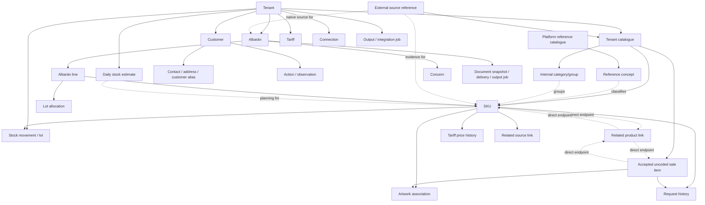

# THE OBJECT MAP — Rocoto's production domain

**Status:** companion to [THE-ARCHITECTURE.md](THE-ARCHITECTURE.md). This is a normative map of
objects, containment, identity, and doors. It is a target domain model, not a claim that each
record, event stream, or projection is deployed.

## OBJ-00 · Laws of the map

1. Every durable object has a stable opaque ID, tenant scope where applicable, revision, lifecycle
   state, actor/time provenance, and an audit trail.
2. An object is owned by one aggregate/stream. A projection may join it, but no screen invents a
   second owner or mutable copy.
3. A relation names both endpoints and its own provenance. A relationship does not transfer
   commercial facts from one endpoint to the other.
4. A source is evidence. External providers/users keep incoming originals; Rocoto retains authorized references and minimal derived business facts separately from normalized fields. Raw email/file content is transient only (THE-SOURCE-PRIVACY-SPEC).
5. Contextual object doors open the same stable ID if the actor may read it. An order card is one destination and opens only its order; customer/product/truck doors are inside the sheet, not nested in the card. The separate hover Archive action sits beside, not inside, that destination.
   A missing permission produces a safe unavailable state, never an ID leak.
6. Product, Customer, and Albarán are the only primary sheet grammars. Reference concepts,
   Internal category/groups, Related products links, sources, tariffs, lots, jobs and contacts are
   related objects or focused editors; they do not pretend to be Product Sheets.

### OBJ-00.1 · Capability and interpretation records

**ProductCapabilityProfile** owns tenant/profile ID, capability key, state
(disabled/design-reviewed/kit-interactive/production-authorized), effective revision, authority and
release evidence. It does not own the underlying commercial or inventory data. A service may be
design-reviewed or browser-interactive while remaining unauthorized; projections and command
authorization must both honour the profile. Release-profile truth wins over a detailed future UI
contract.

**CatalogueIntakeSession** is a session-scoped intake envelope for one **Drop a file** or
**Paste catalogue text** choice. It owns opaque session/tenant/actor/origin IDs, source kind,
visible queue state, item order, transient raw source material and a minimal source checksum or text
fingerprint. It is not a primary sheet and it does not durably retain raw bytes/text, create an SKU,
write an Internal category/group, create a `RelatedItemLink`, approve artwork or invoke a model/provider.

**CatalogueIntakeReviewQueue** belongs to one `CatalogueIntakeSession`. It owns display order,
per-item state and the current recovery door only. It is session-scoped: it is not a durable worker
queue, a parser/model job, a source archive or a record-admission command.

**CatalogueIntakeReviewItem** belongs to one `CatalogueIntakeSession`. It owns a raw row/text
locator, original wording, displayed readback (Product name, SKU, Unit), duplicate/required-field
state and explicit item decision. Internal category, artwork and source history remain later
Product-Sheet facts rather than per-item intake chores. Only an
explicit confirmed decision may create an exact SKU and persist reviewed literal facts/provenance.
Ordinary review never proposes or creates a `RelatedItemLink`. Its visible states and recovery doors
are defined in Catalogue Contract §2.1; their named seam events are UI/audit boundaries only.

**OrderLineInterpretation** owns the source-line ID/revision, current disposition
(exact-SKU, field-check, off-SKU-provisional, multiple-SKU-choice), candidate SKU IDs, exact field
scope, literal wording, operator decision, actor/time and supersession. It never owns an SKU or
silently changes the source. Multiple-choice candidates are unordered unless evidence supports an
explicit rank; the UI cannot invent a top candidate.

**ReplyAttention** owns order/thread/source scope, specific reason, lifecycle
(open, dismissed, resolved, reopened), dismissal text, actor/time and evidence revision. It is
orthogonal to OrderLineInterpretation: a correct SKU can still need a reply, and an ambiguous SKU
does not automatically imply a customer message. In the order-review profile its only communication
door is the native provider.

**ProvisionalOrderLine** owns accepted literal product wording, quantity/unit/note and one-off
decision evidence. It can appear on an unvalued albarán but has no ProductSKU foreign key. Accepting
it does not create catalogue, artwork, price, stock, tariff or ERP master data.

**UncodedSaleItem** is the optional deliberate catalogue projection of one or more accepted
`ProvisionalOrderLine` records. It owns tenant ID, stable uncoded-item ID, literal display wording,
literal Product Unit, internal category reference, illustration association/status, direct relation
endpoints, request-history references, notes/change history and actor/time provenance. It is never
created by merely reading an off-SKU phrase; its admission cites an explicit accepted source line.
It is not a `SKU`, and cannot become a tariff/stock/lot/ERP/customer-alias master merely by being
recurrent. A separately authorized **Assign SKU** operation may link it to a new or existing coded
SKU only after review; it preserves every historical request and relation as evidence.

**RequestHistoryEntry** is a read projection from one exact coded SKU or `UncodedSaleItem` to an
Albarán line/source revision. It owns the return context token (origin Products filters, sheet and
scroll anchor) only for navigation; it never copies or mutates the line. Opening it goes to the
exact Albarán/line; Back restores that token if it remains valid.

**ConversationWorkspaceSnapshot** owns actor/session, thread, source route, scroll anchor and one of
two postures: collapsed or expanded. It owns no customer-send draft in the order-review profile.
**AssistantConversation** is a different internal object and may own a recoverable internal draft;
its tool proposals still require their separate domain commands.

## OBJ-01 · The containment graph

The arrows from reference concept and Internal category/group to SKU are classification arrows,
not ownership. A `RelatedItemLink` has two direct catalogue-record endpoints; each endpoint is a
coded `SKU` or an accepted `UncodedSaleItem`. It is reciprocal for navigation only and is neither a
group nor a base record. The arrow from a source artifact to an SKU
is evidence/review linkage. Neither a reference concept, category/group, relation nor source can
make an SKU sellable without the tenant catalogue's reviewed command.

## OBJ-02 · Primary objects and their owners

| Object | Scope and identity | Authoritative owner | Can open a primary sheet? | Core lifecycle |
|---|---|---|---|---|
| Reference concept | platform-owned immutable ID/version | reference-catalogue stream | No | active, superseded, withdrawn; historical versions remain addressable |
| Tenant | tenant ID | tenant stream | Administration context, not a generic sheet | provisioning, active, restricted, closing, closed |
| Tenant catalogue | one logical catalogue per tenant/version | catalogue stream | Catalogue navigation, not a Product Sheet | active, importing, repair, archived tenant |
| Internal category/group | tenant classification ID | catalogue stream | No; it is a browse/filter context | suggested, reviewed, not organised, superseded; may be empty |
| Related product link | relation ID with two exact coded-SKU or accepted-uncoded-item endpoints | catalogue stream | No; it opens either exact record | active, removed, historical; reciprocal and non-transitive |
| Uncoded sale item | tenant uncoded-item ID, never recycled | catalogue/request stream | **Yes: Product Sheet** | accepted from off-SKU line, active, archived, assigned-to-SKU-by-explicit-command; literal request evidence remains |
| SKU | tenant SKU ID, never recycled | SKU/catalogue stream | **Yes: Product Sheet** | proposed, active, archived, restored; commercial history remains |
| Customer option definition / preparation note | tenant option ID, scoped to a customer, account policy, or brochure | customer/request stream | No; opens contextual customer/request editor | draft, active, paused, retired; recurrence never makes it an SKU |
| Option line snapshot | opaque albarán line-option snapshot ID, tied to one base-SKU line revision | albarán stream | No standalone sheet; opens from its base line | quoted, accepted, superseded/corrected, historical; preserves audience tags and commercial terms |
| Customer | tenant customer ID | customer stream | **Yes: Customer Sheet** | active, merged-by-explicit-link, archived/anonymized subject to retention |
| Albarán | tenant albarán ID plus document revisions | albarán stream | **Yes: Albarán Sheet** | draft, ready, allocated/prepared, issued, dispatched, delivered, corrected/voided, archived |
| Source artifact | tenant source ID and provider/user reference | source-ingestion stream | No; opens native-source context | referenced, transiently fetched, parsed, blocked, unavailable/revoked under policy |
| Inventory position | tenant position ID for exact SKU/location/canonical unit | inventory stream | No; opens focused Stock ledger/editor | evidence-backed, revisioned projection |
| Named lot | opaque tenant lot ID, one exact SKU/location | inventory stream | No; opens focused inspector from Stock or Albarán trace | active, depleted, expired, blocked, recalled, historical; never rewritten |
| Lot commitment | opaque tenant commitment ID, one exact line/position target | inventory stream | No; opens line fulfilment/lot inspector | reserved, allocated, released, fulfilled, superseded; never physical balance |
| Daily stock estimate | tenant planning-rule ID/revision | planning stream | No; opens its focused SKU planning editor | active, superseded, paused, retired; never becomes a physical movement |
| Tariff and price revision | tenant tariff ID / price revision ID | commercial stream | No; editors are part of Product/Admin context | active/retired tariff; dated immutable price history |
| Output or integration job | tenant job ID | job/output stream | No; opens job status/detail | queued, running, succeeded, failed, cancelled, expired according to policy |
| Connection | tenant connection ID | integration-settings stream | Administration connection editor | proposed, authorizing, connected, degraded, revoked, removed |

A reference concept does not acquire a tenant ID. A tenant SKU does not become a platform object.
An Internal category/group is classification context and a `RelatedItemLink` is a direct relation
between two existing catalogue records, each a coded `SKU` or accepted `UncodedSaleItem`; neither is
a hidden base SKU. A customer option/preparation note is not a
hidden SKU: it cannot own stock, a tariff, an artwork association, a standalone albarán
product line, or an external master record. It may be snapshotted as an approved overlay on a base
SKU line, with preparation/pack/weight and a surcharge or final unit price that belong to that line
revision only. A source artifact and a job have IDs because they need audit and recovery, but they
do not compete with the three primary sheets.

## OBJ-03 · Product ownership: exact sellable-record facts

The Product Sheet names one exact sellable record: a coded `SKU` or an `UncodedSaleItem`. The following facts belong to that exact record and cannot
be read as Internal category/group, Related products, or similarly named product facts:

| Related object | Owner and required relation | Invariant |
|---|---|---|
| Original identity | SKU stream → immutable `OriginalIdentity` record(s) | imported/source name, code, row/attachment reference, and received time survive every display-name edit |
| Current identity | SKU stream | display name, optional sales code, sole Product Unit, reviewed attributes, and classification are revisioned projections; the SKU ID never changes |
| Alias | SKU stream → `Alias` with scope | tenant aliases may support tenant-wide search; a customer alias carries a customer ID and is never used outside that customer resolution context |
| Reference classification | SKU ↔ reference-concept relation | classification is evidence/versioned policy, never a substitute SKU ID or stock membership |
| Internal category/group | SKU ↔ reviewable classification relation | category/group can group items without relating them and cannot change commercial facts |
| Related products | exact record ↔ direct reciprocal `RelatedItemLink` | add/remove can change only navigation; it cannot change price, stock, source identity, artwork or order history; each endpoint may be coded or accepted uncoded |
| Requests history | exact record ↔ frozen Albarán line/source revision | opens the exact historical line; route Back restores the Products origin token and never turns a request into a new master fact |
| Tariff price | SKU ↔ tariff → append-only price revision | every tariff has this SKU's own exact money/unit/effective period history; no implicit inherited price |
| Stock and lot | SKU ↔ stock movement/lot | movements, balances, reservations, counts, and allocations are exact-SKU facts; unknown unit equivalence stays separate rather than summed falsely |
| Artwork | SKU ↔ reviewed artwork association | an asset may be byte-deduplicated, but approval is SKU-scoped; a category/group or Related products image is only a candidate |
| Related source/email | SKU ↔ source-link with evidence/review state | link explains why a source is shown. It never turns email into product stock or auto-creates a SKU |
| Albarán line/history | exact line → SKU ID + frozen snapshot | line joins use the recorded SKU ID; later rename/reclassification does not rewrite old documents |
| Insight | derived exact-SKU projection | buyers, revenue, trends and recommendations cite source lines and exclude other SKU data; category/group or Related products context never supplies an exact-SKU metric |

A SKU can be active with sparse information. `Still to record`, `unknown`, `pending review`, and
`no price set` are valid states. Zero, a generated image, a guessed equivalence, or a category/group
or Related products metric is never used to make a sparse SKU look complete.

## OBJ-04 · Source, imports, and aliases

A `SourceArtifact` holds the unaltered received material and delivery metadata permitted by its
retention policy. It can be an uploaded file, imported row, supplier email and attachment,
customer message, manual note, scanner result, or provider webhook. Parsing creates a
`SourceObservation` that references the artifact span/row/page. Review can create a proposal;
acceptance writes a domain command. The parsed value never overwrites the artifact. For E186
file/pasted-list intake, the raw file or text belongs only to `CatalogueIntakeSession`; a durable
source association has only the allowed checksum/reference or text fingerprint, locator and reviewed
result/decision.

| Relation | What it records | What it cannot do alone |
|---|---|---|
| source → tenant catalogue | import batch, parser version, row status, matching evidence | add/merge/archive a SKU without a reviewed command |
| source → SKU | external code/name, evidence span, link state, reviewer/actor | change SKU price, stock, unit, artwork, Internal category/group or Related products silently |
| source → Albarán | native message/thread/attachment, source span, channel capability | claim that a message was sent, read, or replied to without a provider receipt |
| source → supplier | declared sender/connection association and confidence | make supplier identity authoritative where verification failed |
| alias → SKU | phrase, normalized index key, scope, provenance, validity, reviewer | select a more specific SKU than evidence supports or cross a customer boundary |

Supplier email is a source channel. It may suggest catalogue membership, receipt, availability, or
lot facts. It becomes a stock movement only through `StockReceived` or another inventory command
with exact SKU/unit/location/lot data. A Product Sheet's **Source evidence** section reads only its exact-SKU source-link projection,
uses the empty state **No related source evidence**, opens native-source context and returns to the
same product context. It is not a Stock navigation seat; the separately gated Stock update owns a
supplier/source feed.

## OBJ-05 · Customer ownership

The Customer Sheet owns the tenant's relationship with a business customer. Contacts, delivery
addresses, account facts, customer-scoped aliases, actions, observations, and preferences are
children of that relationship. Orders/albaranes are separate objects linked by customer ID.

| Child or relation | Owner | Rule |
|---|---|---|
| Contact | customer stream | name, role, channel, consent/preference, verification status, and revision are customer-scoped; a contact can be archived without deleting prior document attribution |
| Address / delivery preference | customer stream | delivery details are versioned and retain validity/effective period; a route snapshot on an albarán is frozen separately |
| Customer alias / menu entry | customer ↔ SKU relation | preserves the customer's language and evidence; it cannot rename the SKU or make it available to other customers |
| Action | customer stream | an assigned actionable record with due state, completion, actor, and links; it is not an invented insight |
| Frequent product | derived projection | computed from exact historical lines with a stated time window; one result opens its SKU and evidence |
| Upcoming/history | albarán projection keyed by customer | upcoming uses lifecycle state; history uses issued/delivered/corrected records and preserves snapshots |
| Observation/insight | evidence-backed derived record | source IDs, rule/model version, and validity are visible in the related evidence/details view; it never edits customer facts by itself |

A customer merge is an explicit, authorized, audited relationship that keeps both prior IDs and
reassigns only permitted future references. The merge screen must disclose historical effect. It
never silently combines two contacts because names, phones, or email text look similar.

## OBJ-06 · Albarán ownership

An Albarán is the user-facing continuous work record. It starts with a request/source and gains
review, fulfilment, document, and delivery facts over time. It is not deleted merely because it
has been printed or delivered.

| Child or relation | Owner | Rule |
|---|---|---|
| Native source conversation | source-link projection | original words/media/attachments and channel capability stay visible above or beside the work they caused; forwarding-only is read-only |
| Line | albarán stream | stable line ID, original phrase, exact resolved SKU or unresolved state, quantity, unit, equivalence revision, rate, total, tax treatment, class, packing note, and provenance |
| Lot commitment / allocation | inventory relation from line | exact lot ID or explicit unassigned position plus quantity; it is scoped to exact line and changes no physical balance. A missing lot number is honest unassigned stock, never generated code. |
| Concern | concern stream linked to precise target | target is source block, line, field, or explicit line group; concern state cannot be changed by an unrelated edit or navigation |
| Fulfilment | albarán/inventory stream relation | allocation, preparation, dispatch, delivery, and exception facts are events with actor/time and evidence |
| Document snapshot | document stream | issue creates immutable revision with commercial snapshot; reprint points to that revision |
| Delivery / output job | job stream relation | queueing, submission, receipt, failure, retry, and cancellation are separate facts; delivery result is not inferred from a button click |

A line with unresolved product language remains an honest line/proposal and can be fulfilled only
under the tenant's approved exception policy. It does not acquire an Internal category/group or Related products link as a fake SKU.
A corrected commercial document creates a linked successor, correction, or void record according
to the configured legal workflow; old documents remain auditable.

## OBJ-07 · Inventory, money, and output ownership

| Object | Owner | Rule that protects history |
|---|---|---|
| Unit definition/equivalence | commercial/catalogue stream | equivalence has its own ID/revision, source, precision, and effective scope. Unknown equivalence remains unknown. |
| Tariff | tenant commercial stream | tariff ID is stable through retirement; retirement ends future applicability, not historical price lookup. |
| Tariff price revision | exact SKU + tariff | amount is exact decimal/currency/unit/effective interval; correcting a price appends a revision. |
| Stock movement | inventory stream | physical receipt/count/variance/depletion/adjustment/reversal carries exact SKU, location, quantity, unit/equivalence revision and source. **Recorded balance** is the evidence-only projection; rule/estimate events never feed it. |
| Inventory position | inventory stream | one exact tenant/SKU/location/canonical-unit position. Recorded balance is sum of named lot positions and explicit unassigned position; no forecast/inbound/commitment feeds it. |
| Named lot | inventory stream | opaque immutable lot ID plus human-entered display lot number, exact SKU/location, origin and source links. Same display code never auto-merges; never a generic category/group or Related-products lot. |
| Unassigned stock position | inventory stream | explicit physical quantity with no trustworthy lot number. It is visible/auditable, never a synthetic lot. |
| Physical lot posting | inventory stream | signed receipt/count/depletion/correction/zero-net-attribution posting against one named lot or unassigned position. Historical facts reverse/compensate; they do not rewrite. |
| Reservation / allocation / release | inventory-commercial relation | exact line/position commitment. It may feed Available to promise but never Recorded balance. |
| Lot-position reassignment | inventory stream | revision-checked equal-and-opposite named/unassigned attribution postings plus source/reason. It supports Product **Assign stock to lots** and must leave Recorded balance unchanged. |
| Daily stock estimate | planning stream | recurring user assumption with owner/time/timezone/revision. It changes no physical balance, lot, availability, receipt or delivery promise. |
| Expected delivery | inbound/source relation | supplier-confirmed quantity/unit/due/source relation. It stays separate until a physical receipt exists. |
| Availability | derived projection | records calculation time, input watermarks, scope, reservations/allocations and unknowns. It must not claim physical availability from missing data or an estimate. |
| Print/export/email/ERP job | job stream | immutable selection/snapshot/profile/version/content hash, idempotency key, attempts and receipts. A job result never revises an albarán silently. |

### LOT-01 · Lot position, provenance and commitment law

A named lot is not a code string and an allocation is not a physical movement. The stock model has
three independently auditable layers:

~~~text
Recorded balance
  → named lot physical positions + Unassigned stock position
  → changed only by receipt, count, physical depletion or physical correction

Assign stock to lots
  → revision-checked reattribution among named/unassigned positions
  → equal-and-opposite postings; Recorded balance unchanged

Albarán line allocation
  → commitment against an existing eligible position
  → Available to promise/fulfilment changes; Recorded balance unchanged
~~~

A new named lot has opaque ID, typed display lot number, origin, source/evidence, actor/time and
exact SKU/location. It can be created by receipt, count or Product **Assign stock to lots** with
different provenance. A new typed name during Product assignment must not be called receipt or
supplier confirmation. When a person cannot identify a lot, amount remains in explicit unassigned
position. A count’s after quantities across named lots/unassigned add to exact counted total. A
Product lot split’s after positions add to its fixed Recorded balance. A commitment cannot make a
physical position negative or be silently cancelled by count/reattribution.

[THE-STOCK-LOTS-SPEC.md](THE-STOCK-LOTS-SPEC.md) is the detailed authority for LOT-01 fields,
controls, API/event names, collision handling, traceability, recall, states and release proof.

## OBJ-08 · The three sheet grammars

Every sheet has an identity header, contextual action area, current work, history/evidence,
insights where evidence exists, and a stable browser/mobile return path. The section order is
fixed enough for habit but each sheet carries different work.

| Sheet | Header and first work | Required related sections | Doors and prohibited substitutions |
|---|---|---|---|
| **Product Sheet** | exact sellable-record identity, active/archive state, kind-eligible image truth, Internal category, Related products and Unit | exact-record albaranes/history/insights/details always; coded-SKU stock/lots, source evidence and tariff history only under their gates | Related-product rows open either endpoint’s Product Sheet. Internal category/group opens feedback only. Do not show another record’s price/stock/art/history as the current record’s own. |
| **Customer Sheet** | customer identity, contacts, delivery/account facts, next actions | frequent products, upcoming work, history, observations, insights, customer aliases/menu | product and albarán doors carry their own IDs. Do not make a contact or an inferred buying pattern a second customer. |
| **Albarán Sheet** | status, customer, delivery context, editable exact lines and current concerns | quantity/unit/rate/total/class/lot/note controls, native source, fulfilment, document snapshots, output/delivery status, audit/history | line product opens exact SKU; customer opens Customer Sheet; a concern opens its exact target. Do not replace native source with paraphrase or represent a queue as delivery. |

State matrices, save/error behaviour, keyboard rules, and responsive requirements are in
`THE-SYSTEM-SPEC.md` under PRD-01, CUS-01, ALB-01, and OBJ-01.

## OBJ-09 · Doors, projections, and visibility

A door is an intent to open an object, not a raw client-side pointer. The query service resolves it
against the active tenant membership and object lifecycle, then returns one of: object projection,
archived projection, unavailable/permission-safe response, deleted/redacted explanation, or
loading/retry state. It never returns cross-tenant search suggestions, identifiers, counts, or
source text.

Projection rows contain `objectId`, `objectType`, `revision`, `asOf`, and relation evidence where
needed. A list may be stale only within its declared watermark; a mutating command acknowledgement
returns the resulting aggregate revision and projection cursor. The client then reconciles its
optimistic state or shows the explicit conflict/failure state. Presence is advisory and names an
actor/action only where tenant policy permits; it is never a lock.

## OBJ-10 · Archive, deletion, and redaction

Archive removes an object from default active work without erasing history. An archived SKU remains
reachable from old albarán lines, price history, stock movements, source evidence, audit, and
explicit archived browsing. It cannot receive new stock, price, artwork, or direct order offerings
until restored. An archived customer remains visible on historical documents under retention
rules. An issued Albarán is never physically deleted by a regular user.

True deletion is limited to eligible drafts, temporary uploads, unadopted leads, and configured
personal data after authorization/retention review. It records a deletion/redaction event,
reason, actor, policy basis, and affected projections. Legal/commercial records retain the minimum
required audit shell while protected personal content is redacted or cryptographically erased
where policy permits. Deletion is not a hidden projection filter and does not allow identifiers to
be reused.

## OBJ-10 · Unit ownership

TenantUnitDefinition owns literal vocabulary, kind and precision. Product.unit is the sole current Product Unit. A scoped UnitConversion owns an explicit exact multiplier: the reusable global object is the default and an exact-product exception shadows only its matching Unit pair. Nominal/catch-weight text remains non-calculating measurement evidence. UnitUseSnapshot freezes the Unit and any applied conversion revision on each commercial or stock act. Price, lots, stock, order lines and issued documents keep their own snapshot facts rather than becoming parallel Product-unit roles. None belongs to an Internal category/group or Related products link; see THE-UNITS-SPEC.
