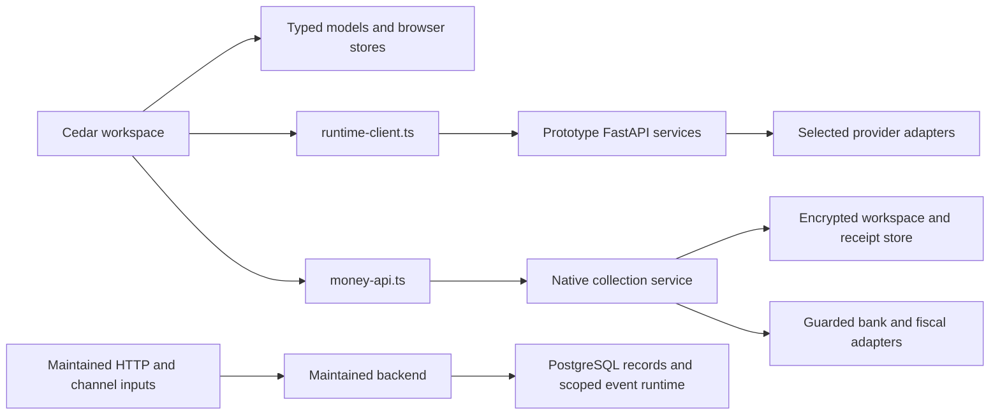
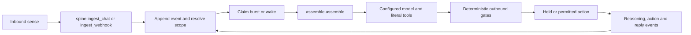
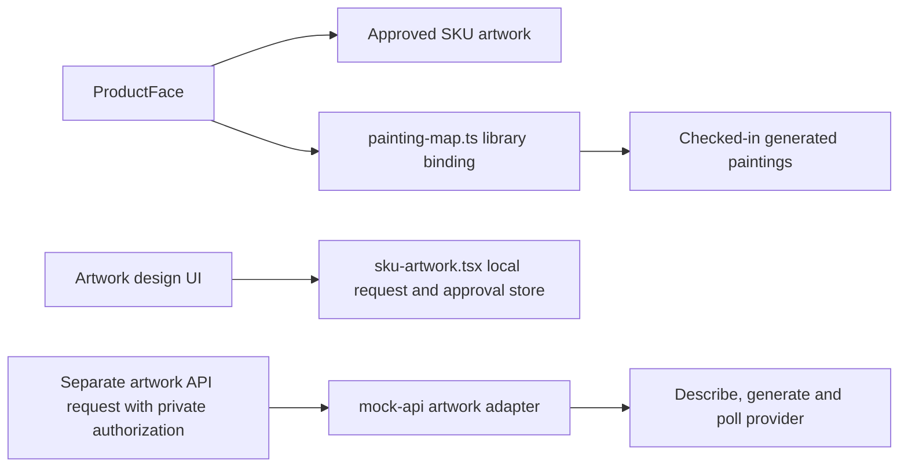

# Architecture

Three implementations share product concepts and selected code. Each has its own data and proof boundary.

The Cedar→maintained-backend data adapter remains integration work. The diagram shows actual call boundaries; it does not draw an already connected universal client.

## Maintained runtime

`backend/runtime.py` coordinates the cycle. `spine.py` owns append/claim/wake operations; `assemble.py` deterministically folds a bounded event window, cards, standing state and recall. `memory.py` stores facts, lookup, summaries and cards. `gate.py` checks outbound prices, effective mode and held actions. Domain services supply literal business operations.

Review and automatic modes are configured separately. A model response does not itself establish a valid price, identity, quantity or permission. The runtime, deterministic gates, role checks and durable domain operations own those decisions.

## Scope and storage

`tenancy.py` resolves identity and scope. PostgreSQL `ltree` identifies runtime scopes; `db.scoped_tx` sets scope for a transaction under the restricted runtime role. The control role supports cross-scope background reads. Migrations and legacy owner work have their own pool.

Runtime RLS and legacy domain predicates are distinct layers. The starter proof exercises both and records their exact result. New integrations must preserve the relevant tenant predicate and role rather than infer universal isolation from a folder name.

## Product model

Cedar’s catalogue, orders, customers, lots, money and documents reuse stable identities and shared units. Shared kit components provide the controls; candidate-owned models supply behaviour and state. The same product identifier can be recognized on a catalogue object, order line, stock lot and delivery note without duplicating the business object.

The native collection service persists document-bound requests, immutable receipt evidence and guarded provider state independently of browser storage. Its Prometeo and NubeFact transports remain explicitly commissioned integrations. Sample bank records are generated from Cedar’s retained synthetic money fixtures.

## Artwork

The missing automatic edge between the local request store and the separate service remains visible here. Existing library paintings, a recorded UI request, an approved SKU association and a provider generation receipt establish different facts.

Read [decisions](decisions.md), [workflow relationships](workflows.md), the [public kernel seam](../backend/KERNEL-API.md) and the [complete source navigation](reference/source-index.md).
