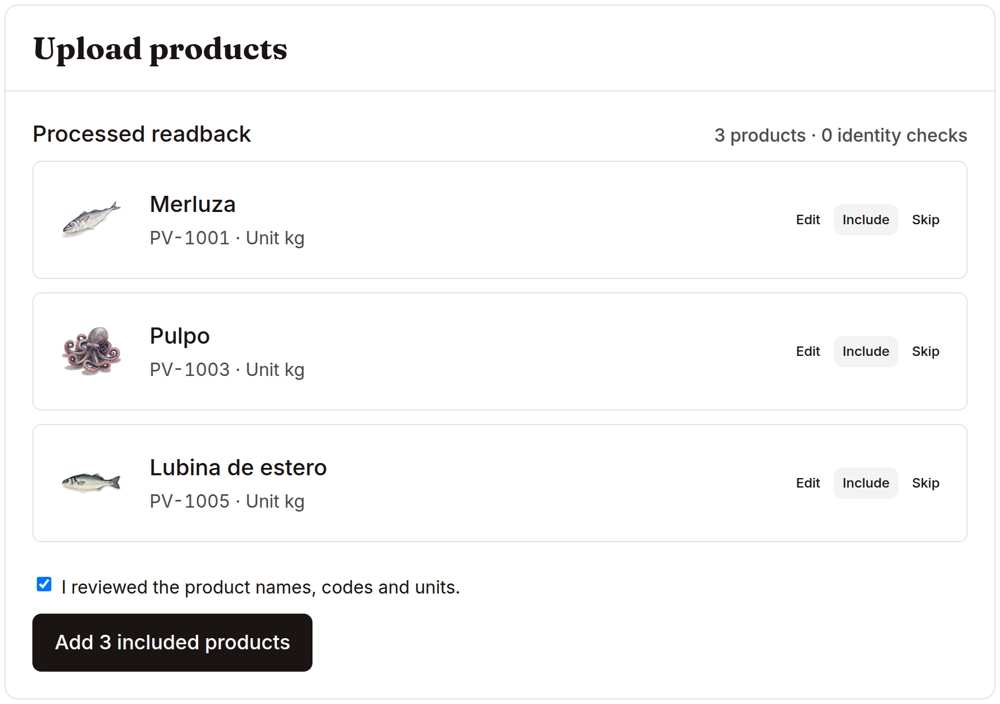
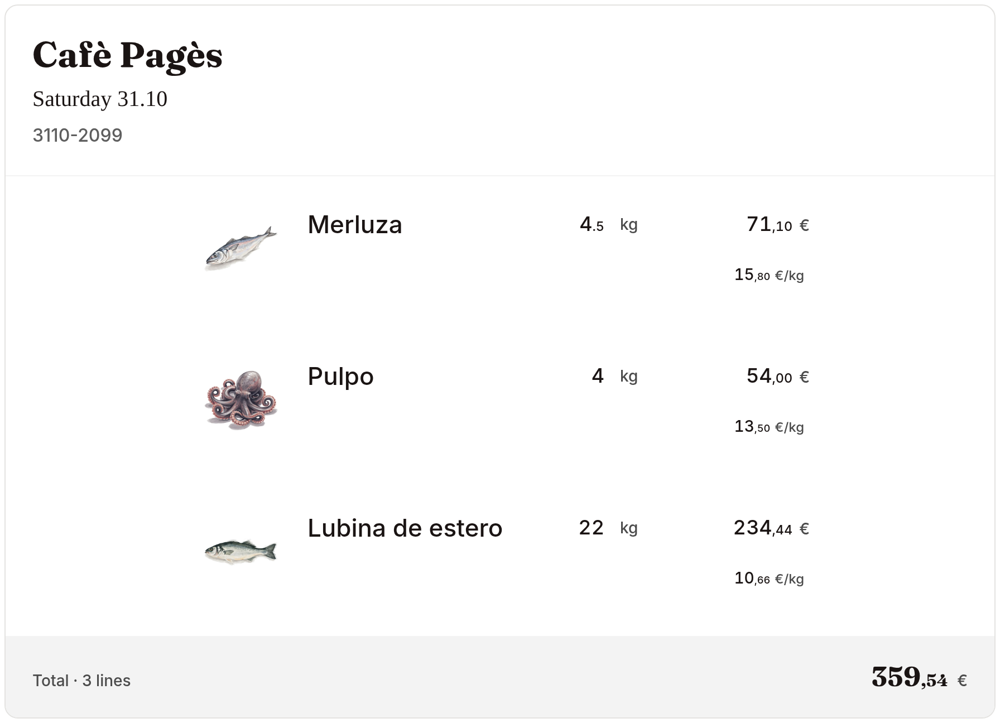

# First result

The first result is an interactive catalogue and order workspace. It runs locally with synthetic business records, the original illustrations and the original component system.

## Install and open

Install Node 22.12+ and npm, then run from the repository root:

```sh
make install-ui
make dev-ui
```

Open `http://127.0.0.1:8080/app.html`. The component gallery is at `/`; scenario examples are at `/scenarios.html`. The workspace entry loads `app/src/prototypes/cedar/main.tsx`.

Choose a sample business. The Spain/fish workspace supplies the catalogue illustrated in this repository: Merluza, Pulpo and Lubina de estero. Business capabilities determine which pricing, inventory and country-specific money surfaces appear.

## Review a catalogue

Open Products and its catalogue intake. Paste a small list with names, codes and units, using the native paste door:

```text
Code	Name	Unit
DEMO-001	Merluza	kg
DEMO-002	Pulpo	kg
DEMO-003	Lubina de estero	kg
```

Inspect the parsed names, codes and units, correct any row, review it and use Add. Review is a business operation: a parsed string becomes a catalogue record only after the operator accepts the intended identity.



The documented capture uses the three existing source-fixture codes and stops with Add ready. The example above gives a new local catalogue its own demo codes. The capture proves the actual review surface; it does not claim a provider extraction or submitted import.

## Follow a product into an order

Open Sales and an existing order. The product’s identity, unit, quantity and price carry into its delivery document. Explore the product sheet, stock/lot surfaces and output templates from those same records. [Workflows](workflows.md) explains the relationships and their source paths.



## Understand what persists

Cedar’s selected business, edits and workflow state use its existing browser stores on this origin. A reload reads that local workspace. Browser-origin changes and storage resets create a separate state boundary. This is the interactive product prototype.

The maintained FastAPI/PostgreSQL backend has a separate persistent data model, authentication and scoped runtime. [Run its first order proof](backend-starter.md) before building a connection between the two. That distinction preserves both the original design and a testable application architecture.

## Add optional services

`make install` installs Python dependencies in `.venv`. `make dev` starts the checkout-owned prototype API and the UI on loopback ports, printing their addresses. Its health route reports configured/missing providers from environment presence.

Use [provider setup](providers.md) for your own parsing, speech, model or artwork account. The static workspace and first backend proof work with synthetic data independently of those accounts.

`make build` produces the English workspace and its generated Spanish entry from the same source. Build receipts retain upstream provenance and identify a Git checkout or portable source export accurately.
