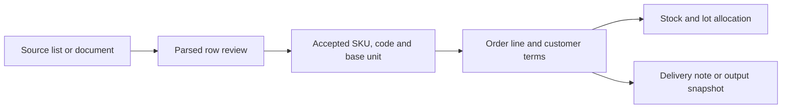

# Product workflows

## Catalogue to order

Catalogue intake accepts a file, paste or reviewed rows. It distinguishes the source document from the business records it proposes. The operator resolves names, literal codes, units and hierarchy before commit. A product keeps one identity through its representations.

Start with Cedar’s `onboarding-catalogue.tsx`, `catalogue.ts`, `uncoded-catalogue.tsx`, product-sheet modules and product areas. The exact source navigation links each current function/component. The detailed contracts are `THE-CATALOGUE-CONTRACT-SPEC.md`, `THE-PARSING-SPEC.md` and `THE-PRODUCT-SHEET-SPEC.md`.

The interactive Cedar flow uses its own stores. Maintained backend intake sessions and catalogue commit routes are separately implemented in `backend/app.py`. Connecting those exact models is an explicit application integration.

## Stock, units and documents

A quantity belongs to a unit and a product. A lot has its own identity, availability and provenance. Customer-facing quantities, base-unit quantities, package conversions and priced units remain distinguishable. Stock allocation changes the right lot rather than inventing a second SKU.

Documents preserve the business object and its state at the relevant stage. Output templates, paper registration, QR identity and readback are shared contracts, rather than a separate invented representation for each channel. Read `THE-UNITS-SPEC.md`, `THE-STOCK-LOTS-SPEC.md`, `THE-OUTPUTS-SPEC.md` and `THE-PAPER-SPEC.md`.

## Order to collection

An eligible Cedar order creates a document-bound request through `money-api.ts`. The native collection service stores that identity and receipt history. A buyer capability can inspect that document’s remaining balance; owner/operator capabilities govern account configuration and fiscal actions.

Sample evidence, manual evidence and authenticated bank evidence keep their source. Exact account, currency and reference matching govern allocation. NubeFact document identity is saved before submission; uncertainty preserves it for query/recovery. The selected contracts distinguish payment from fiscal acceptance.

## Corrections and learning

Shared scoped records, events and correction evidence are the foundations. The maintained runtime can retrieve facts and event context; the product contracts describe further intake/index, prediction, evaluation and correction-learning work. A correction recorded by the interface is evidence for its own flow, rather than proof of every proposed learning system.

Read `THE-AI-SPEC.md`, `THE-INTELLIGENCE-SPEC.md`, `THE-SYSTEM-SPEC.md` and `THE-IMPLEMENTATION-SPEC.md` for the full ambition and explicit implementation distinctions.
